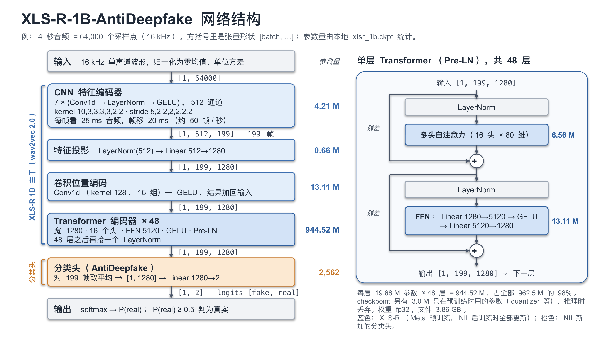

# XLS-R-1B-AntiDeepfake 模型说明（Model Overview）

英文版：[xlsr_1b_antideepfake_en.md](xlsr_1b_antideepfake_en.md)（内容相同）。

整理日期：2026-10-28。本文说明 `antideepfake/` 所用的深度伪造（deepfake）语音检测模型：它做什么、网络结构、大小、两步训练的数据和方法、许可。
数字来自论文、官方 GitHub、Hugging Face model card 和 Zenodo，或在本地 `models/antideepfake/xlsr_1b.ckpt` 上实测（标"实测"）；来源见第 7 节。标"未核实"的没能从一手资料确认。

## 0. 要点

- **做什么**：输入任意长度的 16 kHz 单声道波形，输出两个 logits，顺序是 [fake, real]；softmax 后取 P(real)。`config/antideepfake.yaml` 的 `inference.threshold` 默认 0.5：P(real) ≥ 0.5 判为真实，否则判为伪造。
- **结构**：XLS-R 1B（wav2vec 2.0：7 层 CNN + 48 层 Transformer，宽 1280）+ 对所有帧取平均 + 一个 Linear(1280→2)。分类头只有 2,562 个参数，区分真假的能力几乎都在 XLS-R 里。
- **大小**（实测）：推理网络 962.5 M 参数，98% 在 Transformer；checkpoint 共 965.5 M（多出的 3.0 M 只在预训练时用），全部 fp32，文件 3.86 GB。
- **两步训练**：Meta 先用 436k h、128 种语言的无标注语音做 wav2vec 2.0 自监督预训练（XLS-R）；NII 再用 29 个数据源、约 74.7k h 语音（真实 56.4k h，伪造 18.3k h，100 多种语言）做真/假二分类的有监督"后训练"（post-training），整个网络一起更新。
- **`xlsr_1b.ckpt` 是哪个版本**：后训练完直接发布的默认版（训练时用了 RawBoost 数据增强），没有再在某个数据集上微调。零样本 EER 从 1.35%（In-the-Wild）到 26.76%（Deepfake-Eval-2024）。
- **许可**：checkpoint 是 CC BY-NC-SA 4.0，只能非商用；上游代码是 BSD-3-Clause。

## 1. 模型做什么

模型读入一段 16 kHz 单声道波形（任意长度，先整段归一化为零均值、单位方差），输出两个 logits，顺序是 [fake, real]。
softmax 后的第二项就是 P(real)，即"这段语音是真人原声"的概率；P(fake) = 1 − P(real)。
`config/antideepfake.yaml` 里 `inference.threshold: 0.5`：P(real) ≥ 0.5 判为真实，这也是 AntiDeepfake 的默认阈值。

"fake" 的范围比 deepfake 宽：后训练时，TTS 和 VC 生成的语音、经 vocoder 重合成的语音、经神经网络修复（restored）的语音、经神经编解码器（neural codec）重建的语音都标为 fake（第 4.2 节）。
论文明确说 codec 语音不算 deepfake，只是"带痕迹的语音"的一种。所以 P(real) 低说明语音带有生成或重合成的痕迹，不一定是冒充。

## 2. 网络结构

可编辑的原图：[figures/xlsr_1b_antideepfake_architecture.pptx](figures/xlsr_1b_antideepfake_architecture.pptx)（第 1 页中文，第 2 页英文）。

结构来自上游的 `models/W2V.py` 和 `models/W2V_configs.py`（`xlsr_1b` 配置），与 `inference.py` 里的网络相同。
下表的形状是把 4 s 音频（64,000 个采样点）送进 `inference.py` 的网络、逐层打印得到的（实测）：

| # | 模块 | 结构 | 输出形状 | 参数量（实测） |
|---|---|---|---|---|
| 1 | 输入 | 单声道，16 kHz，整段归一化为零均值、单位方差 | [1, 64000] | — |
| 2 | CNN 特征编码器 | 7 层 Conv1d，每层后接 LayerNorm 和 GELU；512 通道；kernel 10, 3, 3, 3, 3, 2, 2，stride 5, 2, 2, 2, 2, 2, 2。每帧覆盖 400 个采样点（25 ms），帧移 320 个采样点（20 ms），约 50 帧/秒 | [1, 512, 199] | 4,210,176 |
| 3 | 特征投影 | LayerNorm(512) → Linear(512→1280) | [1, 199, 1280] | 657,664 |
| 4 | 卷积位置编码 | Conv1d（1280→1280，kernel 128，16 组，weight norm）→ GELU，结果加回输入。位置信息靠这个卷积学到，没有固定的位置表 | [1, 199, 1280] | 13,108,480 |
| 5 | Transformer 编码器 | 48 层；宽 1280，16 个头（每头 80 维），FFN 5120，GELU。Pre-LN：自注意力和 FFN 之前各做一次 LayerNorm，残差连接绕过它们；48 层之后再接一个 LayerNorm。注意力是全局的，每帧都看整段音频 | [1, 199, 1280] | 944,519,680 |
| 6 | 分类头（AntiDeepfake） | 对所有帧取平均（global average pooling）→ Linear(1280→2) | [1, 1280] → [1, 2] | 2,562 |
| 7 | 输出 | softmax，取 index 1 作为 P(real) | P(real) | — |

- 帧数：N 个采样点得到 ⌊(N − 400) / 320⌋ + 1 帧。1 s 是 49 帧，4 s 是 199 帧，10 s 是 499 帧，13 s（后训练时最长的输入）是 649 帧。
- 推理时不做 mask，也不用量化模块（上游以 `mask=False, features_only=True` 调用 fairseq 的 `Wav2Vec2Model`），所以 checkpoint 里预训练专用的部分（第 3 节）用不到。
- 分类头前没有 attention pooling 或 AASIST 之类的后端，只有一个平均和一个 Linear。

## 3. 大小

| 项目 | 数值 | 来源 |
|---|---|---|
| 参数：推理网络 | 962,498,562（962.5 M） | 实测（`inference.py` 建的网络） |
| 参数：checkpoint | 965,517,314（965.5 M）；AntiDeepfake 论文和 XLS-R 论文都写 965 M | 实测；论文表 II |
| CNN 特征编码器 | 4,210,176（占推理网络的 0.44%） | 实测 |
| 特征投影 | 657,664（0.07%） | 实测 |
| 卷积位置编码 | 13,108,480（1.36%） | 实测 |
| Transformer | 944,519,680（98.13%）：每层 19,677,440（自注意力 6,558,720 + FFN 13,113,600 + 两个 LayerNorm 5,120）× 48，加最后的 LayerNorm 2,560 | 实测 |
| 分类头 | 2,562（1280 × 2 + 2） | 实测 |
| 只在预训练用的参数 | 3,018,624：`quantizer` 656,000，`project_q` 1,049,600，`final_proj` 1,311,744，`mask_emb` 1,280。推理时丢弃 | 实测 |
| 层数 | CNN 7 层，Transformer 48 层；另有 1 层位置卷积和 1 个 Linear 分类层 | 上游配置 |
| 文件 | `xlsr_1b.ckpt`，3,862,339,848 bytes（3.86 GB）；PyTorch state dict，815 个张量，参数名沿用 fairseq（`m_ssl.model.*`、`proj_fc.*`）；MD5 `61dde44830acfa192a2ff13bd0e8925a`，与 Zenodo 公布的一致 | 实测；Zenodo |
| 精度 | 全部 fp32。上游后训练用 fp16 混合精度（`hparams/xlsr_1b.yaml` 的 `precision: fp16`） | 实测；上游 hparams |

名字里的 "1B" 是约数，实际约 0.97 B（fairseq 的原始文件名是 `xlsr2_960m_1000k.pt`）。
XLS-R 论文的模型表把 1B 模型写成宽 1024、FFN 4096，与 965 M 参数对不上，应是笔误：Hugging Face 上 XLS-R 1B 的配置、AntiDeepfake 的配置和本地 checkpoint 都是 1280 和 5120。

## 4. 训练

分两步：Meta 的自监督预训练得到 XLS-R 1B；NII 在它的基础上做有监督的后训练，得到 XLS-R-1B-AntiDeepfake。

### 4.1 第一步：XLS-R 1B 自监督预训练（Meta，2021）

**目标（wav2vec 2.0）**：不需要标注。随机遮住约一半的帧，让模型根据上下文，从 100 多个候选里认出每个被遮帧对应的语音单元（对比学习）；这些离散的语音单元由模型同时学出的 codebook 给出。

**数据**：436k h 公开的无标注语音，128 种语言：

| 数据集 | 时长 | 语言 | 内容 | 链接 |
|---|---|---|---|---|
| VoxPopuli（VP-400K） | 372k h（去掉首尾静音前约 400k h） | 23 种欧洲语言 | 欧洲议会演讲 | [GitHub](https://github.com/facebookresearch/voxpopuli) |
| Multilingual LibriSpeech（MLS） | 约 50k h，其中英语 44k h | 8 种欧洲语言 | LibriVox 有声书朗读 | [OpenSLR 94](https://www.openslr.org/94/) |
| Common Voice v6.1（2020-12） | 7k 多 h | 60 种 | 众包朗读 | [Common Voice](https://commonvoice.mozilla.org/en/datasets) |
| VoxLingua107 | 6.6k h | 107 种 | YouTube 视频里的语音片段 | [官方页](https://cs.taltech.ee/staff/tanel.alumae/data/voxlingua107/) |
| BABEL | 约 1k h | 17 种非洲和亚洲语言 | 电话对话 | [IARPA Babel](https://www.iarpa.gov/research-programs/babel) |

**训练设置**（XLS-R 论文）：

- 1M 次更新，200 张 GPU，每个 batch 约 3 h 音频（2.8–3.6 h）；音频最长截到 20 s。
- 低资源语言会被多采样（p ∝ (n / N)^0.5）。
- 峰值学习率、GPU 型号和训练时长，论文都没写（未核实）。

### 4.2 第二步：AntiDeepfake 后训练（NII，2025）

NII 从 fairseq 发布的 XLS-R 1B checkpoint（`xlsr2_960m_1000k.pt`）出发，接上平均池化和 Linear(1280→2)，用真/假二分类数据训练整个网络。
论文把这一步叫后训练（post-training）：介于自监督预训练和针对某个数据集的微调之间，数据量大、来源杂，目的是得到适合检测伪造的通用表示。

**数据**：29 个数据源（27 个公开数据集 + NII 自己用 vocoder 生成的 2 个），真实 56,371 h，伪造 18,282 h，共 74,653 h，100 多种语言。
合计由论文表 I 各行相加，与论文写的 56.37k h 和 18.28k h 一致。按痕迹类型分 5 类：

| 类别 | 数据源 | 真实（h） | 伪造（h） |
|---|---|---|---|
| TTS 和 VC 生成 | 14 | 1,020 | 6,164 |
| vocoder 重合成 | 7 | 2,105 | 8,826 |
| 神经修复（restored） | 3 | 1,389 | 1,822 |
| 神经编解码（codec） | 2 | 130 | 1,469 |
| 只有真实语音 | 3 | 51,728 | 0 |
| **合计** | **29** | **56,371** | **18,282** |

- 真实语音里 MLS 一个就有 50,558 h，占真实时长的 90%、全部时长的 68%；MLS 也是 XLS-R 预训练的数据。
- 伪造语音只有三分之一（6.2k h）是 TTS 和 VC 生成的"典型" deepfake，其余是经 vocoder、修复或 codec 处理的语音。
- 验证集是各数据集原本划为 dev 或 valid 的部分（14 个数据集有），只用来挑 checkpoint。
  其余文件，包括很多数据集的官方测试集（如 ASVspoof 2019 LA 的 eval、ASVspoof 5 的 test），都用于训练（上游 `protocols/README.md`）。在这些测试集上评估 `xlsr_1b.ckpt` 不算独立测试。

全部 29 个数据源（顺序和时长按论文表 I，源数据按上游 `protocols/README.md`）：

| 类别 | 数据集 | 语言 | 真实（h） | 伪造（h） | 说明 | 链接 |
|---|---|---|---|---|---|---|
| TTS、VC | ASVspoof 2019 LA | en | 11.85 | 97.80 | 源数据 VCTK | [Edinburgh DataShare](https://datashare.ed.ac.uk/handle/10283/3336) |
| | ASVspoof 2021 LA | en | 16.40 | 116.10 | 源数据 VCTK | [Zenodo 4837263](https://zenodo.org/records/4837263) |
| | ASVspoof 2021 DF | en | 20.73 | 487.00 | 源数据 VCTK | [Zenodo 4835108](https://zenodo.org/records/4835108) |
| | ASVspoof 5 | en | 413.49 | 1,808.48 | 源数据 MLS | [Zenodo 14498691](https://zenodo.org/records/14498691) |
| | CFAD | zh | 171.25 | 224.55 | 源数据 AISHELL-1/3、THCHS-30、MAGICDATA 等 | [Zenodo 8122764](https://zenodo.org/records/8122764) |
| | DECRO | en、zh | 35.18 | 102.44 | 源数据 VCTK、AISHELL 等 | [GitHub](https://github.com/petrichorwq/DECRO-dataset) |
| | DFADD | en | 41.62 | 66.01 | 源数据 VCTK；diffusion 和 flow-matching TTS | [GitHub](https://github.com/isjwdu/DFADD) |
| | Diffuse or Confuse | en | 0 | 231.66 | 源数据 LJSpeech；diffusion TTS | [GitHub](https://github.com/AntonFirc/diffusion-deepfake-speech-dataset) |
| | DiffSSD | en | 0 | 139.73 | 源数据 LibriSpeech、LJSpeech；diffusion TTS | [Hugging Face](https://huggingface.co/datasets/purdueviperlab/diffssd) |
| | DSD | en、ja、ko | 100.98 | 60.23 | 源数据 LibriSpeech、VCTK、AIHUB 等 | [Zenodo 13788455](https://zenodo.org/records/13788455) |
| | HABLA | es | 35.56 | 87.83 | 拉丁美洲西班牙语 | [Zenodo 7370805](https://zenodo.org/records/7370805) |
| | MLAAD | 38 种 | 0 | 377.96 | 源数据 M-AILABS；上游用的是 v5 | [官方页](https://deepfake-total.com/mlaad) |
| | SpoofCeleb | 多语言 | 173.00 | 1,916.20 | 源数据 VoxCeleb1 | [Hugging Face](https://huggingface.co/datasets/jungjee/spoofceleb) |
| | VoiceMOS 2022 | en | 0 | 448.44 | 只用其中的合成语音，去掉真人录音 | [Zenodo 6572573](https://zenodo.org/records/6572573) |
| vocoder | CVoiceFake | en、fr、de、it、zh | 315.14 | 1,561.16 | 源数据 Common Voice | [Zenodo 14062964](https://zenodo.org/records/14062964) |
| | LibriTTS | en | 585.83 | 0 | 原始真人语音 | [OpenSLR 60](https://www.openslr.org/60/) |
| | LibriTTS-Vocoded | en | 0 | 2,345.14 | NII 用 HiFi-GAN、hn-sinc-NSF 等 vocoder 重合成 LibriTTS；上游给的获取方式是用 Colab 笔记本自己生成 | [上游说明](https://github.com/nii-yamagishilab/AntiDeepfake/blob/main/protocols/LibriTTS-Vocoded.py) |
| | LJSpeech | en | 23.92 | 0 | 原始真人语音 | [官方页](https://keithito.com/LJ-Speech-Dataset/) |
| | VoxCeleb2 | 多语言 | 1,179.62 | 0 | 原始真人语音 | [官方页](https://www.robots.ox.ac.uk/~vgg/data/voxceleb/vox2.html) |
| | VoxCeleb2-Vocoded | 多语言 | 0 | 4,721.46 | NII 重合成 VoxCeleb2，做法同上 | [上游说明](https://github.com/nii-yamagishilab/AntiDeepfake/blob/main/protocols/VoxCeleb2-Vocoded.py) |
| | WaveFake | en、ja | 0 | 198.65 | 源数据 LJSpeech、JSUT | [Zenodo 5642694](https://zenodo.org/records/5642694) |
| 神经修复 | FLEURS | 102 种 | 1,388.97 | 0 | 原始（音质较低的）真人语音 | [Hugging Face](https://huggingface.co/datasets/google/fleurs) |
| | FLEURS-R | 102 种 | 0 | 1,238.83 | FLEURS 经 diffusion vocoder 修复 | [Hugging Face](https://huggingface.co/datasets/google/fleurs-r) |
| | LibriTTS-R | en | 0 | 583.15 | LibriTTS 的修复版 | [OpenSLR 141](https://www.openslr.org/141/) |
| codec | Codecfake（Xie 等） | en、zh | 129.66 | 808.32 | 源数据 LibriTTS、VCTK、AISHELL-3 | [GitHub](https://github.com/xieyuankun/Codecfake) |
| | CodecFake（Wu 等） | en | 0 | 660.92 | 源数据 VCTK | [Hugging Face](https://huggingface.co/datasets/rogertseng/CodecFake) |
| 只有真实语音 | AISHELL-3 | zh | 85.62 | 0 | | [OpenSLR 93](https://www.openslr.org/93/) |
| | CN-Celeb2 | zh | 1,084.34 | 0 | | [OpenSLR 82](https://www.openslr.org/82/) |
| | MLS | 8 种 | 50,558.11 | 0 | XLS-R 预训练也用过 | [OpenSLR 94](https://www.openslr.org/94/) |

**方法**：

| 项目 | 设置 | 来源 |
|---|---|---|
| 起点 | fairseq 的 XLS-R 1B 预训练 checkpoint `xlsr2_960m_1000k.pt` | 上游 hparams |
| 网络 | XLS-R 1B + 对所有帧取平均 + Linear(1280→2)；全部权重一起更新，没有冻结任何层 | 论文第 III-B 节；`W2V.py`、`main.py` |
| Loss | 二分类 cross-entropy（标签 1 = real，0 = fake）；各类数据不加权 | 论文第 III-B 节；`main.py` |
| 采样 | 不做真假平衡或重采样：所有数据合并后打乱；按时长分 20 个桶组成动态 batch（SpeechBrain `DynamicBatchSampler`），每个 batch 最多 100 s 音频，短的补零 | 论文第 IV-A 节；hparams；`dataio.py`、`protocols/generate_protocol_by_proportion.py` |
| 预处理 | 重采样到 16 kHz，单声道，整段归一化；长于 13 s 的文件随机截取 10–13 s | 论文第 III-B、IV-A 节；`dataio.py` |
| 数据增强 | RawBoost (1)+(2)：线性和非线性卷积噪声（LnL）+ 冲激型、与信号相关的加性噪声（ISD）。`xlsr_1b.ckpt` 用了；Zenodo 上的 `xlsr_1b_nda.ckpt` 是不加增强的版本 | model card；hparams |
| 优化器 | AdamW，weight decay 0.01 | 论文第 IV-A 节 |
| 学习率 | 前 80k 步线性升到 1e-7，之后衰减，800k 步时停止。论文写"线性衰减到 0"；hparams 用的是 SpeechBrain 的 `WarmAndExpDecayLRSchedule`（`decay_factor: 0.01`），即按指数衰减，到 800k 步时为峰值的 1% | 论文第 IV-A 节；hparams |
| 训练量 | 800k 步；论文说除 XLS-R-2B 外，各模型把大部分训练数据看了两遍。每 100k 步在验证集上算一次 EER，只保留 EER 最低的 checkpoint | 论文第 IV-A 节；`main.py` |
| 其他 | fp16 混合精度，梯度裁剪阈值 100 | hparams |
| 硬件 | 8 张 NVIDIA H100（东京科学大学的 TSUBAME4.0 超算） | 论文第 IV-A 节、致谢 |
| 训练时长 | 未公布（未核实） | — |

**`xlsr_1b.ckpt` 是哪一个**：

- Zenodo record 15580543 里每个模型有两个版本：默认版（如 `xlsr_1b.ckpt`）和 NDA 版（`xlsr_1b_nda.ckpt`，No Data Augmentation）。model card 说默认版训练时用了数据增强。
- 本地 `xlsr_1b.ckpt` 的 MD5 与 Zenodo 公布的一致。抽查 5 个张量（含分类头），与 Hugging Face 默认版 [xls-r-1b-anti-deepfake](https://huggingface.co/nii-yamagishilab/xls-r-1b-anti-deepfake) 逐位相同，与 NDA 版不同（实测）。
- 上游 README 说发布的都是后训练的 checkpoint，在 Deepfake-Eval-2024 上微调的版本没有发布。所以 `xlsr_1b.ckpt` 是"预训练 + 后训练"，没有微调。

**评测结果**：下表是论文表 II 中 XLS-R-1B"用 RawBoost"一列，与 model card 一致；这些测试集都没有用于预训练和后训练。
EER（equal error rate）：调整阈值，使"伪造判为真实"和"真实判为伪造"两种错误率相等，此时的错误率。越低越好。

| 测试集 | 内容 | EER | EER 处的 P(real) 阈值（model card） |
|---|---|---|---|
| ADD 2023 Track 1.2 R2 test | 普通话 | 5.39% | 0.566 |
| DEEP-VOICE（切段后的全集） | 8 位名人的真实演讲录音和变声版本 | 2.47% | 0.944 |
| FakeOrReal（original test） | 英语 | 5.74% | 0.456 |
| FakeOrReal（norm test） | 英语，FakeOrReal 的第二版 | 12.14% | 0.798 |
| In-the-Wild（全集） | 英语 | 1.35% | 0.494 |
| Deepfake-Eval-2024（audio test，4 s 段） | 2024 年从社交媒体和检测平台收集的真假音频，50 多种语言 | 26.76% | 0.995 |

- EER 处的阈值从 0.46 到 0.99 不等，0.5 不是对所有数据都合适：在 Deepfake-Eval-2024 上用 0.5，有 55.1% 的伪造片段被判为真实（model card 的 FPR）。
- 论文还在 Deepfake-Eval-2024 的训练集上做了微调：XLS-R-1B 的 EER 降到 11.86%（4 s 段）至 8.28%（50 s 段）；不经后训练直接微调则是 19.96% 至 11.20%（论文表 III）。这些微调后的权重没有发布。

## 5. 许可

- **checkpoint**：CC BY-NC-SA 4.0（Zenodo record 的许可、`models/antideepfake/LICENSE-CHECKPOINT`、model card）。可以复制和修改，但要署名，不能商用，改编的成果也要用同一许可。版权属于 NII。
- **上游代码**：BSD-3-Clause（AntiDeepfake 的 `LICENSE-CODE`）。本仓库没有复制上游代码。
- **其他**：XLS-R 1B 的预训练权重在 Hugging Face 上是 Apache-2.0，fairseq 是 MIT。后训练数据各有许可，其中有不能商用或不能演绎的（如 Codecfake 是 CC BY-NC-ND 4.0）。

## 6. 本仓库怎么用

`inference.py` 不装 fairseq（装了会降级 hydra-core 和 omegaconf，弄坏 emotion_recognition 环境里的 FunASR），而是用纯 PyTorch、按 fairseq 的参数名重写了第 2 节的网络，所以 `xlsr_1b.ckpt` 能原样加载。
加载时丢掉 8 个只在预训练用的张量（3.0 M 参数），把按 weight norm 存储的位置卷积合成一个普通权重（weight = g · v / ‖v‖），再用 `load_state_dict(strict=True)` 检查每个名字和形状。
音频处理与上游 `test_audio_pipeline()` 相同：声道取平均，重采样到 16 kHz，整段归一化，每个文件一次前向；`max_seconds` 分段后对 logits 取平均是本仓库加的，上游没有。
按 [README](../README.md) 第 5 节，它的 logits 与 Hugging Face transformers 和 torchaudio 的同结构实现相差不超过 2.5 × 10⁻⁵。用法、速度和示例输出见 README。

## 7. 来源

- AntiDeepfake 论文：W. Ge, X. Wang, X. Liu, J. Yamagishi, "Post-training for Deepfake Speech Detection", ASRU 2025；[arXiv:2506.21090](https://arxiv.org/abs/2506.21090) v4（2025-10-21，修正 EER 计算后的版本）。训练数据见表 I，训练设置见第 III-B、IV-A 节，零样本结果见表 II，微调结果见表 III。
- AntiDeepfake 代码：[GitHub nii-yamagishilab/AntiDeepfake](https://github.com/nii-yamagishilab/AntiDeepfake)（2026-10-27 的 `main`，commit `8609809`）。用到的文件：`models/W2V.py`、`models/W2V_configs.py`（网络和 `xlsr_1b` 配置），`hparams/xlsr_1b.yaml`（训练超参数），`dataio/dataio.py`（预处理、截断、RawBoost），`main.py`（loss、checkpoint 选择），`evaluation.py`（`softmax_score()` 和各项指标），[`protocols/README.md`](https://github.com/nii-yamagishilab/AntiDeepfake/blob/main/protocols/README.md)（各数据集的源数据和用法），`LICENSE-CODE`、`LICENSE-CHECKPOINT`。
- Model card：[nii-yamagishilab/xls-r-1b-anti-deepfake](https://huggingface.co/nii-yamagishilab/xls-r-1b-anti-deepfake)（默认版，含评测结果和训练数据表）；[NDA 版](https://huggingface.co/nii-yamagishilab/xls-r-1b-anti-deepfake-nda)。
- Checkpoint：[Zenodo record 15580543](https://zenodo.org/records/15580543)（v1.0，2025-06-24）：文件、大小、MD5、许可。
- XLS-R：A. Babu et al., "XLS-R: Self-supervised Cross-lingual Speech Representation Learning at Scale", Interspeech 2022；[arXiv:2111.09296](https://arxiv.org/abs/2111.09296)（训练数据、预训练设置、模型表）。[fairseq XLS-R 页](https://github.com/facebookresearch/fairseq/blob/main/examples/wav2vec/xlsr/README.md)（checkpoint `xlsr2_960m_1000k.pt`）；[Hugging Face facebook/wav2vec2-xls-r-1b](https://huggingface.co/facebook/wav2vec2-xls-r-1b)（配置、Apache-2.0）。
- wav2vec 2.0：A. Baevski, Y. Zhou, A. Mohamed, M. Auli, NeurIPS 2020；[arXiv:2006.11477](https://arxiv.org/abs/2006.11477)（目标函数、遮罩、CNN 结构）。
- RawBoost：H. Tak et al., ICASSP 2022；[arXiv:2111.04433](https://arxiv.org/abs/2111.04433)。
- SpeechBrain `WarmAndExpDecayLRSchedule`：[speechbrain/nnet/schedulers.py（v1.0.2）](https://github.com/speechbrain/speechbrain/blob/v1.0.2/speechbrain/nnet/schedulers.py)（上游安装的版本）。
- 数据集链接见第 4.1 和 4.2 节的表格。
- 实测（2026-10-28，PyTorch 2.5.1，CPU）：读取本地 `models/antideepfake/xlsr_1b.ckpt`，统计参数和数据类型并计算 MD5；用 `inference.py` 的网络跑 4 s 输入，逐层打印形状；用 HTTP range 请求读出 Hugging Face 两个版本 `model.safetensors` 中的 5 个张量，与本地 checkpoint 逐位比较。
