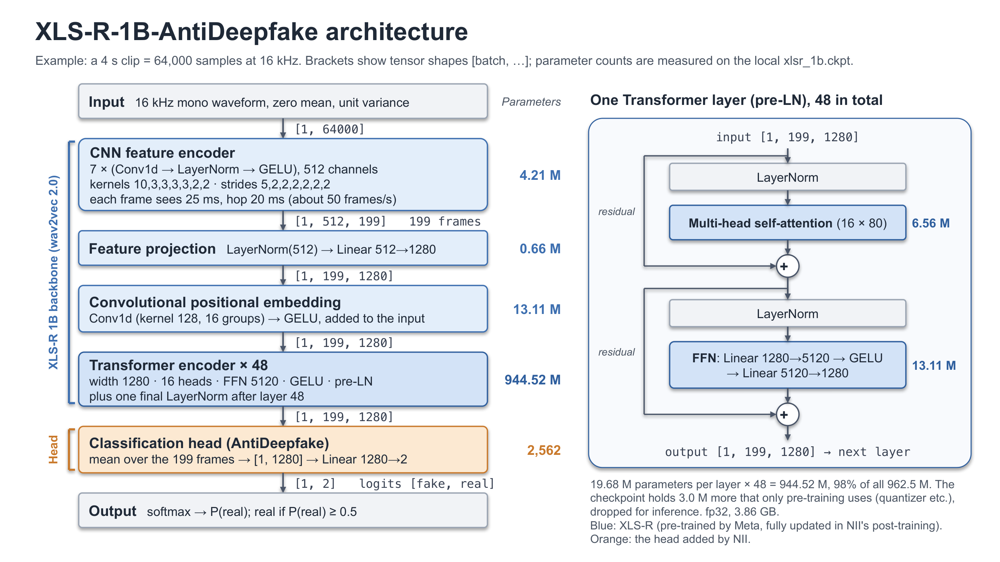

# XLS-R-1B-AntiDeepfake Model Overview

English translation of [xlsr_1b_antideepfake.md](xlsr_1b_antideepfake.md) (Chinese); the two have the same content.

Date: 2026-10-28. This document describes the deepfake speech detection model used in `antideepfake/`: what it does, its
network, its size, the data and method of its two training stages, and its licence.
Numbers come from the paper, the official GitHub repository, the Hugging Face model card and Zenodo, or were measured on
the local `models/xlsr_1b.ckpt` (marked "measured"); section 7 lists the sources. "Unverified" marks what could not be
confirmed from a primary source.

## 0. Key points

- **What it does**: it takes a 16 kHz mono waveform of any length and outputs two logits, in the order [fake, real]; their softmax gives P(real). `inference.threshold` in `config.yaml` is 0.5 by default: P(real) ≥ 0.5 counts as real, anything lower as fake.
- **Network**: XLS-R 1B (wav2vec 2.0: a 7-layer CNN and 48 Transformer layers of width 1280), an average over all frames, and one Linear(1280→2). The head has only 2,562 parameters; nearly all of the ability to tell real from fake sits in XLS-R.
- **Size** (measured): the inference network has 962.5 M parameters, 98% of them in the Transformer; the checkpoint holds 965.5 M (the extra 3.0 M are only used in pre-training), all fp32, in a 3.86 GB file.
- **Two training stages**: Meta pre-trained XLS-R with the self-supervised wav2vec 2.0 objective on 436k h of unlabelled speech in 128 languages; NII then "post-trained" the whole network, supervised, to classify real versus fake on about 74.7k h of speech from 29 sources (56.4k h real, 18.3k h fake, over 100 languages).
- **Which version `xlsr_1b.ckpt` is**: the default release straight after post-training (trained with RawBoost data augmentation), not fine-tuned on any particular dataset. Its zero-shot EER ranges from 1.35% (In-the-Wild) to 26.76% (Deepfake-Eval-2024).
- **Licence**: the checkpoint is CC BY-NC-SA 4.0, non-commercial use only; the upstream code is BSD-3-Clause.

## 1. What the model does

The model reads a 16 kHz mono waveform (any length, first normalised as a whole to zero mean and unit variance) and
outputs two logits, in the order [fake, real].
The second entry of their softmax is P(real), the probability that the speech is a real human recording; P(fake) = 1 − P(real).
`config.yaml` sets `inference.threshold: 0.5`: P(real) ≥ 0.5 counts as real, which is also AntiDeepfake's default threshold.

"Fake" covers more than deepfakes: in post-training, speech generated by TTS or VC, speech re-synthesised by a vocoder,
speech restored by a neural network and speech reconstructed by a neural codec were all labelled fake (section 4.2).
The paper states that codec speech is not regarded as deepfake speech, only as one kind of "speech with artifacts". A low
P(real) therefore means the speech carries traces of generation or re-synthesis, not necessarily that someone is being
impersonated.

## 2. Network

Editable source of the figure: [figures/xlsr_1b_antideepfake_architecture.pptx](figures/xlsr_1b_antideepfake_architecture.pptx)
(slide 1 Chinese, slide 2 English).

The structure comes from upstream `models/W2V.py` and `models/W2V_configs.py` (the `xlsr_1b` configuration) and is the
same network as in `inference.py`.
The shapes in the table were printed layer by layer while a 4 s clip (64,000 samples) went through the network of
`inference.py` (measured):

| # | Module | Structure | Output shape | Parameters (measured) |
|---|---|---|---|---|
| 1 | Input | mono, 16 kHz, normalised as a whole to zero mean and unit variance | [1, 64000] | — |
| 2 | CNN feature encoder | 7 Conv1d layers, each followed by LayerNorm and GELU; 512 channels; kernels 10, 3, 3, 3, 3, 2, 2, strides 5, 2, 2, 2, 2, 2, 2. Each frame covers 400 samples (25 ms), the hop is 320 samples (20 ms), about 50 frames per second | [1, 512, 199] | 4,210,176 |
| 3 | Feature projection | LayerNorm(512) → Linear(512→1280) | [1, 199, 1280] | 657,664 |
| 4 | Convolutional positional embedding | Conv1d(1280→1280, kernel 128, 16 groups, weight norm) → GELU, added to the input. Position is learnt by this convolution; there is no fixed position table | [1, 199, 1280] | 13,108,480 |
| 5 | Transformer encoder | 48 layers; width 1280, 16 heads (80 dimensions each), FFN 5120, GELU. Pre-LN: a LayerNorm before self-attention and before the FFN, with the residual connections around them; one more LayerNorm after layer 48. Attention is global: every frame sees the whole clip | [1, 199, 1280] | 944,519,680 |
| 6 | Classification head (AntiDeepfake) | mean over all frames (global average pooling) → Linear(1280→2) | [1, 1280] → [1, 2] | 2,562 |
| 7 | Output | softmax; index 1 is P(real) | P(real) | — |

- Frames: N samples give ⌊(N − 400) / 320⌋ + 1 frames. 1 s gives 49 frames, 4 s 199, 10 s 499, and 13 s (the longest input in post-training) 649.
- Inference uses no masking and no quantiser (upstream calls fairseq's `Wav2Vec2Model` with `mask=False, features_only=True`), so the pre-training parts of the checkpoint (section 3) are not used.
- There is no attention pooling or AASIST-style back end before the output: only an average and one Linear layer.

## 3. Size

| Item | Value | Source |
|---|---|---|
| Parameters: inference network | 962,498,562 (962.5 M) | measured (network built by `inference.py`) |
| Parameters: checkpoint | 965,517,314 (965.5 M); the AntiDeepfake and XLS-R papers both give 965 M | measured; paper Table II |
| CNN feature encoder | 4,210,176 (0.44% of the inference network) | measured |
| Feature projection | 657,664 (0.07%) | measured |
| Convolutional positional embedding | 13,108,480 (1.36%) | measured |
| Transformer | 944,519,680 (98.13%): 19,677,440 per layer (self-attention 6,558,720 + FFN 13,113,600 + two LayerNorms 5,120) × 48, plus the final LayerNorm 2,560 | measured |
| Classification head | 2,562 (1280 × 2 + 2) | measured |
| Parameters used only in pre-training | 3,018,624: `quantizer` 656,000, `project_q` 1,049,600, `final_proj` 1,311,744, `mask_emb` 1,280. Dropped for inference | measured |
| Layers | 7 CNN layers and 48 Transformer layers, plus 1 positional convolution and 1 Linear output layer | upstream configuration |
| File | `xlsr_1b.ckpt`, 3,862,339,848 bytes (3.86 GB); a PyTorch state dict of 815 tensors with fairseq parameter names (`m_ssl.model.*`, `proj_fc.*`); MD5 `61dde44830acfa192a2ff13bd0e8925a`, as published on Zenodo | measured; Zenodo |
| Precision | all fp32. Upstream post-training used fp16 mixed precision (`precision: fp16` in `hparams/xlsr_1b.yaml`) | measured; upstream hparams |

The "1B" in the name is a round figure: the model has about 0.97 B parameters (fairseq's original file is
`xlsr2_960m_1000k.pt`).
The model table of the XLS-R paper gives the 1B model a width of 1024 and an FFN of 4096, which does not match 965 M
parameters and is presumably a typo: the Hugging Face configuration of XLS-R 1B, AntiDeepfake's configuration and the
local checkpoint all use 1280 and 5120.

## 4. Training

Two stages: Meta's self-supervised pre-training produced XLS-R 1B; NII's supervised post-training on top of it produced
XLS-R-1B-AntiDeepfake.

### 4.1 Stage 1: self-supervised pre-training of XLS-R 1B (Meta, 2021)

**Objective (wav2vec 2.0)**: no labels are needed. About half of the frames are masked, and the model learns to pick,
from the context, the right speech unit for each masked frame out of 100-odd candidates (a contrastive loss); the
discrete speech units come from a codebook that the model learns at the same time.

**Data**: 436k h of public unlabelled speech in 128 languages:

| Dataset | Duration | Languages | Content | Link |
|---|---|---|---|---|
| VoxPopuli (VP-400K) | 372k h (about 400k h before removing leading and trailing silence) | 23 European languages | European Parliament speeches | [GitHub](https://github.com/facebookresearch/voxpopuli) |
| Multilingual LibriSpeech (MLS) | about 50k h, of which 44k h English | 8 European languages | LibriVox audiobooks, read | [OpenSLR 94](https://www.openslr.org/94/) |
| Common Voice v6.1 (2020-12) | over 7k h | 60 | crowd-sourced reading | [Common Voice](https://commonvoice.mozilla.org/en/datasets) |
| VoxLingua107 | 6.6k h | 107 | speech segments from YouTube videos | [Official page](https://cs.taltech.ee/staff/tanel.alumae/data/voxlingua107/) |
| BABEL | about 1k h | 17 African and Asian languages | telephone conversations | [IARPA Babel](https://www.iarpa.gov/research-programs/babel) |

**Training setup** (XLS-R paper):

- 1M updates on 200 GPUs, about 3 h of audio per batch (2.8–3.6 h); audio cropped to at most 20 s.
- Low-resource languages are sampled more often (p ∝ (n / N)^0.5).
- Peak learning rate, GPU type and training time: not given in the paper (unverified).

### 4.2 Stage 2: AntiDeepfake post-training (NII, 2025)

NII started from the XLS-R 1B checkpoint released by fairseq (`xlsr2_960m_1000k.pt`), added average pooling and a
Linear(1280→2) layer, and trained the whole network on real-versus-fake data.
The paper calls this stage post-training: it sits between self-supervised pre-training and fine-tuning on one dataset,
uses a large and varied dataset, and aims at a general representation suited to detecting fakes.

**Data**: 29 sources (27 public datasets and 2 that NII generated with vocoders), 56,371 h real and 18,282 h fake,
74,653 h in total, in over 100 languages.
The totals are the sums of the rows of the paper's Table I and match the 56.37k h and 18.28k h given in the paper. The
sources fall into 5 categories by type of artifact:

| Category | Sources | Real (h) | Fake (h) |
|---|---|---|---|
| TTS and VC | 14 | 1,020 | 6,164 |
| Vocoder re-synthesis | 7 | 2,105 | 8,826 |
| Neural restoration | 3 | 1,389 | 1,822 |
| Neural codec | 2 | 130 | 1,469 |
| Real speech only | 3 | 51,728 | 0 |
| **Total** | **29** | **56,371** | **18,282** |

- MLS alone contributes 50,558 h: 90% of the real speech and 68% of all the data. MLS was also part of the XLS-R pre-training data.
- Only a third of the fake speech (6.2k h) is "classic" deepfake speech from TTS and VC; the rest went through a vocoder, a restoration model or a codec.
- The validation set is the part each dataset designates as dev or valid (14 of the datasets have one) and is used only to pick the checkpoint.
  All other files, including the official test sets of many datasets (e.g. the eval set of ASVspoof 2019 LA and the test set of ASVspoof 5), were used for training (upstream `protocols/README.md`). Evaluating `xlsr_1b.ckpt` on these test sets is therefore not an independent test.

All 29 sources (order and hours from the paper's Table I; source data from upstream `protocols/README.md`):

| Category | Dataset | Languages | Real (h) | Fake (h) | Notes | Link |
|---|---|---|---|---|---|---|
| TTS, VC | ASVspoof 2019 LA | en | 11.85 | 97.80 | source data VCTK | [Edinburgh DataShare](https://datashare.ed.ac.uk/handle/10283/3336) |
| | ASVspoof 2021 LA | en | 16.40 | 116.10 | source data VCTK | [Zenodo 4837263](https://zenodo.org/records/4837263) |
| | ASVspoof 2021 DF | en | 20.73 | 487.00 | source data VCTK | [Zenodo 4835108](https://zenodo.org/records/4835108) |
| | ASVspoof 5 | en | 413.49 | 1,808.48 | source data MLS | [Zenodo 14498691](https://zenodo.org/records/14498691) |
| | CFAD | zh | 171.25 | 224.55 | source data AISHELL-1/3, THCHS-30, MAGICDATA and others | [Zenodo 8122764](https://zenodo.org/records/8122764) |
| | DECRO | en, zh | 35.18 | 102.44 | source data VCTK, AISHELL and others | [GitHub](https://github.com/petrichorwq/DECRO-dataset) |
| | DFADD | en | 41.62 | 66.01 | source data VCTK; diffusion and flow-matching TTS | [GitHub](https://github.com/isjwdu/DFADD) |
| | Diffuse or Confuse | en | 0 | 231.66 | source data LJSpeech; diffusion TTS | [GitHub](https://github.com/AntonFirc/diffusion-deepfake-speech-dataset) |
| | DiffSSD | en | 0 | 139.73 | source data LibriSpeech, LJSpeech; diffusion TTS | [Hugging Face](https://huggingface.co/datasets/purdueviperlab/diffssd) |
| | DSD | en, ja, ko | 100.98 | 60.23 | source data LibriSpeech, VCTK, AIHUB and others | [Zenodo 13788455](https://zenodo.org/records/13788455) |
| | HABLA | es | 35.56 | 87.83 | Latin American Spanish | [Zenodo 7370805](https://zenodo.org/records/7370805) |
| | MLAAD | 38 languages | 0 | 377.96 | source data M-AILABS; upstream used v5 | [Official page](https://deepfake-total.com/mlaad) |
| | SpoofCeleb | multilingual | 173.00 | 1,916.20 | source data VoxCeleb1 | [Hugging Face](https://huggingface.co/datasets/jungjee/spoofceleb) |
| | VoiceMOS 2022 | en | 0 | 448.44 | only its synthetic speech; the human recordings were left out | [Zenodo 6572573](https://zenodo.org/records/6572573) |
| Vocoder | CVoiceFake | en, fr, de, it, zh | 315.14 | 1,561.16 | source data Common Voice | [Zenodo 14062964](https://zenodo.org/records/14062964) |
| | LibriTTS | en | 585.83 | 0 | original human speech | [OpenSLR 60](https://www.openslr.org/60/) |
| | LibriTTS-Vocoded | en | 0 | 2,345.14 | LibriTTS re-synthesised by NII with vocoders such as HiFi-GAN and hn-sinc-NSF; upstream says to generate it yourself with a Colab notebook | [Upstream notes](https://github.com/nii-yamagishilab/AntiDeepfake/blob/main/protocols/LibriTTS-Vocoded.py) |
| | LJSpeech | en | 23.92 | 0 | original human speech | [Official page](https://keithito.com/LJ-Speech-Dataset/) |
| | VoxCeleb2 | multilingual | 1,179.62 | 0 | original human speech | [Official page](https://www.robots.ox.ac.uk/~vgg/data/voxceleb/vox2.html) |
| | VoxCeleb2-Vocoded | multilingual | 0 | 4,721.46 | VoxCeleb2 re-synthesised by NII, as above | [Upstream notes](https://github.com/nii-yamagishilab/AntiDeepfake/blob/main/protocols/VoxCeleb2-Vocoded.py) |
| | WaveFake | en, ja | 0 | 198.65 | source data LJSpeech, JSUT | [Zenodo 5642694](https://zenodo.org/records/5642694) |
| Neural restoration | FLEURS | 102 languages | 1,388.97 | 0 | original (lower-quality) human speech | [Hugging Face](https://huggingface.co/datasets/google/fleurs) |
| | FLEURS-R | 102 languages | 0 | 1,238.83 | FLEURS restored with a diffusion vocoder | [Hugging Face](https://huggingface.co/datasets/google/fleurs-r) |
| | LibriTTS-R | en | 0 | 583.15 | restored version of LibriTTS | [OpenSLR 141](https://www.openslr.org/141/) |
| Codec | Codecfake (Xie et al.) | en, zh | 129.66 | 808.32 | source data LibriTTS, VCTK, AISHELL-3 | [GitHub](https://github.com/xieyuankun/Codecfake) |
| | CodecFake (Wu et al.) | en | 0 | 660.92 | source data VCTK | [Hugging Face](https://huggingface.co/datasets/rogertseng/CodecFake) |
| Real speech only | AISHELL-3 | zh | 85.62 | 0 | | [OpenSLR 93](https://www.openslr.org/93/) |
| | CN-Celeb2 | zh | 1,084.34 | 0 | | [OpenSLR 82](https://www.openslr.org/82/) |
| | MLS | 8 languages | 50,558.11 | 0 | also used in XLS-R pre-training | [OpenSLR 94](https://www.openslr.org/94/) |

**Method**:

| Item | Setting | Source |
|---|---|---|
| Starting point | fairseq's pre-trained XLS-R 1B checkpoint `xlsr2_960m_1000k.pt` | upstream hparams |
| Network | XLS-R 1B + mean over all frames + Linear(1280→2); all weights updated together, no layer frozen | paper Sec. III-B; `W2V.py`, `main.py` |
| Loss | binary cross-entropy over two classes (label 1 = real, 0 = fake); no weighting of the data categories | paper Sec. III-B; `main.py` |
| Sampling | no balancing or re-sampling of real and fake: all data merged and shuffled; dynamic batches from 20 duration buckets (SpeechBrain `DynamicBatchSampler`), at most 100 s of audio per batch, shorter files zero-padded | paper Sec. IV-A; hparams; `dataio.py`, `protocols/generate_protocol_by_proportion.py` |
| Pre-processing | resampled to 16 kHz, mono, normalised as a whole; files longer than 13 s randomly cropped to 10–13 s | paper Sec. III-B, IV-A; `dataio.py` |
| Data augmentation | RawBoost (1)+(2): linear and non-linear convolutive noise (LnL) + impulsive signal-dependent additive noise (ISD). Used for `xlsr_1b.ckpt`; `xlsr_1b_nda.ckpt` on Zenodo is the version without augmentation | model card; hparams |
| Optimiser | AdamW, weight decay 0.01 | paper Sec. IV-A |
| Learning rate | linear warm-up to 1e-7 over the first 80k steps, then decay; training stops at 800k steps. The paper says "linearly decaying to 0"; the hparams use SpeechBrain's `WarmAndExpDecayLRSchedule` (`decay_factor: 0.01`), i.e. exponential decay to 1% of the peak at step 800k | paper Sec. IV-A; hparams |
| Amount of training | 800k steps; the paper says that every model except XLS-R-2B saw most of the training data twice. The validation EER was computed every 100k steps, and only the checkpoint with the lowest EER was kept | paper Sec. IV-A; `main.py` |
| Other | fp16 mixed precision, gradient clipping at 100 | hparams |
| Hardware | 8 NVIDIA H100 GPUs (TSUBAME4.0 supercomputer, Institute of Science Tokyo) | paper Sec. IV-A, acknowledgment |
| Training time | not published (unverified) | — |

**Which checkpoint `xlsr_1b.ckpt` is**:

- Zenodo record 15580543 holds two versions of each model: the default one (e.g. `xlsr_1b.ckpt`) and an NDA one (`xlsr_1b_nda.ckpt`, No Data Augmentation). The model card says the default version was trained with data augmentation.
- The MD5 of the local `xlsr_1b.ckpt` matches the one published on Zenodo. Five sampled tensors (including the head) are bit-identical to those of the default Hugging Face release [xls-r-1b-anti-deepfake](https://huggingface.co/nii-yamagishilab/xls-r-1b-anti-deepfake) and differ from those of the NDA release (measured).
- The upstream README says the released checkpoints are post-trained ones and that the versions fine-tuned on Deepfake-Eval-2024 are not released. `xlsr_1b.ckpt` is therefore "pre-training + post-training", without fine-tuning.

**Evaluation results**: the table gives the "with RawBoost" column of XLS-R-1B in the paper's Table II, which matches
the model card; none of these test sets was used in pre-training or post-training.
EER (equal error rate): the error rate at the threshold where "fake judged real" and "real judged fake" are equally
frequent. Lower is better.

| Test set | Content | EER | P(real) threshold at the EER (model card) |
|---|---|---|---|
| ADD 2023 Track 1.2 R2 test | Mandarin | 5.39% | 0.566 |
| DEEP-VOICE (segmented full set) | real speech recordings of 8 celebrities and their voice-converted versions | 2.47% | 0.944 |
| FakeOrReal (original test) | English | 5.74% | 0.456 |
| FakeOrReal (norm test) | English, the second version of FakeOrReal | 12.14% | 0.798 |
| In-the-Wild (full set) | English | 1.35% | 0.494 |
| Deepfake-Eval-2024 (audio test, 4 s segments) | real and fake audio collected in 2024 from social media and detection platforms, over 50 languages | 26.76% | 0.995 |

- The threshold at the EER ranges from 0.46 to 0.99, so 0.5 does not suit every dataset: with 0.5 on Deepfake-Eval-2024, 55.1% of the fake segments are judged real (the FPR on the model card).
- The paper also fine-tuned on the training set of Deepfake-Eval-2024: the EER of XLS-R-1B fell to 11.86% (4 s segments) to 8.28% (50 s segments), against 19.96% to 11.20% when fine-tuned without post-training (paper Table III). These fine-tuned weights are not released.

## 5. Licence

- **Checkpoint**: CC BY-NC-SA 4.0 (the licence of the Zenodo record, `models/LICENSE-CHECKPOINT`, the model card). It may be copied and adapted with attribution, for non-commercial purposes only, and adaptations must be shared under the same licence. Copyright belongs to NII.
- **Upstream code**: BSD-3-Clause (AntiDeepfake's `LICENSE-CODE`). No upstream code is copied into this repository.
- **Other**: the pre-trained XLS-R 1B weights are Apache-2.0 on Hugging Face, and fairseq is MIT. The post-training datasets have licences of their own, some of them non-commercial or no-derivatives (e.g. Codecfake is CC BY-NC-ND 4.0).

## 6. How this repository uses the model

`inference.py` does not install fairseq (installing it would downgrade hydra-core and omegaconf and break FunASR in the
emotion_recognition environment). It re-implements the network of section 2 in plain PyTorch with fairseq's parameter
names, so `xlsr_1b.ckpt` loads unchanged.
On loading, it drops the 8 tensors used only in pre-training (3.0 M parameters), turns the weight-normalised positional
convolution into one plain weight (weight = g · v / ‖v‖), and checks every name and shape with
`load_state_dict(strict=True)`.
Audio is prepared as in upstream `test_audio_pipeline()`: channels averaged, resampled to 16 kHz, normalised as a whole,
one forward pass per file; averaging the logits of segments with `max_seconds` is an addition of this repository, not
part of upstream.
According to section 5 of the [README](../README.md), its logits agree with implementations of the same network in
Hugging Face transformers and torchaudio to within 2.5 × 10⁻⁵. Usage, speed and example output are in the README.

## 7. Sources

- AntiDeepfake paper: W. Ge, X. Wang, X. Liu, J. Yamagishi, "Post-training for Deepfake Speech Detection", ASRU 2025; [arXiv:2506.21090](https://arxiv.org/abs/2506.21090) v4 (2025-10-21, the version with the corrected EER computation). Training data in Table I, training setup in Sec. III-B and IV-A, zero-shot results in Table II, fine-tuning results in Table III.
- AntiDeepfake code: [GitHub nii-yamagishilab/AntiDeepfake](https://github.com/nii-yamagishilab/AntiDeepfake) (`main` of 2026-10-27, commit `8609809`). Files used: `models/W2V.py` and `models/W2V_configs.py` (network and `xlsr_1b` configuration), `hparams/xlsr_1b.yaml` (training hyperparameters), `dataio/dataio.py` (pre-processing, cropping, RawBoost), `main.py` (loss, checkpoint selection), `evaluation.py` (`softmax_score()` and the metrics), [`protocols/README.md`](https://github.com/nii-yamagishilab/AntiDeepfake/blob/main/protocols/README.md) (source data and use of each dataset), `LICENSE-CODE`, `LICENSE-CHECKPOINT`.
- Model card: [nii-yamagishilab/xls-r-1b-anti-deepfake](https://huggingface.co/nii-yamagishilab/xls-r-1b-anti-deepfake) (default release, with evaluation results and the training data table); [NDA release](https://huggingface.co/nii-yamagishilab/xls-r-1b-anti-deepfake-nda).
- Checkpoint: [Zenodo record 15580543](https://zenodo.org/records/15580543) (v1.0, 2025-06-24): files, sizes, MD5, licence.
- XLS-R: A. Babu et al., "XLS-R: Self-supervised Cross-lingual Speech Representation Learning at Scale", Interspeech 2022; [arXiv:2111.09296](https://arxiv.org/abs/2111.09296) (training data, pre-training setup, model table). [fairseq XLS-R page](https://github.com/facebookresearch/fairseq/blob/main/examples/wav2vec/xlsr/README.md) (checkpoint `xlsr2_960m_1000k.pt`); [Hugging Face facebook/wav2vec2-xls-r-1b](https://huggingface.co/facebook/wav2vec2-xls-r-1b) (configuration, Apache-2.0).
- wav2vec 2.0: A. Baevski, Y. Zhou, A. Mohamed, M. Auli, NeurIPS 2020; [arXiv:2006.11477](https://arxiv.org/abs/2006.11477) (objective, masking, CNN structure).
- RawBoost: H. Tak et al., ICASSP 2022; [arXiv:2111.04433](https://arxiv.org/abs/2111.04433).
- SpeechBrain `WarmAndExpDecayLRSchedule`: [speechbrain/nnet/schedulers.py (v1.0.2)](https://github.com/speechbrain/speechbrain/blob/v1.0.2/speechbrain/nnet/schedulers.py) (the version upstream installs).
- Dataset links: in the tables of sections 4.1 and 4.2.
- Measurements (2026-10-28, PyTorch 2.5.1, CPU): read the local `models/xlsr_1b.ckpt` to count its parameters and data types and compute its MD5; ran a 4 s input through the network of `inference.py` and printed the shape after each layer; read 5 tensors from the `model.safetensors` of both Hugging Face releases with HTTP range requests and compared them bit by bit with the local checkpoint.
