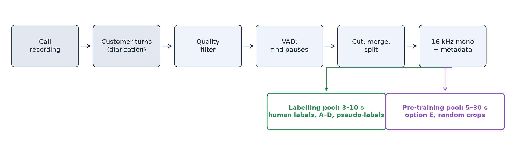
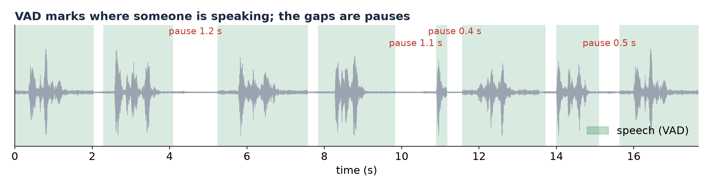
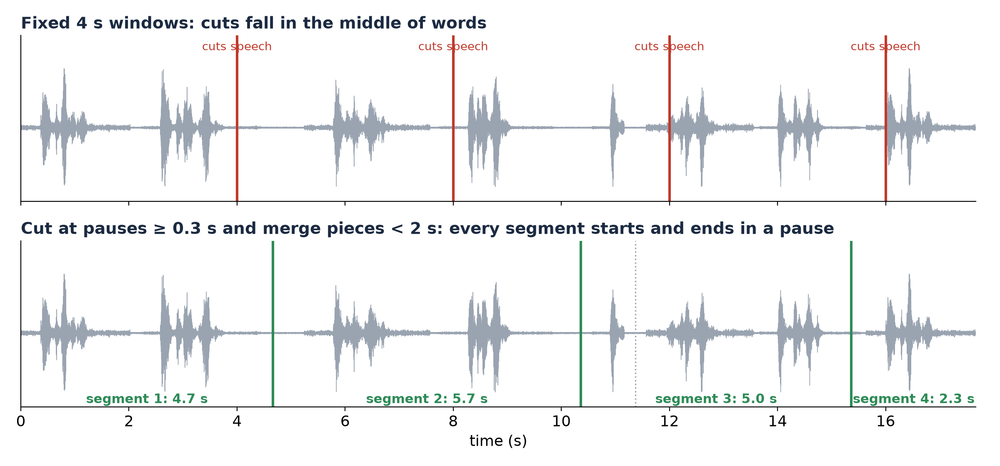
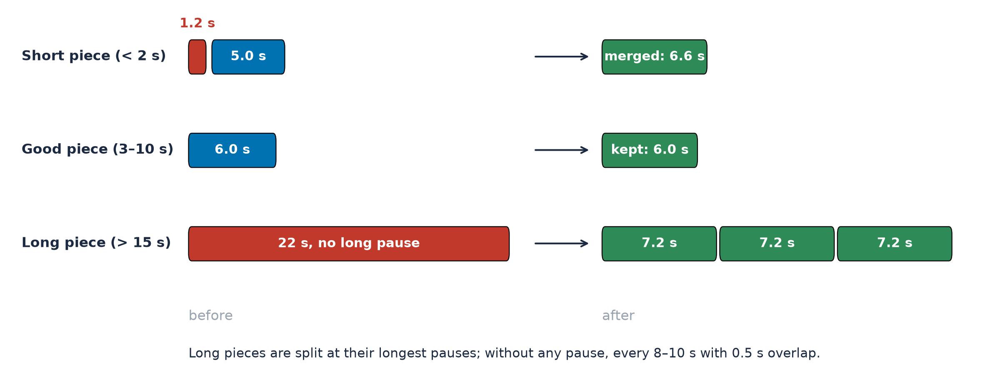
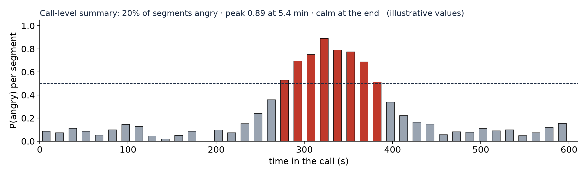

# Data Preparation for Call-Centre Audio

How to turn recorded calls into training data for emotion2vec+ large and MERaLiON-SER-v1: short segments for human
labelling and fine-tuning (options A–D), and longer audio for continued pre-training (option E). The options are
explained in the presentation (`presentation/SER_evaluation.pptx`, part 6).

Status: proposal, 2026-11-02. Call audio, transcripts and metadata never go into this repository.

## In short

- Cut each customer turn **at pauses**, not every fixed 4 or 10 seconds.
- Aim for **3–10 s segments**: merge pieces under 2 s, split pieces over 12–15 s.
- Use the **same segments** for labelling, fine-tuning (A–D) and inference.
- Pre-training (E) also uses segments, but **longer (5–30 s) and with looser rules**.
- Convert everything to **16 kHz mono**, and keep each customer in only one of training, validation and test data.

## 1. Pipeline

Diarization (already available) gives one file per customer turn. We then remove unusable audio (hold music, IVR
prompts, overlapping agent speech, heavy noise), find the pauses, cut, and store each segment with its metadata.

## 2. VAD: finding the pauses

VAD (voice activity detection) checks every 10–30 ms of audio and decides whether someone is speaking. The gaps between
speech are the pauses where we can cut.

Tools: [Silero VAD](https://github.com/snakers4/silero-vad) (neural, robust to telephone noise, MIT licence) or
[WebRTC VAD](https://github.com/wiseman/py-webrtcvad) (very fast, less robust). The existing diarization pipeline
usually contains a VAD already; its speech intervals can be reused. Typical settings: a pause of at least 0.3–0.5 s is a
cut point; speech shorter than 0.25 s (clicks, breaths) is ignored.

## 3. Why cut at pauses

Fixed windows cut words in half: the pieces sound unnatural, are hard to label, and teach the model cut artefacts.
Cutting at pauses keeps whole phrases.

## 4. Why 3–10 seconds

- **Long clips** mix several emotions (calm, then angry, then calm), so one label does not fit. They also cost the models:
  emotion2vec+ memory grows with the square of the length (it was trained on clips of at most 20 s), and MERaLiON uses
  only the first 30 s.
- **Very short clips** ("yes", "okay") carry almost no emotion and are nearly always labelled neutral. MERaLiON also pads
  every clip to 30 s with silence and averages over it, so short clips are diluted.
- **Other corpora agree**: MSP-Podcast (natural emotional speech) uses 2.75–11 s turns; the Vox-Profile models were
  trained on 3–15 s clips.

## 5. Length rules

| Piece | What to do |
|---|---|
| shorter than 2 s | merge with the neighbouring piece of the same turn; if it stays short, leave it out of labelling (keep it for pre-training) |
| 3–10 s | keep |
| 10–15 s | keep if there is no pause; otherwise split at the longest pause |
| longer than 15 s | split at the longest pauses; if there are none, cut every 8–10 s with 0.5 s overlap |
| silence at both ends | trim, keeping about 0.1–0.2 s |

## 6. Labelling and fine-tuning data (options A–D)

- Listeners label the 3–10 s segments with the labelling tool (`labeling_tool/`).
- The 1k seed set is sampled across many calls, not from consecutive segments of one turn. Later rounds are picked by
  active learning from the same pool.
- Pseudo-labels for MERaLiON (E′) count as labels, so they use the same segments.

## 7. Pre-training data (option E)

- Still cut, because memory grows quickly with length and batches need clips of similar length.
- Rules are looser: no label depends on the boundaries. Store 5–30 s VAD segments and let the training code cut random
  windows from them. Short utterances can stay.
- Remove silence, music and IVR. Customer speech is the target; agent speech on the same phone line can also help the
  model adapt to telephone audio.
- What counts is the total hours of clean speech (e.g. 100–1,000 h).

## 8. From segments back to turns and calls

New calls are cut the same way and every segment gets a prediction. A turn is the duration-weighted average of its
segments. A call can be summarised by the share of angry segments, the peak, or how it ended (the figure uses made-up
values).

## 9. Metadata, splits and privacy

Keep one manifest row per segment: `segment_id`, pseudonymised `call_id` and `customer_id`, `turn_index`,
`segment_index`, `start_s`, `end_s`, `duration_s`, `pool` (labelling or pre-training) and `quality_flags`.

- Training, validation and test data contain different customers.
- Segments may contain names, card numbers and other personal data: pseudonymise IDs, redact transcripts, keep
  everything inside the company environment.

## 10. Pilot before full labelling

Label 200 segments of 4–6 s and 200 of 8–10 s with the same listeners. Compare listener agreement (κ), time per clip
(the tool records `seconds_spent`) and the share of "bad clip" votes, then pick the length with better agreement.

Open decisions: the label set (7 classes + unknown, or call-centre classes such as frustrated); whether listeners also
hear the previous segment as context; which VAD to use; how much agent speech to include in pre-training.

## Sources

- Model input limits: [emotion2vec_plus_large_en.md](emotion2vec_plus_large_en.md),
  [finetuning_emotion2vec_plus_large_en.md](finetuning_emotion2vec_plus_large_en.md), [models_survey_en.md](models_survey_en.md) (table 1b)
- MSP-Podcast: Lotfian & Busso, IEEE Transactions on Affective Computing, 2019
- Figures: `python docs/figures/make_data_preparation_figures.py` (from the `emotion_recognition/` folder). The example turn
  is built from the six CREMA-D sample clips in `data/samples/` (ODbL), joined with pauses.
