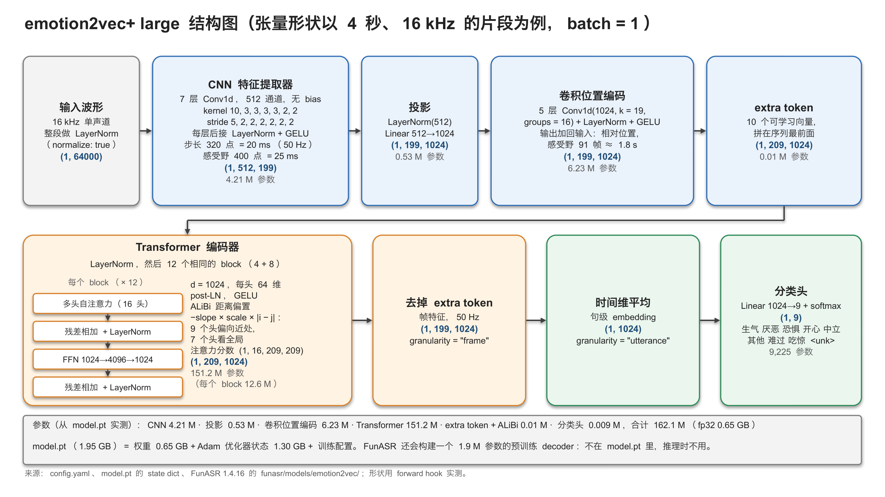

# emotion2vec+ large 模型说明（The emotion2vec+ large Model）

英文版：[emotion2vec_plus_large_en.md](emotion2vec_plus_large_en.md)（内容相同）。微调要多少数据和算力，见 [finetuning_emotion2vec_plus_large.md](finetuning_emotion2vec_plus_large.md)。

日期：2026-10-28。对象：本项目用 FunASR 1.4.16 运行的 [emotion2vec_plus_large](https://huggingface.co/emotion2vec/emotion2vec_plus_large)。

方法：结构和参数量来自本地的 `config.yaml`、`model.pt`（与 Hugging Face 上的文件 SHA-256 相同）和 FunASR 1.4.16 的 [`funasr/models/emotion2vec/`](https://github.com/modelscope/FunASR/tree/main/funasr/models/emotion2vec) 代码；张量形状用 forward hook 在 M4 Max 上实测。
训练信息来自论文、模型卡、官方 GitHub，以及 `model.pt` 里保存的训练配置。标"未核实"的内容没能从一手资料确认；标"推断"的是根据文件和配置得出的结论，作者没有确认过。

## 0. 要点

- **做什么**：输入 16 kHz 单声道语音，输出整段语音在 9 个类别上的概率：生气/angry、厌恶/disgusted、恐惧/fearful、开心/happy、中立/neutral、其他/other、难过/sad、吃惊/surprised、`<unk>`。也可以输出每 20 ms 一帧的 1024 维帧特征，或整段的 1024 维 embedding。
- **结构**：7 层 CNN（把波形降采样 320 倍）→ 投影到 1024 维 → 5 层卷积位置编码 → 12 个 Transformer block（1024 维、16 头、FFN 4096，注意力带 ALiBi 距离偏置）→ 所有帧求平均 → Linear(1024→9) + softmax。
- **大小**：推理用的权重共 **162.1 M** 参数（fp32 约 0.65 GB）。模型卡写的 "~300M" 与文件不符：配置与 data2vec 2.0 Large 基本相同，只是深度减半（12 个 block，不是 24 个）；24 个 block 的版本是 313 M（按配置计算）。
- **model.pt 为什么有 1.95 GB**：除了 0.65 GB 权重，还有 1.30 GB 的 Adam 优化器状态和 fairseq 训练配置；没有 EMA teacher，也没有 decoder。推理只用权重。
- **训练**：emotion2vec 先在 262 h 无标注情感语音上做自监督预训练（data2vec 2.0 风格）。emotion2vec+ 再用标签训练三代：seed（EmoBox 学术数据，201 h）→ base（伪标签，4,788 h）→ large（伪标签，42,526 h，从约 16 万小时中筛出约 4 万小时）。伪标签数据的来源、筛选规则和训练算力都没有公开。
  `model.pt` 里的配置显示，large 的最后一个阶段用 8 块 GPU（型号未记录）在名为 `emo_box_fix` 的数据上训练了 13,669 步。
- **本项目的实测**：在 EmoBox 包含的数据集上准确率 85.5–92.5%，在 EmoBox 以外的数据集上只有 40.8–61.3%。MPS 处理不了长于 20.48 s 的片段（脚本会改用 CPU）；内存大约随片段长度的平方增长。
- **许可**：Hugging Face 模型卡指向 FunASR 模型许可（可以使用、修改、分发，包括微调后的模型，但要注明出处并保留模型名）；ModelScope 模型卡写 Apache-2.0。两处不一致。

## 1. 它做什么

FunASR 的 `inference()`（`model.py`）对每个文件做这几步：

1. 读入音频，转成 16 kHz 单声道。
2. 对整段波形做 `layer_norm`（`normalize: true`）：减均值、除以标准差，没有可学习参数。
3. `extract_features()`：CNN → 投影 → 位置编码 → 加 10 个 extra token → 12 个 Transformer block。推理时不做 mask。
4. 去掉 extra token，得到帧特征 (T, 1024)，每 20 ms 一帧（`granularity="frame"` 返回它）。
5. 在时间维上求平均，得到 1024 维的句级 embedding（`granularity="utterance"` 返回它）。每帧权重相同，停顿也算在内。
6. `proj`：Linear(1024→9)，再 softmax，得到 9 个概率，顺序同 `tokens.txt`。

- 一个输入只有一个标签，不管多长。作者建议先用 VAD 切成语义完整的片段，并说模型是用变长片段训练的（[issue #30](https://github.com/ddlBoJack/emotion2vec/issues/30)）。
- `extract_embedding=True` 时同时返回特征，`False` 时只返回标签和概率。
- `other` 和 `<unk>`（模型卡里叫 unknown）的含义没有公开定义。

## 2. 结构

可编辑的 PowerPoint 文件：[figures/emotion2vec_plus_large_architecture.pptx](figures/emotion2vec_plus_large_architecture.pptx)（第 1 页中文，第 2 页英文）。

| 模块（FunASR 中的名字） | 配置（`config.yaml` 和代码） | 4 s 片段的输出形状 | 参数 |
|---|---|---|---|
| 波形归一化 | 整段 `layer_norm` | (1, 64000) | 0 |
| CNN 特征提取器（`local_encoder`） | 7 层 Conv1d，512 通道，无 bias；kernel 10, 3, 3, 3, 3, 2, 2，stride 5, 2, 2, 2, 2, 2, 2；每层后接 LayerNorm + GELU。总步长 320 点 = 20 ms（50 Hz），感受野 400 点 = 25 ms | (1, 512, 199) | 4,206,592 |
| 投影（`project_features`） | LayerNorm(512) + Linear 512→1024 | (1, 199, 1024) | 526,336 |
| 卷积位置编码（`relative_positional_encoder`） | 5 层 Conv1d(1024→1024, kernel 19, groups 16) + LayerNorm（无可学习参数）+ GELU，输出加回输入；感受野 91 帧 ≈ 1.8 s | (1, 199, 1024) | 6,231,040 |
| extra token（`extra_tokens`） | 10 个可学习向量，拼在序列最前面。预训练时用于句级损失（论文中的 chunk embedding），推理时在池化前去掉 | (1, 209, 1024) | 10,240 |
| ALiBi 缩放系数（`alibi_scale`） | 每个头一个，12 个 block 共用（见下文） | 每个 block 的注意力分数 (1, 16, 209, 209) | 16 |
| Transformer（`context_encoder` 的 LayerNorm 和 4 个 block，加上 `blocks` 的 8 个 block） | 12 个相同的 block：d = 1024，16 头 × 64 维，FFN 1024→4096→1024（GELU），QKV 带 bias；post-LN：x = LN(x + Attn(x))，x = LN(x + FFN(x))；dropout 0.1 只在训练时生效 | (1, 209, 1024) | 151,156,736（每个 block 12,596,224） |
| 去掉 extra token，时间平均 | 无参数 | (1, 199, 1024) → (1, 1024) | 0 |
| 分类头（`proj`） | Linear 1024→9，再 softmax | (1, 9) | 9,225 |
| **合计（推理）** | | | **162,140,185** |

- 帧数 = ⌊(采样点数 − 400) / 320⌋ + 1，所以 4 s 是 199 帧，不是 200 帧。
- 论文正文把 kernel 和 stride 写反了（写成 kernel (5, 2, …)、stride (10, 3, …)）。上表按 `config.yaml` 和代码。
- 4 + 8 只是代码结构（data2vec 2.0 里"模态专用的 block"和"共享的 block"）；对纯音频模型就是 12 个串联的相同 block。最后没有额外的 LayerNorm（`layer_norm_first: false`）。
- **位置信息**有两种，都不是绝对位置编码，所以输入长度没有硬上限：卷积位置编码（每帧看到前后约 0.9 s），以及 ALiBi，即按帧的距离给注意力分数打折扣，每个头学一个缩放系数。这个文件里，9 个头偏向附近的帧（约 0.05–2.4 s 以内），另外 7 个头不打折扣，看整段输入。
- 注意力是显式计算的（`q @ kᵀ`，softmax 用 fp32）：每个 block 有一个 16 × N × N 的分数矩阵（N = 帧数 + 10），内存大约随长度的平方增长（第 5 节）。
- **配置的来历**：就是 data2vec 2.0 Large 的音频配置（[`large_audio_only_task.yaml`](https://github.com/facebookresearch/fairseq/blob/main/examples/data2vec/config/v2/large_audio_only_task.yaml)），只是深度减半：12 个 block，不是 24 个。

## 3. 大小

### 3.1 model.pt 里有什么

`model.pt`（1,945,790,254 字节）是一个 fairseq 训练 checkpoint：

| 顶层 key | 内容 | 元素个数 | 大小（fp32） |
|---|---|---|---|
| `model` | 模型权重，185 个张量 | 162,140,185 | 648.6 MB |
| `last_optimizer_state` | Adam 的 `exp_avg` 和 `exp_avg_sq`，各是一个与全部权重等长的向量（第 13,669 步） | 324,280,370 | 1,297.1 MB |
| `cfg`、`optimizer_history`、`extra_state`、`task_state` | 训练配置、训练进度、标签表 | — | < 0.1 MB |
| **合计** | | | **≈ 1,945.8 MB** |

`model` 中的参数按前缀分：

| 前缀 | 参数 |
|---|---|
| `d2v_model.modality_encoders.AUDIO.local_encoder`（CNN） | 4,206,592 |
| `…AUDIO.project_features`（投影） | 526,336 |
| `…AUDIO.relative_positional_encoder`（卷积位置编码） | 6,231,040 |
| `…AUDIO.extra_tokens`、`…AUDIO.alibi_scale` | 10,240、16 |
| `…AUDIO.context_encoder`（LayerNorm + 4 个 block） | 50,386,944 |
| `d2v_model.blocks`（8 个 block） | 100,769,792 |
| `proj`（分类头） | 9,225 |
| **合计** | **162,140,185** |

- 没有 EMA teacher（训练配置 `ema.store_ema: false`），也没有预训练 decoder 的权重。
- FunASR 会按 `config.yaml` 再建一个 1,908,736 参数的 decoder（预训练才用），它不在 `model.pt` 里，推理也不用；所以 FunASR 报 164.0 M。本项目的脚本加载时用 `excludes` 跳过它。
- 推理只需要 162.1 M 个权重：fp32 0.65 GB，fp16 约 0.32 GB。去掉优化器状态，文件可以缩到约 0.65 GB（推算，没有做）。
- 层数：7 层 CNN 卷积 + 5 层位置卷积 + 12 个 Transformer block + 1 个线性分类层。

### 3.2 与 seed、base 比较

| 模型 | 模型卡写的大小 | 结构（`config.yaml`） | 推理参数 | `model.pt` 大小 |
|---|---|---|---|---|
| emotion2vec（base，只做了自监督） | 论文：93.79 M（含 decoder） | 768 维、12 头、4 + 8 个 block | 93.2 M（按配置计算；含 decoder 93.8 M） | 1.13 GB（`emotion2vec_base.pt`） |
| emotion2vec+ seed | 未写 | 同上 | 93.2 M（按配置计算） | 1.12 GB |
| emotion2vec+ base | ~90M | 同上 | 93.2 M（按配置计算） | 1.12 GB |
| emotion2vec+ large | ~300M | 1024 维、16 头、4 + 8 个 block | **162.1 M（实测）** | 1.95 GB |

- seed 和 base 的 `config.yaml` 完全相同。它们的文件大小约等于 12 字节 × 93.2 M，与"权重 + Adam 状态"相符（推断，没有下载核对）。
- large 的层数与 base 相同，每个 block 的参数是 base 的 1.78 倍（1024² / 768²）。一个 4 s 片段的前向计算量：base 58.3 GFLOP，large 87.6 GFLOP（用 PyTorch FLOP counter 实测）。

## 4. 训练

### 4.1 第一步：emotion2vec 的自监督预训练（论文）

| 项目 | 内容 |
|---|---|
| 初始化 | data2vec 2.0 base（在 LibriSpeech 960 h 上自监督预训练）。论文也比较了从 data2vec 初始化，data2vec 2.0 更好 |
| 数据 | 262 h 无标注的英语情感语音，169,053 条：[IEMOCAP](https://sail.usc.edu/iemocap/) 7.0 h、[MELD](https://affective-meld.github.io/) 12.2 h、[CMU-MOSEI](http://multicomp.cs.cmu.edu/resources/cmu-mosei-dataset/) 91.9 h、[MEAD](https://github.com/uniBruce/Mead) 37.3 h、[MSP-Podcast](https://www.lab-msp.com/MSP/MSP-Podcast.html) v1.8 113.5 h |
| 方法 | 在线蒸馏：teacher 是 student 的 EMA（τ 从 0.999 线性升到 0.99999）。帧级损失：student 在被 mask 的帧上回归 teacher 最上面 8 个 block 的平均输出（同 data2vec 2.0）；句级损失：可学习的 chunk embedding（多个 token）回归 teacher 输出的时间平均。总损失 = 帧级 + 1 × 句级。mask：每帧以 0.5 的概率作为起点，连续遮 5 帧 |
| 算力 | 4 块 NVIDIA A10，update frequency 4（模拟 16 块 GPU），100 个 epoch，每个约 37 分钟，合计约 62 h、约 250 个 A10 GPU 小时（这两个数是我乘出来的）；每个 batch 最多 1e6 个 token（fairseq 的音频任务里 token 就是采样点，即 62.5 s 音频）；Adam，学习率 7.5e-5，weight decay 0.01，cosine，5% warm-up |
| 结果 | 冻结编码器、只训练两层线性层（hidden 256）：IEMOCAP WA 71.79%（leave-one-session-out），从 data2vec 2.0 得到的是 68.58% |

### 4.2 第二步：emotion2vec+ 的数据迭代（模型卡和 GitHub）

| 版本 | 微调数据 | 时长 | 说明 |
|---|---|---|---|
| seed | [EmoBox](https://github.com/emo-box/EmoBox) 的学术情感数据 | 201 h | EmoBox 共 32 个数据集、14 种语言、262,020 条、294.4 h（[EmoBox 论文](https://arxiv.org/abs/2406.07162)）。seed 用了哪些子集、怎么划分，没有公开（[issue #77](https://github.com/ddlBoJack/emotion2vec/issues/77) 未回复） |
| base | 筛选后的大规模伪标签数据 | 4,788 h | 作者说伪标签由 seed 打（[issue #46](https://github.com/ddlBoJack/emotion2vec/issues/46)） |
| large | 筛选后的大规模伪标签数据 | 42,526 h | "40k out of 160k hours of speech emotion data"；ModelScope 中文卡写"最终我们获得四万小时情感数据" |

- 方法：每一代由前一代的数据迭代而来（"each derived from the data of its predecessor"）：给更多语音打伪标签，筛选后训练下一代。base 的伪标签由 seed 打；large 的伪标签由哪个模型打，没有说明。官方说"Details of data engineering will be announced later"，到 2026-10-28 仍未公布（GitHub 仓库最后一次提交是 2024-12-23）。
- 前身的做法：2024 年 1 月发布的 emotion2vec_base_finetuned，[ModelScope 卡](https://www.modelscope.cn/models/iic/emotion2vec_base_finetuned)写的是：先用学术情感数据微调 emotion2vec，再给 15 万小时中英文数据打标签，只保留"文本情感与语音情感一致、并且置信度高"的数据（超过 1 万小时），再微调一次。emotion2vec+ 是否用了同样的规则，没有说明（未核实）。
- 作者说 emotion2vec+ 系列是在情感数据上"fully finetuned"（所有层都训练，[issue #64](https://github.com/ddlBoJack/emotion2vec/issues/64)）。
- 没有公开：16 万小时数据的来源、语言和录音条件，伪标签的阈值，seed、base、large 的训练算力。large 的初始化也没有说明；它是 1024 维，不能直接用 768 维的 emotion2vec 初始化。

### 4.3 model.pt 自己记录的训练信息

`model.pt` 里保存的 fairseq 配置（`cfg`）和训练进度，描述的是 large 的**最后一个训练阶段**：

| 项目 | 记录 |
|---|---|
| 任务 | 分类微调（fairseq `audio_classification`，`prediction_mode: average_before`：先对帧求平均，再过线性层，与推理一致） |
| 数据 | manifest 目录名 `emo_box_fix`，训练子集 `train_full2`，验证子集 `dev` |
| 起点 | 名为 `randn_large_fake_zh_en_v4_noshuf` 的运行的最佳 checkpoint，那次运行训练了 255,000 步（`optimizer_history`）；它的骨干来自 `randn_large_ser_tts_msp_fake_zh_en2/checkpoint_1_1.pt` |
| 长度 | 13,669 步，30 个 epoch，共 5,272,942 条（每个 epoch 约 17.6 万条，每步约 386 条） |
| 硬件 | `distributed_world_size: 8`，每个节点 4 块，即 2 × 4 块 GPU；型号没有记录；fp16 |
| 优化器 | Adam（β = 0.9/0.98，ε = 1e-8，weight decay 0），学习率 6e-5，cosine，20,000 步 warm-up，计划 300,000 步。发布的 checkpoint 停在第 13,669 步，还在 warm-up 中（记录的学习率是 4.1e-5） |
| batch | 每块 GPU 最多 2,000,000 个采样点（125 s 音频），`update_freq` 2，每步最多约 2,000 s（33 分钟）音频 |
| 片段长度 | `max_sample_size` 320,000（20 s，更长的被裁剪），`min_sample_size` 16,000（1 s，更短的被跳过） |
| 数据增强等 | 波形 mixup（`source_mixup: 0.5`，`label_mixup: false`）、训练时 mask（`apply_mask: true`）、layerdrop 0.1、dropout 0.1、attention dropout 0.2 |

推断（未核实）：
- `fake` 很可能指伪标签数据，`emo_box_fix` 指 EmoBox（每个 epoch 约 17.6 万条，与 EmoBox 训练部分的规模相当）。所以 large 很可能先在中英文伪标签数据上训练了 255,000 步，最后在 EmoBox 上训练了 13,669 步。
- 骨干来自一个名字以 `randn` 开头的运行的 `checkpoint_1_1.pt`，说明它可能是从接近随机的权重开始、直接用（伪）标签训练的，而不是从自监督预训练的模型开始。
- `extra_state` 记录的累计训练时间约 94 h；如果两个阶段都用 8 块 GPU，约 750 GPU 小时。GPU 型号没有记录。

## 5. 本项目的实用信息

**准确率**（[汇总报告](../reports/emotion2vec_plus_large/summary.md)，2026-10-27，按表演情绪计分）：

| 数据集 | 语言 | 在 EmoBox 中 | 准确率 | 只算 4 种共有情绪 |
|---|---|---|---|---|
| CREMA-D | 英语 | 是 | 86.5% | 93.2% |
| RAVDESS | 英语 | 是 | 92.1% | 92.5% |
| TESS | 英语 | 是 | 85.5% | 100.0% |
| JL-Corpus | 英语（新西兰） | 是 | 92.5% | 94.7% |
| MCAE-SPPS | 普通话 | 否 | 61.3% | 87.8% |
| MESS | 英语 | 否 | 40.8% | 40.8% |

在 EmoBox 里的数据集，模型很可能训练时见过，结果偏高；不在 EmoBox 里的数据集更接近真实水平。

**长度和设备**：
- MPS：第一层卷积（kernel 10，stride 5）的输出超过 65,536 步时报 `NotImplementedError: Output channels > 65536 not supported at the MPS device`。阈值是 327,685 个采样点（20.48 s）；实测 20.4 s 正常，20.5 s 报错。本项目的脚本遇到这个错误会改用 CPU。
- 内存：CPU 上单条推理的峰值额外内存，16 s 约 0.3 GB，60 s 约 2.3 GB，120 s 约 9.3 GB；耗时 16 s 0.38 s，60 s 1.9 s，120 s 6.7 s（M4 Max，12 线程）。2–16 s 的 CPU 和 MPS 测量，以及训练时的显存，见微调文档第 3 节。
- 作者说用 emotion2vec 提取特征最多需要 2–3 GB GPU 显存；有用户把整段对话一次送入而 OOM（[issue #7](https://github.com/ddlBoJack/emotion2vec/issues/7)）。
- large 最后阶段训练时，片段被裁到最长 20 s（4.3 节），更长的输入不在训练分布内。

**许可**：Hugging Face 模型卡指向 [FunASR 模型开源协议 1.1](https://github.com/modelscope/FunASR/blob/main/MODEL_LICENSE)：可以使用、修改、分发（包括微调后的模型），但要注明出处并保留模型名；ModelScope 写 Apache-2.0；emotion2vec 的 GitHub 徽章写 MIT，但仓库里没有 LICENSE 文件。几处不一致，按更严格的 FunASR 协议执行比较稳妥（不是法律意见）。

## 6. 主要来源

- 本地文件：`models/emotion2vec_plus_large/` 下的 `config.yaml`、`model.pt`、`tokens.txt`、`README.md`（下载后才有，不在 git 里）；同样的文件：https://huggingface.co/emotion2vec/emotion2vec_plus_large/tree/main
- FunASR 1.4.16 代码：https://github.com/modelscope/FunASR/tree/main/funasr/models/emotion2vec （`model.py`、`audio.py`、`base.py`、`modules.py`）
- 模型卡：https://huggingface.co/emotion2vec/emotion2vec_plus_large 、https://huggingface.co/emotion2vec/emotion2vec_plus_base 、https://huggingface.co/emotion2vec/emotion2vec_plus_seed 、https://huggingface.co/emotion2vec/emotion2vec_base ；ModelScope：https://modelscope.cn/models/iic/emotion2vec_plus_large 、https://www.modelscope.cn/models/iic/emotion2vec_base_finetuned
- 官方 GitHub：https://github.com/ddlBoJack/emotion2vec ；issues #7、#30、#46、#64、#77
- emotion2vec 论文：https://arxiv.org/abs/2312.15185 （ACL 2024 Findings：https://aclanthology.org/2024.findings-acl.931/ ）
- EmoBox：https://arxiv.org/abs/2406.07162 （Interspeech 2024）、https://github.com/emo-box/EmoBox
- data2vec 2.0：https://arxiv.org/abs/2212.07525 ；fairseq 配置：https://github.com/facebookresearch/fairseq/tree/main/examples/data2vec/config/v2
- 解读 checkpoint 配置用的 fairseq 代码：https://github.com/facebookresearch/fairseq/blob/main/examples/data2vec/models/audio_classification.py 、https://github.com/facebookresearch/fairseq/blob/main/fairseq/trainer.py 、https://github.com/facebookresearch/fairseq/blob/main/fairseq/data/iterators.py
- FunASR 模型许可：https://github.com/modelscope/FunASR/blob/main/MODEL_LICENSE
- 本项目的评估结果：[../reports/emotion2vec_plus_large/summary.md](../reports/emotion2vec_plus_large/summary.md)
