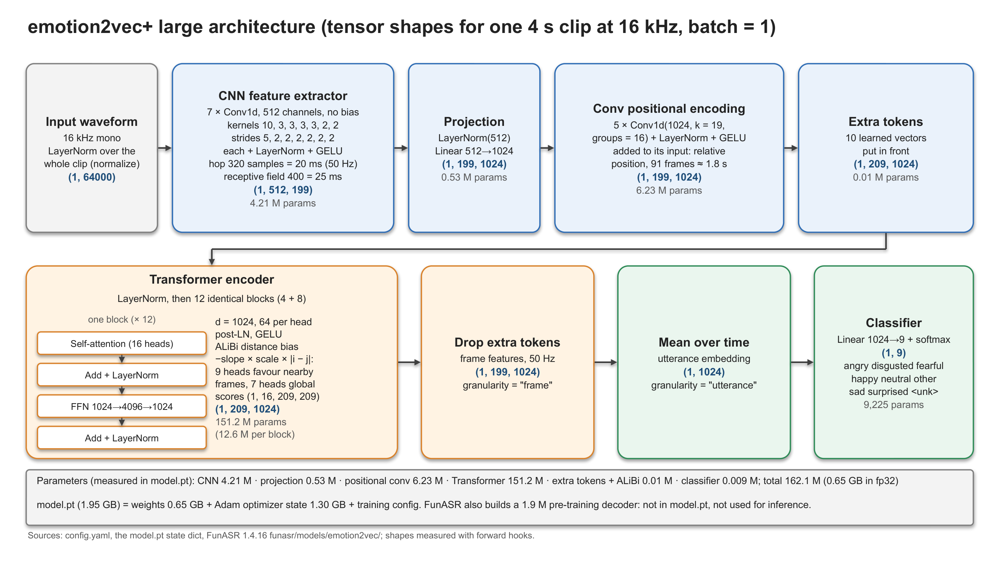

# The emotion2vec+ large Model

English translation of [emotion2vec_plus_large.md](emotion2vec_plus_large.md) (Chinese); the two have the same content. How much data and compute fine-tuning needs: [finetuning_emotion2vec_plus_large_en.md](finetuning_emotion2vec_plus_large_en.md).

Date: 2026-10-28. Subject: [emotion2vec_plus_large](https://huggingface.co/emotion2vec/emotion2vec_plus_large), as this project runs it with FunASR 1.4.16.

Method: the architecture and parameter counts come from the local `config.yaml`, `model.pt` (same SHA-256 as the file on Hugging Face) and the FunASR 1.4.16 code in
[`funasr/models/emotion2vec/`](https://github.com/modelscope/FunASR/tree/main/funasr/models/emotion2vec); tensor shapes were measured with forward hooks on the M4 Max.
Training information comes from the paper, the model cards, the official GitHub repository and the training configuration saved inside `model.pt`. "Unverified" marks what could not be confirmed
from a primary source; "inferred" marks conclusions drawn from the files and configuration that the authors have not confirmed.

## 0. Key points

- **What it does**: takes 16 kHz mono speech and outputs one probability per class for the whole clip, over 9 classes: angry, disgusted, fearful, happy, neutral, other, sad, surprised, `<unk>`.
  It can also output 1024-dimensional frame features (one every 20 ms) or one 1024-dimensional embedding for the clip.
- **Architecture**: a 7-layer CNN (downsamples the waveform 320×) → projection to 1024 dimensions → 5-layer convolutional positional encoding → 12 Transformer blocks (1024 dimensions, 16 heads,
  FFN 4096, ALiBi distance bias in the attention) → mean over all frames → Linear(1024→9) + softmax.
- **Size**: the weights used for inference have **162.1 M** parameters (about 0.65 GB in fp32). The "~300M" on the model card does not match the file: the configuration is essentially that of data2vec
  2.0 Large with half the depth (12 blocks instead of 24); the 24-block version would have 313 M (computed from the configuration).
- **Why model.pt is 1.95 GB**: besides 0.65 GB of weights it holds 1.30 GB of Adam optimizer state and the fairseq training configuration; there is no EMA teacher and no decoder. Inference uses only
  the weights.
- **Training**: emotion2vec was first pre-trained self-supervised on 262 h of unlabelled emotional speech (data2vec 2.0 style). emotion2vec+ was then trained with labels in three generations: seed
  (academic data from EmoBox, 201 h) → base (pseudo-labels, 4,788 h) → large (pseudo-labels, 42,526 h, about 40k hours kept out of about 160k). The sources of the pseudo-labelled data, the filtering
  rules and the training compute are not published.
  The configuration in `model.pt` shows that the last stage of large ran 13,669 updates on 8 GPUs (type not recorded) on data named `emo_box_fix`.
- **Measured in this project**: 85.5–92.5% accuracy on datasets that are in EmoBox, only 40.8–61.3% on datasets that are not. MPS cannot process clips longer than 20.48 s (the scripts switch to
  the CPU); memory grows roughly with the square of the clip length.
- **Licence**: the Hugging Face model card points to the FunASR model licence (use, modify and share, including fine-tuned models, with attribution and keeping the model name); the ModelScope
  model card says Apache-2.0. The two do not agree.

## 1. What it does

FunASR's `inference()` (`model.py`) runs these steps for each file:

1. Read the audio and convert it to 16 kHz mono.
2. Apply `layer_norm` to the whole waveform (`normalize: true`): subtract the mean, divide by the standard deviation; no learned parameters.
3. `extract_features()`: CNN → projection → positional encoding → 10 extra tokens added → 12 Transformer blocks. No masking at inference.
4. Drop the extra tokens: frame features (T, 1024), one frame every 20 ms (returned by `granularity="frame"`).
5. Average over time: a 1024-dimensional utterance embedding (returned by `granularity="utterance"`). Every frame has the same weight, pauses included.
6. `proj`: Linear(1024→9), then softmax: 9 probabilities, in the order of `tokens.txt`.

- One input gets one label, however long it is. The author advises cutting the audio with a VAD into semantically complete segments, and says that the model was trained on variable-length
  segments ([issue #30](https://github.com/ddlBoJack/emotion2vec/issues/30)).
- `extract_embedding=True` also returns the features; `False` returns only the labels and probabilities.
- What `other` and `<unk>` (called unknown on the model card) mean is not defined anywhere public.

## 2. Architecture

Editable PowerPoint file: [figures/emotion2vec_plus_large_architecture.pptx](figures/emotion2vec_plus_large_architecture.pptx) (slide 1 in Chinese, slide 2 in English).

| Module (name in FunASR) | Configuration (`config.yaml` and code) | Output shape for a 4 s clip | Parameters |
|---|---|---|---|
| Waveform normalisation | `layer_norm` over the whole clip | (1, 64000) | 0 |
| CNN feature extractor (`local_encoder`) | 7 × Conv1d, 512 channels, no bias; kernels 10, 3, 3, 3, 3, 2, 2, strides 5, 2, 2, 2, 2, 2, 2; each followed by LayerNorm + GELU. Total stride 320 samples = 20 ms (50 Hz), receptive field 400 samples = 25 ms | (1, 512, 199) | 4,206,592 |
| Projection (`project_features`) | LayerNorm(512) + Linear 512→1024 | (1, 199, 1024) | 526,336 |
| Convolutional positional encoding (`relative_positional_encoder`) | 5 × Conv1d(1024→1024, kernel 19, groups 16) + LayerNorm (no learned parameters) + GELU, added to its input; receptive field 91 frames ≈ 1.8 s | (1, 199, 1024) | 6,231,040 |
| Extra tokens (`extra_tokens`) | 10 learned vectors put in front of the sequence. Used for the utterance-level loss in pre-training (the paper's chunk embedding); dropped before pooling at inference | (1, 209, 1024) | 10,240 |
| ALiBi scales (`alibi_scale`) | one per head, shared by the 12 blocks (see below) | attention scores (1, 16, 209, 209) in every block | 16 |
| Transformer (`context_encoder`'s LayerNorm and 4 blocks, then the 8 `blocks`) | 12 identical blocks: d = 1024, 16 heads × 64, FFN 1024→4096→1024 (GELU), QKV with bias; post-LN: x = LN(x + Attn(x)), x = LN(x + FFN(x)); dropout 0.1, active only in training | (1, 209, 1024) | 151,156,736 (12,596,224 per block) |
| Drop extra tokens, average over time | no parameters | (1, 199, 1024) → (1, 1024) | 0 |
| Classifier (`proj`) | Linear 1024→9, then softmax | (1, 9) | 9,225 |
| **Total (inference)** | | | **162,140,185** |

- Number of frames = ⌊(samples − 400) / 320⌋ + 1, so 4 s gives 199 frames, not 200.
- The paper's text swaps kernels and strides (kernels (5, 2, …), strides (10, 3, …)). The table follows `config.yaml` and the code.
- 4 + 8 is only the code structure (data2vec 2.0's "modality-specific" and "shared" blocks); for an audio-only model it is 12 identical blocks in a row. There is no final LayerNorm
  (`layer_norm_first: false`).
- **Position information** comes from two sources, neither an absolute position embedding, so the input length has no hard
  limit: the convolutional positional encoding (each frame sees about 0.9 s on either side) and ALiBi, a distance penalty on
  the attention scores with one learned scale per head. In this file 9 heads favour nearby frames (within about 0.05–2.4 s)
  and 7 heads have no penalty and look at the whole input.
- Attention is computed explicitly (`q @ kᵀ`, softmax in fp32): every block has a 16 × N × N score matrix (N = frames + 10), so memory grows roughly with the square of the length (section 5).
- **Where the configuration comes from**: it is data2vec 2.0 Large's audio configuration
  ([`large_audio_only_task.yaml`](https://github.com/facebookresearch/fairseq/blob/main/examples/data2vec/config/v2/large_audio_only_task.yaml)) with the depth halved: 12 blocks instead of 24.

## 3. Size

### 3.1 What is in model.pt

`model.pt` (1,945,790,254 bytes) is a fairseq training checkpoint:

| Top-level key | Content | Elements | Size (fp32) |
|---|---|---|---|
| `model` | the weights, 185 tensors | 162,140,185 | 648.6 MB |
| `last_optimizer_state` | Adam's `exp_avg` and `exp_avg_sq`, each one vector as long as all the weights (update 13,669) | 324,280,370 | 1,297.1 MB |
| `cfg`, `optimizer_history`, `extra_state`, `task_state` | training configuration, training progress, label table | — | < 0.1 MB |
| **Total** | | | **≈ 1,945.8 MB** |

The parameters in `model`, by prefix:

| Prefix | Parameters |
|---|---|
| `d2v_model.modality_encoders.AUDIO.local_encoder` (CNN) | 4,206,592 |
| `…AUDIO.project_features` (projection) | 526,336 |
| `…AUDIO.relative_positional_encoder` (convolutional positional encoding) | 6,231,040 |
| `…AUDIO.extra_tokens`, `…AUDIO.alibi_scale` | 10,240, 16 |
| `…AUDIO.context_encoder` (LayerNorm + 4 blocks) | 50,386,944 |
| `d2v_model.blocks` (8 blocks) | 100,769,792 |
| `proj` (classifier) | 9,225 |
| **Total** | **162,140,185** |

- No EMA teacher (the training configuration has `ema.store_ema: false`) and no weights of the pre-training decoder.
- FunASR builds a 1,908,736-parameter decoder from `config.yaml` (used only in pre-training). It is not in `model.pt` and not used for inference, which is why FunASR reports 164.0 M. This project's
  scripts skip it with `excludes`.
- Inference needs only the 162.1 M weights: 0.65 GB in fp32, about 0.32 GB in fp16. Without the optimizer state the file would shrink to about 0.65 GB (computed, not done).
- Layers: 7 CNN convolutions + 5 positional convolutions + 12 Transformer blocks + 1 linear classifier.

### 3.2 Compared with seed and base

| Model | Size on the model card | Architecture (`config.yaml`) | Inference parameters | `model.pt` size |
|---|---|---|---|---|
| emotion2vec (base, self-supervised only) | paper: 93.79 M (with decoder) | 768 dimensions, 12 heads, 4 + 8 blocks | 93.2 M (computed from the configuration; 93.8 M with the decoder) | 1.13 GB (`emotion2vec_base.pt`) |
| emotion2vec+ seed | not given | same | 93.2 M (computed) | 1.12 GB |
| emotion2vec+ base | ~90M | same | 93.2 M (computed) | 1.12 GB |
| emotion2vec+ large | ~300M | 1024 dimensions, 16 heads, 4 + 8 blocks | **162.1 M (measured)** | 1.95 GB |

- seed and base have identical `config.yaml` files. Their file sizes are about 12 bytes × 93.2 M, consistent with "weights + Adam state" (inferred; not downloaded to check).
- large has as many blocks as base, with 1.78 times the parameters per block (1024² / 768²). Forward compute for a 4 s clip: base 58.3 GFLOP, large 87.6 GFLOP (measured with PyTorch's FLOP counter).

## 4. Training

### 4.1 Step 1: self-supervised pre-training of emotion2vec (paper)

| Item | Content |
|---|---|
| Initialisation | data2vec 2.0 base (self-supervised on LibriSpeech 960 h). The paper also tried data2vec; data2vec 2.0 was better |
| Data | 262 h of unlabelled English emotional speech, 169,053 utterances: [IEMOCAP](https://sail.usc.edu/iemocap/) 7.0 h, [MELD](https://affective-meld.github.io/) 12.2 h, [CMU-MOSEI](http://multicomp.cs.cmu.edu/resources/cmu-mosei-dataset/) 91.9 h, [MEAD](https://github.com/uniBruce/Mead) 37.3 h, [MSP-Podcast](https://www.lab-msp.com/MSP/MSP-Podcast.html) v1.8 113.5 h |
| Method | Online distillation: the teacher is an EMA of the student (τ rises linearly from 0.999 to 0.99999). Frame-level loss: on masked frames, the student regresses the average output of the teacher's top 8 blocks (as in data2vec 2.0). Utterance-level loss: learned chunk embedding tokens regress the time average of the teacher's output. Total loss = frame-level + 1 × utterance-level. Masking: each frame starts a 5-frame masked span with probability 0.5 |
| Compute | 4 NVIDIA A10 GPUs, update frequency 4 (simulating 16 GPUs), 100 epochs of about 37 minutes, i.e. about 62 h and about 250 A10 GPU-hours (these two numbers are my multiplication); at most 1e6 tokens per batch (in fairseq's audio tasks a token is a sample, so 62.5 s of audio); Adam, learning rate 7.5e-5, weight decay 0.01, cosine schedule with 5% warm-up |
| Result | Frozen encoder plus two trained linear layers (hidden size 256): IEMOCAP WA 71.79% (leave-one-session-out), against 68.58% from data2vec 2.0 |

### 4.2 Step 2: the emotion2vec+ data iterations (model cards and GitHub)

| Version | Fine-tuning data | Duration | Notes |
|---|---|---|---|
| seed | academic emotion data from [EmoBox](https://github.com/emo-box/EmoBox) | 201 h | EmoBox has 32 datasets, 14 languages, 262,020 utterances, 294.4 h ([EmoBox paper](https://arxiv.org/abs/2406.07162)). Which subsets and splits seed used is not published ([issue #77](https://github.com/ddlBoJack/emotion2vec/issues/77), unanswered) |
| base | filtered large-scale pseudo-labelled data | 4,788 h | the author says the pseudo-labels came from seed ([issue #46](https://github.com/ddlBoJack/emotion2vec/issues/46)) |
| large | filtered large-scale pseudo-labelled data | 42,526 h | "40k out of 160k hours of speech emotion data"; the Chinese ModelScope card says "最终我们获得四万小时情感数据" (in the end we obtained 40,000 hours of emotion data) |

- Method: each generation is "derived from the data of its predecessor": more speech is pseudo-labelled, filtered, and used to train the next generation. base's pseudo-labels came from seed;
  which model labelled the data of large is not stated. The authors wrote "Details of data engineering will be announced later"; as of 2026-10-28 nothing has been published (the GitHub repository's
  last commit is from 2024-12-23).
- What the predecessor did: for emotion2vec_base_finetuned, released in January 2024, the [ModelScope card](https://www.modelscope.cn/models/iic/emotion2vec_base_finetuned) says that emotion2vec
  was first fine-tuned on academic emotion data, then 150k hours of Chinese and English speech were labelled, only data whose text emotion and speech emotion agreed with high confidence was kept
  (more than 10k hours), and emotion2vec was fine-tuned again. Whether emotion2vec+ used the same rule is not stated (unverified).
- The author says the emotion2vec+ models are "fully finetuned" on emotion data (all layers trained, [issue #64](https://github.com/ddlBoJack/emotion2vec/issues/64)).
- Not published: the sources, languages and recording conditions of the 160k hours, the pseudo-label thresholds, and the training compute of seed, base and large. Nor is the initialisation of large:
  it is 1024-dimensional, so it cannot have been initialised directly from the 768-dimensional emotion2vec.

### 4.3 What model.pt itself records

The fairseq configuration (`cfg`) and training progress saved in `model.pt` describe the **last training stage** of large:

| Item | Recorded |
|---|---|
| Task | classification fine-tuning (fairseq `audio_classification`, `prediction_mode: average_before`: frames averaged first, then the linear layer, as at inference) |
| Data | manifest folder `emo_box_fix`, training subset `train_full2`, validation subset `dev` |
| Starting point | the best checkpoint of a run named `randn_large_fake_zh_en_v4_noshuf`, which trained for 255,000 updates (`optimizer_history`); that run's backbone came from `randn_large_ser_tts_msp_fake_zh_en2/checkpoint_1_1.pt` |
| Length | 13,669 updates, 30 epochs, 5,272,942 clips in total (about 176k clips per epoch, about 386 per update) |
| Hardware | `distributed_world_size: 8` with 4 per node, i.e. 2 × 4 GPUs; GPU type not recorded; fp16 |
| Optimizer | Adam (β = 0.9/0.98, ε = 1e-8, weight decay 0), learning rate 6e-5, cosine schedule with 20,000 warm-up updates, planned 300,000 updates. The released checkpoint stopped at update 13,669, still in warm-up (recorded learning rate 4.1e-5) |
| Batch | at most 2,000,000 samples (125 s of audio) per GPU, `update_freq` 2, so at most about 2,000 s (33 minutes) of audio per update |
| Clip length | `max_sample_size` 320,000 (20 s; longer clips are cropped), `min_sample_size` 16,000 (1 s; shorter clips are skipped) |
| Augmentation and regularisation | waveform mixup (`source_mixup: 0.5`, `label_mixup: false`), masking during training (`apply_mask: true`), layerdrop 0.1, dropout 0.1, attention dropout 0.2 |

Inferred (unverified):
- `fake` most likely means pseudo-labelled data and `emo_box_fix` EmoBox (about 176k clips per epoch matches the size of
  EmoBox's training part). So large was probably trained for 255,000 updates on Chinese and English pseudo-labelled data,
  then for a last 13,669 updates on EmoBox.
- The backbone comes from `checkpoint_1_1.pt` of a run whose name starts with `randn`, which suggests that it started from
  nearly random weights and was trained directly with (pseudo-)labels, not from a self-supervised model.
- `extra_state` records a cumulative training time of about 94 h; if both stages used 8 GPUs, that is about 750 GPU-hours.
  The GPU type is not recorded.

## 5. Practical notes from this project

**Accuracy** ([summary report](../reports/emotion2vec_plus_large/summary.md), 2026-10-27, scored against the acted emotion):

| Dataset | Language | In EmoBox | Accuracy | 4 shared emotions only |
|---|---|---|---|---|
| CREMA-D | English | yes | 86.5% | 93.2% |
| RAVDESS | English | yes | 92.1% | 92.5% |
| TESS | English | yes | 85.5% | 100.0% |
| JL-Corpus | English (New Zealand) | yes | 92.5% | 94.7% |
| MCAE-SPPS | Mandarin | no | 61.3% | 87.8% |
| MESS | English | no | 40.8% | 40.8% |

The model has probably seen the datasets that are in EmoBox, so their results are optimistic; the others are closer to real performance.

**Length and devices**:
- MPS: when the first convolution (kernel 10, stride 5) has more than 65,536 output steps it raises `NotImplementedError: Output channels > 65536 not supported at the MPS device`. The threshold is
  327,685 samples (20.48 s); 20.4 s runs, 20.5 s fails (measured). This project's scripts catch the error and run such clips on the CPU.
- Memory: peak extra memory for one clip on the CPU is about 0.3 GB at 16 s, 2.3 GB at 60 s and 9.3 GB at 120 s; time 0.38 s, 1.9 s and 6.7 s (M4 Max, 12 threads). Measurements for 2–16 s on
  CPU and MPS, and memory during training, are in section 3 of the fine-tuning document.
- The author says feature extraction with emotion2vec needs at most 2–3 GB of GPU memory; a user who ran out of memory had fed a whole dialogue at once
  ([issue #7](https://github.com/ddlBoJack/emotion2vec/issues/7)).
- In the last training stage of large, clips were cropped to at most 20 s (section 4.3), so longer inputs are outside the training distribution.

**Licence**: the Hugging Face model card points to the [FunASR Model Open Source License Agreement 1.1](https://github.com/modelscope/FunASR/blob/main/MODEL_LICENSE): use,
modification and sharing are allowed (fine-tuned models included) with attribution and the model name kept; ModelScope
says Apache-2.0; the emotion2vec GitHub shows an MIT badge but has no LICENSE file. They disagree; following the stricter
FunASR licence is the safe choice (not legal advice).

## 6. Main sources

- Local files: `config.yaml`, `model.pt`, `tokens.txt`, `README.md` in `models/emotion2vec_plus_large/` (present after download, not in git); the same files: https://huggingface.co/emotion2vec/emotion2vec_plus_large/tree/main
- FunASR 1.4.16 code: https://github.com/modelscope/FunASR/tree/main/funasr/models/emotion2vec (`model.py`, `audio.py`, `base.py`, `modules.py`)
- Model cards: https://huggingface.co/emotion2vec/emotion2vec_plus_large , https://huggingface.co/emotion2vec/emotion2vec_plus_base , https://huggingface.co/emotion2vec/emotion2vec_plus_seed , https://huggingface.co/emotion2vec/emotion2vec_base ; ModelScope: https://modelscope.cn/models/iic/emotion2vec_plus_large , https://www.modelscope.cn/models/iic/emotion2vec_base_finetuned
- Official GitHub: https://github.com/ddlBoJack/emotion2vec ; issues #7, #30, #46, #64, #77
- emotion2vec paper: https://arxiv.org/abs/2312.15185 (ACL 2024 Findings: https://aclanthology.org/2024.findings-acl.931/ )
- EmoBox: https://arxiv.org/abs/2406.07162 (Interspeech 2024), https://github.com/emo-box/EmoBox
- data2vec 2.0: https://arxiv.org/abs/2212.07525 ; fairseq configurations: https://github.com/facebookresearch/fairseq/tree/main/examples/data2vec/config/v2
- fairseq code used to read the checkpoint configuration: https://github.com/facebookresearch/fairseq/blob/main/examples/data2vec/models/audio_classification.py , https://github.com/facebookresearch/fairseq/blob/main/fairseq/trainer.py , https://github.com/facebookresearch/fairseq/blob/main/fairseq/data/iterators.py
- FunASR model licence: https://github.com/modelscope/FunASR/blob/main/MODEL_LICENSE
- This project's evaluation: [../reports/emotion2vec_plus_large/summary.md](../reports/emotion2vec_plus_large/summary.md)
