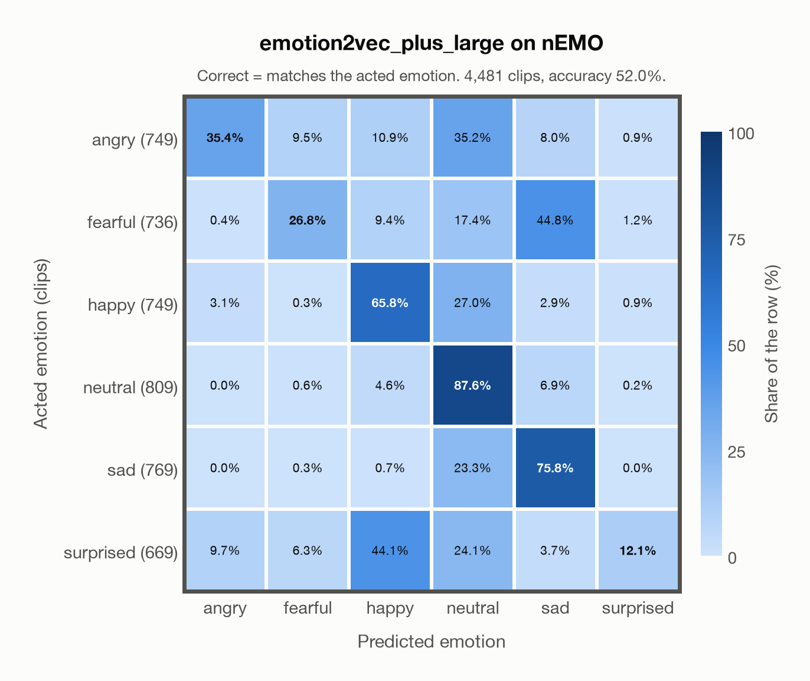

# emotion2vec_plus_large on nEMO

> **Archived on 2026-10-28.** nEMO (Polish) is no longer part of the evaluation (`evaluation.exclude` in config/config.yaml), so this report is kept as it was. Its per-clip predictions moved to `outputs/archive/emotion2vec_plus_large/`.

Generated by `scripts/evaluate.py` on 2026-10-23.

## Summary

| Metric | Value |
|---|---|
| Clips evaluated | 4,481 (Polish) |
| **Accuracy: prediction matches the acted emotion** | **52.0%** |
| Unweighted accuracy (mean recall of the 6 acted emotions) | 50.6% |
| Macro F1 (acted emotion) | 47.4% |
| Accuracy, all 9 model classes (acted emotion) | 46.7% |
| Chance level (6 emotions) | 16.7% |

## Setup

- **Model**: `emotion2vec_plus_large` as released (no fine-tuning), FunASR 1.4.16, one prediction per clip.
- **Data**: 4,481 clips of nEMO (Polish) from `data/nemo/`.
- **Ground truth (acted emotion)**: the emotion each speaker was asked to portray (`emotion`).
- Label mapping: anger = angry, fear = fearful, happiness = happy, sadness = sad, surprised = surprised, neutral = neutral.
- **6 emotions**: the prediction is the most probable of the 6 emotions in this dataset (angry, fearful, happy, neutral, sad, surprised); the model's other classes (`disgusted`, `other`, `<unk>`) are ignored. **All 9 classes**: the prediction is the most probable of all nine classes, so choosing a class that the dataset does not have counts as wrong.
- **Hardware**: Apple M4 Max, device `cpu`, PyTorch 2.5.1. Inference took 5.1 min (69 ms per clip).
- **Per-clip predictions**: `outputs/archive/emotion2vec_plus_large/nemo_predictions.csv` (not in git; re-run the script to recreate it). The JSON file next to it describes the columns.

## Results per emotion

Rows: acted emotion. Precision, recall and F1 compare the prediction with the acted emotion.

| Emotion | Clips | Precision | Recall | F1 |
|---|---|---|---|---|
| angry | 749 | 74.4% | 35.4% | 48.0% |
| fearful | 736 | 61.8% | 26.8% | 37.3% |
| happy | 749 | 50.3% | 65.8% | 57.0% |
| neutral | 809 | 43.2% | 87.6% | 57.8% |
| sad | 769 | 54.2% | 75.8% | 63.2% |
| surprised | 669 | 76.4% | 12.1% | 20.9% |

## Confusion matrix: acted emotion

The same numbers as a table. Rows: acted emotion. Columns: predicted emotion. Each row adds up to 100%.

| Acted \ Predicted | angry | fearful | happy | neutral | sad | surprised |
|---|---|---|---|---|---|---|
| angry (749) | **35.4%** | 9.5% | 10.9% | 35.2% | 8.0% | 0.9% |
| fearful (736) | 0.4% | **26.8%** | 9.4% | 17.4% | 44.8% | 1.2% |
| happy (749) | 3.1% | 0.3% | **65.8%** | 27.0% | 2.9% | 0.9% |
| neutral (809) | 0.0% | 0.6% | 4.6% | **87.6%** | 6.9% | 0.2% |
| sad (769) | 0.0% | 0.3% | 0.7% | 23.3% | **75.8%** | 0.0% |
| surprised (669) | 9.7% | 6.3% | 44.1% | 24.1% | 3.7% | **12.1%** |

Most frequent confusions: fearful predicted as sad (44.8%), surprised predicted as happy (44.1%), angry predicted as neutral (35.2%).

## Predictions outside the 6 emotions

With all nine classes, the model chose a class that this dataset does not have for 614 clips (13.7%): `disgusted` 379, `other` 206, `<unk>` 29.

## Caveats

- **Not in EmoBox**, so emotion2vec+ seed was not fine-tuned on it. emotion2vec+ large was later trained on 40k hours of pseudo-labelled data whose sources are not published, so earlier exposure cannot be ruled out completely.
- No listeners' labels are published: listeners only screened the recordings, so there is one way of counting a prediction as correct.
- Recorded at home (24 kHz); only 3 of the 9 speakers are professional voice actors.
