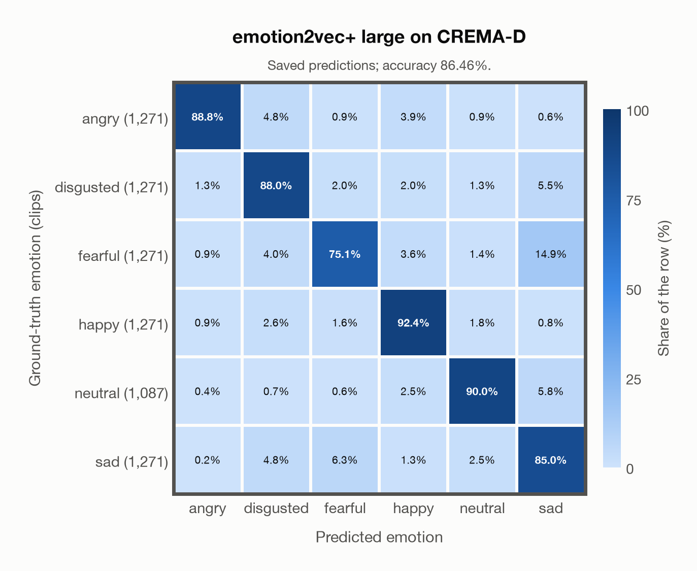

# emotion2vec+ large on CREMA-D

Regenerated offline from saved CSV/JSON by `scripts/evaluation/refresh_reports.py`. This refresh performs no model inference or API requests.

## Summary

| Metric | Recomputed value |
|---|---:|
| Clips | 7,442 |
| Accuracy: acted emotion | 86.46% |
| UAR: mean ground-truth-row recall | 86.54% |
| Macro F1 | 86.57% |
| Weighted F1: true-support weighted | 86.48% |
| Accuracy: all model classes | 86.43% |
| Accuracy: acted emotion or listener vote | 89.64% |
| Single listener vote vs acted emotion | 45.59% |
| Model vs single listener vote | 44.81% |

## Imported run and verification

- Source: [prediction CSV](../../outputs/emotion2vec_plus_large/crema_d_predictions.csv) and [metadata JSON](../../outputs/emotion2vec_plus_large/crema_d_predictions.json); both remain byte-for-byte unchanged.
- Original execution date recorded in JSON: `2026-10-23`.
- Dataset scope recorded in JSON: **CREMA-D**, English; 7,442 / 7,442 clips.
- Ground-truth column: `acted_emotion`. Candidate classes: angry, disgusted, fearful, happy, neutral, sad.
- Row counts, unique audio paths, correctness flags and saved metrics were checked against the CSV. Metric agreement tolerance is 0.000001 (six-decimal metadata).
- Weighted F1 weights each class's F1 by its true support, using the same resolved truth as macro F1; invalid answers remain errors. New metrics absent from the source JSON are recorded in the offline audit and summaries; the source JSON is preserved.

## Results per emotion

| Ground-truth emotion | Clips | Recall | Acted-or-listener recall |
|---|---:|---:|---:|
| angry | 1,271 | 88.83% | 91.58% |
| disgusted | 1,271 | 88.04% | 91.42% |
| fearful | 1,271 | 75.06% | 80.57% |
| happy | 1,271 | 92.37% | 94.96% |
| neutral | 1,087 | 89.97% | 90.25% |
| sad | 1,271 | 84.97% | 89.14% |

Precision/F1 use the same resolved-truth convention as the evaluation script. Weighted F1 uses the resolved-truth clip counts below as weights.

| Predicted emotion | Resolved-truth clips | Precision | Recall | F1 |
|---|---:|---:|---:|---:|
| angry | 1,271 | 96.17% | 88.83% | 92.35% |
| disgusted | 1,271 | 83.95% | 88.04% | 85.94% |
| fearful | 1,271 | 86.89% | 75.06% | 80.54% |
| happy | 1,271 | 87.81% | 92.37% | 90.03% |
| neutral | 1,087 | 90.64% | 89.97% | 90.30% |
| sad | 1,271 | 76.00% | 84.97% | 80.24% |

## Confusion matrix: acted emotion

| Ground truth \ Predicted | angry | disgusted | fearful | happy | neutral | sad |
|---|---|---|---|---|---|---|
| angry (1,271) | **88.8%** | 4.8% | 0.9% | 3.9% | 0.9% | 0.6% |
| disgusted (1,271) | 1.3% | **88.0%** | 2.0% | 2.0% | 1.3% | 5.5% |
| fearful (1,271) | 0.9% | 4.0% | **75.1%** | 3.6% | 1.4% | 14.9% |
| happy (1,271) | 0.9% | 2.6% | 1.6% | **92.4%** | 1.8% | 0.8% |
| neutral (1,087) | 0.4% | 0.7% | 0.6% | 2.5% | **90.0%** | 5.8% |
| sad (1,271) | 0.2% | 4.8% | 6.3% | 1.3% | 2.5% | **85.0%** |

## Confusion matrix: acted emotion or listener vote

A prediction accepted only through the listener vote is placed in that predicted emotion's row; other clips keep their original ground-truth row. Row supports can therefore change.

| Ground truth \ Predicted | angry | disgusted | fearful | happy | neutral | sad |
|---|---|---|---|---|---|---|
| angry (1,256) | **91.5%** | 3.3% | 0.7% | 3.6% | 0.2% | 0.6% |
| disgusted (1,261) | 0.6% | **91.4%** | 1.6% | 1.9% | 0.1% | 4.4% |
| fearful (1,227) | 0.6% | 3.8% | **79.9%** | 3.3% | 0.2% | 12.3% |
| happy (1,249) | 0.3% | 2.6% | 1.4% | **94.9%** | 0.1% | 0.8% |
| neutral (1,176) | 0.3% | 0.7% | 0.5% | 2.3% | **91.0%** | 5.2% |
| sad (1,273) | 0.2% | 4.1% | 5.2% | 1.3% | 0.2% | **89.2%** |

## Caveats

- **Training involvement for emotion2vec+ large: Used via upstream training**. Evidence scope: upstream teacher lineage. Author documents EmoBox seed training and iterative pseudo-label lineage into large; the exact seed corpus subset and raw-audio/weight inheritance into large are not enumerated. Source: EmoBox academic data is used for seed fine-tuning, followed by teacher pseudo-labelling and data iteration to large; this project counts those corpora as used through upstream training. Large also uses 42,526 h of industrial pseudo-labelled audio. This is distinct from a claim that every EmoBox corpus directly entered large encoder self-supervised pretraining. Direct use and upstream teacher use both count as training involvement. No pattern: no corpus-specific evidence, not verified unseen. Corpus use is not test-clip leakage.
- The known empty CREMA-D recording 1076_MTI_SAD_XX.wav is retained in the saved predictions, matching the existing project evaluation scope.
- Internal CSV/JSON consistency does not authenticate the original model or remote request logs.

[Offline validation audit](crema_d_offline_audit.json)
