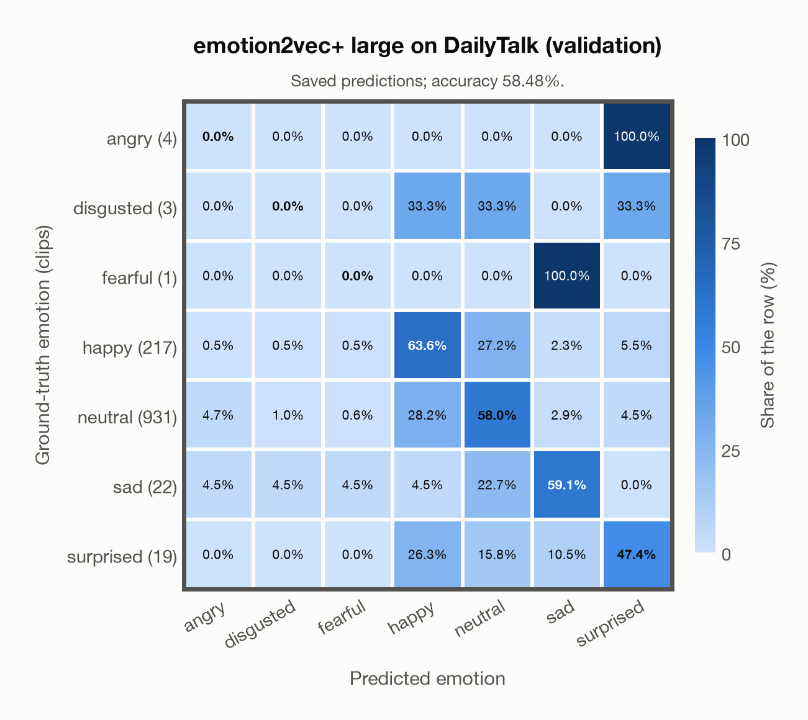

# emotion2vec+ large on DailyTalk (validation)

Regenerated offline from saved CSV/JSON by `scripts/evaluation/refresh_reports.py`. This refresh performs no model inference or API requests.

## Summary

| Metric | Recomputed value |
|---|---:|
| Clips | 1,197 |
| Accuracy: acted emotion | 58.48% |
| UAR: mean ground-truth-row recall | 32.58% |
| Macro F1 | 24.60% |
| Weighted F1: true-support weighted | 63.60% |
| Accuracy: all model classes | 53.47% |

## Imported run and verification

- Source: [prediction CSV](../../outputs/emotion2vec_plus_large/dailytalk_predictions.csv) and [metadata JSON](../../outputs/emotion2vec_plus_large/dailytalk_predictions.json); both remain byte-for-byte unchanged.
- Original execution date recorded in JSON: `2026-11-10`.
- Dataset scope recorded in JSON: **DailyTalk (validation)**, English; 1,197 / 1,197 clips.
- Ground-truth column: `acted_emotion`. Candidate classes: angry, disgusted, fearful, happy, neutral, sad, surprised.
- Row counts, unique audio paths, correctness flags and saved metrics were checked against the CSV. Metric agreement tolerance is 0.000001 (six-decimal metadata).
- Weighted F1 weights each class's F1 by its true support, using the same resolved truth as macro F1; invalid answers remain errors. New metrics absent from the source JSON are recorded in the offline audit and summaries; the source JSON is preserved.
- Original execution/client runtime metadata (reported by the imported run, not measured by this refresh): `{"device": "cpu", "hardware": "Apple M3 Pro", "seconds": 164.1, "ms_per_clip": 137.1, "on_cpu": 0}`.

## Results per emotion

| Ground-truth emotion | Clips | Recall | Acted-or-listener recall |
|---|---:|---:|---:|
| angry | 4 | 0.00% | — |
| disgusted | 3 | 0.00% | — |
| fearful | 1 | 0.00% | — |
| happy | 217 | 63.59% | — |
| neutral | 931 | 58.00% | — |
| sad | 22 | 59.09% | — |
| surprised | 19 | 47.37% | — |

Precision/F1 use the same resolved-truth convention as the evaluation script. Weighted F1 uses the resolved-truth clip counts below as weights.

| Predicted emotion | Resolved-truth clips | Precision | Recall | F1 |
|---|---:|---:|---:|---:|
| angry | 4 | 0.00% | 0.00% | 0.00% |
| disgusted | 3 | 0.00% | 0.00% | 0.00% |
| fearful | 1 | 0.00% | 0.00% | 0.00% |
| happy | 217 | 33.82% | 63.59% | 44.16% |
| neutral | 931 | 88.82% | 58.00% | 70.18% |
| sad | 22 | 27.08% | 59.09% | 37.14% |
| surprised | 19 | 13.24% | 47.37% | 20.69% |

## Confusion matrix: acted emotion

| Ground truth \ Predicted | angry | disgusted | fearful | happy | neutral | sad | surprised |
|---|---|---|---|---|---|---|---|
| angry (4) | **0.0%** | 0.0% | 0.0% | 0.0% | 0.0% | 0.0% | 100.0% |
| disgusted (3) | 0.0% | **0.0%** | 0.0% | 33.3% | 33.3% | 0.0% | 33.3% |
| fearful (1) | 0.0% | 0.0% | **0.0%** | 0.0% | 0.0% | 100.0% | 0.0% |
| happy (217) | 0.5% | 0.5% | 0.5% | **63.6%** | 27.2% | 2.3% | 5.5% |
| neutral (931) | 4.7% | 1.0% | 0.6% | 28.2% | **58.0%** | 2.9% | 4.5% |
| sad (22) | 4.5% | 4.5% | 4.5% | 4.5% | 22.7% | **59.1%** | 0.0% |
| surprised (19) | 0.0% | 0.0% | 0.0% | 26.3% | 15.8% | 10.5% | **47.4%** |

## Caveats

- **Training involvement for emotion2vec+ large: No corpus-specific evidence**. Source: EmoBox academic data is used for seed fine-tuning, followed by teacher pseudo-labelling and data iteration to large; this project counts those corpora as used through upstream training. Large also uses 42,526 h of industrial pseudo-labelled audio. This is distinct from a claim that every EmoBox corpus directly entered large encoder self-supervised pretraining. Direct use and upstream teacher use both count as training involvement. No pattern: no corpus-specific evidence, not verified unseen. Corpus use is not test-clip leakage.
- Internal CSV/JSON consistency does not authenticate the original model or remote request logs.

[Offline validation audit](dailytalk_offline_audit.json)
