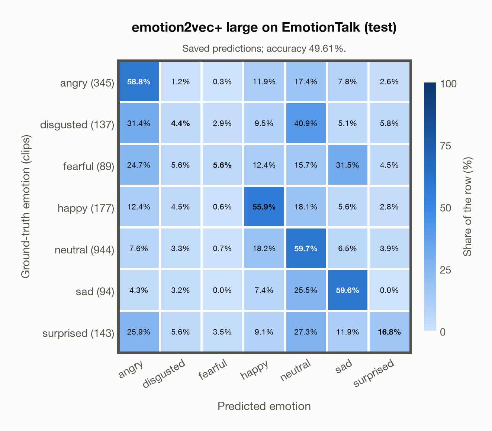

# emotion2vec+ large on EmotionTalk (test)

Regenerated offline from saved CSV/JSON by `scripts/evaluation/refresh_reports.py`. This refresh performs no model inference or API requests.

## Summary

| Metric | Recomputed value |
|---|---:|
| Clips | 1,929 |
| Accuracy: acted emotion | 49.61% |
| UAR: mean ground-truth-row recall | 37.27% |
| Macro F1 | 32.80% |
| Weighted F1: true-support weighted | 49.17% |
| Accuracy: all model classes | 49.30% |

## Imported run and verification

- Source: [prediction CSV](../../outputs/emotion2vec_plus_large/emotiontalk_predictions.csv) and [metadata JSON](../../outputs/emotion2vec_plus_large/emotiontalk_predictions.json); both remain byte-for-byte unchanged.
- Original execution date recorded in JSON: `2026-11-10`.
- Dataset scope recorded in JSON: **EmotionTalk (test)**, Mandarin; 1,929 / 1,929 clips.
- Ground-truth column: `acted_emotion`. Candidate classes: angry, disgusted, fearful, happy, neutral, sad, surprised.
- Row counts, unique audio paths, correctness flags and saved metrics were checked against the CSV. Metric agreement tolerance is 0.000001 (six-decimal metadata).
- Weighted F1 weights each class's F1 by its true support, using the same resolved truth as macro F1; invalid answers remain errors. New metrics absent from the source JSON are recorded in the offline audit and summaries; the source JSON is preserved.
- Original execution/client runtime metadata (reported by the imported run, not measured by this refresh): `{"device": "cpu", "hardware": "Apple M3 Pro", "seconds": 355.7, "ms_per_clip": 184.4, "on_cpu": 0}`.

## Results per emotion

| Ground-truth emotion | Clips | Recall | Acted-or-listener recall |
|---|---:|---:|---:|
| angry | 345 | 58.84% | — |
| disgusted | 137 | 4.38% | — |
| fearful | 89 | 5.62% | — |
| happy | 177 | 55.93% | — |
| neutral | 944 | 59.75% | — |
| sad | 94 | 59.57% | — |
| surprised | 143 | 16.78% | — |

Precision/F1 use the same resolved-truth convention as the evaluation script. Weighted F1 uses the resolved-truth clip counts below as weights.

| Predicted emotion | Resolved-truth clips | Precision | Recall | F1 |
|---|---:|---:|---:|---:|
| angry | 345 | 50.37% | 58.84% | 54.28% |
| disgusted | 137 | 9.23% | 4.38% | 5.94% |
| fearful | 89 | 21.74% | 5.62% | 8.93% |
| happy | 177 | 27.81% | 55.93% | 37.15% |
| neutral | 944 | 71.48% | 59.75% | 65.09% |
| sad | 94 | 27.18% | 59.57% | 37.33% |
| surprised | 143 | 27.59% | 16.78% | 20.87% |

## Confusion matrix: acted emotion

| Ground truth \ Predicted | angry | disgusted | fearful | happy | neutral | sad | surprised |
|---|---|---|---|---|---|---|---|
| angry (345) | **58.8%** | 1.2% | 0.3% | 11.9% | 17.4% | 7.8% | 2.6% |
| disgusted (137) | 31.4% | **4.4%** | 2.9% | 9.5% | 40.9% | 5.1% | 5.8% |
| fearful (89) | 24.7% | 5.6% | **5.6%** | 12.4% | 15.7% | 31.5% | 4.5% |
| happy (177) | 12.4% | 4.5% | 0.6% | **55.9%** | 18.1% | 5.6% | 2.8% |
| neutral (944) | 7.6% | 3.3% | 0.7% | 18.2% | **59.7%** | 6.5% | 3.9% |
| sad (94) | 4.3% | 3.2% | 0.0% | 7.4% | 25.5% | **59.6%** | 0.0% |
| surprised (143) | 25.9% | 5.6% | 3.5% | 9.1% | 27.3% | 11.9% | **16.8%** |

## Caveats

- **Training involvement for emotion2vec+ large: No corpus-specific evidence**. Source: EmoBox academic data is used for seed fine-tuning, followed by teacher pseudo-labelling and data iteration to large; this project counts those corpora as used through upstream training. Large also uses 42,526 h of industrial pseudo-labelled audio. This is distinct from a claim that every EmoBox corpus directly entered large encoder self-supervised pretraining. Direct use and upstream teacher use both count as training involvement. No pattern: no corpus-specific evidence, not verified unseen. Corpus use is not test-clip leakage.
- Internal CSV/JSON consistency does not authenticate the original model or remote request logs.

[Offline validation audit](emotiontalk_offline_audit.json)
