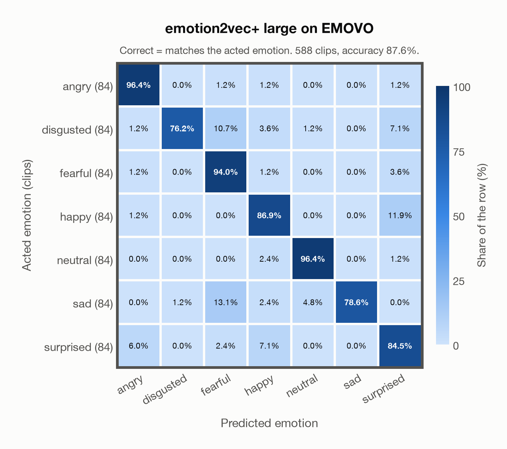

# emotion2vec+ large on EMOVO

Generated by `scripts/evaluation/evaluate.py` on 2026-11-06.

## Summary

| Metric | Value |
|---|---|
| Clips evaluated | 588 (Italian) |
| **Accuracy: prediction matches the acted emotion** | **87.6%** |
| Unweighted accuracy (mean recall of the 7 acted emotions) | 87.6% |
| Macro F1 (acted emotion) | 87.6% |
| Accuracy, all 9 model classes (acted emotion) | 87.6% |
| Chance level (7 emotions) | 14.3% |

## Setup

- **Model**: emotion2vec+ large (`emotion2vec/emotion2vec_plus_large`) as released (no fine-tuning), FunASR 1.4.16, loaded by `scripts/models/emotion2vec.py`. One prediction per clip (FunASR, granularity utterance); FunASR averages stereo channels and resamples the audio to 16 kHz.
- **Data**: 588 clips of EMOVO (Italian) from `data/emovo/`.
- **Ground truth (acted emotion)**: the emotion each actor was asked to portray, from the first part of the file name (`dis`gusto, `gio`ia, `neu`trale, `pau`ra, `rab`bia, `sor`presa, `tri`stezza).
- Label mapping: rabbia = angry, disgusto = disgusted, paura = fearful, gioia = happy, neutrale = neutral, tristezza = sad, sorpresa = surprised.
- 6 professional actors (3 female, 3 male) say the same 14 sentences (some of them nonsense sentences) in each of the 7 emotions: 588 clips.
- **7 emotions**: the prediction is the most probable of the 7 emotions in this dataset (angry, disgusted, fearful, happy, neutral, sad, surprised); the model's other classes (`other`, `<unk>`) are ignored. **All 9 model classes**: the prediction is the most probable of all 9 model classes, so choosing a class that the dataset does not have counts as wrong.
- **Hardware**: Apple M4 Max, device `cpu`, PyTorch 2.7.1. Inference took 1.1 min (107 ms per clip).
- **Per-clip predictions**: `outputs/emotion2vec_plus_large/emovo_predictions.csv` (in git, so the results can be checked clip by clip). The JSON file next to it describes the columns.

## Results per emotion

Rows: acted emotion. Precision, recall and F1 compare the prediction with the acted emotion.

| Emotion | Clips | Precision | Recall | F1 |
|---|---|---|---|---|
| angry | 84 | 91.0% | 96.4% | 93.6% |
| disgusted | 84 | 98.5% | 76.2% | 85.9% |
| fearful | 84 | 77.5% | 94.0% | 84.9% |
| happy | 84 | 83.0% | 86.9% | 84.9% |
| neutral | 84 | 94.2% | 96.4% | 95.3% |
| sad | 84 | 100.0% | 78.6% | 88.0% |
| surprised | 84 | 77.2% | 84.5% | 80.7% |

## Confusion matrix: acted emotion

The same numbers as a table. Rows: acted emotion. Columns: predicted emotion. Each row adds up to 100%.

| Acted \ Predicted | angry | disgusted | fearful | happy | neutral | sad | surprised |
|---|---|---|---|---|---|---|---|
| angry (84) | **96.4%** | 0.0% | 1.2% | 1.2% | 0.0% | 0.0% | 1.2% |
| disgusted (84) | 1.2% | **76.2%** | 10.7% | 3.6% | 1.2% | 0.0% | 7.1% |
| fearful (84) | 1.2% | 0.0% | **94.0%** | 1.2% | 0.0% | 0.0% | 3.6% |
| happy (84) | 1.2% | 0.0% | 0.0% | **86.9%** | 0.0% | 0.0% | 11.9% |
| neutral (84) | 0.0% | 0.0% | 0.0% | 2.4% | **96.4%** | 0.0% | 1.2% |
| sad (84) | 0.0% | 1.2% | 13.1% | 2.4% | 4.8% | **78.6%** | 0.0% |
| surprised (84) | 6.0% | 0.0% | 2.4% | 7.1% | 0.0% | 0.0% | **84.5%** |

Most frequent confusions: sad predicted as fearful (13.1%), happy predicted as surprised (11.9%), disgusted predicted as fearful (10.7%).

## Predictions outside the 7 emotions

With all 9 model classes, the model chose a class that this dataset does not have for 0 clips (0.0%): `other` 0, `<unk>` 0.

## Caveats

- **In emotion2vec+ large's training data** (EmoBox, through emotion2vec+ seed), so the model has probably seen these clips; treat the result as optimistic. emotion2vec+ seed, the first model in the chain that led to emotion2vec+ large, was fine-tuned on EmoBox data; large was later trained on about 40k hours of pseudo-labelled data whose sources are not published, so earlier exposure to other datasets cannot be ruled out completely.
- **Unofficial copy.** The official site (voice.fub.it) is gone and there is no official mirror; the files come from a copy on DagsHub (kingabzpro/EMOVO), checked only against the file names and count of the corpus.
- No listeners' labels per clip are published (the authors' listening test covered 2 sentences per actor). Only six speakers. Audio: 48 kHz WAV, stereo except one file (the channels are averaged), resampled to 16 kHz.
