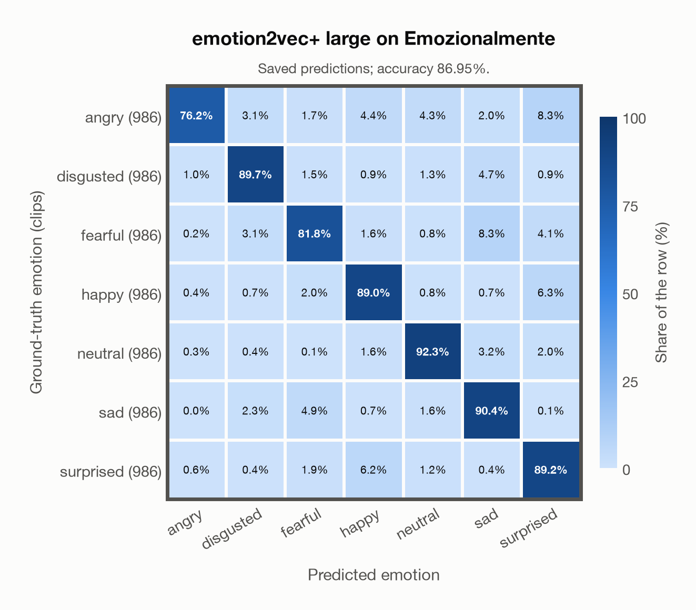
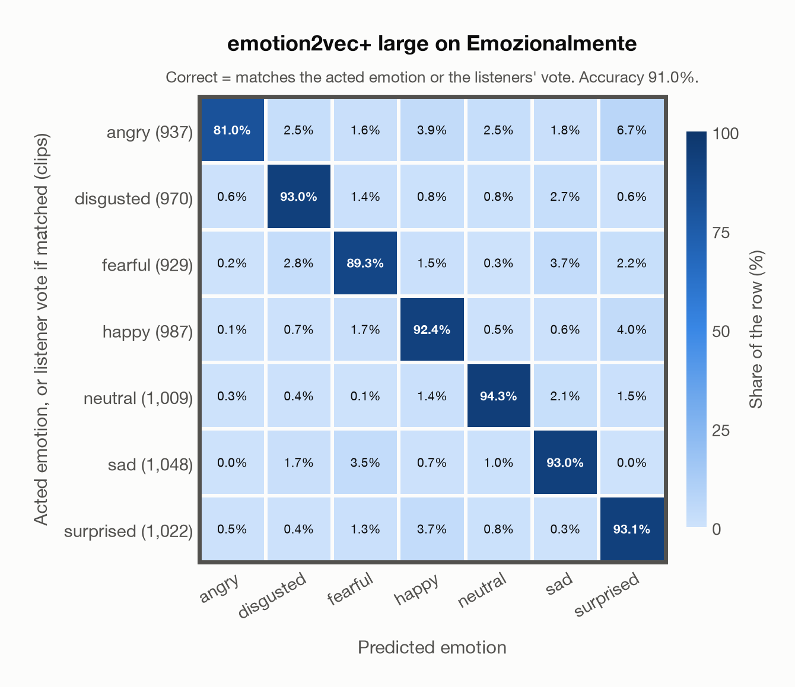

# emotion2vec+ large on Emozionalmente

Generated by `scripts/evaluation/evaluate.py` on 2026-11-06.

## Summary

| Metric | Value |
|---|---|
| Clips evaluated | 6,902 (Italian) |
| **Accuracy: prediction matches the acted emotion** | **86.9%** |
| **Accuracy: prediction matches the acted emotion or the listeners' vote** | **91.0%** |
| Unweighted accuracy (mean recall of the 7 acted emotions) | 86.9% |
| Macro F1 (acted emotion) | 86.9% |
| Accuracy, all 9 model classes (acted emotion) | 86.9% |
| Chance level (7 emotions) | 14.3% |
| Listeners' majority vote vs acted emotion | 81.2% |

## Setup

- **Model**: emotion2vec+ large (`emotion2vec/emotion2vec_plus_large`) as released (no fine-tuning), FunASR 1.4.16, loaded by `scripts/models/emotion2vec.py`. One prediction per clip (FunASR, granularity utterance); FunASR averages stereo channels and resamples the audio to 16 kHz.
- **Data**: 6,902 clips of Emozionalmente (Italian) from `data/emozionalmente/`.
- **Ground truth (acted emotion)**: the emotion each speaker meant to express (`emotion_expressed` in `metadata/samples.csv`).
- **Listeners' vote**: the majority vote of the 5 crowd-sourced listeners who rated each clip (`metadata/evaluations.csv`, `emotion_recognized`); a tie counts every tied emotion.
- Label mapping: anger = angry, disgust = disgusted, fear = fearful, joy = happy, neutrality = neutral, sadness = sad, surprise = surprised.
- 431 non-professional speakers recorded themselves through a web application, saying 18 sentences in the 7 emotions (986 clips per emotion). All 6,902 clips are evaluated (the authors' speaker-independent train/dev/test split is not used). Audio: 16 kHz mono WAV, the models' own sampling rate.
- **7 emotions**: the prediction is the most probable of the 7 emotions in this dataset (angry, disgusted, fearful, happy, neutral, sad, surprised); the model's other classes (`other`, `<unk>`) are ignored. **All 9 model classes**: the prediction is the most probable of all 9 model classes, so choosing a class that the dataset does not have counts as wrong.
- **Two ways to count a prediction as correct.** *Acted emotion*: it must match the acted emotion. *Acted emotion or listeners' vote*: it also counts when it matches the listeners' majority vote (for a tied vote, any of the tied emotions). Both are reported.
- **Hardware**: Apple M4 Max, device `cpu`, PyTorch 2.7.1. Inference took 12.5 min (108 ms per clip).
- **Per-clip predictions**: `outputs/emotion2vec_plus_large/emozionalmente_predictions.csv` (in git, so the results can be checked clip by clip). The JSON file next to it describes the columns.

## Results per emotion

Rows: acted emotion. Precision, recall and F1 compare the prediction with the acted emotion; the last column also accepts the listeners' vote.

| Emotion | Clips | Precision | Recall | F1 | Correct, acted or listeners' vote |
|---|---|---|---|---|---|
| angry | 986 | 96.8% | 76.2% | 85.2% | 81.9% |
| disgusted | 986 | 89.8% | 89.7% | 89.7% | 93.1% |
| fearful | 986 | 87.1% | 81.8% | 84.4% | 90.0% |
| happy | 986 | 85.2% | 89.0% | 87.1% | 92.4% |
| neutral | 986 | 90.2% | 92.3% | 91.2% | 94.1% |
| sad | 986 | 82.3% | 90.4% | 86.2% | 92.6% |
| surprised | 986 | 80.4% | 89.2% | 84.6% | 92.8% |

## Confusion matrix: acted emotion

The same numbers as a table. Rows: acted emotion. Columns: predicted emotion. Each row adds up to 100%.

| Acted \ Predicted | angry | disgusted | fearful | happy | neutral | sad | surprised |
|---|---|---|---|---|---|---|---|
| angry (986) | **76.2%** | 3.1% | 1.7% | 4.4% | 4.3% | 2.0% | 8.3% |
| disgusted (986) | 1.0% | **89.7%** | 1.5% | 0.9% | 1.3% | 4.7% | 0.9% |
| fearful (986) | 0.2% | 3.1% | **81.8%** | 1.6% | 0.8% | 8.3% | 4.1% |
| happy (986) | 0.4% | 0.7% | 2.0% | **89.0%** | 0.8% | 0.7% | 6.3% |
| neutral (986) | 0.3% | 0.4% | 0.1% | 1.6% | **92.3%** | 3.2% | 2.0% |
| sad (986) | 0.0% | 2.3% | 4.9% | 0.7% | 1.6% | **90.4%** | 0.1% |
| surprised (986) | 0.6% | 0.4% | 1.9% | 6.2% | 1.2% | 0.4% | **89.2%** |

Most frequent confusions: fearful predicted as sad (8.3%), angry predicted as surprised (8.3%), happy predicted as surprised (6.3%).

## Confusion matrix: acted emotion or listeners' vote

Here a prediction is correct when it matches the acted emotion or the listeners' vote. A clip goes into the row of the label its prediction matched, otherwise into the row of its acted emotion. The diagonal therefore holds every correct prediction, and the rows differ in size from the matrix above. 279 clips (4.0%) count as correct only because of the listeners' vote; the most common are acted fearful predicted as sad (48), acted happy predicted as surprised (23), acted surprised predicted as happy (23).

| Ground truth \ Predicted | angry | disgusted | fearful | happy | neutral | sad | surprised |
|---|---|---|---|---|---|---|---|
| angry (937) | **81.0%** | 2.5% | 1.6% | 3.9% | 2.5% | 1.8% | 6.7% |
| disgusted (970) | 0.6% | **93.0%** | 1.4% | 0.8% | 0.8% | 2.7% | 0.6% |
| fearful (929) | 0.2% | 2.8% | **89.3%** | 1.5% | 0.3% | 3.7% | 2.2% |
| happy (987) | 0.1% | 0.7% | 1.7% | **92.4%** | 0.5% | 0.6% | 4.0% |
| neutral (1,009) | 0.3% | 0.4% | 0.1% | 1.4% | **94.3%** | 2.1% | 1.5% |
| sad (1,048) | 0.0% | 1.7% | 3.5% | 0.7% | 1.0% | **93.0%** | 0.0% |
| surprised (1,022) | 0.5% | 0.4% | 1.3% | 3.7% | 0.8% | 0.3% | **93.1%** |

Most frequent confusions: angry predicted as surprised (6.7%), happy predicted as surprised (4.0%), angry predicted as happy (3.9%).

## Predictions outside the 7 emotions

With all 9 model classes, the model chose a class that this dataset does not have for 1 clips (0.0%): `other` 0, `<unk>` 1.

## Comparison with human listeners

The listeners' majority vote matches the acted emotion for 81.2% of the 6,187 clips with a single (untied) vote. The model agrees with that vote for 77.5% of the same clips.

## Caveats

- **Training involvement for emotion2vec+ large: Used via upstream training**. Evidence scope: upstream teacher lineage. Author documents EmoBox seed training and iterative pseudo-label lineage into large; the exact seed corpus subset and raw-audio/weight inheritance into large are not enumerated. Source: EmoBox academic data is used for seed fine-tuning, followed by teacher pseudo-labelling and data iteration to large; this project counts those corpora as used through upstream training. Large also uses 42,526 h of industrial pseudo-labelled audio. This is distinct from a claim that every EmoBox corpus directly entered large encoder self-supervised pretraining. Direct use and upstream teacher use both count as training involvement. No pattern: no corpus-specific evidence, not verified unseen. Corpus use is not test-clip leakage. This project counts EmoBox-related corpora as seen through seed fine-tuning and subsequent pseudo-label supervision. The upstream marker records this training route; the final large checkpoint's exact raw recordings and initial weights are not enumerated.
- **Amateur speakers and microphones.** The clips were crowd-sourced and mostly recorded with non-professional equipment; the listeners marked the audio quality as bad in 4% of their ratings. They recognised the intended emotion with a UAR of 66% (the authors' figure).
- Emozionalmente is in EmoBox, so it is in the training data of emotion2vec+, and in Melati's training data.
- **Acted labels are not perceived emotions.** The ground truth is what the actor intended; listeners sometimes heard something else, as the listeners' numbers above show.
