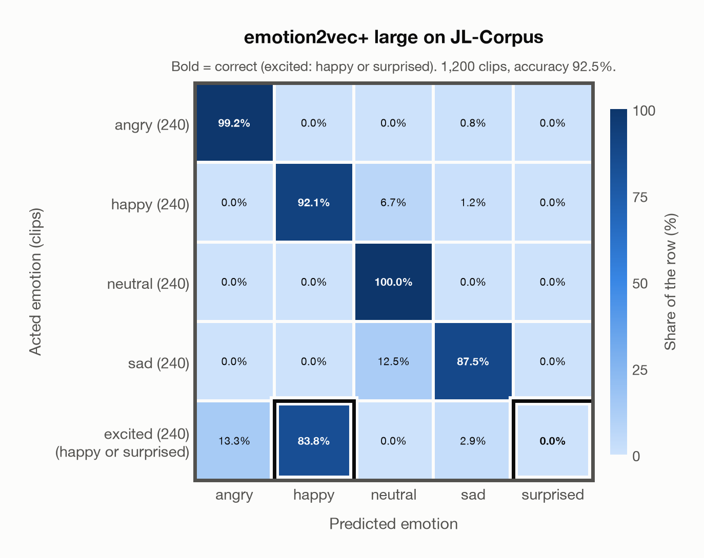

# emotion2vec+ large on JL-Corpus

Generated by `scripts/evaluation/evaluate.py` on 2026-10-28.

## Summary

| Metric | Value |
|---|---|
| Clips evaluated | 1,200 (English (New Zealand)) |
| **Accuracy: prediction matches the acted emotion** | **92.5%** |
| Unweighted accuracy (mean recall of the 5 acted emotions) | 92.5% |
| Macro F1 (acted emotion, over 4 of the 5 predicted emotions) | 92.3% |
| Accuracy, all 9 model classes (acted emotion) | 92.5% |
| Chance level (5 emotions; excited accepts 2) | 24.0% |

## Setup

- **Model**: emotion2vec+ large (`emotion2vec/emotion2vec_plus_large`) as released (no fine-tuning), FunASR 1.4.16, loaded by `scripts/models/emotion2vec.py`. One prediction per clip (FunASR, granularity utterance); FunASR averages stereo channels and resamples the audio to 16 kHz.
- **Data**: 1,200 clips of JL-Corpus (English (New Zealand)) from `data/jl_corpus/`.
- **Ground truth (acted emotion)**: the emotion each speaker was asked to portray, from the second part of the file name.
- Only the five primary emotions (1,200 of 2,400 clips): angry, happy, neutral and sad keep their names; **excited has no model class, so a prediction of happy or surprised counts as correct** for it (its label stays excited). The prediction is therefore chosen from angry, happy, neutral, sad and surprised, although no clip is acted surprised. The five secondary emotions (anxious, apologetic, assertive, concerned, encouraging) have no model class and are left out.
- Four trained voice actors of New Zealand English (two female, two male) say the same 15 sentences in each primary emotion, in two sessions, twice each.
- **5 emotions**: the prediction is the most probable of the 5 emotions in this dataset (angry, happy, neutral, sad, surprised); the model's other classes (`disgusted`, `fearful`, `other`, `<unk>`) are ignored. **All 9 model classes**: the prediction is the most probable of all 9 model classes, so choosing a class that the dataset does not have counts as wrong.
- **Composite label**: *excited* has no model class, so a prediction of happy or surprised counts as correct for it (also with all 9 model classes). Each such label has its own row in the confusion matrices, whose bold cells count as correct; its recall is the share of its clips predicted correctly, and chance level (24.0% instead of 20.0%) counts every class it accepts.
- **Hardware**: Apple M4 Max, device `cpu`, PyTorch 2.5.1. Inference took 1.8 min (91 ms per clip).
- **Per-clip predictions**: `outputs/emotion2vec_plus_large/jl_corpus_predictions.csv` (in git, so the results can be checked clip by clip). The JSON file next to it describes the columns.

## Results per emotion

Rows: acted emotion. Recall: the share of the row's clips whose prediction counts as correct; unweighted accuracy is the mean of this column.

| Emotion | Clips | Recall |
|---|---|---|
| angry | 240 | 99.2% |
| happy | 240 | 92.1% |
| neutral | 240 | 100.0% |
| sad | 240 | 87.5% |
| excited (happy or surprised) | 240 | 83.8% |

Precision, recall and F1 of each predicted emotion compare the prediction with a resolved truth: the prediction when it counts as correct, otherwise the acted emotion, and for excited the first class it accepts (happy). So a correct excited clip counts as a clip of the emotion predicted, and a wrong one as happy. Clips: the clips of each resolved truth. Macro F1 is the mean of the F1 column; surprised is left out, because no clip has this label and the model never predicted it, so its F1 is undefined.

| Predicted emotion | Clips | Precision | Recall | F1 |
|---|---|---|---|---|
| angry | 240 | 88.1% | 99.2% | 93.3% |
| happy | 480 | 100.0% | 87.9% | 93.6% |
| neutral | 240 | 83.9% | 100.0% | 91.3% |
| sad | 240 | 94.6% | 87.5% | 90.9% |
| surprised | 0 | – | – | – |

## Confusion matrix: acted emotion

The same numbers as a table. Rows: acted emotion. Columns: predicted emotion. Each row adds up to 100%. Bold: the cells that count as correct.

| Acted \ Predicted | angry | happy | neutral | sad | surprised |
|---|---|---|---|---|---|
| angry (240) | **99.2%** | 0.0% | 0.0% | 0.8% | 0.0% |
| happy (240) | 0.0% | **92.1%** | 6.7% | 1.2% | 0.0% |
| neutral (240) | 0.0% | 0.0% | **100.0%** | 0.0% | 0.0% |
| sad (240) | 0.0% | 0.0% | 12.5% | **87.5%** | 0.0% |
| excited (happy or surprised) (240) | 13.3% | **83.8%** | 0.0% | 2.9% | **0.0%** |

Most frequent confusions: excited predicted as angry (13.3%), sad predicted as neutral (12.5%), happy predicted as neutral (6.7%).

## Predictions outside the 5 emotions

With all 9 model classes, the model chose a class that this dataset does not have for 0 clips (0.0%): `disgusted` 0, `fearful` 0, `other` 0, `<unk>` 0.

## Caveats

- **In emotion2vec+ large's training data** (EmoBox, through emotion2vec+ seed), so the model has probably seen these clips; treat the result as optimistic. emotion2vec+ seed, the first model in the chain that led to emotion2vec+ large, was fine-tuned on EmoBox data; large was later trained on about 40k hours of pseudo-labelled data whose sources are not published, so earlier exposure to other datasets cannot be ruled out completely.
- *Excited* is neither *happy* nor *surprised*: excited clips predicted as happy or surprised count as correct. Surprised is a possible prediction only because of excited, and it is wrong for a clip of any other emotion.
- This is the raw corpus ("unchecked and unannotated"). In the authors' perception test (120 listeners) about 70% of the primary-emotion clips were recognised; the results per clip are not published, so poorly acted clips are included.
- Audio: 44.1 kHz WAV, resampled to 16 kHz.
