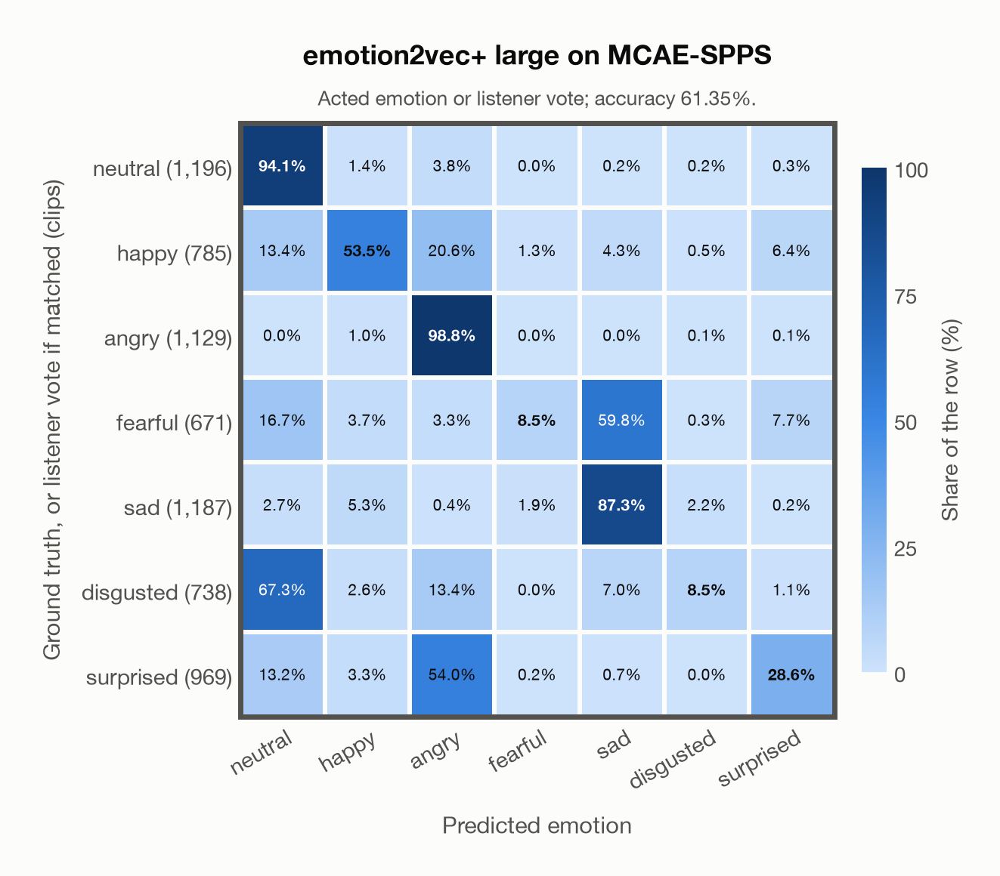

# emotion2vec+ large on MCAE-SPPS

Regenerated offline from saved CSV/JSON by `scripts/evaluation/refresh_reports.py`. This refresh performs no model inference or API requests.

## Summary

| Metric | Recomputed value |
|---|---:|
| Clips | 6,675 |
| Accuracy: acted emotion | 61.35% |
| UAR: mean ground-truth-row recall | 54.20% |
| Macro F1 | 50.08% |
| Weighted F1: true-support weighted | 54.62% |
| Accuracy: all model classes | 61.35% |
| Accuracy: acted emotion or listener vote | 61.35% |
| Single listener vote vs acted emotion | 100.00% |
| Model vs single listener vote | 61.35% |

## Imported run and verification

- Source: [prediction CSV](../../outputs/emotion2vec_plus_large/mcae_spps_predictions.csv) and [metadata JSON](../../outputs/emotion2vec_plus_large/mcae_spps_predictions.json); both remain byte-for-byte unchanged.
- Original execution date recorded in JSON: `2026-10-23`.
- Dataset scope recorded in JSON: **MCAE-SPPS**, Mandarin; 6,675 / 6,675 clips.
- Ground-truth column: `acted_emotion`. Candidate classes: neutral, happy, angry, fearful, sad, disgusted, surprised.
- Row counts, unique audio paths, correctness flags and saved metrics were checked against the CSV. Metric agreement tolerance is 0.000001 (six-decimal metadata).
- Weighted F1 weights each class's F1 by its true support, using the same resolved truth as macro F1; invalid answers remain errors. New metrics absent from the source JSON are recorded in the offline audit and summaries; the source JSON is preserved.

## Results per emotion

| Ground-truth emotion | Clips | Recall | Acted-or-listener recall |
|---|---:|---:|---:|
| neutral | 1,196 | 94.15% | 94.15% |
| happy | 785 | 53.50% | 53.50% |
| angry | 1,129 | 98.85% | 98.85% |
| fearful | 671 | 8.49% | 8.49% |
| sad | 1,187 | 87.28% | 87.28% |
| disgusted | 738 | 8.54% | 8.54% |
| surprised | 969 | 28.59% | 28.59% |

Precision/F1 use the same resolved-truth convention as the evaluation script. Weighted F1 uses the resolved-truth clip counts below as weights.

| Predicted emotion | Resolved-truth clips | Precision | Recall | F1 |
|---|---:|---:|---:|---:|
| neutral | 1,196 | 56.30% | 94.15% | 70.46% |
| happy | 785 | 71.55% | 53.50% | 61.22% |
| angry | 1,129 | 56.59% | 98.85% | 71.98% |
| fearful | 671 | 61.96% | 8.49% | 14.94% |
| sad | 1,187 | 67.62% | 87.28% | 76.20% |
| disgusted | 738 | 64.29% | 8.54% | 15.07% |
| surprised | 969 | 70.30% | 28.59% | 40.65% |

## Confusion matrix: acted emotion

| Ground truth \ Predicted | neutral | happy | angry | fearful | sad | disgusted | surprised |
|---|---|---|---|---|---|---|---|
| neutral (1,196) | **94.1%** | 1.4% | 3.8% | 0.0% | 0.2% | 0.2% | 0.3% |
| happy (785) | 13.4% | **53.5%** | 20.6% | 1.3% | 4.3% | 0.5% | 6.4% |
| angry (1,129) | 0.0% | 1.0% | **98.8%** | 0.0% | 0.0% | 0.1% | 0.1% |
| fearful (671) | 16.7% | 3.7% | 3.3% | **8.5%** | 59.8% | 0.3% | 7.7% |
| sad (1,187) | 2.7% | 5.3% | 0.4% | 1.9% | **87.3%** | 2.2% | 0.2% |
| disgusted (738) | 67.3% | 2.6% | 13.4% | 0.0% | 7.0% | **8.5%** | 1.1% |
| surprised (969) | 13.2% | 3.3% | 54.0% | 0.2% | 0.7% | 0.0% | **28.6%** |

## Confusion matrix: acted emotion or listener vote

A prediction accepted only through the listener vote is placed in that predicted emotion's row; other clips keep their original ground-truth row. Row supports can therefore change.

| Ground truth \ Predicted | neutral | happy | angry | fearful | sad | disgusted | surprised |
|---|---|---|---|---|---|---|---|
| neutral (1,196) | **94.1%** | 1.4% | 3.8% | 0.0% | 0.2% | 0.2% | 0.3% |
| happy (785) | 13.4% | **53.5%** | 20.6% | 1.3% | 4.3% | 0.5% | 6.4% |
| angry (1,129) | 0.0% | 1.0% | **98.8%** | 0.0% | 0.0% | 0.1% | 0.1% |
| fearful (671) | 16.7% | 3.7% | 3.3% | **8.5%** | 59.8% | 0.3% | 7.7% |
| sad (1,187) | 2.7% | 5.3% | 0.4% | 1.9% | **87.3%** | 2.2% | 0.2% |
| disgusted (738) | 67.3% | 2.6% | 13.4% | 0.0% | 7.0% | **8.5%** | 1.1% |
| surprised (969) | 13.2% | 3.3% | 54.0% | 0.2% | 0.7% | 0.0% | **28.6%** |

## Caveats

- **Training involvement for emotion2vec+ large: No corpus-specific evidence**. Source: EmoBox academic data is used for seed fine-tuning, followed by teacher pseudo-labelling and data iteration to large; this project counts those corpora as used through upstream training. Large also uses 42,526 h of industrial pseudo-labelled audio. This is distinct from a claim that every EmoBox corpus directly entered large encoder self-supervised pretraining. Direct use and upstream teacher use both count as training involvement. No pattern: no corpus-specific evidence, not verified unseen. Corpus use is not test-clip leakage.
- Internal CSV/JSON consistency does not authenticate the original model or remote request logs.

[Offline validation audit](mcae_spps_offline_audit.json)
