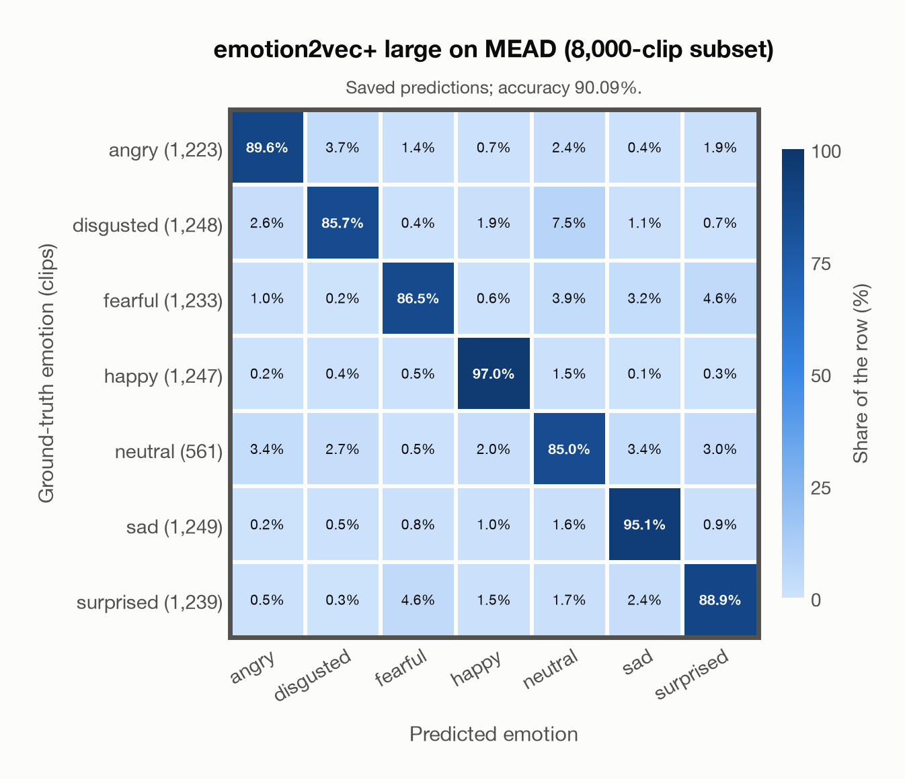

# emotion2vec+ large on MEAD (8,000-clip subset)

Regenerated offline from saved CSV/JSON by `scripts/evaluation/refresh_reports.py`. This refresh performs no model inference or API requests.

## Summary

| Metric | Recomputed value |
|---|---:|
| Clips | 8,000 |
| Accuracy: acted emotion | 90.09% |
| UAR: mean ground-truth-row recall | 89.68% |
| Macro F1 | 89.02% |
| Weighted F1: true-support weighted | 90.19% |
| Accuracy: all model classes | 89.26% |

## Imported run and verification

- Source: [prediction CSV](../../outputs/emotion2vec_plus_large/mead_predictions.csv) and [metadata JSON](../../outputs/emotion2vec_plus_large/mead_predictions.json); both remain byte-for-byte unchanged.
- Original execution date recorded in JSON: `2026-11-06`.
- Dataset scope recorded in JSON: **MEAD (8,000-clip subset)**, English; 8,000 / 8,000 clips.
- Ground-truth column: `acted_emotion`. Candidate classes: angry, disgusted, fearful, happy, neutral, sad, surprised.
- Row counts, unique audio paths, correctness flags and saved metrics were checked against the CSV. Metric agreement tolerance is 0.000001 (six-decimal metadata).
- Weighted F1 weights each class's F1 by its true support, using the same resolved truth as macro F1; invalid answers remain errors. New metrics absent from the source JSON are recorded in the offline audit and summaries; the source JSON is preserved.
- Original execution/client runtime metadata (reported by the imported run, not measured by this refresh): `{"device": "cpu", "hardware": "Apple M4 Max", "seconds": 1221.5, "ms_per_clip": 152.7, "on_cpu": 0}`.

## Results per emotion

| Ground-truth emotion | Clips | Recall | Acted-or-listener recall |
|---|---:|---:|---:|
| angry | 1,223 | 89.62% | — |
| disgusted | 1,248 | 85.66% | — |
| fearful | 1,233 | 86.46% | — |
| happy | 1,247 | 96.95% | — |
| neutral | 561 | 85.03% | — |
| sad | 1,249 | 95.12% | — |
| surprised | 1,239 | 88.94% | — |

Precision/F1 use the same resolved-truth convention as the evaluation script. Weighted F1 uses the resolved-truth clip counts below as weights.

| Predicted emotion | Resolved-truth clips | Precision | Recall | F1 |
|---|---:|---:|---:|---:|
| angry | 1,223 | 93.60% | 89.62% | 91.56% |
| disgusted | 1,248 | 93.20% | 85.66% | 89.27% |
| fearful | 1,233 | 91.58% | 86.46% | 88.94% |
| happy | 1,247 | 93.65% | 96.95% | 95.27% |
| neutral | 561 | 67.37% | 85.03% | 75.18% |
| sad | 1,249 | 91.67% | 95.12% | 93.36% |
| surprised | 1,239 | 90.11% | 88.94% | 89.52% |

## Confusion matrix: acted emotion

| Ground truth \ Predicted | angry | disgusted | fearful | happy | neutral | sad | surprised |
|---|---|---|---|---|---|---|---|
| angry (1,223) | **89.6%** | 3.7% | 1.4% | 0.7% | 2.4% | 0.4% | 1.9% |
| disgusted (1,248) | 2.6% | **85.7%** | 0.4% | 1.9% | 7.5% | 1.1% | 0.7% |
| fearful (1,233) | 1.0% | 0.2% | **86.5%** | 0.6% | 3.9% | 3.2% | 4.6% |
| happy (1,247) | 0.2% | 0.4% | 0.5% | **97.0%** | 1.5% | 0.1% | 0.3% |
| neutral (561) | 3.4% | 2.7% | 0.5% | 2.0% | **85.0%** | 3.4% | 3.0% |
| sad (1,249) | 0.2% | 0.5% | 0.8% | 1.0% | 1.6% | **95.1%** | 0.9% |
| surprised (1,239) | 0.5% | 0.3% | 4.6% | 1.5% | 1.7% | 2.4% | **88.9%** |

## Caveats

- **Training involvement for emotion2vec+ large: Used via upstream training**. Evidence scope: upstream teacher lineage. Author documents EmoBox seed training and iterative pseudo-label lineage into large; the exact seed corpus subset and raw-audio/weight inheritance into large are not enumerated. Source: EmoBox academic data is used for seed fine-tuning, followed by teacher pseudo-labelling and data iteration to large; this project counts those corpora as used through upstream training. Large also uses 42,526 h of industrial pseudo-labelled audio. This is distinct from a claim that every EmoBox corpus directly entered large encoder self-supervised pretraining. Direct use and upstream teacher use both count as training involvement. No pattern: no corpus-specific evidence, not verified unseen. Corpus use is not test-clip leakage.
- Internal CSV/JSON consistency does not authenticate the original model or remote request logs.

[Offline validation audit](mead_offline_audit.json)
