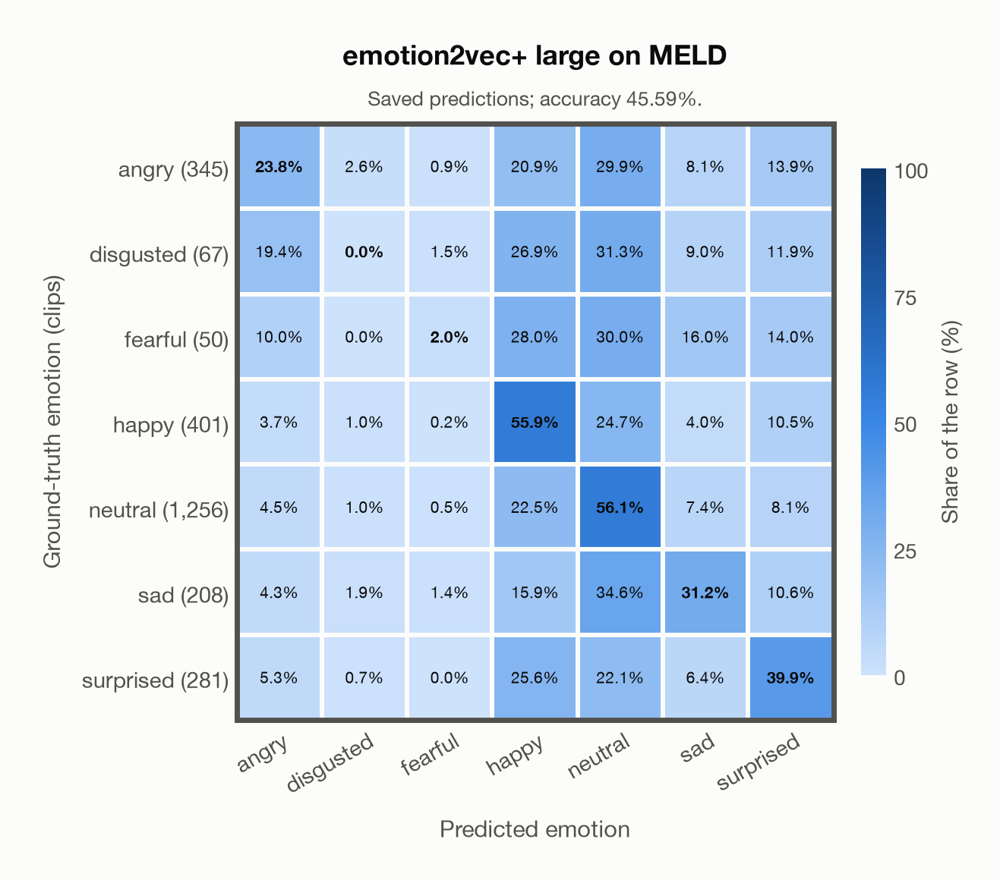

# emotion2vec+ large on MELD

Regenerated offline from saved CSV/JSON by `scripts/evaluation/refresh_reports.py`. This refresh performs no model inference or API requests.

## Summary

| Metric | Recomputed value |
|---|---:|
| Clips | 2,608 |
| Accuracy: acted emotion | 45.59% |
| UAR: mean ground-truth-row recall | 29.84% |
| Macro F1 | 28.49% |
| Weighted F1: true-support weighted | 45.58% |
| Accuracy: all model classes | 45.25% |

## Imported run and verification

- Source: [prediction CSV](../../outputs/emotion2vec_plus_large/meld_predictions.csv) and [metadata JSON](../../outputs/emotion2vec_plus_large/meld_predictions.json); both remain byte-for-byte unchanged.
- Original execution date recorded in JSON: `2026-11-06`.
- Dataset scope recorded in JSON: **MELD**, English; 2,608 / 2,608 clips.
- Ground-truth column: `acted_emotion`. Candidate classes: angry, disgusted, fearful, happy, neutral, sad, surprised.
- Row counts, unique audio paths, correctness flags and saved metrics were checked against the CSV. Metric agreement tolerance is 0.000001 (six-decimal metadata).
- Weighted F1 weights each class's F1 by its true support, using the same resolved truth as macro F1; invalid answers remain errors. New metrics absent from the source JSON are recorded in the offline audit and summaries; the source JSON is preserved.
- Original execution/client runtime metadata (reported by the imported run, not measured by this refresh): `{"device": "cpu", "hardware": "Apple M4 Max", "seconds": 350.6, "ms_per_clip": 134.4, "on_cpu": 0}`.

## Results per emotion

| Ground-truth emotion | Clips | Recall | Acted-or-listener recall |
|---|---:|---:|---:|
| angry | 345 | 23.77% | — |
| disgusted | 67 | 0.00% | — |
| fearful | 50 | 2.00% | — |
| happy | 401 | 55.86% | — |
| neutral | 1,256 | 56.13% | — |
| sad | 208 | 31.25% | — |
| surprised | 281 | 39.86% | — |

Precision/F1 use the same resolved-truth convention as the evaluation script. Weighted F1 uses the resolved-truth clip counts below as weights.

| Predicted emotion | Resolved-truth clips | Precision | Recall | F1 |
|---|---:|---:|---:|---:|
| angry | 345 | 42.05% | 23.77% | 30.37% |
| disgusted | 67 | 0.00% | 0.00% | 0.00% |
| fearful | 50 | 6.67% | 2.00% | 3.08% |
| happy | 401 | 31.33% | 55.86% | 40.14% |
| neutral | 1,256 | 65.46% | 56.13% | 60.44% |
| sad | 208 | 27.78% | 31.25% | 29.41% |
| surprised | 281 | 32.84% | 39.86% | 36.01% |

## Confusion matrix: acted emotion

| Ground truth \ Predicted | angry | disgusted | fearful | happy | neutral | sad | surprised |
|---|---|---|---|---|---|---|---|
| angry (345) | **23.8%** | 2.6% | 0.9% | 20.9% | 29.9% | 8.1% | 13.9% |
| disgusted (67) | 19.4% | **0.0%** | 1.5% | 26.9% | 31.3% | 9.0% | 11.9% |
| fearful (50) | 10.0% | 0.0% | **2.0%** | 28.0% | 30.0% | 16.0% | 14.0% |
| happy (401) | 3.7% | 1.0% | 0.2% | **55.9%** | 24.7% | 4.0% | 10.5% |
| neutral (1,256) | 4.5% | 1.0% | 0.5% | 22.5% | **56.1%** | 7.4% | 8.1% |
| sad (208) | 4.3% | 1.9% | 1.4% | 15.9% | 34.6% | **31.2%** | 10.6% |
| surprised (281) | 5.3% | 0.7% | 0.0% | 25.6% | 22.1% | 6.4% | **39.9%** |

## Caveats

- **Training involvement for emotion2vec+ large: Used via upstream training**. Evidence scope: upstream teacher lineage. Author documents EmoBox seed training and iterative pseudo-label lineage into large; the exact seed corpus subset and raw-audio/weight inheritance into large are not enumerated. Source: EmoBox academic data is used for seed fine-tuning, followed by teacher pseudo-labelling and data iteration to large; this project counts those corpora as used through upstream training. Large also uses 42,526 h of industrial pseudo-labelled audio. This is distinct from a claim that every EmoBox corpus directly entered large encoder self-supervised pretraining. Direct use and upstream teacher use both count as training involvement. No pattern: no corpus-specific evidence, not verified unseen. Corpus use is not test-clip leakage.
- Internal CSV/JSON consistency does not authenticate the original model or remote request logs.

[Offline validation audit](meld_offline_audit.json)
