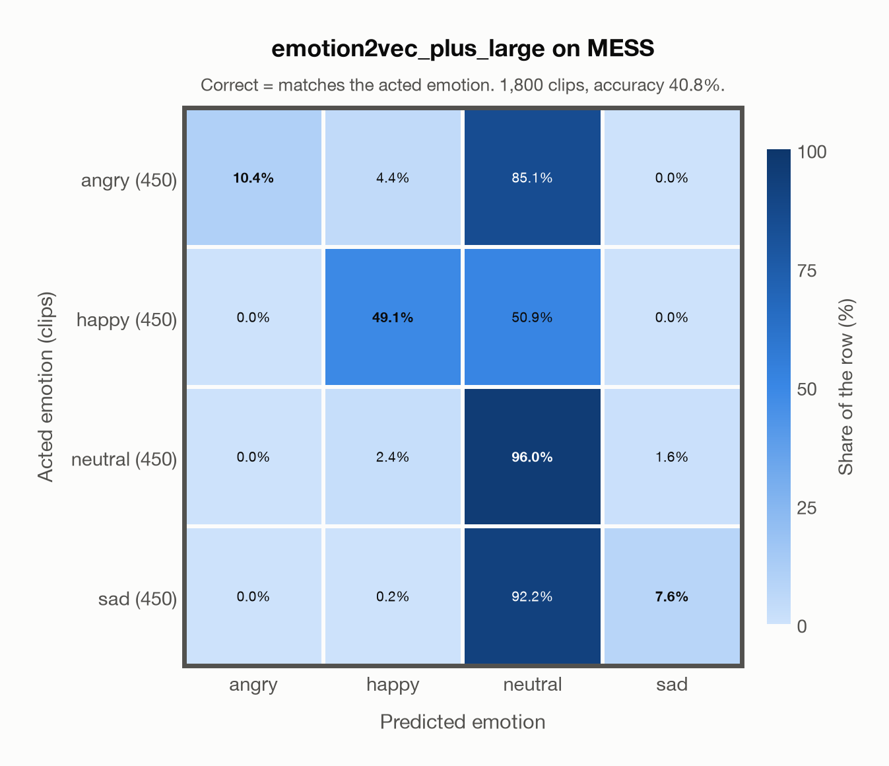

# emotion2vec+ large on MESS

Generated by `scripts/evaluation/evaluate.py` on 2026-10-28.

## Summary

| Metric | Value |
|---|---|
| Clips evaluated | 1,800 (English) |
| **Accuracy: prediction matches the acted emotion** | **40.8%** |
| Unweighted accuracy (mean recall of the 4 acted emotions) | 40.8% |
| Macro F1 (acted emotion) | 35.2% |
| Accuracy, all 9 model classes (acted emotion) | 38.7% |
| Chance level (4 emotions) | 25.0% |

## Setup

- **Model**: emotion2vec+ large (`emotion2vec/emotion2vec_plus_large`) as released (no fine-tuning), FunASR 1.4.16, loaded by `scripts/models/emotion2vec.py`. One prediction per clip (FunASR, granularity utterance); FunASR averages stereo channels and resamples the audio to 16 kHz.
- **Data**: 1,800 clips of MESS (English) from `data/mess/`.
- **Ground truth (acted emotion)**: the emotion each speaker was asked to portray, from the first letter of the file name (`A`ngry, `C`alm, `H`appy, `S`ad).
- Label mapping: angry = angry, happy = happy, sad = sad, and **calm = neutral** (the project's emotions have no *calm*).
- **4 emotions**: the prediction is the most probable of the 4 emotions in this dataset (angry, happy, neutral, sad); the model's other classes (`disgusted`, `fearful`, `other`, `surprised`, `<unk>`) are ignored. **All 9 model classes**: the prediction is the most probable of all 9 model classes, so choosing a class that the dataset does not have counts as wrong.
- **Hardware**: Apple M4 Max, device `cpu`, PyTorch 2.5.1. Inference took 20.9 min (697 ms per clip).
- **Per-clip predictions**: `outputs/emotion2vec_plus_large/mess_predictions.csv` (in git, so the results can be checked clip by clip). The JSON file next to it describes the columns.

## Results per emotion

Rows: acted emotion. Precision, recall and F1 compare the prediction with the acted emotion.

| Emotion | Clips | Precision | Recall | F1 |
|---|---|---|---|---|
| angry | 450 | 100.0% | 10.4% | 18.9% |
| happy | 450 | 87.4% | 49.1% | 62.9% |
| neutral | 450 | 29.6% | 96.0% | 45.3% |
| sad | 450 | 82.9% | 7.6% | 13.8% |

## Confusion matrix: acted emotion

The same numbers as a table. Rows: acted emotion. Columns: predicted emotion. Each row adds up to 100%.

| Acted \ Predicted | angry | happy | neutral | sad |
|---|---|---|---|---|
| angry (450) | **10.4%** | 4.4% | 85.1% | 0.0% |
| happy (450) | 0.0% | **49.1%** | 50.9% | 0.0% |
| neutral (450) | 0.0% | 2.4% | **96.0%** | 1.6% |
| sad (450) | 0.0% | 0.2% | 92.2% | **7.6%** |

Most frequent confusions: sad predicted as neutral (92.2%), angry predicted as neutral (85.1%), happy predicted as neutral (50.9%).

## Predictions outside the 4 emotions

With all 9 model classes, the model chose a class that this dataset does not have for 99 clips (5.5%): `disgusted` 29, `fearful` 1, `other` 17, `surprised` 3, `<unk>` 49.

## Caveats

- **Not in emotion2vec+ large's training data** (EmoBox, through emotion2vec+ seed). emotion2vec+ seed, the first model in the chain that led to emotion2vec+ large, was fine-tuned on EmoBox data; large was later trained on about 40k hours of pseudo-labelled data whose sources are not published, so earlier exposure to other datasets cannot be ruled out completely.
- *Calm* is not quite *neutral*: calm clips predicted as neutral count as correct.
- The public version has 1,800 clips and acted labels only; the listeners' ratings are available from the author on request. Audio is sampled at 24,414 Hz, resampled to 16 kHz.
