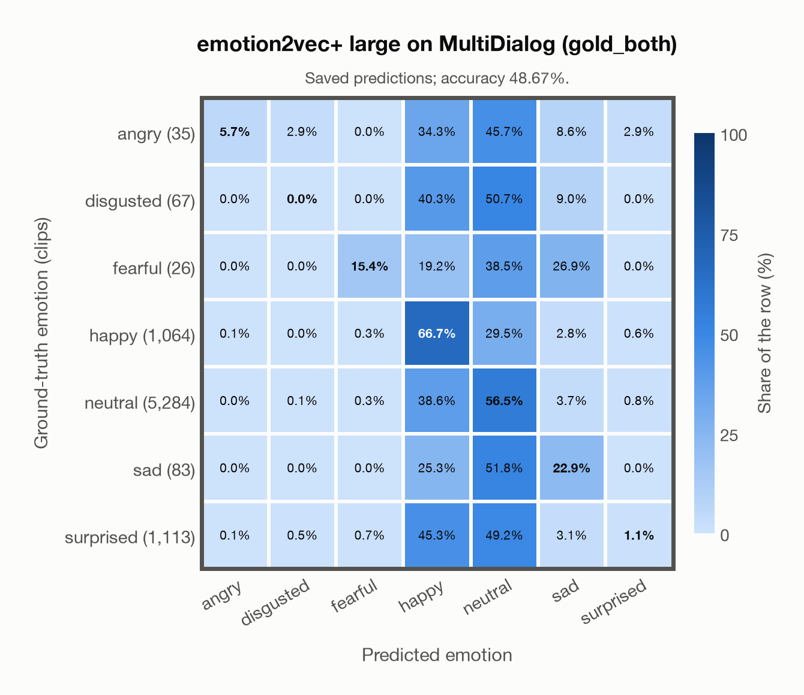

# emotion2vec+ large on MultiDialog (gold_both)

Regenerated offline from saved CSV/JSON by `scripts/evaluation/refresh_reports.py`. This refresh performs no model inference or API requests.

## Summary

| Metric | Recomputed value |
|---|---:|
| Clips | 7,672 |
| Accuracy: acted emotion | 48.67% |
| UAR: mean ground-truth-row recall | 24.05% |
| Macro F1 | 19.10% |
| Weighted F1: true-support weighted | 49.54% |
| Accuracy: all model classes | 40.25% |

## Imported run and verification

- Source: [prediction CSV](../../outputs/emotion2vec_plus_large/multidialog_predictions.csv) and [metadata JSON](../../outputs/emotion2vec_plus_large/multidialog_predictions.json); both remain byte-for-byte unchanged.
- Original execution date recorded in JSON: `2026-11-10`.
- Dataset scope recorded in JSON: **MultiDialog (gold_both)**, English; 7,672 / 7,672 clips.
- Ground-truth column: `acted_emotion`. Candidate classes: angry, disgusted, fearful, happy, neutral, sad, surprised.
- Row counts, unique audio paths, correctness flags and saved metrics were checked against the CSV. Metric agreement tolerance is 0.000001 (six-decimal metadata).
- Weighted F1 weights each class's F1 by its true support, using the same resolved truth as macro F1; invalid answers remain errors. New metrics absent from the source JSON are recorded in the offline audit and summaries; the source JSON is preserved.
- Original execution/client runtime metadata (reported by the imported run, not measured by this refresh): `{"device": "cpu", "hardware": "Apple M3 Pro", "seconds": 1956.7, "ms_per_clip": 255.0, "on_cpu": 0}`.

## Results per emotion

| Ground-truth emotion | Clips | Recall | Acted-or-listener recall |
|---|---:|---:|---:|
| angry | 35 | 5.71% | — |
| disgusted | 67 | 0.00% | — |
| fearful | 26 | 15.38% | — |
| happy | 1,064 | 66.73% | — |
| neutral | 5,284 | 56.53% | — |
| sad | 83 | 22.89% | — |
| surprised | 1,113 | 1.08% | — |

Precision/F1 use the same resolved-truth convention as the evaluation script. Weighted F1 uses the resolved-truth clip counts below as weights.

| Predicted emotion | Resolved-truth clips | Precision | Recall | F1 |
|---|---:|---:|---:|---:|
| angry | 35 | 40.00% | 5.71% | 10.00% |
| disgusted | 67 | 0.00% | 0.00% | 0.00% |
| fearful | 26 | 13.79% | 15.38% | 14.55% |
| happy | 1,064 | 21.40% | 66.73% | 32.41% |
| neutral | 5,284 | 75.58% | 56.53% | 64.68% |
| sad | 83 | 6.44% | 22.89% | 10.05% |
| surprised | 1,113 | 19.05% | 1.08% | 2.04% |

## Confusion matrix: acted emotion

| Ground truth \ Predicted | angry | disgusted | fearful | happy | neutral | sad | surprised |
|---|---|---|---|---|---|---|---|
| angry (35) | **5.7%** | 2.9% | 0.0% | 34.3% | 45.7% | 8.6% | 2.9% |
| disgusted (67) | 0.0% | **0.0%** | 0.0% | 40.3% | 50.7% | 9.0% | 0.0% |
| fearful (26) | 0.0% | 0.0% | **15.4%** | 19.2% | 38.5% | 26.9% | 0.0% |
| happy (1,064) | 0.1% | 0.0% | 0.3% | **66.7%** | 29.5% | 2.8% | 0.6% |
| neutral (5,284) | 0.0% | 0.1% | 0.3% | 38.6% | **56.5%** | 3.7% | 0.8% |
| sad (83) | 0.0% | 0.0% | 0.0% | 25.3% | 51.8% | **22.9%** | 0.0% |
| surprised (1,113) | 0.1% | 0.5% | 0.7% | 45.3% | 49.2% | 3.1% | **1.1%** |

## Caveats

- **Training involvement for emotion2vec+ large: No corpus-specific evidence**. Source: EmoBox academic data is used for seed fine-tuning, followed by teacher pseudo-labelling and data iteration to large; this project counts those corpora as used through upstream training. Large also uses 42,526 h of industrial pseudo-labelled audio. This is distinct from a claim that every EmoBox corpus directly entered large encoder self-supervised pretraining. Direct use and upstream teacher use both count as training involvement. No pattern: no corpus-specific evidence, not verified unseen. Corpus use is not test-clip leakage.
- Internal CSV/JSON consistency does not authenticate the original model or remote request logs.

[Offline validation audit](multidialog_offline_audit.json)
