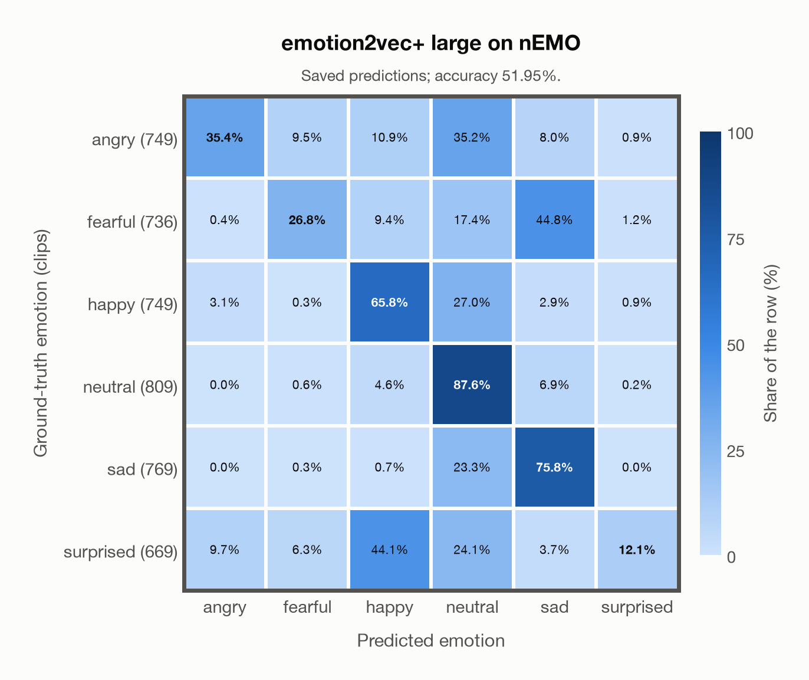

# emotion2vec+ large on nEMO

Regenerated offline from saved CSV/JSON by `scripts/evaluation/refresh_reports.py`. This refresh performs no model inference or API requests.

## Summary

| Metric | Recomputed value |
|---|---:|
| Clips | 4,481 |
| Accuracy: acted emotion | 51.95% |
| UAR: mean ground-truth-row recall | 50.59% |
| Macro F1 | 47.37% |
| Weighted F1: true-support weighted | 48.08% |
| Accuracy: all model classes | 46.73% |

## Imported run and verification

- Source: [prediction CSV](../../outputs/emotion2vec_plus_large/nemo_predictions.csv) and [metadata JSON](../../outputs/emotion2vec_plus_large/nemo_predictions.json); both remain byte-for-byte unchanged.
- Original execution date recorded in JSON: `2026-10-23`.
- Dataset scope recorded in JSON: **nEMO**, Polish; 4,481 / 4,481 clips.
- Ground-truth column: `acted_emotion`. Candidate classes: angry, fearful, happy, neutral, sad, surprised.
- Row counts, unique audio paths, correctness flags and saved metrics were checked against the CSV. Metric agreement tolerance is 0.000001 (six-decimal metadata).
- Weighted F1 weights each class's F1 by its true support, using the same resolved truth as macro F1; invalid answers remain errors. New metrics absent from the source JSON are recorded in the offline audit and summaries; the source JSON is preserved.

## Results per emotion

| Ground-truth emotion | Clips | Recall | Acted-or-listener recall |
|---|---:|---:|---:|
| angry | 749 | 35.38% | — |
| fearful | 736 | 26.77% | — |
| happy | 749 | 65.82% | — |
| neutral | 809 | 87.64% | — |
| sad | 769 | 75.81% | — |
| surprised | 669 | 12.11% | — |

Precision/F1 use the same resolved-truth convention as the evaluation script. Weighted F1 uses the resolved-truth clip counts below as weights.

| Predicted emotion | Resolved-truth clips | Precision | Recall | F1 |
|---|---:|---:|---:|---:|
| angry | 749 | 74.44% | 35.38% | 47.96% |
| fearful | 736 | 61.76% | 26.77% | 37.35% |
| happy | 749 | 50.25% | 65.82% | 56.99% |
| neutral | 809 | 43.15% | 87.64% | 57.83% |
| sad | 769 | 54.18% | 75.81% | 63.20% |
| surprised | 669 | 76.42% | 12.11% | 20.90% |

## Confusion matrix: acted emotion

| Ground truth \ Predicted | angry | fearful | happy | neutral | sad | surprised |
|---|---|---|---|---|---|---|
| angry (749) | **35.4%** | 9.5% | 10.9% | 35.2% | 8.0% | 0.9% |
| fearful (736) | 0.4% | **26.8%** | 9.4% | 17.4% | 44.8% | 1.2% |
| happy (749) | 3.1% | 0.3% | **65.8%** | 27.0% | 2.9% | 0.9% |
| neutral (809) | 0.0% | 0.6% | 4.6% | **87.6%** | 6.9% | 0.2% |
| sad (769) | 0.0% | 0.3% | 0.7% | 23.3% | **75.8%** | 0.0% |
| surprised (669) | 9.7% | 6.3% | 44.1% | 24.1% | 3.7% | **12.1%** |

## Caveats

- **Training involvement for emotion2vec+ large: No corpus-specific evidence**. Source: EmoBox academic data is used for seed fine-tuning, followed by teacher pseudo-labelling and data iteration to large; this project counts those corpora as used through upstream training. Large also uses 42,526 h of industrial pseudo-labelled audio. This is distinct from a claim that every EmoBox corpus directly entered large encoder self-supervised pretraining. Direct use and upstream teacher use both count as training involvement. No pattern: no corpus-specific evidence, not verified unseen. Corpus use is not test-clip leakage.
- Internal CSV/JSON consistency does not authenticate the original model or remote request logs.

[Offline validation audit](nemo_offline_audit.json)
