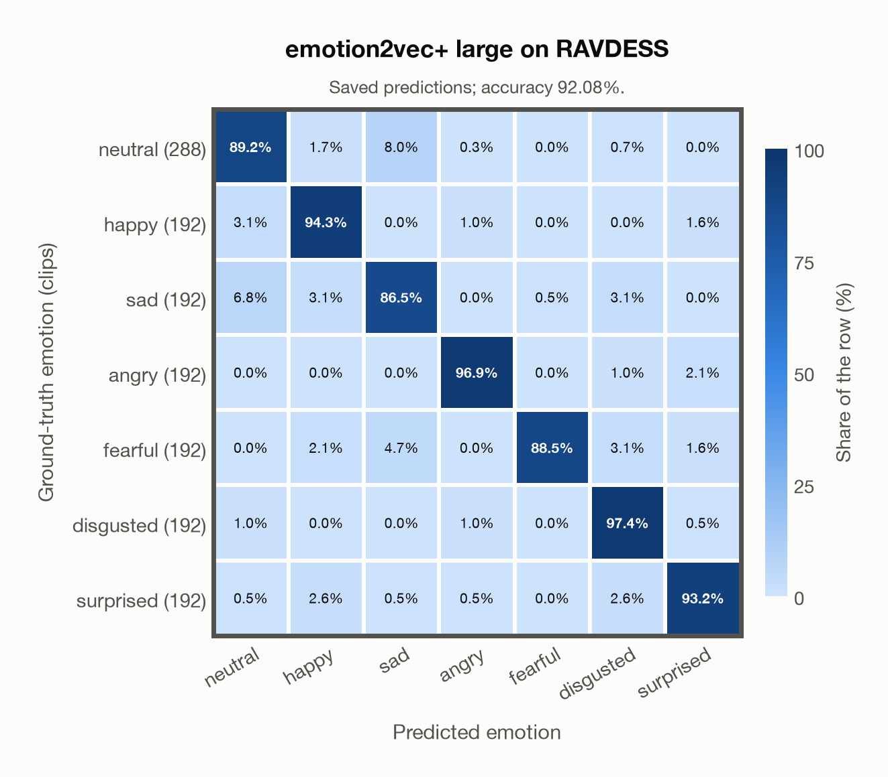

# emotion2vec+ large on RAVDESS

Regenerated offline from saved CSV/JSON by `scripts/evaluation/refresh_reports.py`. This refresh performs no model inference or API requests.

## Summary

| Metric | Recomputed value |
|---|---:|
| Clips | 1,440 |
| Accuracy: acted emotion | 92.08% |
| UAR: mean ground-truth-row recall | 92.29% |
| Macro F1 | 92.20% |
| Weighted F1: true-support weighted | 92.10% |
| Accuracy: all model classes | 92.08% |

## Imported run and verification

- Source: [prediction CSV](../../outputs/emotion2vec_plus_large/ravdess_predictions.csv) and [metadata JSON](../../outputs/emotion2vec_plus_large/ravdess_predictions.json); both remain byte-for-byte unchanged.
- Original execution date recorded in JSON: `2026-10-27`.
- Dataset scope recorded in JSON: **RAVDESS**, English; 1,440 / 1,440 clips.
- Ground-truth column: `acted_emotion`. Candidate classes: neutral, happy, sad, angry, fearful, disgusted, surprised.
- Row counts, unique audio paths, correctness flags and saved metrics were checked against the CSV. Metric agreement tolerance is 0.000001 (six-decimal metadata).
- Weighted F1 weights each class's F1 by its true support, using the same resolved truth as macro F1; invalid answers remain errors. New metrics absent from the source JSON are recorded in the offline audit and summaries; the source JSON is preserved.

## Results per emotion

| Ground-truth emotion | Clips | Recall | Acted-or-listener recall |
|---|---:|---:|---:|
| neutral | 288 | 89.24% | — |
| happy | 192 | 94.27% | — |
| sad | 192 | 86.46% | — |
| angry | 192 | 96.88% | — |
| fearful | 192 | 88.54% | — |
| disgusted | 192 | 97.40% | — |
| surprised | 192 | 93.23% | — |

Precision/F1 use the same resolved-truth convention as the evaluation script. Weighted F1 uses the resolved-truth clip counts below as weights.

| Predicted emotion | Resolved-truth clips | Precision | Recall | F1 |
|---|---:|---:|---:|---:|
| neutral | 288 | 92.11% | 89.24% | 90.65% |
| happy | 192 | 90.05% | 94.27% | 92.11% |
| sad | 192 | 83.42% | 86.46% | 84.91% |
| angry | 192 | 96.88% | 96.88% | 96.88% |
| fearful | 192 | 99.42% | 88.54% | 93.66% |
| disgusted | 192 | 89.90% | 97.40% | 93.50% |
| surprised | 192 | 94.21% | 93.23% | 93.72% |

## Confusion matrix: acted emotion

| Ground truth \ Predicted | neutral | happy | sad | angry | fearful | disgusted | surprised |
|---|---|---|---|---|---|---|---|
| neutral (288) | **89.2%** | 1.7% | 8.0% | 0.3% | 0.0% | 0.7% | 0.0% |
| happy (192) | 3.1% | **94.3%** | 0.0% | 1.0% | 0.0% | 0.0% | 1.6% |
| sad (192) | 6.8% | 3.1% | **86.5%** | 0.0% | 0.5% | 3.1% | 0.0% |
| angry (192) | 0.0% | 0.0% | 0.0% | **96.9%** | 0.0% | 1.0% | 2.1% |
| fearful (192) | 0.0% | 2.1% | 4.7% | 0.0% | **88.5%** | 3.1% | 1.6% |
| disgusted (192) | 1.0% | 0.0% | 0.0% | 1.0% | 0.0% | **97.4%** | 0.5% |
| surprised (192) | 0.5% | 2.6% | 0.5% | 0.5% | 0.0% | 2.6% | **93.2%** |

## Caveats

- **Training involvement for emotion2vec+ large: Used via upstream training**. Evidence scope: upstream teacher lineage. Author documents EmoBox seed training and iterative pseudo-label lineage into large; the exact seed corpus subset and raw-audio/weight inheritance into large are not enumerated. Source: EmoBox academic data is used for seed fine-tuning, followed by teacher pseudo-labelling and data iteration to large; this project counts those corpora as used through upstream training. Large also uses 42,526 h of industrial pseudo-labelled audio. This is distinct from a claim that every EmoBox corpus directly entered large encoder self-supervised pretraining. Direct use and upstream teacher use both count as training involvement. No pattern: no corpus-specific evidence, not verified unseen. Corpus use is not test-clip leakage.
- Internal CSV/JSON consistency does not authenticate the original model or remote request logs.

[Offline validation audit](ravdess_offline_audit.json)
