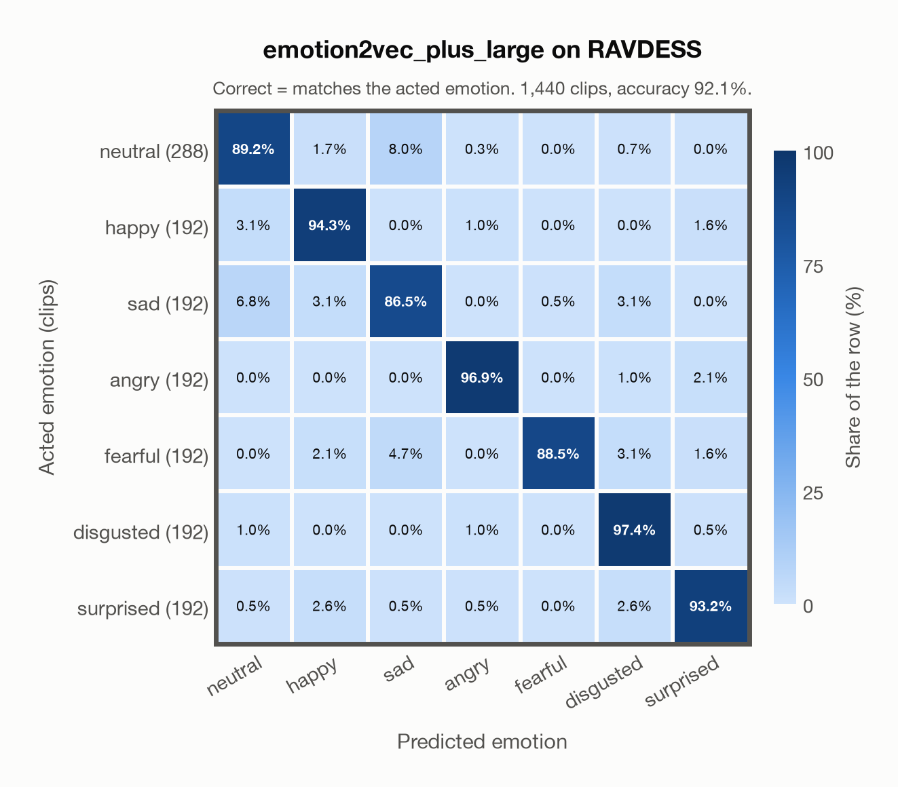

# emotion2vec_plus_large on RAVDESS

Generated by `scripts/emotion2vec/evaluate.py` on 2026-10-27.

## Summary

| Metric | Value |
|---|---|
| Clips evaluated | 1,440 (English) |
| **Accuracy: prediction matches the acted emotion** | **92.1%** |
| Unweighted accuracy (mean recall of the 7 acted emotions) | 92.3% |
| Macro F1 (acted emotion) | 92.2% |
| Accuracy, all 9 model classes (acted emotion) | 92.1% |
| Chance level (7 emotions) | 14.3% |

## Setup

- **Model**: `emotion2vec_plus_large` as released (no fine-tuning), FunASR 1.4.16, one prediction per clip.
- **Data**: 1,440 clips of RAVDESS (English) from `data/ravdess/`.
- **Ground truth (acted emotion)**: the emotion each actor was asked to portray, from the third number in the file name (01 neutral, 02 calm, 03 happy, 04 sad, 05 angry, 06 fearful, 07 disgust, 08 surprised).
- Label mapping: neutral, happy, sad, angry, fearful and surprised keep their names; disgust = disgusted, and **calm = neutral** (emotion2vec+ has no *calm* class), so neutral has 288 clips: 96 acted neutral and 192 acted calm.
- 24 professional actors (12 female, 12 male) say two sentences, "Kids are talking by the door" and "Dogs are sitting by the door", twice in each emotion, at two intensities (normal and strong) except for neutral.
- **7 emotions**: the prediction is the most probable of the 7 emotions in this dataset (neutral, happy, sad, angry, fearful, disgusted, surprised); the model's other classes (`other`, `<unk>`) are ignored. **All 9 classes**: the prediction is the most probable of all nine classes, so choosing a class that the dataset does not have counts as wrong.
- **Hardware**: Apple M4 Max, device `cpu`, PyTorch 2.5.1. Inference took 2.4 min (99 ms per clip).
- **Per-clip predictions**: `outputs/emotion2vec_plus_large/ravdess_predictions.csv` (in git, so the results can be checked clip by clip). The JSON file next to it describes the columns.

## Results per emotion

Rows: acted emotion. Precision, recall and F1 compare the prediction with the acted emotion.

| Emotion | Clips | Precision | Recall | F1 |
|---|---|---|---|---|
| neutral | 288 | 92.1% | 89.2% | 90.7% |
| happy | 192 | 90.0% | 94.3% | 92.1% |
| sad | 192 | 83.4% | 86.5% | 84.9% |
| angry | 192 | 96.9% | 96.9% | 96.9% |
| fearful | 192 | 99.4% | 88.5% | 93.7% |
| disgusted | 192 | 89.9% | 97.4% | 93.5% |
| surprised | 192 | 94.2% | 93.2% | 93.7% |

## Confusion matrix: acted emotion

The same numbers as a table. Rows: acted emotion. Columns: predicted emotion. Each row adds up to 100%.

| Acted \ Predicted | neutral | happy | sad | angry | fearful | disgusted | surprised |
|---|---|---|---|---|---|---|---|
| neutral (288) | **89.2%** | 1.7% | 8.0% | 0.3% | 0.0% | 0.7% | 0.0% |
| happy (192) | 3.1% | **94.3%** | 0.0% | 1.0% | 0.0% | 0.0% | 1.6% |
| sad (192) | 6.8% | 3.1% | **86.5%** | 0.0% | 0.5% | 3.1% | 0.0% |
| angry (192) | 0.0% | 0.0% | 0.0% | **96.9%** | 0.0% | 1.0% | 2.1% |
| fearful (192) | 0.0% | 2.1% | 4.7% | 0.0% | **88.5%** | 3.1% | 1.6% |
| disgusted (192) | 1.0% | 0.0% | 0.0% | 1.0% | 0.0% | **97.4%** | 0.5% |
| surprised (192) | 0.5% | 2.6% | 0.5% | 0.5% | 0.0% | 2.6% | **93.2%** |

Most frequent confusions: neutral predicted as sad (8.0%), sad predicted as neutral (6.8%), fearful predicted as sad (4.7%).

## Predictions outside the 7 emotions

With all nine classes, the model chose a class that this dataset does not have for 1 clips (0.1%): `other` 0, `<unk>` 1.

## Caveats

- **In EmoBox.** EmoBox data fine-tuned emotion2vec+ seed, the first model in the chain that led to emotion2vec+ large, so the model has probably seen these clips or labels derived from them. Treat these numbers as optimistic.
- *Calm* is not quite *neutral*: calm clips predicted as neutral count as correct.
- Listeners rated every file 10 times (247 listeners). The paper publishes their ratings as recognition rates per file, not as a vote for an emotion, so this report has no listeners' labels.
- Audio: 48 kHz WAV, resampled to 16 kHz; 5 files are stereo, and FunASR averages their channels.
