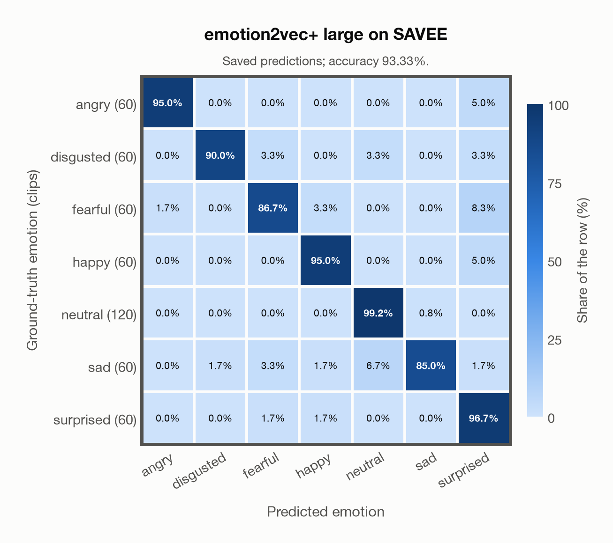

# emotion2vec+ large on SAVEE

Regenerated offline from saved CSV/JSON by `scripts/evaluation/refresh_reports.py`. This refresh performs no model inference or API requests.

## Summary

| Metric | Recomputed value |
|---|---:|
| Clips | 480 |
| Accuracy: acted emotion | 93.33% |
| UAR: mean ground-truth-row recall | 92.50% |
| Macro F1 | 92.82% |
| Weighted F1: true-support weighted | 93.36% |
| Accuracy: all model classes | 93.33% |

## Imported run and verification

- Source: [prediction CSV](../../outputs/emotion2vec_plus_large/savee_predictions.csv) and [metadata JSON](../../outputs/emotion2vec_plus_large/savee_predictions.json); both remain byte-for-byte unchanged.
- Original execution date recorded in JSON: `2026-11-06`.
- Dataset scope recorded in JSON: **SAVEE**, English (British); 480 / 480 clips.
- Ground-truth column: `acted_emotion`. Candidate classes: angry, disgusted, fearful, happy, neutral, sad, surprised.
- Row counts, unique audio paths, correctness flags and saved metrics were checked against the CSV. Metric agreement tolerance is 0.000001 (six-decimal metadata).
- Weighted F1 weights each class's F1 by its true support, using the same resolved truth as macro F1; invalid answers remain errors. New metrics absent from the source JSON are recorded in the offline audit and summaries; the source JSON is preserved.
- Original execution/client runtime metadata (reported by the imported run, not measured by this refresh): `{"device": "cpu", "hardware": "Apple M4 Max", "seconds": 60.0, "ms_per_clip": 124.9, "on_cpu": 0}`.

## Results per emotion

| Ground-truth emotion | Clips | Recall | Acted-or-listener recall |
|---|---:|---:|---:|
| angry | 60 | 95.00% | — |
| disgusted | 60 | 90.00% | — |
| fearful | 60 | 86.67% | — |
| happy | 60 | 95.00% | — |
| neutral | 120 | 99.17% | — |
| sad | 60 | 85.00% | — |
| surprised | 60 | 96.67% | — |

Precision/F1 use the same resolved-truth convention as the evaluation script. Weighted F1 uses the resolved-truth clip counts below as weights.

| Predicted emotion | Resolved-truth clips | Precision | Recall | F1 |
|---|---:|---:|---:|---:|
| angry | 60 | 98.28% | 95.00% | 96.61% |
| disgusted | 60 | 98.18% | 90.00% | 93.91% |
| fearful | 60 | 91.23% | 86.67% | 88.89% |
| happy | 60 | 93.44% | 95.00% | 94.21% |
| neutral | 120 | 95.20% | 99.17% | 97.14% |
| sad | 60 | 98.08% | 85.00% | 91.07% |
| surprised | 60 | 80.56% | 96.67% | 87.88% |

## Confusion matrix: acted emotion

| Ground truth \ Predicted | angry | disgusted | fearful | happy | neutral | sad | surprised |
|---|---|---|---|---|---|---|---|
| angry (60) | **95.0%** | 0.0% | 0.0% | 0.0% | 0.0% | 0.0% | 5.0% |
| disgusted (60) | 0.0% | **90.0%** | 3.3% | 0.0% | 3.3% | 0.0% | 3.3% |
| fearful (60) | 1.7% | 0.0% | **86.7%** | 3.3% | 0.0% | 0.0% | 8.3% |
| happy (60) | 0.0% | 0.0% | 0.0% | **95.0%** | 0.0% | 0.0% | 5.0% |
| neutral (120) | 0.0% | 0.0% | 0.0% | 0.0% | **99.2%** | 0.8% | 0.0% |
| sad (60) | 0.0% | 1.7% | 3.3% | 1.7% | 6.7% | **85.0%** | 1.7% |
| surprised (60) | 0.0% | 0.0% | 1.7% | 1.7% | 0.0% | 0.0% | **96.7%** |

## Caveats

- **Training involvement for emotion2vec+ large: Used via upstream training**. Evidence scope: upstream teacher lineage. Author documents EmoBox seed training and iterative pseudo-label lineage into large; the exact seed corpus subset and raw-audio/weight inheritance into large are not enumerated. Source: EmoBox academic data is used for seed fine-tuning, followed by teacher pseudo-labelling and data iteration to large; this project counts those corpora as used through upstream training. Large also uses 42,526 h of industrial pseudo-labelled audio. This is distinct from a claim that every EmoBox corpus directly entered large encoder self-supervised pretraining. Direct use and upstream teacher use both count as training involvement. No pattern: no corpus-specific evidence, not verified unseen. Corpus use is not test-clip leakage.
- Internal CSV/JSON consistency does not authenticate the original model or remote request logs.

[Offline validation audit](savee_offline_audit.json)
