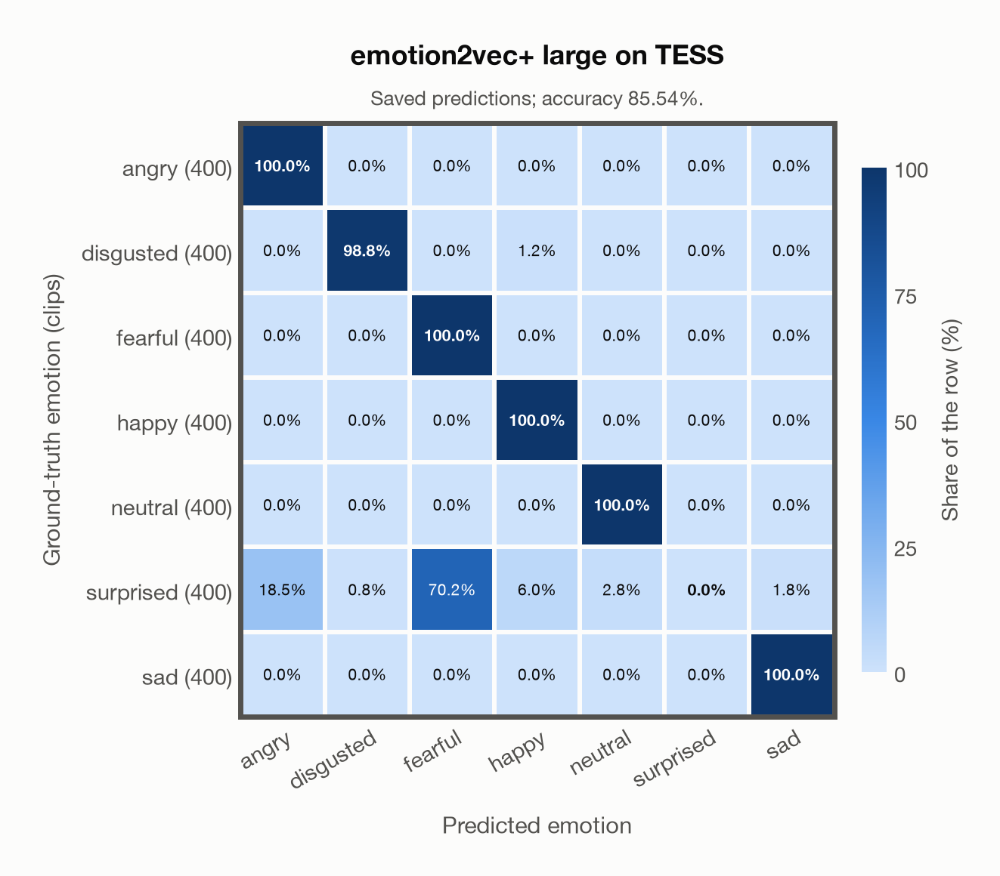

# emotion2vec+ large on TESS

Regenerated offline from saved CSV/JSON by `scripts/evaluation/refresh_reports.py`. This refresh performs no model inference or API requests.

## Summary

| Metric | Recomputed value |
|---|---:|
| Clips | 2,800 |
| Accuracy: acted emotion | 85.54% |
| UAR: mean ground-truth-row recall | 85.54% |
| Macro F1 | 79.83% |
| Weighted F1: true-support weighted | 79.83% |
| Accuracy: all model classes | 84.50% |

## Imported run and verification

- Source: [prediction CSV](../../outputs/emotion2vec_plus_large/tess_predictions.csv) and [metadata JSON](../../outputs/emotion2vec_plus_large/tess_predictions.json); both remain byte-for-byte unchanged.
- Original execution date recorded in JSON: `2026-10-27`.
- Dataset scope recorded in JSON: **TESS**, English; 2,800 / 2,800 clips.
- Ground-truth column: `acted_emotion`. Candidate classes: angry, disgusted, fearful, happy, neutral, surprised, sad.
- Row counts, unique audio paths, correctness flags and saved metrics were checked against the CSV. Metric agreement tolerance is 0.000001 (six-decimal metadata).
- Weighted F1 weights each class's F1 by its true support, using the same resolved truth as macro F1; invalid answers remain errors. New metrics absent from the source JSON are recorded in the offline audit and summaries; the source JSON is preserved.

## Results per emotion

| Ground-truth emotion | Clips | Recall | Acted-or-listener recall |
|---|---:|---:|---:|
| angry | 400 | 100.00% | — |
| disgusted | 400 | 98.75% | — |
| fearful | 400 | 100.00% | — |
| happy | 400 | 100.00% | — |
| neutral | 400 | 100.00% | — |
| surprised | 400 | 0.00% | — |
| sad | 400 | 100.00% | — |

Precision/F1 use the same resolved-truth convention as the evaluation script. Weighted F1 uses the resolved-truth clip counts below as weights.

| Predicted emotion | Resolved-truth clips | Precision | Recall | F1 |
|---|---:|---:|---:|---:|
| angry | 400 | 84.39% | 100.00% | 91.53% |
| disgusted | 400 | 99.25% | 98.75% | 99.00% |
| fearful | 400 | 58.74% | 100.00% | 74.01% |
| happy | 400 | 93.24% | 100.00% | 96.50% |
| neutral | 400 | 97.32% | 100.00% | 98.64% |
| surprised | 400 | 0.00% | 0.00% | 0.00% |
| sad | 400 | 98.28% | 100.00% | 99.13% |

## Confusion matrix: acted emotion

| Ground truth \ Predicted | angry | disgusted | fearful | happy | neutral | surprised | sad |
|---|---|---|---|---|---|---|---|
| angry (400) | **100.0%** | 0.0% | 0.0% | 0.0% | 0.0% | 0.0% | 0.0% |
| disgusted (400) | 0.0% | **98.8%** | 0.0% | 1.2% | 0.0% | 0.0% | 0.0% |
| fearful (400) | 0.0% | 0.0% | **100.0%** | 0.0% | 0.0% | 0.0% | 0.0% |
| happy (400) | 0.0% | 0.0% | 0.0% | **100.0%** | 0.0% | 0.0% | 0.0% |
| neutral (400) | 0.0% | 0.0% | 0.0% | 0.0% | **100.0%** | 0.0% | 0.0% |
| surprised (400) | 18.5% | 0.8% | 70.2% | 6.0% | 2.8% | **0.0%** | 1.8% |
| sad (400) | 0.0% | 0.0% | 0.0% | 0.0% | 0.0% | 0.0% | **100.0%** |

## Caveats

- **Training involvement for emotion2vec+ large: Used via upstream training**. Evidence scope: upstream teacher lineage. Author documents EmoBox seed training and iterative pseudo-label lineage into large; the exact seed corpus subset and raw-audio/weight inheritance into large are not enumerated. Source: EmoBox academic data is used for seed fine-tuning, followed by teacher pseudo-labelling and data iteration to large; this project counts those corpora as used through upstream training. Large also uses 42,526 h of industrial pseudo-labelled audio. This is distinct from a claim that every EmoBox corpus directly entered large encoder self-supervised pretraining. Direct use and upstream teacher use both count as training involvement. No pattern: no corpus-specific evidence, not verified unseen. Corpus use is not test-clip leakage.
- Internal CSV/JSON consistency does not authenticate the original model or remote request logs.

[Offline validation audit](tess_offline_audit.json)
