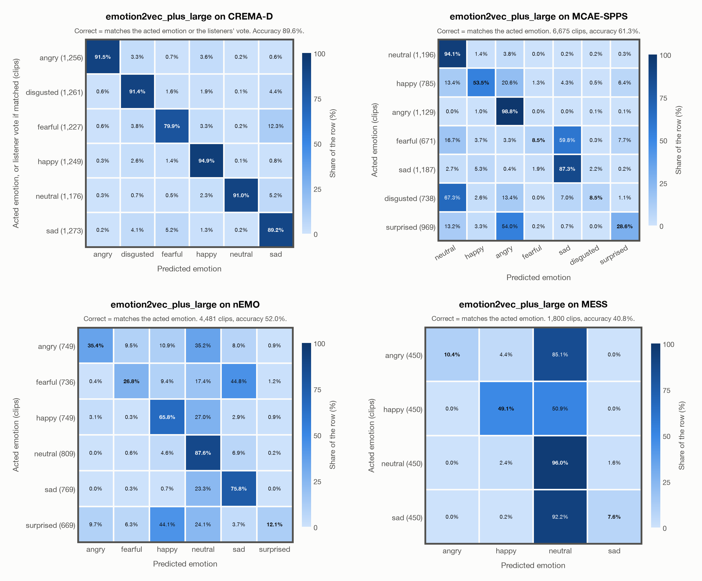

# emotion2vec_plus_large: results on every dataset

Generated by `scripts/evaluate.py` on 2026-10-27. Each dataset links to its full report.

| Dataset | Language | Clips | Emotions | Chance | Accuracy: acted emotion | Accuracy: acted or listeners' vote | Unweighted accuracy | Macro F1 | In EmoBox |
|---|---|---|---|---|---|---|---|---|---|
| [CREMA-D](crema_d_emotion2vec_plus_large.md) | English | 7,442 | 6 | 16.7% | **86.5%** | 89.6% | 86.5% | 86.6% | yes |
| [MCAE-SPPS](mcae_spps_emotion2vec_plus_large.md) | Mandarin | 6,675 | 7 | 14.3% | **61.3%** | 61.3% | 54.2% | 50.1% | no |
| [nEMO](nemo_emotion2vec_plus_large.md) | Polish | 4,481 | 6 | 16.7% | **52.0%** | – | 50.6% | 47.4% | no |
| [MESS](mess_emotion2vec_plus_large.md) | English | 1,800 | 4 | 25.0% | **40.8%** | – | 40.8% | 35.2% | no |

- **Accuracy: acted emotion** compares the prediction with the emotion the speaker was asked to portray. The prediction is the most probable of the emotions that the dataset has, so chance level depends on how many emotions it has.
- **Accuracy: acted or listeners' vote** also accepts the listeners' majority vote; it exists only for datasets that publish listeners' labels.
- **In EmoBox**: the dataset was probably part of emotion2vec+'s training data, so its result is optimistic. For the others, earlier exposure cannot be ruled out completely either (see each report).

## Confusion matrices

One matrix per dataset, from each dataset's report: CREMA-D, MCAE-SPPS, nEMO, MESS (order: `evaluation.summary_figure` in config/config.yaml). Rows: acted emotion; columns: predicted emotion; each row adds up to 100%. CREMA-D: the matrix where a prediction also counts as correct when it matches the listeners' vote, so a clip whose prediction matched that vote sits in the row of that vote.

## Only the emotions every dataset has: angry, happy, neutral, sad

The datasets have different emotions, and some emotions are much harder than others, so the table above also reflects which emotions each dataset has. Here every dataset is scored on the same 4 emotions (chance 25.0%): clips of other emotions are left out, and the prediction is the most probable of these 4.

| Dataset | Language | Clips | Accuracy | Unweighted accuracy | In EmoBox |
|---|---|---|---|---|---|
| [CREMA-D](crema_d_emotion2vec_plus_large.md) | English | 4,900 | **93.2%** | 93.1% | yes |
| [MCAE-SPPS](mcae_spps_emotion2vec_plus_large.md) | Mandarin | 4,297 | **87.8%** | 85.3% | no |
| [nEMO](nemo_emotion2vec_plus_large.md) | Polish | 3,076 | **67.8%** | 67.4% | no |
| [MESS](mess_emotion2vec_plus_large.md) | English | 1,800 | **40.8%** | 40.8% | no |

Computed from the predictions files in `outputs/`. Their probabilities have 4 decimals, so a clip whose shared emotions are tied counts as wrong.
