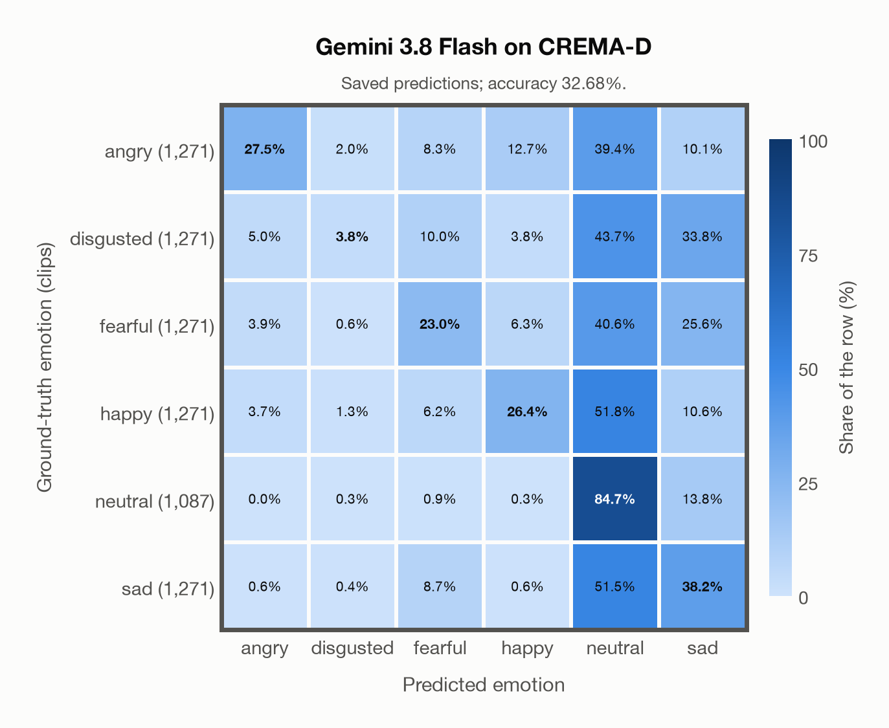
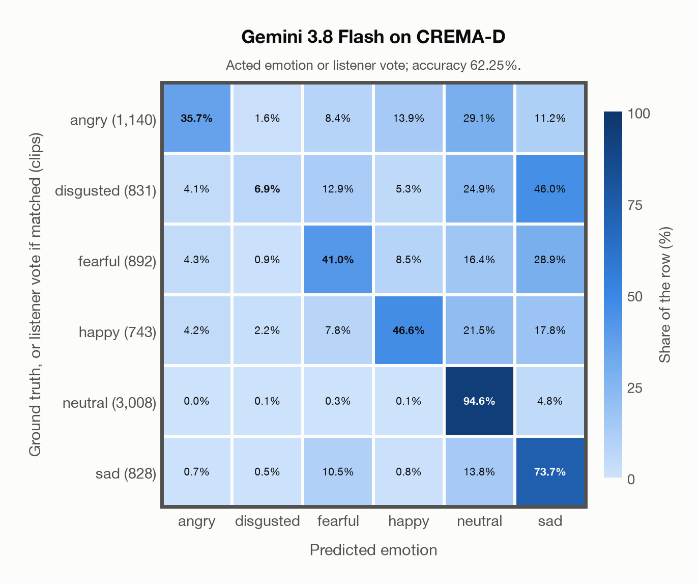

# Gemini 3.8 Flash on CREMA-D

Regenerated offline from saved CSV/JSON by `scripts/evaluation/refresh_reports.py`. This refresh performs no model inference or API requests.

## Summary

| Metric | Recomputed value |
|---|---:|
| Clips | 7,442 |
| Accuracy: acted emotion | 32.68% |
| UAR: mean ground-truth-row recall | 33.94% |
| Macro F1 | 30.24% |
| Weighted F1 (by true class support) | 30.05% |
| Accuracy: all model classes | 32.68% |
| Accuracy: acted emotion or listener vote | 62.25% |
| Single listener vote vs acted emotion | 45.59% |
| Model vs single listener vote | 53.30% |

## Imported run and verification

- Source: [prediction CSV](../../outputs/gemini-3.8-flash/crema_d_predictions.csv) and [metadata JSON](../../outputs/gemini-3.8-flash/crema_d_predictions.json); both remain byte-for-byte unchanged.
- Original execution date recorded in JSON: `2026-11-10`.
- Dataset scope recorded in JSON: **CREMA-D**, English; 7,442 / 7,442 clips.
- Ground-truth column: `acted_emotion`. Candidate classes: angry, disgusted, fearful, happy, neutral, sad.
- Row counts, unique audio paths, correctness flags and saved metrics were checked against the CSV. Metric agreement tolerance is 0.000001 (six-decimal metadata).
- Saved candidate/prompt/model protocol matches current configuration: scope `dataset`, model `gemini-3.8-flash`, prompt hash `4ff3d2e97612`.
- Original execution/client runtime metadata (reported by the imported run, not measured by this refresh): `{"device": "cpu", "hardware": "Apple M3 Pro", "seconds": 3448.9, "ms_per_clip": 463.4, "on_cpu": 0}`.
- The original notes report one 24 kHz audio clip per request.
- The original notes report up to 10 concurrent clip evaluations.
- The recorded ms_per_clip is total wall-clock time divided by the number of clips, not individual request latency; it is not directly comparable with local GPU inference timing.
- The original notes describe schema-constrained answers validated as literal JSON strings.
- Saved p_* columns encode the returned answer as one-hot values; they are not calibrated API class probabilities, and no confidence plot is inferred from them.
- A raw responses journal is present; this refresh validates CSV/JSON only.

## Results per emotion

| Ground-truth emotion | Clips | Recall | Acted-or-listener recall |
|---|---:|---:|---:|
| angry | 1,271 | 27.46% | 42.33% |
| disgusted | 1,271 | 3.78% | 39.10% |
| fearful | 1,271 | 22.97% | 58.62% |
| happy | 1,271 | 26.44% | 68.76% |
| neutral | 1,087 | 84.73% | 85.19% |
| sad | 1,271 | 38.24% | 82.85% |

Precision/F1 use the same resolved-truth convention as the evaluation script.

| Predicted emotion | Resolved-truth clips | Precision | Recall | F1 |
|---|---:|---:|---:|---:|
| angry | 1,271 | 67.64% | 27.46% | 39.06% |
| disgusted | 1,271 | 45.28% | 3.78% | 6.97% |
| fearful | 1,271 | 40.33% | 22.97% | 29.27% |
| happy | 1,271 | 52.91% | 26.44% | 35.26% |
| neutral | 1,087 | 24.20% | 84.73% | 37.65% |
| sad | 1,271 | 29.37% | 38.24% | 33.22% |

## Confusion matrix: acted emotion

| Ground truth \ Predicted | angry | disgusted | fearful | happy | neutral | sad |
|---|---|---|---|---|---|---|
| angry (1,271) | **27.5%** | 2.0% | 8.3% | 12.7% | 39.4% | 10.1% |
| disgusted (1,271) | 5.0% | **3.8%** | 10.0% | 3.8% | 43.7% | 33.8% |
| fearful (1,271) | 3.9% | 0.6% | **23.0%** | 6.3% | 40.6% | 25.6% |
| happy (1,271) | 3.7% | 1.3% | 6.2% | **26.4%** | 51.8% | 10.6% |
| neutral (1,087) | 0.0% | 0.3% | 0.9% | 0.3% | **84.7%** | 13.8% |
| sad (1,271) | 0.6% | 0.4% | 8.7% | 0.6% | 51.5% | **38.2%** |

## Confusion matrix: acted emotion or listener vote

A prediction accepted only through the listener vote is placed in that predicted emotion's row; other clips keep their original ground-truth row. Row supports can therefore change.

| Ground truth \ Predicted | angry | disgusted | fearful | happy | neutral | sad |
|---|---|---|---|---|---|---|
| angry (1,140) | **35.7%** | 1.6% | 8.4% | 13.9% | 29.1% | 11.2% |
| disgusted (831) | 4.1% | **6.9%** | 12.9% | 5.3% | 24.9% | 46.0% |
| fearful (892) | 4.3% | 0.9% | **41.0%** | 8.5% | 16.4% | 28.9% |
| happy (743) | 4.2% | 2.2% | 7.8% | **46.6%** | 21.5% | 17.8% |
| neutral (3,008) | 0.0% | 0.1% | 0.3% | 0.1% | **94.6%** | 4.8% |
| sad (828) | 0.7% | 0.5% | 10.5% | 0.8% | 13.8% | **73.7%** |

## Caveats

- **Training involvement for Gemini 3.8 Flash: No corpus-specific evidence**. Source: not published (Google). Direct use and upstream teacher use both count as training involvement. No pattern: no corpus-specific evidence, not verified unseen. Corpus use is not test-clip leakage.
- The known empty CREMA-D recording 1076_MTI_SAD_XX.wav is retained in the saved predictions, matching the existing project evaluation scope.
- Internal CSV/JSON consistency does not authenticate the original model or remote request logs.

[Offline validation audit](crema_d_offline_audit.json)
