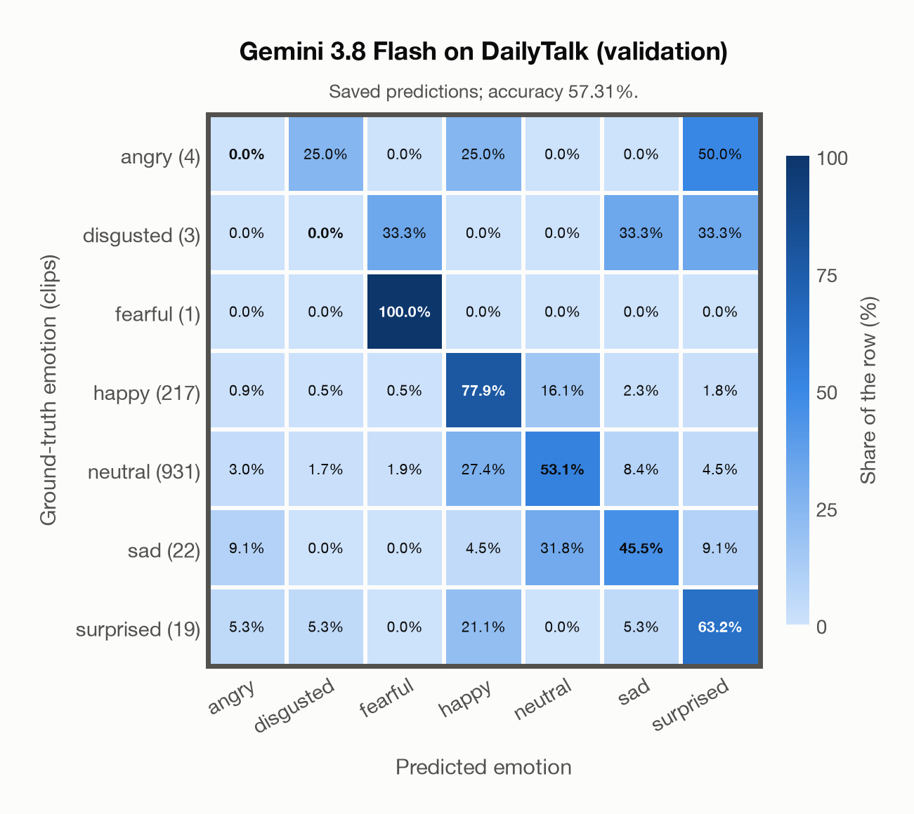

# Gemini 3.8 Flash on DailyTalk (validation)

Regenerated offline from saved CSV/JSON by `scripts/evaluation/refresh_reports.py`. This refresh performs no model inference or API requests.

## Summary

| Metric | Recomputed value |
|---|---:|
| Clips | 1,197 |
| Accuracy: acted emotion | 57.31% |
| UAR: mean ground-truth-row recall | 48.51% |
| Macro F1 | 25.01% |
| Accuracy: all model classes | 57.31% |

## Imported run and verification

- Source: [prediction CSV](../../outputs/gemini-3.8-flash/dailytalk_predictions.csv) and [metadata JSON](../../outputs/gemini-3.8-flash/dailytalk_predictions.json); both remain byte-for-byte unchanged.
- Original execution date recorded in JSON: `2026-11-10`.
- Dataset scope recorded in JSON: **DailyTalk (validation)**, English; 1,197 / 1,197 clips.
- Ground-truth column: `acted_emotion`. Candidate classes: angry, disgusted, fearful, happy, neutral, sad, surprised.
- Row counts, unique audio paths, correctness flags and saved metrics were checked against the CSV. Metric agreement tolerance is 0.000001 (six-decimal metadata).
- Saved candidate/prompt/model protocol matches current configuration: scope `dataset`, model `gemini-3.8-flash`, prompt hash `dc84c979c561`.
- Original execution/client runtime metadata (reported by the imported run, not measured by this refresh): `{"device": "cpu", "hardware": "Apple M3 Pro", "seconds": 248.5, "ms_per_clip": 207.6, "on_cpu": 0}`.
- The original notes report one 24 kHz audio clip per request.
- The original notes report up to 30 concurrent clip evaluations.
- The recorded ms_per_clip is total wall-clock time divided by the number of clips, not individual request latency; it is not directly comparable with local GPU inference timing.
- The original notes describe schema-constrained answers validated as literal JSON strings.
- Saved p_* columns encode the returned answer as one-hot values; they are not calibrated API class probabilities, and no confidence plot is inferred from them.
- A raw responses journal is present; this refresh validates CSV/JSON only.

## Results per emotion

| Ground-truth emotion | Clips | Recall | Acted-or-listener recall |
|---|---:|---:|---:|
| angry | 4 | 0.00% | — |
| disgusted | 3 | 0.00% | — |
| fearful | 1 | 100.00% | — |
| happy | 217 | 77.88% | — |
| neutral | 931 | 53.06% | — |
| sad | 22 | 45.45% | — |
| surprised | 19 | 63.16% | — |

Precision/F1 use the same resolved-truth convention as the evaluation script.

| Predicted emotion | Resolved-truth clips | Precision | Recall | F1 |
|---|---:|---:|---:|---:|
| angry | 4 | 0.00% | 0.00% | 0.00% |
| disgusted | 3 | 0.00% | 0.00% | 0.00% |
| fearful | 1 | 4.76% | 100.00% | 9.09% |
| happy | 217 | 39.30% | 77.88% | 52.24% |
| neutral | 931 | 92.16% | 53.06% | 67.35% |
| sad | 22 | 10.53% | 45.45% | 17.09% |
| surprised | 19 | 19.05% | 63.16% | 29.27% |

## Confusion matrix: acted emotion

| Ground truth \ Predicted | angry | disgusted | fearful | happy | neutral | sad | surprised |
|---|---|---|---|---|---|---|---|
| angry (4) | **0.0%** | 25.0% | 0.0% | 25.0% | 0.0% | 0.0% | 50.0% |
| disgusted (3) | 0.0% | **0.0%** | 33.3% | 0.0% | 0.0% | 33.3% | 33.3% |
| fearful (1) | 0.0% | 0.0% | **100.0%** | 0.0% | 0.0% | 0.0% | 0.0% |
| happy (217) | 0.9% | 0.5% | 0.5% | **77.9%** | 16.1% | 2.3% | 1.8% |
| neutral (931) | 3.0% | 1.7% | 1.9% | 27.4% | **53.1%** | 8.4% | 4.5% |
| sad (22) | 9.1% | 0.0% | 0.0% | 4.5% | 31.8% | **45.5%** | 9.1% |
| surprised (19) | 5.3% | 5.3% | 0.0% | 21.1% | 0.0% | 5.3% | **63.2%** |

## Caveats

- **Training involvement for Gemini 3.8 Flash: No corpus-specific evidence**. Source: not published (Google). Direct use and upstream teacher use both count as training involvement. No pattern: no corpus-specific evidence, not verified unseen. Corpus use is not test-clip leakage.
- Internal CSV/JSON consistency does not authenticate the original model or remote request logs.

[Offline validation audit](dailytalk_offline_audit.json)
