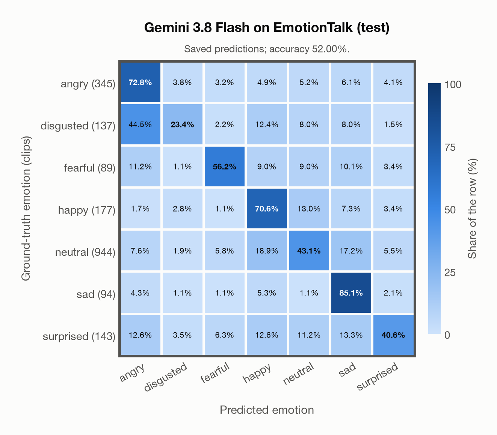

# Gemini 3.8 Flash on EmotionTalk (test)

Regenerated offline from saved CSV/JSON by `scripts/evaluation/refresh_reports.py`. This refresh performs no model inference or API requests.

## Summary

| Metric | Recomputed value |
|---|---:|
| Clips | 1,929 |
| Accuracy: acted emotion | 52.00% |
| UAR: mean ground-truth-row recall | 55.96% |
| Macro F1 | 46.40% |
| Weighted F1 (by true class support) | 53.07% |
| Accuracy: all model classes | 52.00% |

## Imported run and verification

- Source: [prediction CSV](../../outputs/gemini-3.8-flash/emotiontalk_predictions.csv) and [metadata JSON](../../outputs/gemini-3.8-flash/emotiontalk_predictions.json); both remain byte-for-byte unchanged.
- Original execution date recorded in JSON: `2026-11-10`.
- Dataset scope recorded in JSON: **EmotionTalk (test)**, Mandarin; 1,929 / 1,929 clips.
- Ground-truth column: `acted_emotion`. Candidate classes: angry, disgusted, fearful, happy, neutral, sad, surprised.
- Row counts, unique audio paths, correctness flags and saved metrics were checked against the CSV. Metric agreement tolerance is 0.000001 (six-decimal metadata).
- Saved candidate/prompt/model protocol matches current configuration: scope `dataset`, model `gemini-3.8-flash`, prompt hash `dc84c979c561`.
- Original execution/client runtime metadata (reported by the imported run, not measured by this refresh): `{"device": "cpu", "hardware": "Apple M3 Pro", "seconds": 413.3, "ms_per_clip": 214.2, "on_cpu": 0}`.
- The original notes report one 24 kHz audio clip per request.
- The original notes report up to 30 concurrent clip evaluations.
- The recorded ms_per_clip is total wall-clock time divided by the number of clips, not individual request latency; it is not directly comparable with local GPU inference timing.
- The original notes describe schema-constrained answers validated as literal JSON strings.
- Saved p_* columns encode the returned answer as one-hot values; they are not calibrated API class probabilities, and no confidence plot is inferred from them.
- A raw responses journal is present; this refresh validates CSV/JSON only.

## Results per emotion

| Ground-truth emotion | Clips | Recall | Acted-or-listener recall |
|---|---:|---:|---:|
| angry | 345 | 72.75% | — |
| disgusted | 137 | 23.36% | — |
| fearful | 89 | 56.18% | — |
| happy | 177 | 70.62% | — |
| neutral | 944 | 43.11% | — |
| sad | 94 | 85.11% | — |
| surprised | 143 | 40.56% | — |

Precision/F1 use the same resolved-truth convention as the evaluation script.

| Predicted emotion | Resolved-truth clips | Precision | Recall | F1 |
|---|---:|---:|---:|---:|
| angry | 345 | 59.90% | 72.75% | 65.71% |
| disgusted | 137 | 42.67% | 23.36% | 30.19% |
| fearful | 89 | 38.17% | 56.18% | 45.45% |
| happy | 177 | 33.97% | 70.62% | 45.87% |
| neutral | 944 | 84.09% | 43.11% | 57.00% |
| sad | 94 | 25.40% | 85.11% | 39.12% |
| surprised | 143 | 42.34% | 40.56% | 41.43% |

## Confusion matrix: acted emotion

| Ground truth \ Predicted | angry | disgusted | fearful | happy | neutral | sad | surprised |
|---|---|---|---|---|---|---|---|
| angry (345) | **72.8%** | 3.8% | 3.2% | 4.9% | 5.2% | 6.1% | 4.1% |
| disgusted (137) | 44.5% | **23.4%** | 2.2% | 12.4% | 8.0% | 8.0% | 1.5% |
| fearful (89) | 11.2% | 1.1% | **56.2%** | 9.0% | 9.0% | 10.1% | 3.4% |
| happy (177) | 1.7% | 2.8% | 1.1% | **70.6%** | 13.0% | 7.3% | 3.4% |
| neutral (944) | 7.6% | 1.9% | 5.8% | 18.9% | **43.1%** | 17.2% | 5.5% |
| sad (94) | 4.3% | 1.1% | 1.1% | 5.3% | 1.1% | **85.1%** | 2.1% |
| surprised (143) | 12.6% | 3.5% | 6.3% | 12.6% | 11.2% | 13.3% | **40.6%** |

## Caveats

- **Training involvement for Gemini 3.8 Flash: No corpus-specific evidence**. Source: not published (Google). Direct use and upstream teacher use both count as training involvement. No pattern: no corpus-specific evidence, not verified unseen. Corpus use is not test-clip leakage.
- Internal CSV/JSON consistency does not authenticate the original model or remote request logs.

[Offline validation audit](emotiontalk_offline_audit.json)
