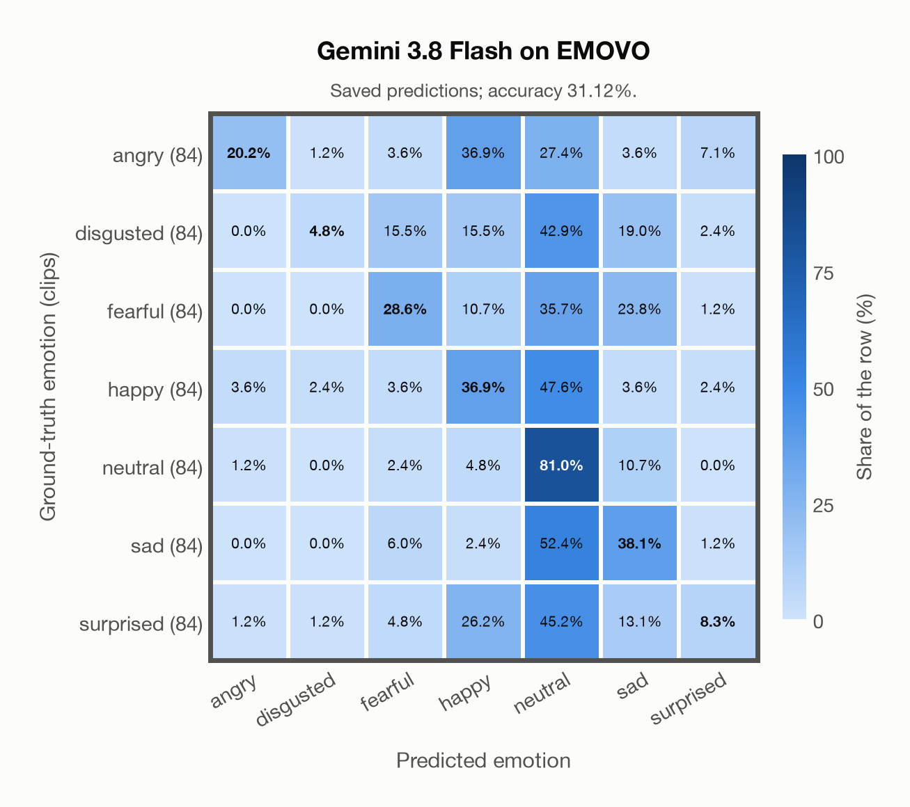

# Gemini 3.8 Flash on EMOVO

Regenerated offline from saved CSV/JSON by `scripts/evaluation/refresh_reports.py`. This refresh performs no model inference or API requests.

## Summary

| Metric | Recomputed value |
|---|---:|
| Clips | 588 |
| Accuracy: acted emotion | 31.12% |
| UAR: mean ground-truth-row recall | 31.12% |
| Macro F1 | 27.74% |
| Accuracy: all model classes | 31.12% |

## Imported run and verification

- Source: [prediction CSV](../../outputs/gemini-3.8-flash/emovo_predictions.csv) and [metadata JSON](../../outputs/gemini-3.8-flash/emovo_predictions.json); both remain byte-for-byte unchanged.
- Original execution date recorded in JSON: `2026-11-10`.
- Dataset scope recorded in JSON: **EMOVO**, Italian; 588 / 588 clips.
- Ground-truth column: `acted_emotion`. Candidate classes: angry, disgusted, fearful, happy, neutral, sad, surprised.
- Row counts, unique audio paths, correctness flags and saved metrics were checked against the CSV. Metric agreement tolerance is 0.000001 (six-decimal metadata).
- Saved candidate/prompt/model protocol matches current configuration: scope `dataset`, model `gemini-3.8-flash`, prompt hash `dc84c979c561`.
- Original execution/client runtime metadata (reported by the imported run, not measured by this refresh): `{"device": "cpu", "hardware": "Apple M3 Pro", "seconds": 86.5, "ms_per_clip": 147.1, "on_cpu": 0}`.
- The original notes report one 24 kHz audio clip per request.
- The original notes report up to 30 concurrent clip evaluations.
- The recorded ms_per_clip is total wall-clock time divided by the number of clips, not individual request latency; it is not directly comparable with local GPU inference timing.
- The original notes describe schema-constrained answers validated as literal JSON strings.
- Saved p_* columns encode the returned answer as one-hot values; they are not calibrated API class probabilities, and no confidence plot is inferred from them.
- A raw responses journal is present; this refresh validates CSV/JSON only.

## Results per emotion

| Ground-truth emotion | Clips | Recall | Acted-or-listener recall |
|---|---:|---:|---:|
| angry | 84 | 20.24% | — |
| disgusted | 84 | 4.76% | — |
| fearful | 84 | 28.57% | — |
| happy | 84 | 36.90% | — |
| neutral | 84 | 80.95% | — |
| sad | 84 | 38.10% | — |
| surprised | 84 | 8.33% | — |

Precision/F1 use the same resolved-truth convention as the evaluation script.

| Predicted emotion | Resolved-truth clips | Precision | Recall | F1 |
|---|---:|---:|---:|---:|
| angry | 84 | 77.27% | 20.24% | 32.08% |
| disgusted | 84 | 50.00% | 4.76% | 8.70% |
| fearful | 84 | 44.44% | 28.57% | 34.78% |
| happy | 84 | 27.68% | 36.90% | 31.63% |
| neutral | 84 | 24.37% | 80.95% | 37.47% |
| sad | 84 | 34.04% | 38.10% | 35.96% |
| surprised | 84 | 36.84% | 8.33% | 13.59% |

## Confusion matrix: acted emotion

| Ground truth \ Predicted | angry | disgusted | fearful | happy | neutral | sad | surprised |
|---|---|---|---|---|---|---|---|
| angry (84) | **20.2%** | 1.2% | 3.6% | 36.9% | 27.4% | 3.6% | 7.1% |
| disgusted (84) | 0.0% | **4.8%** | 15.5% | 15.5% | 42.9% | 19.0% | 2.4% |
| fearful (84) | 0.0% | 0.0% | **28.6%** | 10.7% | 35.7% | 23.8% | 1.2% |
| happy (84) | 3.6% | 2.4% | 3.6% | **36.9%** | 47.6% | 3.6% | 2.4% |
| neutral (84) | 1.2% | 0.0% | 2.4% | 4.8% | **81.0%** | 10.7% | 0.0% |
| sad (84) | 0.0% | 0.0% | 6.0% | 2.4% | 52.4% | **38.1%** | 1.2% |
| surprised (84) | 1.2% | 1.2% | 4.8% | 26.2% | 45.2% | 13.1% | **8.3%** |

## Caveats

- **Training involvement for Gemini 3.8 Flash: No corpus-specific evidence**. Source: not published (Google). Direct use and upstream teacher use both count as training involvement. No pattern: no corpus-specific evidence, not verified unseen. Corpus use is not test-clip leakage.
- Internal CSV/JSON consistency does not authenticate the original model or remote request logs.

[Offline validation audit](emovo_offline_audit.json)
