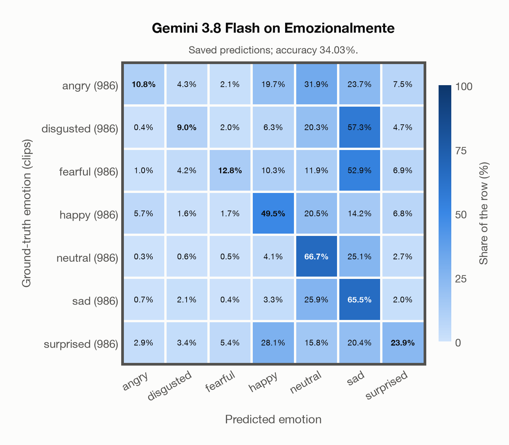
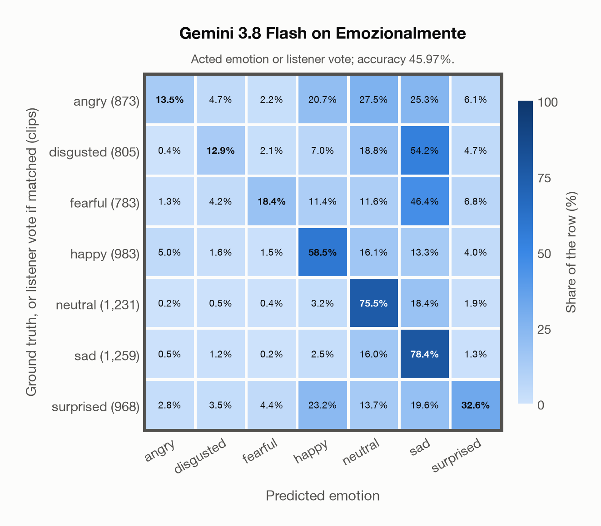

# Gemini 3.8 Flash on Emozionalmente

Regenerated offline from saved CSV/JSON by `scripts/evaluation/refresh_reports.py`. This refresh performs no model inference or API requests.

## Summary

| Metric | Recomputed value |
|---|---:|
| Clips | 6,902 |
| Accuracy: acted emotion | 34.03% |
| UAR: mean ground-truth-row recall | 34.03% |
| Macro F1 | 30.04% |
| Weighted F1 (by true class support) | 30.04% |
| Accuracy: all model classes | 34.03% |
| Accuracy: acted emotion or listener vote | 45.97% |
| Single listener vote vs acted emotion | 81.22% |
| Model vs single listener vote | 41.23% |

## Imported run and verification

- Source: [prediction CSV](../../outputs/gemini-3.8-flash/emozionalmente_predictions.csv) and [metadata JSON](../../outputs/gemini-3.8-flash/emozionalmente_predictions.json); both remain byte-for-byte unchanged.
- Original execution date recorded in JSON: `2026-11-10`.
- Dataset scope recorded in JSON: **Emozionalmente**, Italian; 6,902 / 6,902 clips.
- Ground-truth column: `acted_emotion`. Candidate classes: angry, disgusted, fearful, happy, neutral, sad, surprised.
- Row counts, unique audio paths, correctness flags and saved metrics were checked against the CSV. Metric agreement tolerance is 0.000001 (six-decimal metadata).
- Saved candidate/prompt/model protocol matches current configuration: scope `dataset`, model `gemini-3.8-flash`, prompt hash `dc84c979c561`.
- Original execution/client runtime metadata (reported by the imported run, not measured by this refresh): `{"device": "cpu", "hardware": "Apple M3 Pro", "seconds": 975.2, "ms_per_clip": 141.3, "on_cpu": 0}`.
- The original notes report one 24 kHz audio clip per request.
- The original notes report up to 30 concurrent clip evaluations.
- The recorded ms_per_clip is total wall-clock time divided by the number of clips, not individual request latency; it is not directly comparable with local GPU inference timing.
- The original notes describe schema-constrained answers validated as literal JSON strings.
- Saved p_* columns encode the returned answer as one-hot values; they are not calibrated API class probabilities, and no confidence plot is inferred from them.
- A raw responses journal is present; this refresh validates CSV/JSON only.

## Results per emotion

| Ground-truth emotion | Clips | Recall | Acted-or-listener recall |
|---|---:|---:|---:|
| angry | 986 | 10.75% | 23.43% |
| disgusted | 986 | 9.03% | 28.90% |
| fearful | 986 | 12.78% | 35.19% |
| happy | 986 | 49.49% | 58.62% |
| neutral | 986 | 66.73% | 69.37% |
| sad | 986 | 65.52% | 72.41% |
| surprised | 986 | 23.94% | 33.87% |

Precision/F1 use the same resolved-truth convention as the evaluation script.

| Predicted emotion | Resolved-truth clips | Precision | Recall | F1 |
|---|---:|---:|---:|---:|
| angry | 986 | 49.30% | 10.75% | 17.65% |
| disgusted | 986 | 35.74% | 9.03% | 14.41% |
| fearful | 986 | 51.22% | 12.78% | 20.45% |
| happy | 986 | 40.80% | 49.49% | 44.73% |
| neutral | 986 | 34.58% | 66.73% | 45.55% |
| sad | 986 | 25.28% | 65.52% | 36.49% |
| surprised | 986 | 43.87% | 23.94% | 30.97% |

## Confusion matrix: acted emotion

| Ground truth \ Predicted | angry | disgusted | fearful | happy | neutral | sad | surprised |
|---|---|---|---|---|---|---|---|
| angry (986) | **10.8%** | 4.3% | 2.1% | 19.7% | 31.9% | 23.7% | 7.5% |
| disgusted (986) | 0.4% | **9.0%** | 2.0% | 6.3% | 20.3% | 57.3% | 4.7% |
| fearful (986) | 1.0% | 4.2% | **12.8%** | 10.3% | 11.9% | 52.9% | 6.9% |
| happy (986) | 5.7% | 1.6% | 1.7% | **49.5%** | 20.5% | 14.2% | 6.8% |
| neutral (986) | 0.3% | 0.6% | 0.5% | 4.1% | **66.7%** | 25.1% | 2.7% |
| sad (986) | 0.7% | 2.1% | 0.4% | 3.3% | 25.9% | **65.5%** | 2.0% |
| surprised (986) | 2.9% | 3.4% | 5.4% | 28.1% | 15.8% | 20.4% | **23.9%** |

## Confusion matrix: acted emotion or listener vote

A prediction accepted only through the listener vote is placed in that predicted emotion's row; other clips keep their original ground-truth row. Row supports can therefore change.

| Ground truth \ Predicted | angry | disgusted | fearful | happy | neutral | sad | surprised |
|---|---|---|---|---|---|---|---|
| angry (873) | **13.5%** | 4.7% | 2.2% | 20.7% | 27.5% | 25.3% | 6.1% |
| disgusted (805) | 0.4% | **12.9%** | 2.1% | 7.0% | 18.8% | 54.2% | 4.7% |
| fearful (783) | 1.3% | 4.2% | **18.4%** | 11.4% | 11.6% | 46.4% | 6.8% |
| happy (983) | 5.0% | 1.6% | 1.5% | **58.5%** | 16.1% | 13.3% | 4.0% |
| neutral (1,231) | 0.2% | 0.5% | 0.4% | 3.2% | **75.5%** | 18.4% | 1.9% |
| sad (1,259) | 0.5% | 1.2% | 0.2% | 2.5% | 16.0% | **78.4%** | 1.3% |
| surprised (968) | 2.8% | 3.5% | 4.4% | 23.2% | 13.7% | 19.6% | **32.6%** |

## Caveats

- **Training involvement for Gemini 3.8 Flash: No corpus-specific evidence**. Source: not published (Google). Direct use and upstream teacher use both count as training involvement. No pattern: no corpus-specific evidence, not verified unseen. Corpus use is not test-clip leakage.
- Internal CSV/JSON consistency does not authenticate the original model or remote request logs.

[Offline validation audit](emozionalmente_offline_audit.json)
