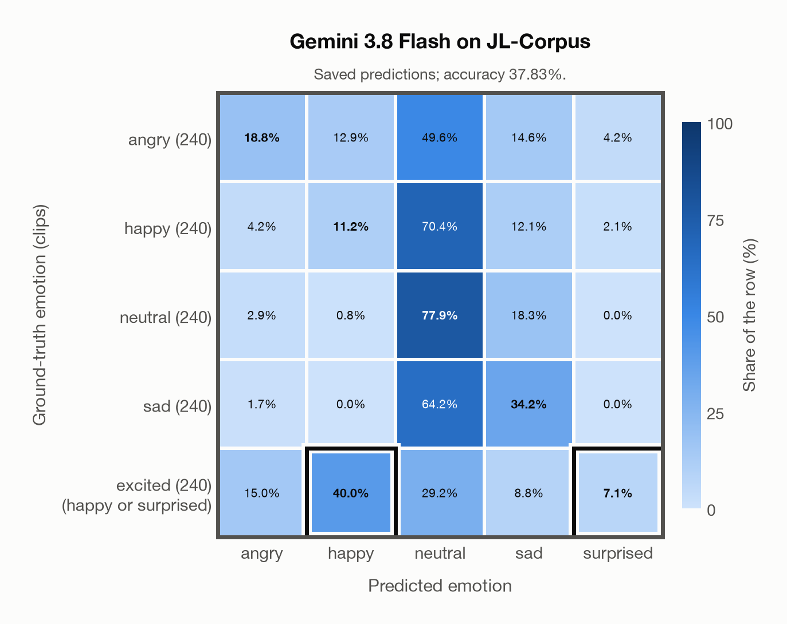

# Gemini 3.8 Flash on JL-Corpus

Regenerated offline from saved CSV/JSON by `scripts/evaluation/refresh_reports.py`. This refresh performs no model inference or API requests.

## Summary

| Metric | Recomputed value |
|---|---:|
| Clips | 1,200 |
| Accuracy: acted emotion | 37.83% |
| UAR: mean ground-truth-row recall | 37.83% |
| Macro F1 | 42.33% |
| Weighted F1 (by resolved-truth class support) | 36.82% |
| Accuracy: all model classes | 37.83% |

## Imported run and verification

- Source: [prediction CSV](../../outputs/gemini-3.8-flash/jl_corpus_predictions.csv) and [metadata JSON](../../outputs/gemini-3.8-flash/jl_corpus_predictions.json); both remain byte-for-byte unchanged.
- Original execution date recorded in JSON: `2026-11-10`.
- Dataset scope recorded in JSON: **JL-Corpus**, English (New Zealand); 1,200 / 1,200 clips.
- Ground-truth column: `acted_emotion`. Candidate classes: angry, happy, neutral, sad, surprised.
- Row counts, unique audio paths, correctness flags and saved metrics were checked against the CSV. Metric agreement tolerance is 0.000001 (six-decimal metadata).
- Saved candidate/prompt/model protocol matches current configuration: scope `dataset`, model `gemini-3.8-flash`, prompt hash `810c234fb672`.
- Original execution/client runtime metadata (reported by the imported run, not measured by this refresh): `{"device": "cpu", "hardware": "Apple M3 Pro", "seconds": 168.2, "ms_per_clip": 140.2, "on_cpu": 0}`.
- The original notes report one 24 kHz audio clip per request.
- The original notes report up to 30 concurrent clip evaluations.
- The recorded ms_per_clip is total wall-clock time divided by the number of clips, not individual request latency; it is not directly comparable with local GPU inference timing.
- The original notes describe schema-constrained answers validated as literal JSON strings.
- Saved p_* columns encode the returned answer as one-hot values; they are not calibrated API class probabilities, and no confidence plot is inferred from them.
- A raw responses journal is present; this refresh validates CSV/JSON only.
- Composite labels follow the existing accepted-label rule: excited accepts happy or surprised. F1 resolves a correct composite to the predicted class, otherwise to its first accepted class.

## Results per emotion

| Ground-truth emotion | Clips | Recall | Acted-or-listener recall |
|---|---:|---:|---:|
| angry | 240 | 18.75% | — |
| happy | 240 | 11.25% | — |
| neutral | 240 | 77.92% | — |
| sad | 240 | 34.17% | — |
| excited (happy or surprised) | 240 | 47.08% | — |

Precision/F1 use the same resolved-truth convention as the evaluation script.

| Predicted emotion | Resolved-truth clips | Precision | Recall | F1 |
|---|---:|---:|---:|---:|
| angry | 240 | 44.12% | 18.75% | 26.32% |
| happy | 463 | 78.85% | 26.57% | 39.74% |
| neutral | 240 | 26.75% | 77.92% | 39.83% |
| sad | 240 | 38.86% | 34.17% | 36.36% |
| surprised | 17 | 53.12% | 100.00% | 69.39% |

## Confusion matrix: acted emotion

| Ground truth \ Predicted | angry | happy | neutral | sad | surprised |
|---|---|---|---|---|---|
| angry (240) | **18.8%** | 12.9% | 49.6% | 14.6% | 4.2% |
| happy (240) | 4.2% | **11.2%** | 70.4% | 12.1% | 2.1% |
| neutral (240) | 2.9% | 0.8% | **77.9%** | 18.3% | 0.0% |
| sad (240) | 1.7% | 0.0% | 64.2% | **34.2%** | 0.0% |
| excited (happy or surprised) (240) | 15.0% | **40.0%** | 29.2% | 8.8% | **7.1%** |

## Caveats

- **Training involvement for Gemini 3.8 Flash: No corpus-specific evidence**. Source: not published (Google). Direct use and upstream teacher use both count as training involvement. No pattern: no corpus-specific evidence, not verified unseen. Corpus use is not test-clip leakage.
- Internal CSV/JSON consistency does not authenticate the original model or remote request logs.

[Offline validation audit](jl_corpus_offline_audit.json)
