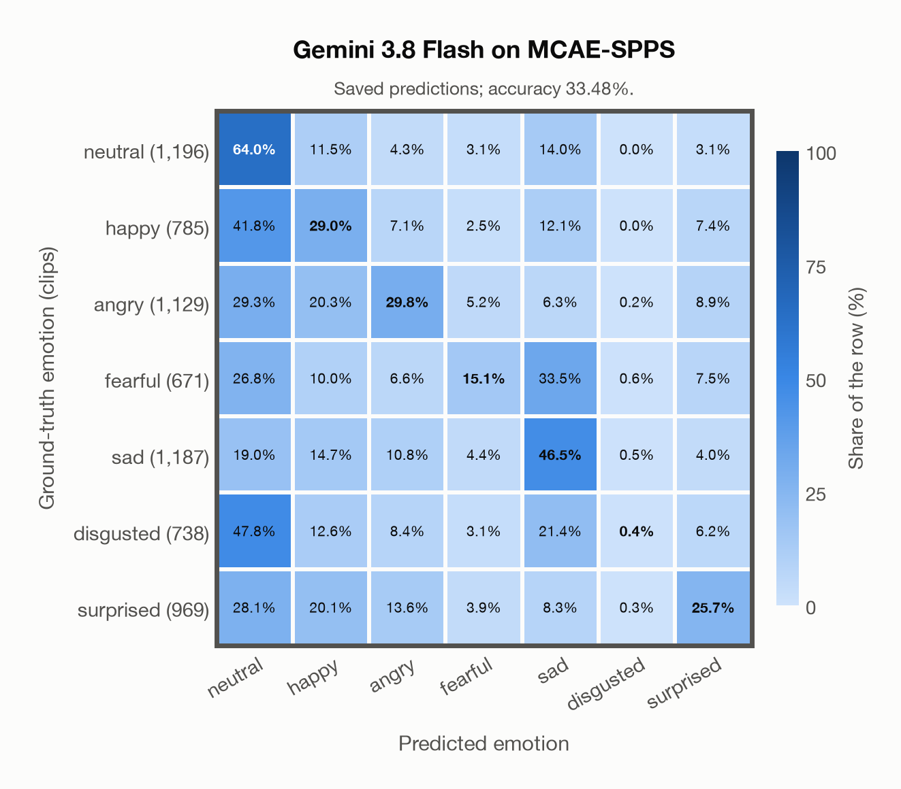

# Gemini 3.8 Flash on MCAE-SPPS

Regenerated offline from saved CSV/JSON by `scripts/evaluation/refresh_reports.py`. This refresh performs no model inference or API requests.

## Summary

| Metric | Recomputed value |
|---|---:|
| Clips | 6,675 |
| Accuracy: acted emotion | 33.48% |
| UAR: mean ground-truth-row recall | 30.07% |
| Macro F1 | 28.14% |
| Weighted F1 (by true class support) | 30.69% |
| Accuracy: all model classes | 33.48% |
| Accuracy: acted emotion or listener vote | 33.48% |
| Single listener vote vs acted emotion | 100.00% |
| Model vs single listener vote | 33.48% |

## Imported run and verification

- Source: [prediction CSV](../../outputs/gemini-3.8-flash/mcae_spps_predictions.csv) and [metadata JSON](../../outputs/gemini-3.8-flash/mcae_spps_predictions.json); both remain byte-for-byte unchanged.
- Original execution date recorded in JSON: `2026-11-10`.
- Dataset scope recorded in JSON: **MCAE-SPPS**, Mandarin; 6,675 / 6,675 clips.
- Ground-truth column: `acted_emotion`. Candidate classes: neutral, happy, angry, fearful, sad, disgusted, surprised.
- Row counts, unique audio paths, correctness flags and saved metrics were checked against the CSV. Metric agreement tolerance is 0.000001 (six-decimal metadata).
- Saved candidate/prompt/model protocol matches current configuration: scope `dataset`, model `gemini-3.8-flash`, prompt hash `dc84c979c561`.
- Original execution/client runtime metadata (reported by the imported run, not measured by this refresh): `{"device": "cpu", "hardware": "Apple M3 Pro", "seconds": 273.1, "ms_per_clip": 40.9, "on_cpu": 0}`.
- The original notes report one 24 kHz audio clip per request.
- The original notes report up to 30 concurrent clip evaluations.
- The recorded ms_per_clip is total wall-clock time divided by the number of clips, not individual request latency; it is not directly comparable with local GPU inference timing.
- The original notes describe schema-constrained answers validated as literal JSON strings.
- Saved p_* columns encode the returned answer as one-hot values; they are not calibrated API class probabilities, and no confidence plot is inferred from them.
- A raw responses journal is present; this refresh validates CSV/JSON only.

## Results per emotion

| Ground-truth emotion | Clips | Recall | Acted-or-listener recall |
|---|---:|---:|---:|
| neutral | 1,196 | 64.05% | 64.05% |
| happy | 785 | 29.04% | 29.04% |
| angry | 1,129 | 29.76% | 29.76% |
| fearful | 671 | 15.05% | 15.05% |
| sad | 1,187 | 46.50% | 46.50% |
| disgusted | 738 | 0.41% | 0.41% |
| surprised | 969 | 25.70% | 25.70% |

Precision/F1 use the same resolved-truth convention as the evaluation script.

| Predicted emotion | Resolved-truth clips | Precision | Recall | F1 |
|---|---:|---:|---:|---:|
| neutral | 1,196 | 31.19% | 64.05% | 41.95% |
| happy | 785 | 20.28% | 29.04% | 23.89% |
| angry | 1,129 | 41.53% | 29.76% | 34.67% |
| fearful | 671 | 30.61% | 15.05% | 20.18% |
| sad | 1,187 | 40.92% | 46.50% | 43.53% |
| disgusted | 738 | 16.67% | 0.41% | 0.79% |
| surprised | 969 | 42.28% | 25.70% | 31.96% |

## Confusion matrix: acted emotion

| Ground truth \ Predicted | neutral | happy | angry | fearful | sad | disgusted | surprised |
|---|---|---|---|---|---|---|---|
| neutral (1,196) | **64.0%** | 11.5% | 4.3% | 3.1% | 14.0% | 0.0% | 3.1% |
| happy (785) | 41.8% | **29.0%** | 7.1% | 2.5% | 12.1% | 0.0% | 7.4% |
| angry (1,129) | 29.3% | 20.3% | **29.8%** | 5.2% | 6.3% | 0.2% | 8.9% |
| fearful (671) | 26.8% | 10.0% | 6.6% | **15.1%** | 33.5% | 0.6% | 7.5% |
| sad (1,187) | 19.0% | 14.7% | 10.8% | 4.4% | **46.5%** | 0.5% | 4.0% |
| disgusted (738) | 47.8% | 12.6% | 8.4% | 3.1% | 21.4% | **0.4%** | 6.2% |
| surprised (969) | 28.1% | 20.1% | 13.6% | 3.9% | 8.3% | 0.3% | **25.7%** |

## Confusion matrix: acted emotion or listener vote

A prediction accepted only through the listener vote is placed in that predicted emotion's row; other clips keep their original ground-truth row. Row supports can therefore change.

| Ground truth \ Predicted | neutral | happy | angry | fearful | sad | disgusted | surprised |
|---|---|---|---|---|---|---|---|
| neutral (1,196) | **64.0%** | 11.5% | 4.3% | 3.1% | 14.0% | 0.0% | 3.1% |
| happy (785) | 41.8% | **29.0%** | 7.1% | 2.5% | 12.1% | 0.0% | 7.4% |
| angry (1,129) | 29.3% | 20.3% | **29.8%** | 5.2% | 6.3% | 0.2% | 8.9% |
| fearful (671) | 26.8% | 10.0% | 6.6% | **15.1%** | 33.5% | 0.6% | 7.5% |
| sad (1,187) | 19.0% | 14.7% | 10.8% | 4.4% | **46.5%** | 0.5% | 4.0% |
| disgusted (738) | 47.8% | 12.6% | 8.4% | 3.1% | 21.4% | **0.4%** | 6.2% |
| surprised (969) | 28.1% | 20.1% | 13.6% | 3.9% | 8.3% | 0.3% | **25.7%** |

## Caveats

- **Training involvement for Gemini 3.8 Flash: No corpus-specific evidence**. Source: not published (Google). Direct use and upstream teacher use both count as training involvement. No pattern: no corpus-specific evidence, not verified unseen. Corpus use is not test-clip leakage.
- Internal CSV/JSON consistency does not authenticate the original model or remote request logs.

[Offline validation audit](mcae_spps_offline_audit.json)
