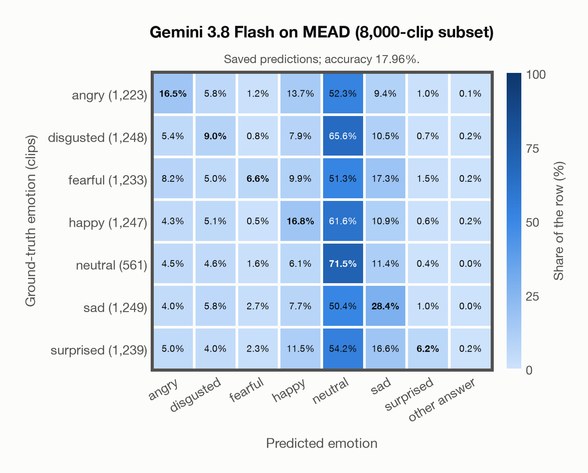

# Gemini 3.8 Flash on MEAD (8,000-clip subset)

Regenerated offline from saved CSV/JSON by `scripts/evaluation/refresh_reports.py`. This refresh performs no model inference or API requests.

## Summary

| Metric | Recomputed value |
|---|---:|
| Clips | 8,000 |
| Accuracy: acted emotion | 17.96% |
| UAR: mean ground-truth-row recall | 22.13% |
| Macro F1 | 17.51% |
| Weighted F1 (by true class support) | 17.67% |
| Accuracy: all model classes | 17.96% |

## Imported run and verification

- Source: [prediction CSV](../../outputs/gemini-3.8-flash/mead_predictions.csv) and [metadata JSON](../../outputs/gemini-3.8-flash/mead_predictions.json); both remain byte-for-byte unchanged.
- Original execution date recorded in JSON: `2026-11-10`.
- Dataset scope recorded in JSON: **MEAD (8,000-clip subset)**, English; 8,000 / 8,000 clips.
- Ground-truth column: `acted_emotion`. Candidate classes: angry, disgusted, fearful, happy, neutral, sad, surprised.
- Row counts, unique audio paths, correctness flags and saved metrics were checked against the CSV. Metric agreement tolerance is 0.000001 (six-decimal metadata).
- Saved candidate/prompt/model protocol matches current configuration: scope `dataset`, model `gemini-3.8-flash`, prompt hash `dc84c979c561`.
- Original execution/client runtime metadata (reported by the imported run, not measured by this refresh): `{"device": "cpu", "hardware": "Apple M3 Pro", "seconds": 1271.0, "ms_per_clip": 158.9, "on_cpu": 0}`.
- The original notes report one 24 kHz audio clip per request.
- The original notes report up to 30 concurrent clip evaluations.
- The recorded ms_per_clip is total wall-clock time divided by the number of clips, not individual request latency; it is not directly comparable with local GPU inference timing.
- The original notes describe schema-constrained answers validated as literal JSON strings.
- Saved p_* columns encode the returned answer as one-hot values; they are not calibrated API class probabilities, and no confidence plot is inferred from them.
- A raw responses journal is present; this refresh validates CSV/JSON only.

## Results per emotion

| Ground-truth emotion | Clips | Recall | Acted-or-listener recall |
|---|---:|---:|---:|
| angry | 1,223 | 16.52% | — |
| disgusted | 1,248 | 8.97% | — |
| fearful | 1,233 | 6.57% | — |
| happy | 1,247 | 16.76% | — |
| neutral | 561 | 71.48% | — |
| sad | 1,249 | 28.42% | — |
| surprised | 1,239 | 6.21% | — |

Precision/F1 use the same resolved-truth convention as the evaluation script.

| Predicted emotion | Resolved-truth clips | Precision | Recall | F1 |
|---|---:|---:|---:|---:|
| angry | 1,223 | 36.01% | 16.52% | 22.65% |
| disgusted | 1,248 | 24.56% | 8.97% | 13.15% |
| fearful | 1,233 | 44.26% | 6.57% | 11.44% |
| happy | 1,247 | 24.05% | 16.76% | 19.75% |
| neutral | 561 | 8.79% | 71.48% | 15.65% |
| sad | 1,249 | 29.10% | 28.42% | 28.76% |
| surprised | 1,239 | 55.80% | 6.21% | 11.18% |

## Confusion matrix: acted emotion

| Ground truth \ Predicted | angry | disgusted | fearful | happy | neutral | sad | surprised | other answer |
|---|---|---|---|---|---|---|---|---|
| angry (1,223) | **16.5%** | 5.8% | 1.2% | 13.7% | 52.3% | 9.4% | 1.0% | 0.1% |
| disgusted (1,248) | 5.4% | **9.0%** | 0.8% | 7.9% | 65.6% | 10.5% | 0.7% | 0.2% |
| fearful (1,233) | 8.2% | 5.0% | **6.6%** | 9.9% | 51.3% | 17.3% | 1.5% | 0.2% |
| happy (1,247) | 4.3% | 5.1% | 0.5% | **16.8%** | 61.6% | 10.9% | 0.6% | 0.2% |
| neutral (561) | 4.5% | 4.6% | 1.6% | 6.1% | **71.5%** | 11.4% | 0.4% | 0.0% |
| sad (1,249) | 4.0% | 5.8% | 2.7% | 7.7% | 50.4% | **28.4%** | 1.0% | 0.0% |
| surprised (1,239) | 5.0% | 4.0% | 2.3% | 11.5% | 54.2% | 16.6% | **6.2%** | 0.2% |

## Caveats

- **Training involvement for Gemini 3.8 Flash: No corpus-specific evidence**. Source: not published (Google). Direct use and upstream teacher use both count as training involvement. No pattern: no corpus-specific evidence, not verified unseen. Corpus use is not test-clip leakage.
- Internal CSV/JSON consistency does not authenticate the original model or remote request logs.

[Offline validation audit](mead_offline_audit.json)
