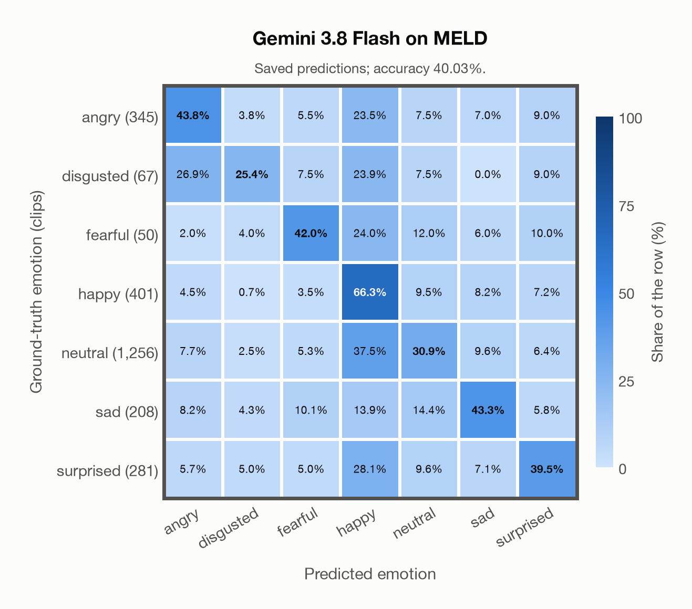

# Gemini 3.8 Flash on MELD

Regenerated offline from saved CSV/JSON by `scripts/evaluation/refresh_reports.py`. This refresh performs no model inference or API requests.

## Summary

| Metric | Recomputed value |
|---|---:|
| Clips | 2,608 |
| Accuracy: acted emotion | 40.03% |
| UAR: mean ground-truth-row recall | 41.59% |
| Macro F1 | 35.16% |
| Accuracy: all model classes | 40.03% |

## Imported run and verification

- Source: [prediction CSV](../../outputs/gemini-3.8-flash/meld_predictions.csv) and [metadata JSON](../../outputs/gemini-3.8-flash/meld_predictions.json); both remain byte-for-byte unchanged.
- Original execution date recorded in JSON: `2026-11-10`.
- Dataset scope recorded in JSON: **MELD**, English; 2,608 / 2,608 clips.
- Ground-truth column: `acted_emotion`. Candidate classes: angry, disgusted, fearful, happy, neutral, sad, surprised.
- Row counts, unique audio paths, correctness flags and saved metrics were checked against the CSV. Metric agreement tolerance is 0.000001 (six-decimal metadata).
- Saved candidate/prompt/model protocol matches current configuration: scope `dataset`, model `gemini-3.8-flash`, prompt hash `dc84c979c561`.
- Original execution/client runtime metadata (reported by the imported run, not measured by this refresh): `{"device": "cpu", "hardware": "Apple M3 Pro", "seconds": 448.2, "ms_per_clip": 171.9, "on_cpu": 0}`.
- The original notes report one 24 kHz audio clip per request.
- The original notes report up to 30 concurrent clip evaluations.
- The recorded ms_per_clip is total wall-clock time divided by the number of clips, not individual request latency; it is not directly comparable with local GPU inference timing.
- The original notes describe schema-constrained answers validated as literal JSON strings.
- Saved p_* columns encode the returned answer as one-hot values; they are not calibrated API class probabilities, and no confidence plot is inferred from them.
- A raw responses journal is present; this refresh validates CSV/JSON only.

## Results per emotion

| Ground-truth emotion | Clips | Recall | Acted-or-listener recall |
|---|---:|---:|---:|
| angry | 345 | 43.77% | — |
| disgusted | 67 | 25.37% | — |
| fearful | 50 | 42.00% | — |
| happy | 401 | 66.33% | — |
| neutral | 1,256 | 30.89% | — |
| sad | 208 | 43.27% | — |
| surprised | 281 | 39.50% | — |

Precision/F1 use the same resolved-truth convention as the evaluation script.

| Predicted emotion | Resolved-truth clips | Precision | Recall | F1 |
|---|---:|---:|---:|---:|
| angry | 345 | 47.48% | 43.77% | 45.55% |
| disgusted | 67 | 18.89% | 25.37% | 21.66% |
| fearful | 50 | 13.04% | 42.00% | 19.91% |
| happy | 401 | 27.88% | 66.33% | 39.26% |
| neutral | 1,256 | 74.62% | 30.89% | 43.69% |
| sad | 208 | 31.03% | 43.27% | 36.14% |
| surprised | 281 | 40.36% | 39.50% | 39.93% |

## Confusion matrix: acted emotion

| Ground truth \ Predicted | angry | disgusted | fearful | happy | neutral | sad | surprised |
|---|---|---|---|---|---|---|---|
| angry (345) | **43.8%** | 3.8% | 5.5% | 23.5% | 7.5% | 7.0% | 9.0% |
| disgusted (67) | 26.9% | **25.4%** | 7.5% | 23.9% | 7.5% | 0.0% | 9.0% |
| fearful (50) | 2.0% | 4.0% | **42.0%** | 24.0% | 12.0% | 6.0% | 10.0% |
| happy (401) | 4.5% | 0.7% | 3.5% | **66.3%** | 9.5% | 8.2% | 7.2% |
| neutral (1,256) | 7.7% | 2.5% | 5.3% | 37.5% | **30.9%** | 9.6% | 6.4% |
| sad (208) | 8.2% | 4.3% | 10.1% | 13.9% | 14.4% | **43.3%** | 5.8% |
| surprised (281) | 5.7% | 5.0% | 5.0% | 28.1% | 9.6% | 7.1% | **39.5%** |

## Caveats

- **Training involvement for Gemini 3.8 Flash: No corpus-specific evidence**. Source: not published (Google). Direct use and upstream teacher use both count as training involvement. No pattern: no corpus-specific evidence, not verified unseen. Corpus use is not test-clip leakage.
- Internal CSV/JSON consistency does not authenticate the original model or remote request logs.

[Offline validation audit](meld_offline_audit.json)
