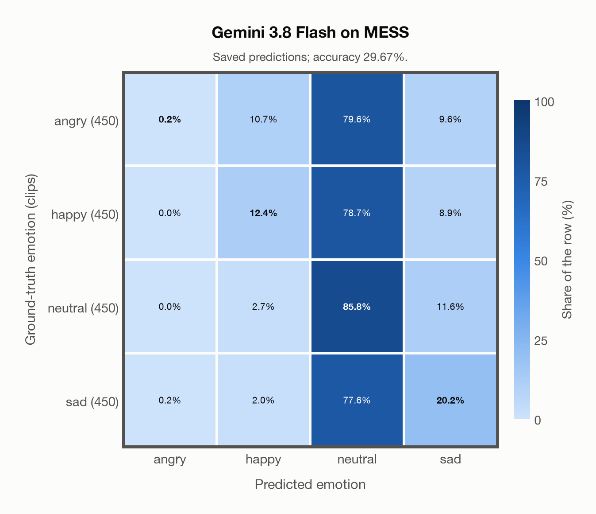

# Gemini 3.8 Flash on MESS

Regenerated offline from saved CSV/JSON by `scripts/evaluation/refresh_reports.py`. This refresh performs no model inference or API requests.

## Summary

| Metric | Recomputed value |
|---|---:|
| Clips | 1,800 |
| Accuracy: acted emotion | 29.67% |
| UAR: mean ground-truth-row recall | 29.67% |
| Macro F1 | 21.88% |
| Weighted F1 (by true class support) | 21.88% |
| Accuracy: all model classes | 29.67% |

## Imported run and verification

- Source: [prediction CSV](../../outputs/gemini-3.8-flash/mess_predictions.csv) and [metadata JSON](../../outputs/gemini-3.8-flash/mess_predictions.json); both remain byte-for-byte unchanged.
- Original execution date recorded in JSON: `2026-11-10`.
- Dataset scope recorded in JSON: **MESS**, English; 1,800 / 1,800 clips.
- Ground-truth column: `acted_emotion`. Candidate classes: angry, happy, neutral, sad.
- Row counts, unique audio paths, correctness flags and saved metrics were checked against the CSV. Metric agreement tolerance is 0.000001 (six-decimal metadata).
- Saved candidate/prompt/model protocol matches current configuration: scope `dataset`, model `gemini-3.8-flash`, prompt hash `58c572e3aa38`.
- Original execution/client runtime metadata (reported by the imported run, not measured by this refresh): `{"device": "cpu", "hardware": "Apple M3 Pro", "seconds": 239.3, "ms_per_clip": 133.0, "on_cpu": 0}`.
- The original notes report one 24 kHz audio clip per request.
- The original notes report up to 30 concurrent clip evaluations.
- The recorded ms_per_clip is total wall-clock time divided by the number of clips, not individual request latency; it is not directly comparable with local GPU inference timing.
- The original notes describe schema-constrained answers validated as literal JSON strings.
- Saved p_* columns encode the returned answer as one-hot values; they are not calibrated API class probabilities, and no confidence plot is inferred from them.
- A raw responses journal is present; this refresh validates CSV/JSON only.

## Results per emotion

| Ground-truth emotion | Clips | Recall | Acted-or-listener recall |
|---|---:|---:|---:|
| angry | 450 | 0.22% | — |
| happy | 450 | 12.44% | — |
| neutral | 450 | 85.78% | — |
| sad | 450 | 20.22% | — |

Precision/F1 use the same resolved-truth convention as the evaluation script.

| Predicted emotion | Resolved-truth clips | Precision | Recall | F1 |
|---|---:|---:|---:|---:|
| angry | 450 | 50.00% | 0.22% | 0.44% |
| happy | 450 | 44.80% | 12.44% | 19.48% |
| neutral | 450 | 26.68% | 85.78% | 40.70% |
| sad | 450 | 40.27% | 20.22% | 26.92% |

## Confusion matrix: acted emotion

| Ground truth \ Predicted | angry | happy | neutral | sad |
|---|---|---|---|---|
| angry (450) | **0.2%** | 10.7% | 79.6% | 9.6% |
| happy (450) | 0.0% | **12.4%** | 78.7% | 8.9% |
| neutral (450) | 0.0% | 2.7% | **85.8%** | 11.6% |
| sad (450) | 0.2% | 2.0% | 77.6% | **20.2%** |

## Caveats

- **Training involvement for Gemini 3.8 Flash: No corpus-specific evidence**. Source: not published (Google). Direct use and upstream teacher use both count as training involvement. No pattern: no corpus-specific evidence, not verified unseen. Corpus use is not test-clip leakage.
- Internal CSV/JSON consistency does not authenticate the original model or remote request logs.

[Offline validation audit](mess_offline_audit.json)
