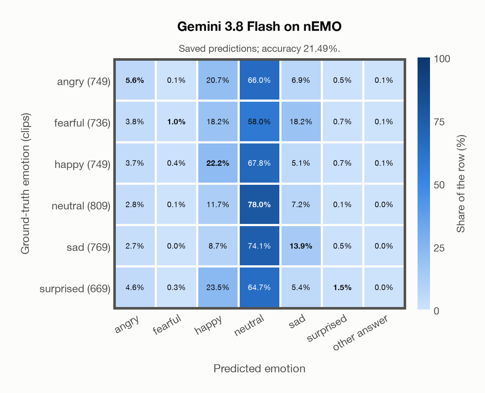

# Gemini 3.8 Flash on nEMO

Regenerated offline from saved CSV/JSON by `scripts/evaluation/refresh_reports.py`. This refresh performs no model inference or API requests.

## Summary

| Metric | Recomputed value |
|---|---:|
| Clips | 4,481 |
| Accuracy: acted emotion | 21.49% |
| UAR: mean ground-truth-row recall | 20.35% |
| Macro F1 | 14.36% |
| Weighted F1 (by true class support) | 14.86% |
| Accuracy: all model classes | 21.49% |

## Imported run and verification

- Source: [prediction CSV](../../outputs/gemini-3.8-flash/nemo_predictions.csv) and [metadata JSON](../../outputs/gemini-3.8-flash/nemo_predictions.json); both remain byte-for-byte unchanged.
- Original execution date recorded in JSON: `2026-11-10`.
- Dataset scope recorded in JSON: **nEMO**, Polish; 4,481 / 4,481 clips.
- Ground-truth column: `acted_emotion`. Candidate classes: angry, fearful, happy, neutral, sad, surprised.
- Row counts, unique audio paths, correctness flags and saved metrics were checked against the CSV. Metric agreement tolerance is 0.000001 (six-decimal metadata).
- Saved candidate/prompt/model protocol matches current configuration: scope `dataset`, model `gemini-3.8-flash`, prompt hash `f9ee39cb12fd`.
- Original execution/client runtime metadata (reported by the imported run, not measured by this refresh): `{"device": "cpu", "hardware": "Apple M3 Pro", "seconds": 543.7, "ms_per_clip": 121.3, "on_cpu": 0}`.
- The original notes report one 24 kHz audio clip per request.
- The original notes report up to 30 concurrent clip evaluations.
- The recorded ms_per_clip is total wall-clock time divided by the number of clips, not individual request latency; it is not directly comparable with local GPU inference timing.
- The original notes describe schema-constrained answers validated as literal JSON strings.
- Saved p_* columns encode the returned answer as one-hot values; they are not calibrated API class probabilities, and no confidence plot is inferred from them.
- A raw responses journal is present; this refresh validates CSV/JSON only.

## Results per emotion

| Ground-truth emotion | Clips | Recall | Acted-or-listener recall |
|---|---:|---:|---:|
| angry | 749 | 5.61% | — |
| fearful | 736 | 0.95% | — |
| happy | 749 | 22.16% | — |
| neutral | 809 | 78.00% | — |
| sad | 769 | 13.91% | — |
| surprised | 669 | 1.49% | — |

Precision/F1 use the same resolved-truth convention as the evaluation script.

| Predicted emotion | Resolved-truth clips | Precision | Recall | F1 |
|---|---:|---:|---:|---:|
| angry | 749 | 24.28% | 5.61% | 9.11% |
| fearful | 736 | 50.00% | 0.95% | 1.87% |
| happy | 749 | 21.45% | 22.16% | 21.80% |
| neutral | 809 | 20.60% | 78.00% | 32.59% |
| sad | 769 | 25.18% | 13.91% | 17.92% |
| surprised | 669 | 34.48% | 1.49% | 2.87% |

## Confusion matrix: acted emotion

| Ground truth \ Predicted | angry | fearful | happy | neutral | sad | surprised | other answer |
|---|---|---|---|---|---|---|---|
| angry (749) | **5.6%** | 0.1% | 20.7% | 66.0% | 6.9% | 0.5% | 0.1% |
| fearful (736) | 3.8% | **1.0%** | 18.2% | 58.0% | 18.2% | 0.7% | 0.1% |
| happy (749) | 3.7% | 0.4% | **22.2%** | 67.8% | 5.1% | 0.7% | 0.1% |
| neutral (809) | 2.8% | 0.1% | 11.7% | **78.0%** | 7.2% | 0.1% | 0.0% |
| sad (769) | 2.7% | 0.0% | 8.7% | 74.1% | **13.9%** | 0.5% | 0.0% |
| surprised (669) | 4.6% | 0.3% | 23.5% | 64.7% | 5.4% | **1.5%** | 0.0% |

## Caveats

- **Training involvement for Gemini 3.8 Flash: No corpus-specific evidence**. Source: not published (Google). Direct use and upstream teacher use both count as training involvement. No pattern: no corpus-specific evidence, not verified unseen. Corpus use is not test-clip leakage.
- Internal CSV/JSON consistency does not authenticate the original model or remote request logs.

[Offline validation audit](nemo_offline_audit.json)
