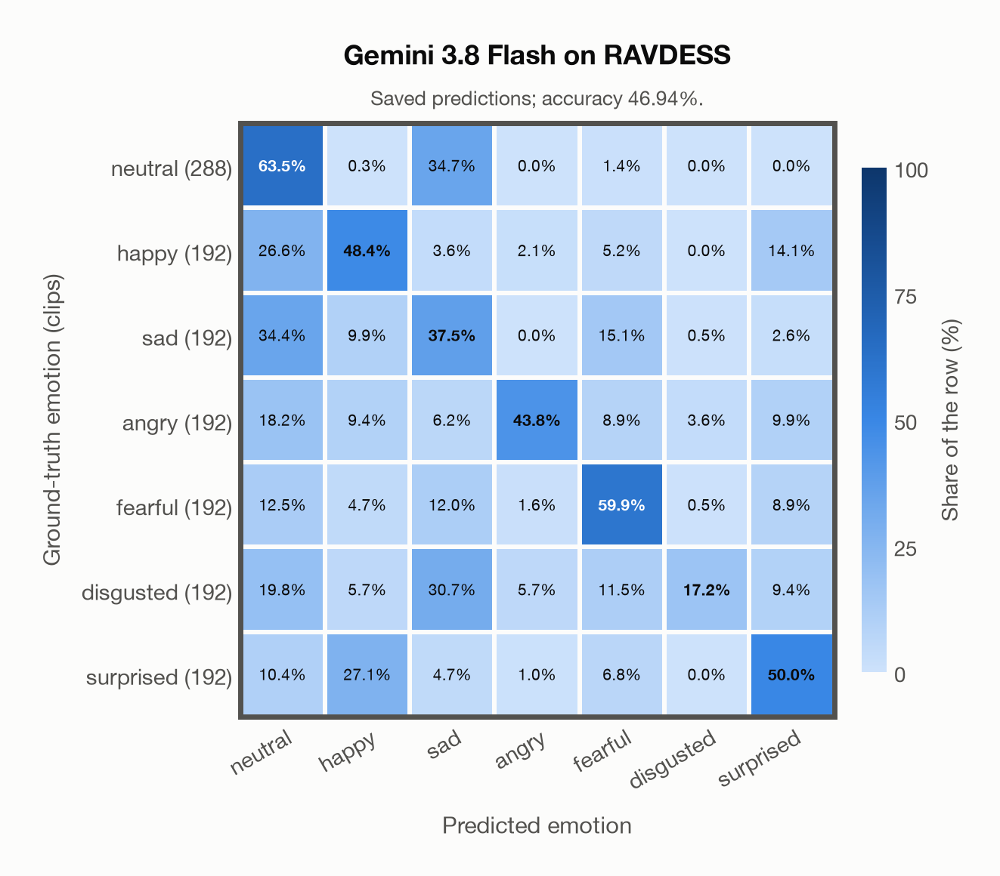

# Gemini 3.8 Flash on RAVDESS

Regenerated offline from saved CSV/JSON by `scripts/evaluation/refresh_reports.py`. This refresh performs no model inference or API requests.

## Summary

| Metric | Recomputed value |
|---|---:|
| Clips | 1,440 |
| Accuracy: acted emotion | 46.94% |
| UAR: mean ground-truth-row recall | 45.76% |
| Macro F1 | 46.13% |
| Weighted F1 (by true class support) | 46.51% |
| Accuracy: all model classes | 46.94% |

## Imported run and verification

- Source: [prediction CSV](../../outputs/gemini-3.8-flash/ravdess_predictions.csv) and [metadata JSON](../../outputs/gemini-3.8-flash/ravdess_predictions.json); both remain byte-for-byte unchanged.
- Original execution date recorded in JSON: `2026-11-10`.
- Dataset scope recorded in JSON: **RAVDESS**, English; 1,440 / 1,440 clips.
- Ground-truth column: `acted_emotion`. Candidate classes: neutral, happy, sad, angry, fearful, disgusted, surprised.
- Row counts, unique audio paths, correctness flags and saved metrics were checked against the CSV. Metric agreement tolerance is 0.000001 (six-decimal metadata).
- Saved candidate/prompt/model protocol matches current configuration: scope `dataset`, model `gemini-3.8-flash`, prompt hash `dc84c979c561`.
- Original execution/client runtime metadata (reported by the imported run, not measured by this refresh): `{"device": "cpu", "hardware": "Apple M3 Pro", "seconds": 260.9, "ms_per_clip": 181.2, "on_cpu": 0}`.
- The original notes report one 24 kHz audio clip per request.
- The original notes report up to 30 concurrent clip evaluations.
- The recorded ms_per_clip is total wall-clock time divided by the number of clips, not individual request latency; it is not directly comparable with local GPU inference timing.
- The original notes describe schema-constrained answers validated as literal JSON strings.
- Saved p_* columns encode the returned answer as one-hot values; they are not calibrated API class probabilities, and no confidence plot is inferred from them.
- A raw responses journal is present; this refresh validates CSV/JSON only.

## Results per emotion

| Ground-truth emotion | Clips | Recall | Acted-or-listener recall |
|---|---:|---:|---:|
| neutral | 288 | 63.54% | — |
| happy | 192 | 48.44% | — |
| sad | 192 | 37.50% | — |
| angry | 192 | 43.75% | — |
| fearful | 192 | 59.90% | — |
| disgusted | 192 | 17.19% | — |
| surprised | 192 | 50.00% | — |

Precision/F1 use the same resolved-truth convention as the evaluation script.

| Predicted emotion | Resolved-truth clips | Precision | Recall | F1 |
|---|---:|---:|---:|---:|
| neutral | 288 | 43.88% | 63.54% | 51.91% |
| happy | 192 | 45.81% | 48.44% | 47.09% |
| sad | 192 | 25.53% | 37.50% | 30.38% |
| angry | 192 | 80.77% | 43.75% | 56.76% |
| fearful | 192 | 54.76% | 59.90% | 57.21% |
| disgusted | 192 | 78.57% | 17.19% | 28.21% |
| surprised | 192 | 52.75% | 50.00% | 51.34% |

## Confusion matrix: acted emotion

| Ground truth \ Predicted | neutral | happy | sad | angry | fearful | disgusted | surprised |
|---|---|---|---|---|---|---|---|
| neutral (288) | **63.5%** | 0.3% | 34.7% | 0.0% | 1.4% | 0.0% | 0.0% |
| happy (192) | 26.6% | **48.4%** | 3.6% | 2.1% | 5.2% | 0.0% | 14.1% |
| sad (192) | 34.4% | 9.9% | **37.5%** | 0.0% | 15.1% | 0.5% | 2.6% |
| angry (192) | 18.2% | 9.4% | 6.2% | **43.8%** | 8.9% | 3.6% | 9.9% |
| fearful (192) | 12.5% | 4.7% | 12.0% | 1.6% | **59.9%** | 0.5% | 8.9% |
| disgusted (192) | 19.8% | 5.7% | 30.7% | 5.7% | 11.5% | **17.2%** | 9.4% |
| surprised (192) | 10.4% | 27.1% | 4.7% | 1.0% | 6.8% | 0.0% | **50.0%** |

## Caveats

- **Training involvement for Gemini 3.8 Flash: No corpus-specific evidence**. Source: not published (Google). Direct use and upstream teacher use both count as training involvement. No pattern: no corpus-specific evidence, not verified unseen. Corpus use is not test-clip leakage.
- Internal CSV/JSON consistency does not authenticate the original model or remote request logs.

[Offline validation audit](ravdess_offline_audit.json)
