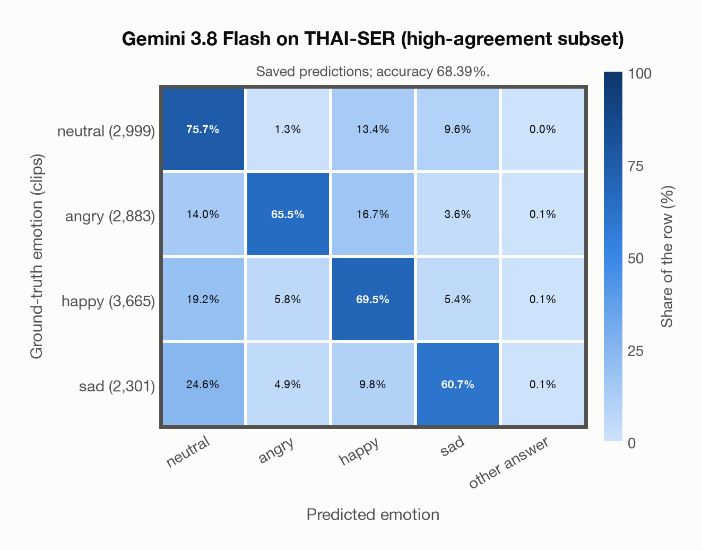

# Gemini 3.8 Flash on THAI-SER (high-agreement subset)

Regenerated offline from saved CSV/JSON by `scripts/evaluation/refresh_reports.py`. This refresh performs no model inference or API requests.

## Summary

| Metric | Recomputed value |
|---|---:|
| Clips | 11,848 |
| Accuracy: acted emotion | 68.39% |
| UAR: mean ground-truth-row recall | 67.85% |
| Macro F1 | 68.43% |
| Weighted F1 (by true class support) | 68.64% |
| Accuracy: all model classes | 68.39% |
| Accuracy: acted emotion or listener vote | 74.25% |
| Single listener vote vs acted emotion | 77.23% |
| Model vs single listener vote | 64.78% |

## Imported run and verification

- Source: [prediction CSV](../../outputs/gemini-3.8-flash/thai_ser_predictions.csv) and [metadata JSON](../../outputs/gemini-3.8-flash/thai_ser_predictions.json); both remain byte-for-byte unchanged.
- Original execution date recorded in JSON: `2026-11-10`.
- Dataset scope recorded in JSON: **THAI-SER (high-agreement subset)**, Thai; 11,848 / 11,848 clips.
- Ground-truth column: `acted_emotion`. Candidate classes: neutral, angry, happy, sad.
- Row counts, unique audio paths, correctness flags and saved metrics were checked against the CSV. Metric agreement tolerance is 0.000001 (six-decimal metadata).
- Saved candidate/prompt/model protocol matches current configuration: scope `dataset`, model `gemini-3.8-flash`, prompt hash `58c572e3aa38`.
- Original execution/client runtime metadata (reported by the imported run, not measured by this refresh): `{"device": "cpu", "hardware": "Apple M3 Pro", "seconds": 1582.6, "ms_per_clip": 133.6, "on_cpu": 0}`.
- The original notes report one 24 kHz audio clip per request.
- The original notes report up to 30 concurrent clip evaluations.
- The recorded ms_per_clip is total wall-clock time divided by the number of clips, not individual request latency; it is not directly comparable with local GPU inference timing.
- The original notes describe schema-constrained answers validated as literal JSON strings.
- Saved p_* columns encode the returned answer as one-hot values; they are not calibrated API class probabilities, and no confidence plot is inferred from them.
- A raw responses journal is present; this refresh validates CSV/JSON only.

## Results per emotion

| Ground-truth emotion | Clips | Recall | Acted-or-listener recall |
|---|---:|---:|---:|
| neutral | 2,999 | 75.69% | 76.39% |
| angry | 2,883 | 65.52% | 68.92% |
| happy | 3,665 | 69.52% | 81.15% |
| sad | 2,301 | 60.67% | 67.14% |

Precision/F1 use the same resolved-truth convention as the evaluation script.

| Predicted emotion | Resolved-truth clips | Precision | Recall | F1 |
|---|---:|---:|---:|---:|
| neutral | 2,999 | 57.58% | 75.69% | 65.41% |
| angry | 2,883 | 83.88% | 65.52% | 73.57% |
| happy | 3,665 | 69.69% | 69.52% | 69.61% |
| sad | 2,301 | 70.29% | 60.67% | 65.13% |

## Confusion matrix: acted emotion

| Ground truth \ Predicted | neutral | angry | happy | sad | other answer |
|---|---|---|---|---|---|
| neutral (2,999) | **75.7%** | 1.3% | 13.4% | 9.6% | 0.0% |
| angry (2,883) | 14.0% | **65.5%** | 16.7% | 3.6% | 0.1% |
| happy (3,665) | 19.2% | 5.8% | **69.5%** | 5.4% | 0.1% |
| sad (2,301) | 24.6% | 4.9% | 9.8% | **60.7%** | 0.1% |

## Confusion matrix: acted emotion or listener vote

A prediction accepted only through the listener vote is placed in that predicted emotion's row; other clips keep their original ground-truth row. Row supports can therefore change.

| Ground truth \ Predicted | neutral | angry | happy | sad | other answer |
|---|---|---|---|---|---|
| neutral (3,600) | **80.3%** | 1.0% | 11.0% | 7.7% | 0.0% |
| angry (2,801) | 11.5% | **68.0%** | 16.7% | 3.7% | 0.1% |
| happy (3,265) | 9.4% | 6.1% | **78.8%** | 5.5% | 0.2% |
| sad (2,182) | 19.3% | 5.2% | 10.1% | **65.4%** | 0.1% |

## Caveats

- **Training involvement for Gemini 3.8 Flash: No corpus-specific evidence**. Source: not published (Google). Direct use and upstream teacher use both count as training involvement. No pattern: no corpus-specific evidence, not verified unseen. Corpus use is not test-clip leakage.
- Internal CSV/JSON consistency does not authenticate the original model or remote request logs.

[Offline validation audit](thai_ser_offline_audit.json)
