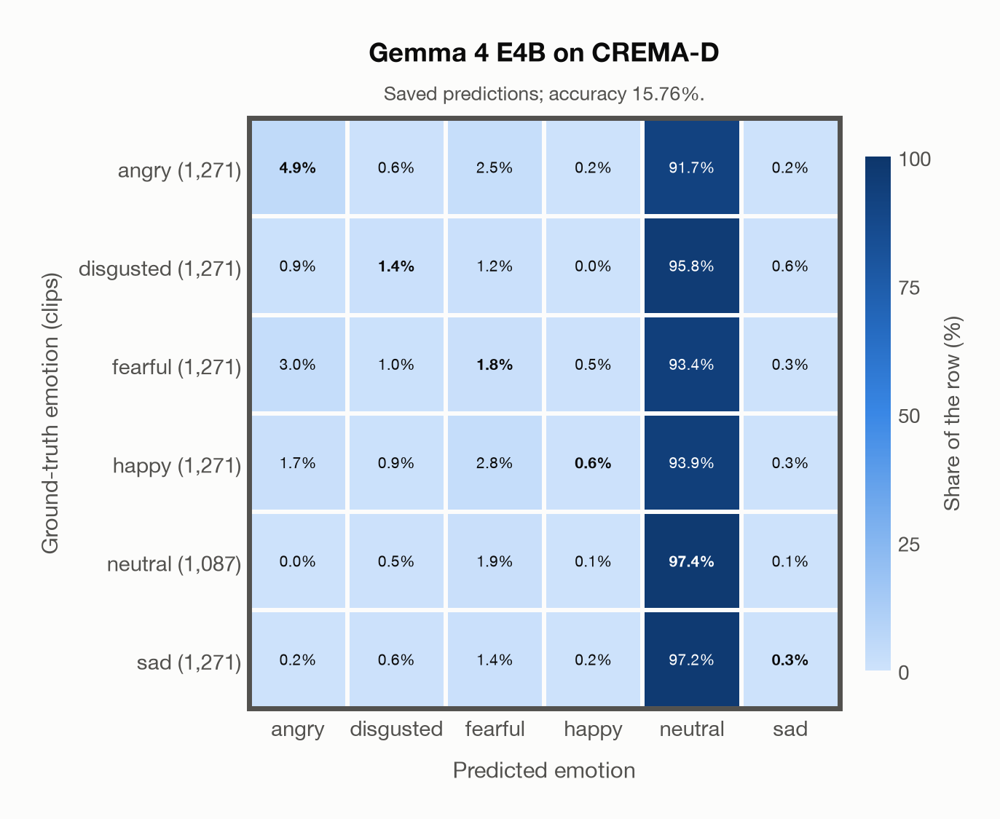
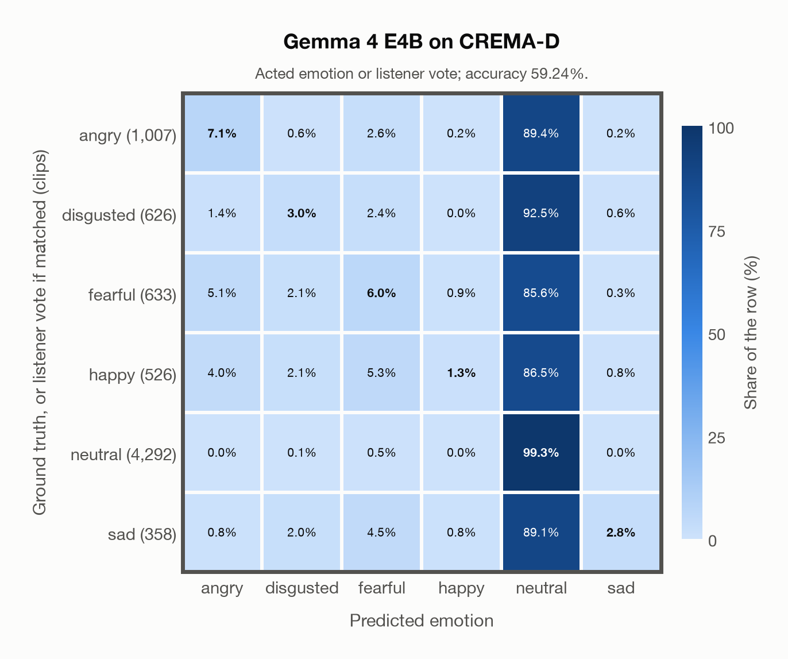

# Gemma 4 E4B on CREMA-D

Regenerated offline from saved CSV/JSON by `scripts/evaluation/refresh_reports.py`. This refresh performs no model inference or API requests.

## Summary

| Metric | Recomputed value |
|---|---:|
| Clips | 7,442 |
| Accuracy: acted emotion | 15.76% |
| UAR: mean ground-truth-row recall | 17.73% |
| Macro F1 | 7.08% |
| Weighted F1: true-support weighted | 6.61% |
| Accuracy: all model classes | 15.76% |
| Invalid / outside-candidate answers | 0 (0.00%) |
| Accuracy: acted emotion or listener vote | 59.24% |
| Single listener vote vs acted emotion | 45.59% |
| Model vs single listener vote | 57.44% |

## Imported run and verification

- Source: [prediction CSV](../../outputs/gemma4_e4b/crema_d_predictions.csv) and [metadata JSON](../../outputs/gemma4_e4b/crema_d_predictions.json); both remain byte-for-byte unchanged.
- Original execution date recorded in JSON: `2026-11-13`.
- Dataset scope recorded in JSON: **CREMA-D**, English; 7,442 / 7,442 clips.
- Ground-truth column: `acted_emotion`. Candidate classes: angry, disgusted, fearful, happy, neutral, sad.
- Row counts, unique audio paths, correctness flags and saved metrics were checked against the CSV. Metric agreement tolerance is 0.000001 (six-decimal metadata).
- Weighted F1 weights each class's F1 by its true support, using the same resolved truth as macro F1; invalid answers remain errors. New metrics absent from the source JSON are recorded in the offline audit and summaries; the source JSON is preserved.
- Saved candidate/prompt/model protocol matches current configuration: scope `dataset`, model `google/gemma-4-E4B-it`, prompt hash `8bf25e176a1f`.
- Original execution/client runtime metadata (reported by the imported run, not measured by this refresh): `{"device": "cuda:0", "hardware": "NVIDIA L4", "seconds": 8851.3, "ms_per_clip": 1189.4, "on_cpu": 0}`.
- Saved p_* columns encode the returned answer as one-hot values; they are not calibrated API class probabilities, and no confidence plot is inferred from them.
- A raw responses journal is present; this refresh validates CSV/JSON only.

## Prediction distribution

Counts and shares use all saved samples. The invalid bucket combines `invalid` and `other answer`: answers outside the dataset's candidate classes remain errors.

| Predicted label | Clips | Share of all clips |
|---|---:|---:|
| angry | 136 | 1.83% |
| disgusted | 61 | 0.82% |
| fearful | 144 | 1.93% |
| happy | 19 | 0.26% |
| neutral | 7,059 | 94.85% |
| sad | 23 | 0.31% |
| invalid / outside candidates | 0 | 0.00% |

## Results per emotion

| Ground-truth emotion | Clips | Recall | Acted-or-listener recall |
|---|---:|---:|---:|
| angry | 1,271 | 4.88% | 26.36% |
| disgusted | 1,271 | 1.42% | 52.24% |
| fearful | 1,271 | 1.81% | 53.19% |
| happy | 1,271 | 0.55% | 59.17% |
| neutral | 1,087 | 97.42% | 97.42% |
| sad | 1,271 | 0.31% | 72.62% |

Precision/F1 use the same resolved-truth convention as the evaluation script. Weighted F1 uses the resolved-truth clip counts below as weights.

| Predicted emotion | Resolved-truth clips | Precision | Recall | F1 |
|---|---:|---:|---:|---:|
| angry | 1,271 | 45.59% | 4.88% | 8.81% |
| disgusted | 1,271 | 29.51% | 1.42% | 2.70% |
| fearful | 1,271 | 15.97% | 1.81% | 3.25% |
| happy | 1,271 | 36.84% | 0.55% | 1.09% |
| neutral | 1,087 | 15.00% | 97.42% | 26.00% |
| sad | 1,271 | 17.39% | 0.31% | 0.62% |

## Confusion matrix: acted emotion

| Ground truth \ Predicted | angry | disgusted | fearful | happy | neutral | sad |
|---|---|---|---|---|---|---|
| angry (1,271) | **4.9%** | 0.6% | 2.5% | 0.2% | 91.7% | 0.2% |
| disgusted (1,271) | 0.9% | **1.4%** | 1.2% | 0.0% | 95.8% | 0.6% |
| fearful (1,271) | 3.0% | 1.0% | **1.8%** | 0.5% | 93.4% | 0.3% |
| happy (1,271) | 1.7% | 0.9% | 2.8% | **0.6%** | 93.9% | 0.3% |
| neutral (1,087) | 0.0% | 0.5% | 1.9% | 0.1% | **97.4%** | 0.1% |
| sad (1,271) | 0.2% | 0.6% | 1.4% | 0.2% | 97.2% | **0.3%** |

## Confusion matrix: acted emotion or listener vote

A prediction accepted only through the listener vote is placed in that predicted emotion's row; other clips keep their original ground-truth row. Row supports can therefore change.

| Ground truth \ Predicted | angry | disgusted | fearful | happy | neutral | sad |
|---|---|---|---|---|---|---|
| angry (1,007) | **7.1%** | 0.6% | 2.6% | 0.2% | 89.4% | 0.2% |
| disgusted (626) | 1.4% | **3.0%** | 2.4% | 0.0% | 92.5% | 0.6% |
| fearful (633) | 5.1% | 2.1% | **6.0%** | 0.9% | 85.6% | 0.3% |
| happy (526) | 4.0% | 2.1% | 5.3% | **1.3%** | 86.5% | 0.8% |
| neutral (4,292) | 0.0% | 0.1% | 0.5% | 0.0% | **99.3%** | 0.0% |
| sad (358) | 0.8% | 2.0% | 4.5% | 0.8% | 89.1% | **2.8%** |

## Caveats

- **Training involvement for Gemma 4 E4B: No corpus-specific evidence**. Source: Broad multimodal pretraining and instruction tuning; complete corpus-level provenance not published (Google). Direct use and upstream teacher use both count as training involvement. No pattern: no corpus-specific evidence, not verified unseen. Corpus use is not test-clip leakage.
- The known empty CREMA-D recording 1076_MTI_SAD_XX.wav is retained in the saved predictions, matching the existing project evaluation scope.
- Internal CSV/JSON consistency does not authenticate the original model or remote request logs.

[Offline validation audit](crema_d_offline_audit.json)
