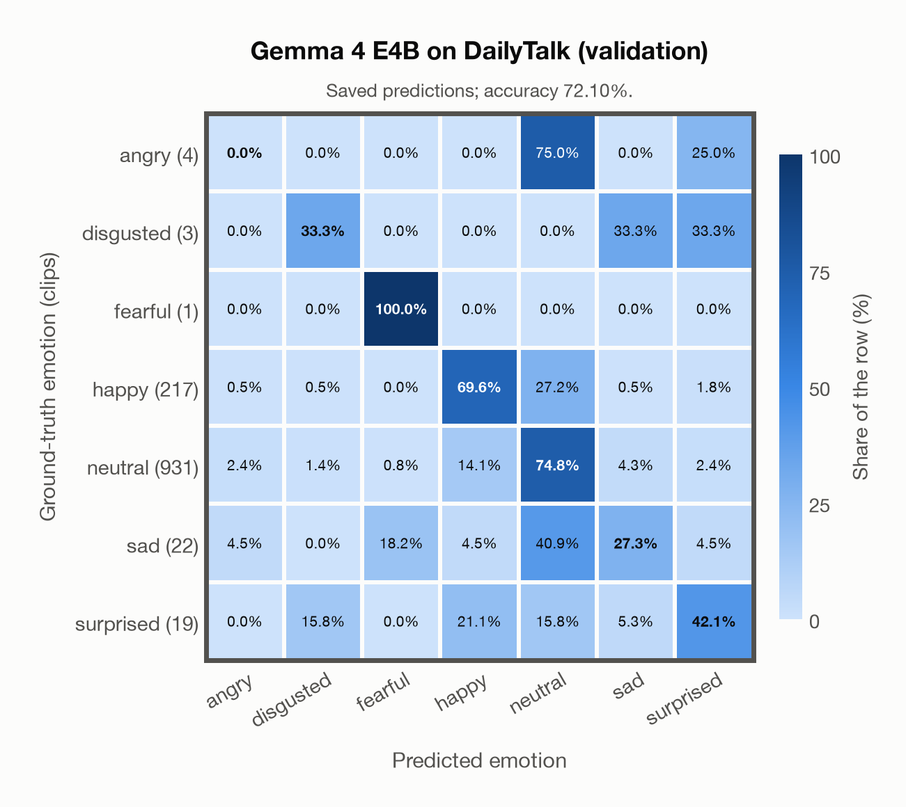

# Gemma 4 E4B on DailyTalk (validation)

Regenerated offline from saved CSV/JSON by `scripts/evaluation/refresh_reports.py`. This refresh performs no model inference or API requests.

## Summary

| Metric | Recomputed value |
|---|---:|
| Clips | 1,197 |
| Accuracy: acted emotion | 72.10% |
| UAR: mean ground-truth-row recall | 49.58% |
| Macro F1 | 30.31% |
| Weighted F1: true-support weighted | 75.31% |
| Accuracy: all model classes | 72.10% |
| Invalid / outside-candidate answers | 0 (0.00%) |

## Imported run and verification

- Source: [prediction CSV](../../outputs/gemma4_e4b/dailytalk_predictions.csv) and [metadata JSON](../../outputs/gemma4_e4b/dailytalk_predictions.json); both remain byte-for-byte unchanged.
- Original execution date recorded in JSON: `2026-11-12`.
- Dataset scope recorded in JSON: **DailyTalk (validation)**, English; 1,197 / 1,197 clips.
- Ground-truth column: `acted_emotion`. Candidate classes: angry, disgusted, fearful, happy, neutral, sad, surprised.
- Row counts, unique audio paths, correctness flags and saved metrics were checked against the CSV. Metric agreement tolerance is 0.000001 (six-decimal metadata).
- Weighted F1 weights each class's F1 by its true support, using the same resolved truth as macro F1; invalid answers remain errors. New metrics absent from the source JSON are recorded in the offline audit and summaries; the source JSON is preserved.
- Saved candidate/prompt/model protocol matches current configuration: scope `dataset`, model `google/gemma-4-E4B-it`, prompt hash `aab2967fd07a`.
- Original execution/client runtime metadata (reported by the imported run, not measured by this refresh): `{"device": "cuda:0", "hardware": "NVIDIA L4", "seconds": 1858.2, "ms_per_clip": 1552.4, "on_cpu": 0}`.
- Saved p_* columns encode the returned answer as one-hot values; they are not calibrated API class probabilities, and no confidence plot is inferred from them.
- A raw responses journal is present; this refresh validates CSV/JSON only.
- Small original ground-truth classes (at most 5 clips): angry (4 clips), disgusted (3 clips), fearful (1 clip). UAR gives each original ground-truth row equal weight; recalls from these small supports should be interpreted with care.

## Prediction distribution

Counts and shares use all saved samples. The invalid bucket combines `invalid` and `other answer`: answers outside the dataset's candidate classes remain errors.

| Predicted label | Clips | Share of all clips |
|---|---:|---:|
| angry | 24 | 2.01% |
| disgusted | 18 | 1.50% |
| fearful | 12 | 1.00% |
| happy | 287 | 23.98% |
| neutral | 770 | 64.33% |
| sad | 49 | 4.09% |
| surprised | 37 | 3.09% |
| invalid / outside candidates | 0 | 0.00% |

## Results per emotion

| Ground-truth emotion | Clips | Recall | Acted-or-listener recall |
|---|---:|---:|---:|
| angry | 4 | 0.00% | — |
| disgusted | 3 | 33.33% | — |
| fearful | 1 | 100.00% | — |
| happy | 217 | 69.59% | — |
| neutral | 931 | 74.76% | — |
| sad | 22 | 27.27% | — |
| surprised | 19 | 42.11% | — |

Precision/F1 use the same resolved-truth convention as the evaluation script. Weighted F1 uses the resolved-truth clip counts below as weights.

| Predicted emotion | Resolved-truth clips | Precision | Recall | F1 |
|---|---:|---:|---:|---:|
| angry | 4 | 0.00% | 0.00% | 0.00% |
| disgusted | 3 | 5.56% | 33.33% | 9.52% |
| fearful | 1 | 8.33% | 100.00% | 15.38% |
| happy | 217 | 52.61% | 69.59% | 59.92% |
| neutral | 931 | 90.39% | 74.76% | 81.83% |
| sad | 22 | 12.24% | 27.27% | 16.90% |
| surprised | 19 | 21.62% | 42.11% | 28.57% |

## Confusion matrix: acted emotion

| Ground truth \ Predicted | angry | disgusted | fearful | happy | neutral | sad | surprised |
|---|---|---|---|---|---|---|---|
| angry (4) | **0.0%** | 0.0% | 0.0% | 0.0% | 75.0% | 0.0% | 25.0% |
| disgusted (3) | 0.0% | **33.3%** | 0.0% | 0.0% | 0.0% | 33.3% | 33.3% |
| fearful (1) | 0.0% | 0.0% | **100.0%** | 0.0% | 0.0% | 0.0% | 0.0% |
| happy (217) | 0.5% | 0.5% | 0.0% | **69.6%** | 27.2% | 0.5% | 1.8% |
| neutral (931) | 2.4% | 1.4% | 0.8% | 14.1% | **74.8%** | 4.3% | 2.4% |
| sad (22) | 4.5% | 0.0% | 18.2% | 4.5% | 40.9% | **27.3%** | 4.5% |
| surprised (19) | 0.0% | 15.8% | 0.0% | 21.1% | 15.8% | 5.3% | **42.1%** |

## Caveats

- **Training involvement for Gemma 4 E4B: No corpus-specific evidence**. Source: Broad multimodal pretraining and instruction tuning; complete corpus-level provenance not published (Google). Direct use and upstream teacher use both count as training involvement. No pattern: no corpus-specific evidence, not verified unseen. Corpus use is not test-clip leakage.
- Internal CSV/JSON consistency does not authenticate the original model or remote request logs.

[Offline validation audit](dailytalk_offline_audit.json)
