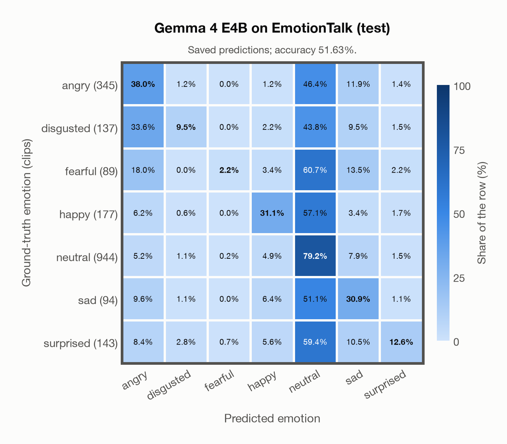

# Gemma 4 E4B on EmotionTalk (test)

Regenerated offline from saved CSV/JSON by `scripts/evaluation/refresh_reports.py`. This refresh performs no model inference or API requests.

## Summary

| Metric | Recomputed value |
|---|---:|
| Clips | 1,929 |
| Accuracy: acted emotion | 51.63% |
| UAR: mean ground-truth-row recall | 29.07% |
| Macro F1 | 29.40% |
| Weighted F1: true-support weighted | 47.88% |
| Accuracy: all model classes | 51.63% |
| Invalid / outside-candidate answers | 0 (0.00%) |

## Imported run and verification

- Source: [prediction CSV](../../outputs/gemma4_e4b/emotiontalk_predictions.csv) and [metadata JSON](../../outputs/gemma4_e4b/emotiontalk_predictions.json); both remain byte-for-byte unchanged.
- Original execution date recorded in JSON: `2026-11-12`.
- Dataset scope recorded in JSON: **EmotionTalk (test)**, Mandarin; 1,929 / 1,929 clips.
- Ground-truth column: `acted_emotion`. Candidate classes: angry, disgusted, fearful, happy, neutral, sad, surprised.
- Row counts, unique audio paths, correctness flags and saved metrics were checked against the CSV. Metric agreement tolerance is 0.000001 (six-decimal metadata).
- Weighted F1 weights each class's F1 by its true support, using the same resolved truth as macro F1; invalid answers remain errors. New metrics absent from the source JSON are recorded in the offline audit and summaries; the source JSON is preserved.
- Saved candidate/prompt/model protocol matches current configuration: scope `dataset`, model `google/gemma-4-E4B-it`, prompt hash `aab2967fd07a`.
- Original execution/client runtime metadata (reported by the imported run, not measured by this refresh): `{"device": "cuda:0", "hardware": "NVIDIA L4", "seconds": 4773.9, "ms_per_clip": 2474.8, "on_cpu": 0}`.
- Saved p_* columns encode the returned answer as one-hot values; they are not calibrated API class probabilities, and no confidence plot is inferred from them.
- A raw responses journal is present; this refresh validates CSV/JSON only.

## Prediction distribution

Counts and shares use all saved samples. The invalid bucket combines `invalid` and `other answer`: answers outside the dataset's candidate classes remain errors.

| Predicted label | Clips | Share of all clips |
|---|---:|---:|
| angry | 274 | 14.20% |
| disgusted | 33 | 1.71% |
| fearful | 5 | 0.26% |
| happy | 125 | 6.48% |
| neutral | 1,256 | 65.11% |
| sad | 191 | 9.90% |
| surprised | 45 | 2.33% |
| invalid / outside candidates | 0 | 0.00% |

## Results per emotion

| Ground-truth emotion | Clips | Recall | Acted-or-listener recall |
|---|---:|---:|---:|
| angry | 345 | 37.97% | — |
| disgusted | 137 | 9.49% | — |
| fearful | 89 | 2.25% | — |
| happy | 177 | 31.07% | — |
| neutral | 944 | 79.24% | — |
| sad | 94 | 30.85% | — |
| surprised | 143 | 12.59% | — |

Precision/F1 use the same resolved-truth convention as the evaluation script. Weighted F1 uses the resolved-truth clip counts below as weights.

| Predicted emotion | Resolved-truth clips | Precision | Recall | F1 |
|---|---:|---:|---:|---:|
| angry | 345 | 47.81% | 37.97% | 42.33% |
| disgusted | 137 | 39.39% | 9.49% | 15.29% |
| fearful | 89 | 40.00% | 2.25% | 4.26% |
| happy | 177 | 44.00% | 31.07% | 36.42% |
| neutral | 944 | 59.55% | 79.24% | 68.00% |
| sad | 94 | 15.18% | 30.85% | 20.35% |
| surprised | 143 | 40.00% | 12.59% | 19.15% |

## Confusion matrix: acted emotion

| Ground truth \ Predicted | angry | disgusted | fearful | happy | neutral | sad | surprised |
|---|---|---|---|---|---|---|---|
| angry (345) | **38.0%** | 1.2% | 0.0% | 1.2% | 46.4% | 11.9% | 1.4% |
| disgusted (137) | 33.6% | **9.5%** | 0.0% | 2.2% | 43.8% | 9.5% | 1.5% |
| fearful (89) | 18.0% | 0.0% | **2.2%** | 3.4% | 60.7% | 13.5% | 2.2% |
| happy (177) | 6.2% | 0.6% | 0.0% | **31.1%** | 57.1% | 3.4% | 1.7% |
| neutral (944) | 5.2% | 1.1% | 0.2% | 4.9% | **79.2%** | 7.9% | 1.5% |
| sad (94) | 9.6% | 1.1% | 0.0% | 6.4% | 51.1% | **30.9%** | 1.1% |
| surprised (143) | 8.4% | 2.8% | 0.7% | 5.6% | 59.4% | 10.5% | **12.6%** |

## Caveats

- **Training involvement for Gemma 4 E4B: No corpus-specific evidence**. Source: Broad multimodal pretraining and instruction tuning; complete corpus-level provenance not published (Google). Direct use and upstream teacher use both count as training involvement. No pattern: no corpus-specific evidence, not verified unseen. Corpus use is not test-clip leakage.
- Internal CSV/JSON consistency does not authenticate the original model or remote request logs.

[Offline validation audit](emotiontalk_offline_audit.json)
