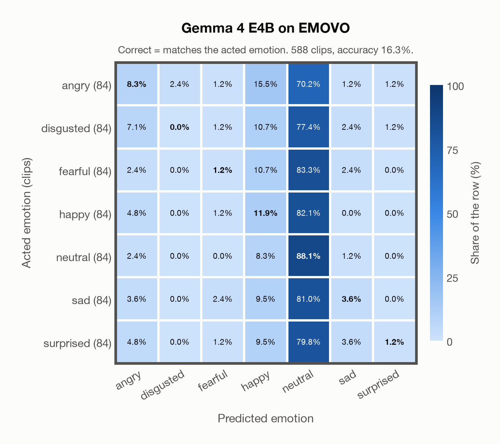

# Gemma 4 E4B on EMOVO

Generated by `scripts/evaluation/evaluate.py` on 2026-11-08.

## Summary

| Metric | Value |
|---|---|
| Clips evaluated | 588 (Italian) |
| **Accuracy: prediction matches the acted emotion** | **16.3%** |
| Unweighted accuracy (mean recall of the 7 acted emotions) | 16.3% |
| Macro F1 (acted emotion) | 9.1% |
| Accuracy, all 8 model classes (acted emotion) | 16.3% |
| Chance level (7 emotions) | 14.3% |

## Setup

- **Model**: Gemma 4 E4B (`google/gemma-4-E4B-it`) as released (no fine-tuning), transformers 5.18.0, loaded by `scripts/models/gemma4_audio.py`. Gemma 4 E4B (thinking off) gets one conversation per clip in its chat template: the system prompt, then one user turn with the user prompt first and the audio after it (as the model card advises), with the system and user prompts of `scripts/llm_eval/prompts.yaml` (the same as for GPT Realtime); the clip as 16 kHz mono (at most its first 30 s). Greedy decoding (do_sample=False, no repetition penalty), at most 24 new tokens, bfloat16 on `mps`, sdpa attention; so the answers are the same from run to run (up to rounding differences between devices). The answer is read by `scripts/llm_eval/parsing.py` and becomes a one-hot vector over the 7 emotions plus `invalid`. An answer that is not exactly one label gets a follow-up in the same conversation ("Answer with exactly one word from this list, in lowercase, and nothing else: angry, disgusted, fearful, happy, neutral, sad, surprised."), up to 1 time(s); then `invalid`. An answer that is not one of the dataset's emotions counts as wrong (column *other answer* of the confusion matrices); the raw answers are in `outputs/gemma4_e4b/responses.jsonl`.
- **Data**: 588 clips of EMOVO (Italian) from `data/emovo/`.
- **Ground truth (acted emotion)**: the emotion each actor was asked to portray, from the first part of the file name (`dis`gusto, `gio`ia, `neu`trale, `pau`ra, `rab`bia, `sor`presa, `tri`stezza).
- Label mapping: rabbia = angry, disgusto = disgusted, paura = fearful, gioia = happy, neutrale = neutral, tristezza = sad, sorpresa = surprised.
- 6 professional actors (3 female, 3 male) say the same 14 sentences (some of them nonsense sentences) in each of the 7 emotions: 588 clips.
- **7 emotions**: the prediction is the model's answer when it is one of the 7 emotions in this dataset (angry, disgusted, fearful, happy, neutral, sad, surprised); any other answer (`invalid`) counts as wrong, so the accuracy is the same with all 8 model classes.
- **Hardware**: Apple M4 Max, device `mps`, PyTorch 2.7.1. Inference took 4.8 min (490 ms per clip; answers saved by an earlier run take no time).
- **Per-clip predictions**: `outputs/gemma4_e4b/emovo_predictions.csv` (in git, so the results can be checked clip by clip). The JSON file next to it describes the columns.

## Results per emotion

Rows: acted emotion. Precision, recall and F1 compare the prediction with the acted emotion.

| Emotion | Clips | Precision | Recall | F1 |
|---|---|---|---|---|
| angry | 84 | 25.0% | 8.3% | 12.5% |
| disgusted | 84 | 0.0% | 0.0% | 0.0% |
| fearful | 84 | 14.3% | 1.2% | 2.2% |
| happy | 84 | 15.6% | 11.9% | 13.5% |
| neutral | 84 | 15.7% | 88.1% | 26.6% |
| sad | 84 | 25.0% | 3.6% | 6.2% |
| surprised | 84 | 33.3% | 1.2% | 2.3% |

## Confusion matrix: acted emotion

The same numbers as a table. Rows: acted emotion. Columns: predicted emotion. Each row adds up to 100%.

| Acted \ Predicted | angry | disgusted | fearful | happy | neutral | sad | surprised |
|---|---|---|---|---|---|---|---|
| angry (84) | **8.3%** | 2.4% | 1.2% | 15.5% | 70.2% | 1.2% | 1.2% |
| disgusted (84) | 7.1% | **0.0%** | 1.2% | 10.7% | 77.4% | 2.4% | 1.2% |
| fearful (84) | 2.4% | 0.0% | **1.2%** | 10.7% | 83.3% | 2.4% | 0.0% |
| happy (84) | 4.8% | 0.0% | 1.2% | **11.9%** | 82.1% | 0.0% | 0.0% |
| neutral (84) | 2.4% | 0.0% | 0.0% | 8.3% | **88.1%** | 1.2% | 0.0% |
| sad (84) | 3.6% | 0.0% | 2.4% | 9.5% | 81.0% | **3.6%** | 0.0% |
| surprised (84) | 4.8% | 0.0% | 1.2% | 9.5% | 79.8% | 3.6% | **1.2%** |

Most frequent confusions: fearful predicted as neutral (83.3%), happy predicted as neutral (82.1%), sad predicted as neutral (81.0%).

## Predictions outside the 7 emotions

With all 8 model classes, the model chose a class that this dataset does not have for 0 clips (0.0%): `invalid` 0.

## Caveats

- **Gemma 4 E4B's training data**: not published (Google). The model may have heard these public datasets during training.
- **Unofficial copy.** The official site (voice.fub.it) is gone and there is no official mirror; the files come from a copy on DagsHub (kingabzpro/EMOVO), checked only against the file names and count of the corpus.
- No listeners' labels per clip are published (the authors' listening test covered 2 sentences per actor). Only six speakers. Audio: 48 kHz WAV, stereo except one file (the channels are averaged), resampled to 16 kHz.
