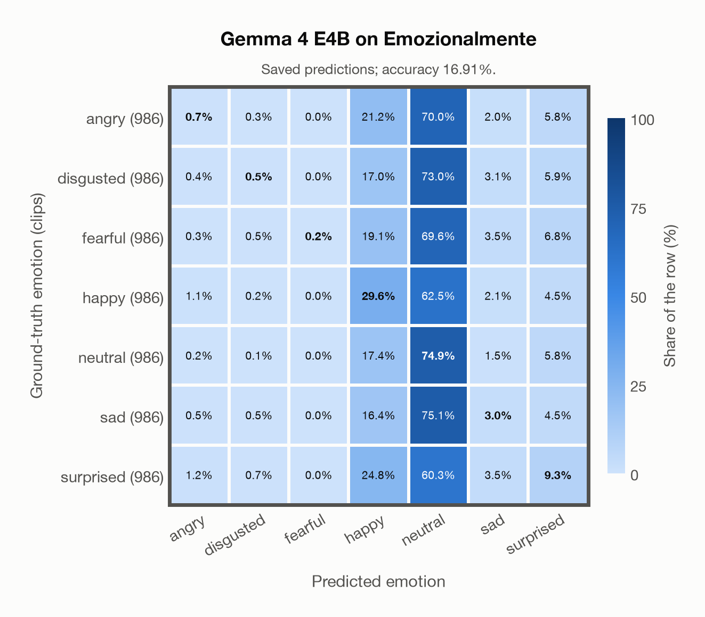
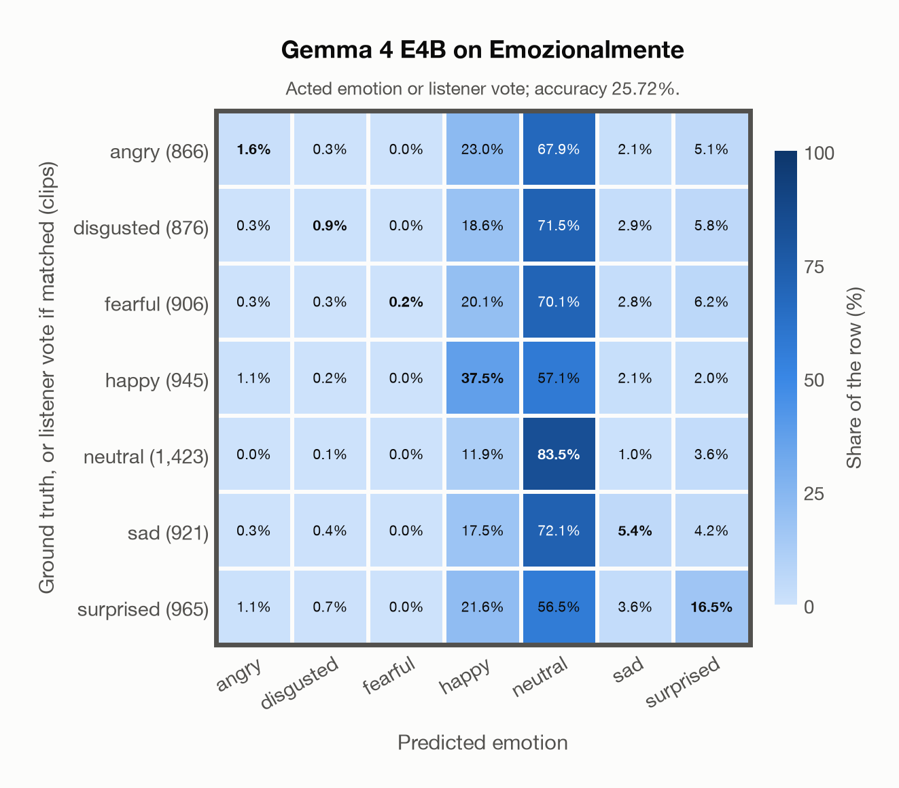

# Gemma 4 E4B on Emozionalmente

Regenerated offline from saved CSV/JSON by `scripts/evaluation/refresh_reports.py`. This refresh performs no model inference or API requests.

## Summary

| Metric | Recomputed value |
|---|---:|
| Clips | 6,902 |
| Accuracy: acted emotion | 16.91% |
| UAR: mean ground-truth-row recall | 16.91% |
| Macro F1 | 10.10% |
| Weighted F1: true-support weighted | 10.10% |
| Accuracy: all model classes | 16.91% |
| Invalid / outside-candidate answers | 0 (0.00%) |
| Accuracy: acted emotion or listener vote | 25.72% |
| Single listener vote vs acted emotion | 81.22% |
| Model vs single listener vote | 22.00% |

## Imported run and verification

- Source: [prediction CSV](../../outputs/gemma4_e4b/emozionalmente_predictions.csv) and [metadata JSON](../../outputs/gemma4_e4b/emozionalmente_predictions.json); both remain byte-for-byte unchanged.
- Original execution date recorded in JSON: `2026-11-14`.
- Dataset scope recorded in JSON: **Emozionalmente**, Italian; 6,902 / 6,902 clips.
- Ground-truth column: `acted_emotion`. Candidate classes: angry, disgusted, fearful, happy, neutral, sad, surprised.
- Row counts, unique audio paths, correctness flags and saved metrics were checked against the CSV. Metric agreement tolerance is 0.000001 (six-decimal metadata).
- Weighted F1 weights each class's F1 by its true support, using the same resolved truth as macro F1; invalid answers remain errors. New metrics absent from the source JSON are recorded in the offline audit and summaries; the source JSON is preserved.
- Saved candidate/prompt/model protocol matches current configuration: scope `dataset`, model `google/gemma-4-E4B-it`, prompt hash `aab2967fd07a`.
- Original execution/client runtime metadata (reported by the imported run, not measured by this refresh): `{"device": "mps", "hardware": "Apple M3 Pro", "seconds": 4651.8, "ms_per_clip": 674.0, "on_cpu": 0}`.
- Saved p_* columns encode the returned answer as one-hot values; they are not calibrated API class probabilities, and no confidence plot is inferred from them.
- A raw responses journal is present; this refresh validates CSV/JSON only.

## Prediction distribution

Counts and shares use all saved samples. The invalid bucket combines `invalid` and `other answer`: answers outside the dataset's candidate classes remain errors.

| Predicted label | Clips | Share of all clips |
|---|---:|---:|
| angry | 44 | 0.64% |
| disgusted | 28 | 0.41% |
| fearful | 2 | 0.03% |
| happy | 1,436 | 20.81% |
| neutral | 4,786 | 69.34% |
| sad | 187 | 2.71% |
| surprised | 419 | 6.07% |
| invalid / outside candidates | 0 | 0.00% |

## Results per emotion

| Ground-truth emotion | Clips | Recall | Acted-or-listener recall |
|---|---:|---:|---:|
| angry | 986 | 0.71% | 13.59% |
| disgusted | 986 | 0.51% | 11.97% |
| fearful | 986 | 0.20% | 8.32% |
| happy | 986 | 29.61% | 40.06% |
| neutral | 986 | 74.95% | 76.17% |
| sad | 986 | 3.04% | 11.66% |
| surprised | 986 | 9.33% | 18.26% |

Precision/F1 use the same resolved-truth convention as the evaluation script. Weighted F1 uses the resolved-truth clip counts below as weights.

| Predicted emotion | Resolved-truth clips | Precision | Recall | F1 |
|---|---:|---:|---:|---:|
| angry | 986 | 15.91% | 0.71% | 1.36% |
| disgusted | 986 | 17.86% | 0.51% | 0.99% |
| fearful | 986 | 100.00% | 0.20% | 0.40% |
| happy | 986 | 20.33% | 29.61% | 24.11% |
| neutral | 986 | 15.44% | 74.95% | 25.61% |
| sad | 986 | 16.04% | 3.04% | 5.12% |
| surprised | 986 | 21.96% | 9.33% | 13.10% |

## Confusion matrix: acted emotion

| Ground truth \ Predicted | angry | disgusted | fearful | happy | neutral | sad | surprised |
|---|---|---|---|---|---|---|---|
| angry (986) | **0.7%** | 0.3% | 0.0% | 21.2% | 70.0% | 2.0% | 5.8% |
| disgusted (986) | 0.4% | **0.5%** | 0.0% | 17.0% | 73.0% | 3.1% | 5.9% |
| fearful (986) | 0.3% | 0.5% | **0.2%** | 19.1% | 69.6% | 3.5% | 6.8% |
| happy (986) | 1.1% | 0.2% | 0.0% | **29.6%** | 62.5% | 2.1% | 4.5% |
| neutral (986) | 0.2% | 0.1% | 0.0% | 17.4% | **74.9%** | 1.5% | 5.8% |
| sad (986) | 0.5% | 0.5% | 0.0% | 16.4% | 75.1% | **3.0%** | 4.5% |
| surprised (986) | 1.2% | 0.7% | 0.0% | 24.8% | 60.3% | 3.5% | **9.3%** |

## Confusion matrix: acted emotion or listener vote

A prediction accepted only through the listener vote is placed in that predicted emotion's row; other clips keep their original ground-truth row. Row supports can therefore change.

| Ground truth \ Predicted | angry | disgusted | fearful | happy | neutral | sad | surprised |
|---|---|---|---|---|---|---|---|
| angry (866) | **1.6%** | 0.3% | 0.0% | 23.0% | 67.9% | 2.1% | 5.1% |
| disgusted (876) | 0.3% | **0.9%** | 0.0% | 18.6% | 71.5% | 2.9% | 5.8% |
| fearful (906) | 0.3% | 0.3% | **0.2%** | 20.1% | 70.1% | 2.8% | 6.2% |
| happy (945) | 1.1% | 0.2% | 0.0% | **37.5%** | 57.1% | 2.1% | 2.0% |
| neutral (1,423) | 0.0% | 0.1% | 0.0% | 11.9% | **83.5%** | 1.0% | 3.6% |
| sad (921) | 0.3% | 0.4% | 0.0% | 17.5% | 72.1% | **5.4%** | 4.2% |
| surprised (965) | 1.1% | 0.7% | 0.0% | 21.6% | 56.5% | 3.6% | **16.5%** |

## Caveats

- **Training involvement for Gemma 4 E4B: No corpus-specific evidence**. Source: Broad multimodal pretraining and instruction tuning; complete corpus-level provenance not published (Google). Direct use and upstream teacher use both count as training involvement. No pattern: no corpus-specific evidence, not verified unseen. Corpus use is not test-clip leakage.
- Internal CSV/JSON consistency does not authenticate the original model or remote request logs.

[Offline validation audit](emozionalmente_offline_audit.json)
