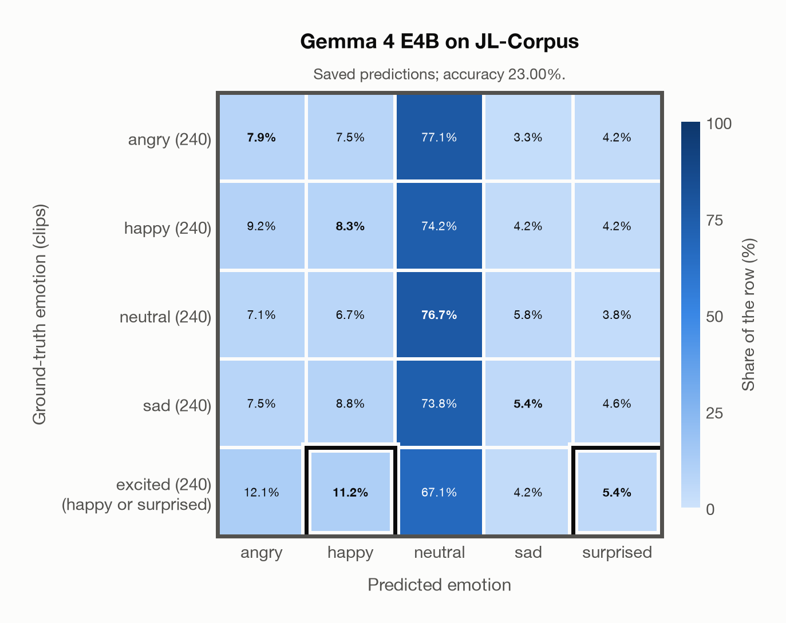

# Gemma 4 E4B on JL-Corpus

Regenerated offline from saved CSV/JSON by `scripts/evaluation/refresh_reports.py`. This refresh performs no model inference or API requests.

## Summary

| Metric | Recomputed value |
|---|---:|
| Clips | 1,200 |
| Accuracy: acted emotion | 23.00% |
| UAR: mean ground-truth-row recall | 23.00% |
| Macro F1 | 21.69% |
| Weighted F1: true-support weighted | 17.36% |
| Accuracy: all model classes | 23.00% |
| Invalid / outside-candidate answers | 0 (0.00%) |

## Imported run and verification

- Source: [prediction CSV](../../outputs/gemma4_e4b/jl_corpus_predictions.csv) and [metadata JSON](../../outputs/gemma4_e4b/jl_corpus_predictions.json); both remain byte-for-byte unchanged.
- Original execution date recorded in JSON: `2026-11-14`.
- Dataset scope recorded in JSON: **JL-Corpus**, English (New Zealand); 1,200 / 1,200 clips.
- Ground-truth column: `acted_emotion`. Candidate classes: angry, happy, neutral, sad, surprised.
- Row counts, unique audio paths, correctness flags and saved metrics were checked against the CSV. Metric agreement tolerance is 0.000001 (six-decimal metadata).
- Weighted F1 weights each class's F1 by its true support, using the same resolved truth as macro F1; invalid answers remain errors. New metrics absent from the source JSON are recorded in the offline audit and summaries; the source JSON is preserved.
- Saved candidate/prompt/model protocol matches current configuration: scope `dataset`, model `google/gemma-4-E4B-it`, prompt hash `1add00540a85`.
- Original execution/client runtime metadata (reported by the imported run, not measured by this refresh): `{"device": "cuda:0", "hardware": "NVIDIA L4", "seconds": 2092.4, "ms_per_clip": 1743.6, "on_cpu": 0}`.
- Saved p_* columns encode the returned answer as one-hot values; they are not calibrated API class probabilities, and no confidence plot is inferred from them.
- A raw responses journal is present; this refresh validates CSV/JSON only.
- Composite labels follow the existing accepted-label rule: excited accepts happy or surprised. F1 resolves a correct composite to the predicted class, otherwise to its first accepted class. Weighted F1 uses the resulting resolved-truth support, which can depend on the predictions.

## Prediction distribution

Counts and shares use all saved samples. The invalid bucket combines `invalid` and `other answer`: answers outside the dataset's candidate classes remain errors.

| Predicted label | Clips | Share of all clips |
|---|---:|---:|
| angry | 105 | 8.75% |
| happy | 102 | 8.50% |
| neutral | 885 | 73.75% |
| sad | 55 | 4.58% |
| surprised | 53 | 4.42% |
| invalid / outside candidates | 0 | 0.00% |

## Results per emotion

| Ground-truth emotion | Clips | Recall | Acted-or-listener recall |
|---|---:|---:|---:|
| angry | 240 | 7.92% | — |
| happy | 240 | 8.33% | — |
| neutral | 240 | 76.67% | — |
| sad | 240 | 5.42% | — |
| excited (happy or surprised) | 240 | 16.67% | — |

Precision/F1 use the same resolved-truth convention as the evaluation script. Weighted F1 uses the resolved-truth clip counts below as weights.

| Predicted emotion | Resolved-truth clips | Precision | Recall | F1 |
|---|---:|---:|---:|---:|
| angry | 240 | 18.10% | 7.92% | 11.01% |
| happy | 467 | 46.08% | 10.06% | 16.52% |
| neutral | 240 | 20.79% | 76.67% | 32.71% |
| sad | 240 | 23.64% | 5.42% | 8.81% |
| surprised | 13 | 24.53% | 100.00% | 39.39% |

## Confusion matrix: acted emotion

| Ground truth \ Predicted | angry | happy | neutral | sad | surprised |
|---|---|---|---|---|---|
| angry (240) | **7.9%** | 7.5% | 77.1% | 3.3% | 4.2% |
| happy (240) | 9.2% | **8.3%** | 74.2% | 4.2% | 4.2% |
| neutral (240) | 7.1% | 6.7% | **76.7%** | 5.8% | 3.8% |
| sad (240) | 7.5% | 8.8% | 73.8% | **5.4%** | 4.6% |
| excited (happy or surprised) (240) | 12.1% | **11.2%** | 67.1% | 4.2% | **5.4%** |

## Caveats

- **Training involvement for Gemma 4 E4B: No corpus-specific evidence**. Source: Broad multimodal pretraining and instruction tuning; complete corpus-level provenance not published (Google). Direct use and upstream teacher use both count as training involvement. No pattern: no corpus-specific evidence, not verified unseen. Corpus use is not test-clip leakage.
- Internal CSV/JSON consistency does not authenticate the original model or remote request logs.

[Offline validation audit](jl_corpus_offline_audit.json)
