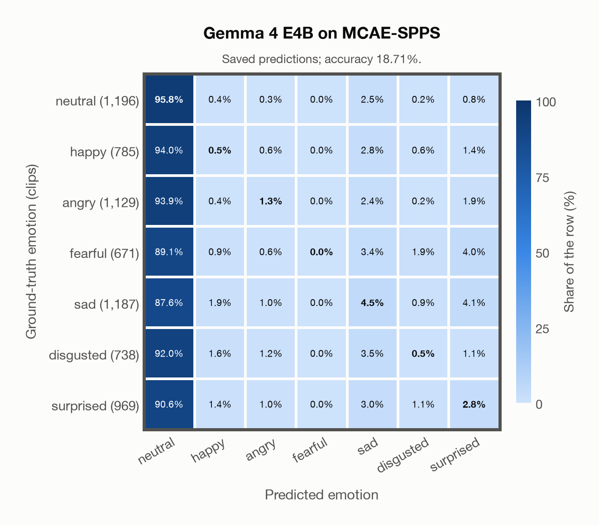

# Gemma 4 E4B on MCAE-SPPS

Regenerated offline from saved CSV/JSON by `scripts/evaluation/refresh_reports.py`. This refresh performs no model inference or API requests.

## Summary

| Metric | Recomputed value |
|---|---:|
| Clips | 6,675 |
| Accuracy: acted emotion | 18.71% |
| UAR: mean ground-truth-row recall | 15.06% |
| Macro F1 | 6.88% |
| Weighted F1: true-support weighted | 8.30% |
| Accuracy: all model classes | 18.71% |
| Invalid / outside-candidate answers | 0 (0.00%) |
| Accuracy: acted emotion or listener vote | 18.71% |
| Single listener vote vs acted emotion | 100.00% |
| Model vs single listener vote | 18.71% |

## Imported run and verification

- Source: [prediction CSV](../../outputs/gemma4_e4b/mcae_spps_predictions.csv) and [metadata JSON](../../outputs/gemma4_e4b/mcae_spps_predictions.json); both remain byte-for-byte unchanged.
- Original execution date recorded in JSON: `2026-11-13`.
- Dataset scope recorded in JSON: **MCAE-SPPS**, Mandarin; 6,675 / 6,675 clips.
- Ground-truth column: `acted_emotion`. Candidate classes: neutral, happy, angry, fearful, sad, disgusted, surprised.
- Row counts, unique audio paths, correctness flags and saved metrics were checked against the CSV. Metric agreement tolerance is 0.000001 (six-decimal metadata).
- Weighted F1 weights each class's F1 by its true support, using the same resolved truth as macro F1; invalid answers remain errors. New metrics absent from the source JSON are recorded in the offline audit and summaries; the source JSON is preserved.
- Saved candidate/prompt/model protocol matches current configuration: scope `dataset`, model `google/gemma-4-E4B-it`, prompt hash `aab2967fd07a`.
- Original execution/client runtime metadata (reported by the imported run, not measured by this refresh): `{"device": "cuda:0", "hardware": "NVIDIA L4", "seconds": 8985.5, "ms_per_clip": 1346.1, "on_cpu": 0}`.
- Saved p_* columns encode the returned answer as one-hot values; they are not calibrated API class probabilities, and no confidence plot is inferred from them.
- A raw responses journal is present; this refresh validates CSV/JSON only.

## Prediction distribution

Counts and shares use all saved samples. The invalid bucket combines `invalid` and `other answer`: answers outside the dataset's candidate classes remain errors.

| Predicted label | Clips | Share of all clips |
|---|---:|---:|
| neutral | 6,139 | 91.97% |
| happy | 67 | 1.00% |
| angry | 59 | 0.88% |
| fearful | 0 | 0.00% |
| sad | 210 | 3.15% |
| disgusted | 48 | 0.72% |
| surprised | 152 | 2.28% |
| invalid / outside candidates | 0 | 0.00% |

## Results per emotion

| Ground-truth emotion | Clips | Recall | Acted-or-listener recall |
|---|---:|---:|---:|
| neutral | 1,196 | 95.82% | 95.82% |
| happy | 785 | 0.51% | 0.51% |
| angry | 1,129 | 1.33% | 1.33% |
| fearful | 671 | 0.00% | 0.00% |
| sad | 1,187 | 4.47% | 4.47% |
| disgusted | 738 | 0.54% | 0.54% |
| surprised | 969 | 2.79% | 2.79% |

Precision/F1 use the same resolved-truth convention as the evaluation script. Weighted F1 uses the resolved-truth clip counts below as weights.

| Predicted emotion | Resolved-truth clips | Precision | Recall | F1 |
|---|---:|---:|---:|---:|
| neutral | 1,196 | 18.67% | 95.82% | 31.25% |
| happy | 785 | 5.97% | 0.51% | 0.94% |
| angry | 1,129 | 25.42% | 1.33% | 2.53% |
| fearful | 671 | 0.00% | 0.00% | 0.00% |
| sad | 1,187 | 25.24% | 4.47% | 7.59% |
| disgusted | 738 | 8.33% | 0.54% | 1.02% |
| surprised | 969 | 17.76% | 2.79% | 4.82% |

## Confusion matrix: acted emotion

| Ground truth \ Predicted | neutral | happy | angry | fearful | sad | disgusted | surprised |
|---|---|---|---|---|---|---|---|
| neutral (1,196) | **95.8%** | 0.4% | 0.3% | 0.0% | 2.5% | 0.2% | 0.8% |
| happy (785) | 94.0% | **0.5%** | 0.6% | 0.0% | 2.8% | 0.6% | 1.4% |
| angry (1,129) | 93.9% | 0.4% | **1.3%** | 0.0% | 2.4% | 0.2% | 1.9% |
| fearful (671) | 89.1% | 0.9% | 0.6% | **0.0%** | 3.4% | 1.9% | 4.0% |
| sad (1,187) | 87.6% | 1.9% | 1.0% | 0.0% | **4.5%** | 0.9% | 4.1% |
| disgusted (738) | 92.0% | 1.6% | 1.2% | 0.0% | 3.5% | **0.5%** | 1.1% |
| surprised (969) | 90.6% | 1.4% | 1.0% | 0.0% | 3.0% | 1.1% | **2.8%** |

## Confusion matrix: acted emotion or listener vote

A prediction accepted only through the listener vote is placed in that predicted emotion's row; other clips keep their original ground-truth row. Row supports can therefore change.

| Ground truth \ Predicted | neutral | happy | angry | fearful | sad | disgusted | surprised |
|---|---|---|---|---|---|---|---|
| neutral (1,196) | **95.8%** | 0.4% | 0.3% | 0.0% | 2.5% | 0.2% | 0.8% |
| happy (785) | 94.0% | **0.5%** | 0.6% | 0.0% | 2.8% | 0.6% | 1.4% |
| angry (1,129) | 93.9% | 0.4% | **1.3%** | 0.0% | 2.4% | 0.2% | 1.9% |
| fearful (671) | 89.1% | 0.9% | 0.6% | **0.0%** | 3.4% | 1.9% | 4.0% |
| sad (1,187) | 87.6% | 1.9% | 1.0% | 0.0% | **4.5%** | 0.9% | 4.1% |
| disgusted (738) | 92.0% | 1.6% | 1.2% | 0.0% | 3.5% | **0.5%** | 1.1% |
| surprised (969) | 90.6% | 1.4% | 1.0% | 0.0% | 3.0% | 1.1% | **2.8%** |

## Caveats

- **Training involvement for Gemma 4 E4B: No corpus-specific evidence**. Source: Broad multimodal pretraining and instruction tuning; complete corpus-level provenance not published (Google). Direct use and upstream teacher use both count as training involvement. No pattern: no corpus-specific evidence, not verified unseen. Corpus use is not test-clip leakage.
- Internal CSV/JSON consistency does not authenticate the original model or remote request logs.

[Offline validation audit](mcae_spps_offline_audit.json)
