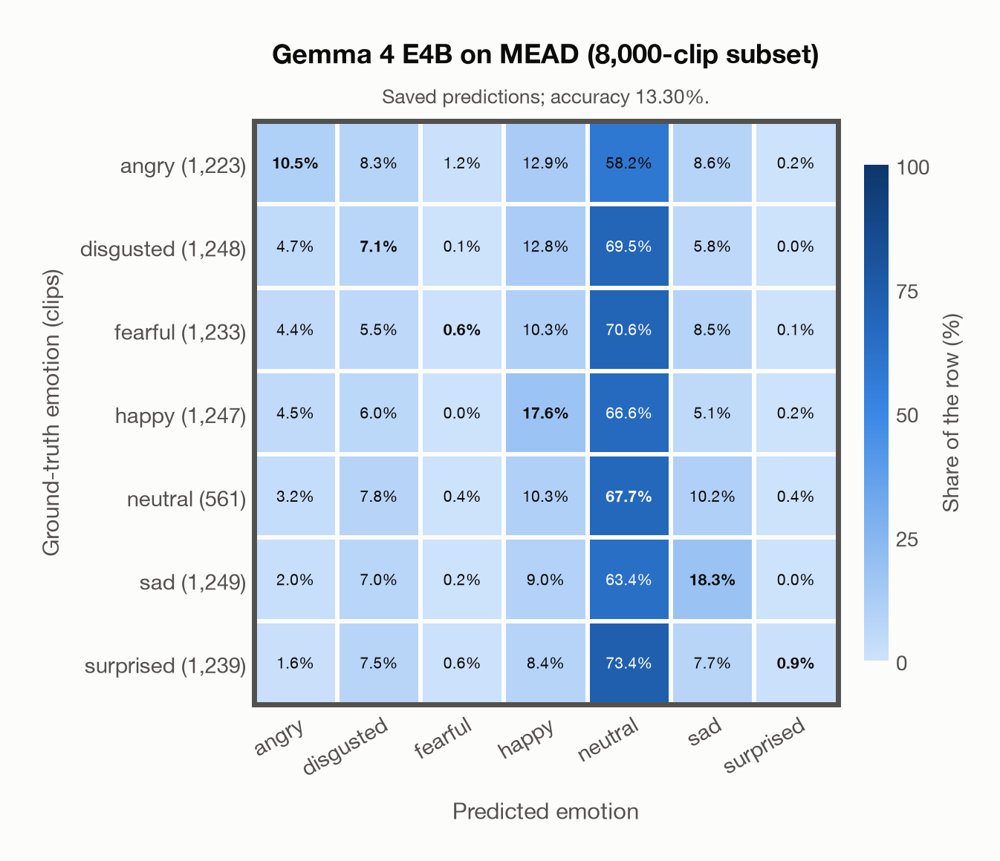

# Gemma 4 E4B on MEAD (8,000-clip subset)

Regenerated offline from saved CSV/JSON by `scripts/evaluation/refresh_reports.py`. This refresh performs no model inference or API requests.

## Summary

| Metric | Recomputed value |
|---|---:|
| Clips | 8,000 |
| Accuracy: acted emotion | 13.30% |
| UAR: mean ground-truth-row recall | 17.54% |
| Macro F1 | 12.14% |
| Weighted F1: true-support weighted | 12.10% |
| Accuracy: all model classes | 13.30% |
| Invalid / outside-candidate answers | 0 (0.00%) |

## Imported run and verification

- Source: [prediction CSV](../../outputs/gemma4_e4b/mead_predictions.csv) and [metadata JSON](../../outputs/gemma4_e4b/mead_predictions.json); both remain byte-for-byte unchanged.
- Original execution date recorded in JSON: `2026-11-14`.
- Dataset scope recorded in JSON: **MEAD (8,000-clip subset)**, English; 8,000 / 8,000 clips.
- Ground-truth column: `acted_emotion`. Candidate classes: angry, disgusted, fearful, happy, neutral, sad, surprised.
- Row counts, unique audio paths, correctness flags and saved metrics were checked against the CSV. Metric agreement tolerance is 0.000001 (six-decimal metadata).
- Weighted F1 weights each class's F1 by its true support, using the same resolved truth as macro F1; invalid answers remain errors. New metrics absent from the source JSON are recorded in the offline audit and summaries; the source JSON is preserved.
- Saved candidate/prompt/model protocol matches current configuration: scope `dataset`, model `google/gemma-4-E4B-it`, prompt hash `aab2967fd07a`.
- Original execution/client runtime metadata (reported by the imported run, not measured by this refresh): `{"device": "mps", "hardware": "Apple M3 Pro", "seconds": 5724.0, "ms_per_clip": 715.5, "on_cpu": 0}`.
- Saved p_* columns encode the returned answer as one-hot values; they are not calibrated API class probabilities, and no confidence plot is inferred from them.
- A raw responses journal is present; this refresh validates CSV/JSON only.

## Prediction distribution

Counts and shares use all saved samples. The invalid bucket combines `invalid` and `other answer`: answers outside the dataset's candidate classes remain errors.

| Predicted label | Clips | Share of all clips |
|---|---:|---:|
| angry | 361 | 4.51% |
| disgusted | 558 | 6.98% |
| fearful | 34 | 0.43% |
| happy | 940 | 11.75% |
| neutral | 5,361 | 67.01% |
| sad | 728 | 9.10% |
| surprised | 18 | 0.22% |
| invalid / outside candidates | 0 | 0.00% |

## Results per emotion

| Ground-truth emotion | Clips | Recall | Acted-or-listener recall |
|---|---:|---:|---:|
| angry | 1,223 | 10.55% | — |
| disgusted | 1,248 | 7.05% | — |
| fearful | 1,233 | 0.57% | — |
| happy | 1,247 | 17.64% | — |
| neutral | 561 | 67.74% | — |
| sad | 1,249 | 18.33% | — |
| surprised | 1,239 | 0.89% | — |

Precision/F1 use the same resolved-truth convention as the evaluation script. Weighted F1 uses the resolved-truth clip counts below as weights.

| Predicted emotion | Resolved-truth clips | Precision | Recall | F1 |
|---|---:|---:|---:|---:|
| angry | 1,223 | 35.73% | 10.55% | 16.29% |
| disgusted | 1,248 | 15.77% | 7.05% | 9.75% |
| fearful | 1,233 | 20.59% | 0.57% | 1.10% |
| happy | 1,247 | 23.40% | 17.64% | 20.12% |
| neutral | 561 | 7.09% | 67.74% | 12.83% |
| sad | 1,249 | 31.46% | 18.33% | 23.17% |
| surprised | 1,239 | 61.11% | 0.89% | 1.75% |

## Confusion matrix: acted emotion

| Ground truth \ Predicted | angry | disgusted | fearful | happy | neutral | sad | surprised |
|---|---|---|---|---|---|---|---|
| angry (1,223) | **10.5%** | 8.3% | 1.2% | 12.9% | 58.2% | 8.6% | 0.2% |
| disgusted (1,248) | 4.7% | **7.1%** | 0.1% | 12.8% | 69.5% | 5.8% | 0.0% |
| fearful (1,233) | 4.4% | 5.5% | **0.6%** | 10.3% | 70.6% | 8.5% | 0.1% |
| happy (1,247) | 4.5% | 6.0% | 0.0% | **17.6%** | 66.6% | 5.1% | 0.2% |
| neutral (561) | 3.2% | 7.8% | 0.4% | 10.3% | **67.7%** | 10.2% | 0.4% |
| sad (1,249) | 2.0% | 7.0% | 0.2% | 9.0% | 63.4% | **18.3%** | 0.0% |
| surprised (1,239) | 1.6% | 7.5% | 0.6% | 8.4% | 73.4% | 7.7% | **0.9%** |

## Caveats

- **Training involvement for Gemma 4 E4B: No corpus-specific evidence**. Source: Broad multimodal pretraining and instruction tuning; complete corpus-level provenance not published (Google). Direct use and upstream teacher use both count as training involvement. No pattern: no corpus-specific evidence, not verified unseen. Corpus use is not test-clip leakage.
- Internal CSV/JSON consistency does not authenticate the original model or remote request logs.

[Offline validation audit](mead_offline_audit.json)
