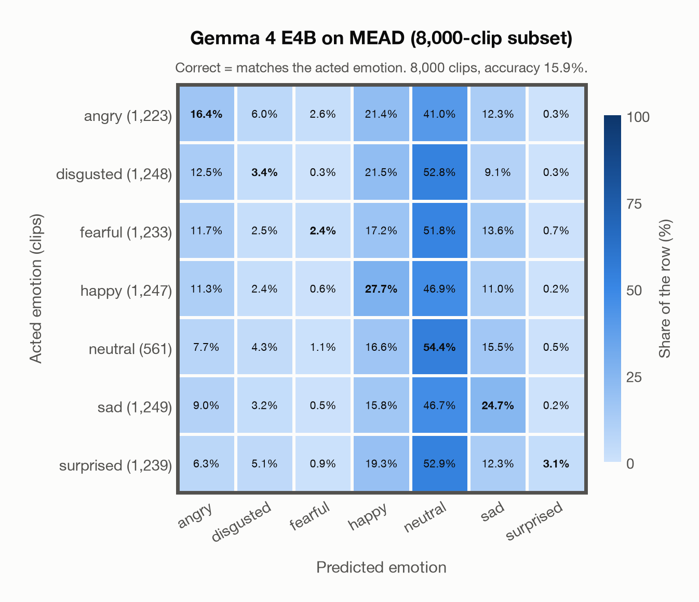

# Gemma 4 E4B on MEAD (8,000-clip subset)

Generated by `scripts/evaluation/evaluate.py` on 2026-11-08.

## Summary

| Metric | Value |
|---|---|
| Clips evaluated | 8,000 (English) |
| **Accuracy: prediction matches the acted emotion** | **15.9%** |
| Unweighted accuracy (mean recall of the 7 acted emotions) | 18.9% |
| Macro F1 (acted emotion) | 14.1% |
| Accuracy, all 8 model classes (acted emotion) | 15.9% |
| Chance level (7 emotions) | 14.3% |

## Setup

- **Model**: Gemma 4 E4B (`google/gemma-4-E4B-it`) as released (no fine-tuning), transformers 5.18.0, loaded by `scripts/models/gemma4_audio.py`. Gemma 4 E4B (thinking off) gets one conversation per clip in its chat template: the system prompt, then one user turn with the user prompt first and the audio after it (as the model card advises), with the system and user prompts of `scripts/llm_eval/prompts.yaml` (the same as for GPT Realtime); the clip as 16 kHz mono (at most its first 30 s). Greedy decoding (do_sample=False, no repetition penalty), at most 24 new tokens, bfloat16 on `mps`, sdpa attention; so the answers are the same from run to run (up to rounding differences between devices). The answer is read by `scripts/llm_eval/parsing.py` and becomes a one-hot vector over the 7 emotions plus `invalid`. An answer that is not exactly one label gets a follow-up in the same conversation ("Answer with exactly one word from this list, in lowercase, and nothing else: angry, disgusted, fearful, happy, neutral, sad, surprised."), up to 1 time(s); then `invalid`. An answer that is not one of the dataset's emotions counts as wrong (column *other answer* of the confusion matrices); the raw answers are in `outputs/gemma4_e4b/responses.jsonl`.
- **Data**: 8,000 clips of MEAD (8,000-clip subset) (English) from `data/mead/`.
- **Ground truth (acted emotion)**: the emotion each actor was asked to portray, from the folder name (`angry`, `disgusted`, `fear`, `happy`, `neutral`, `sad`, `surprised`).
- **Stratified subset** (`subsets` in config/evaluation.yaml): 8,000 of the 27,514 clips, taken at even intervals over the clips sorted by actor, emotion, intensity level and sentence number, so each of the 912 actor/emotion/level cells keeps its share of the clips (rounded down or up, at even intervals within the cell): angry 1,223, disgusted 1,248, fearful 1,233, happy 1,247, neutral 561, sad 1,249, surprised 1,239. Every model is evaluated on the same subset.
- Label mapping: angry, disgusted, happy, neutral, sad and surprised keep their names; fear = fearful. Clips of *contempt* (4,215 of 31,729) are left out because none of the project's emotions matches it.
- 48 of MEAD's 60 actors (those in the official Google Drive folder *Part0*; names starting with M are male, W female) read about 30 sentences in each emotion at three intensities (level 1 weak, 2 medium, 3 strong) and 40 sentences in neutral (one level). All intensities are kept.
- Audio: AAC (.m4a, 48 kHz stereo) from MEAD's audio.tar, converted to 16 kHz mono WAV by scripts/common/download_data.py. Five original files hold no audio and are left out (`M041` sad level 2, 011–014; `W014` angry level 1, 017).
- **7 emotions**: the prediction is the model's answer when it is one of the 7 emotions in this dataset (angry, disgusted, fearful, happy, neutral, sad, surprised); any other answer (`invalid`) counts as wrong, so the accuracy is the same with all 8 model classes.
- **Hardware**: Apple M4 Max, device `mps`, PyTorch 2.7.1. Inference took 68.6 min (514 ms per clip; answers saved by an earlier run take no time).
- **Per-clip predictions**: `outputs/gemma4_e4b/mead_predictions.csv` (in git, so the results can be checked clip by clip). The JSON file next to it describes the columns.

## Results per emotion

Rows: acted emotion. Precision, recall and F1 compare the prediction with the acted emotion.

| Emotion | Clips | Precision | Recall | F1 |
|---|---|---|---|---|
| angry | 1,223 | 22.9% | 16.4% | 19.2% |
| disgusted | 1,248 | 14.1% | 3.4% | 5.5% |
| fearful | 1,233 | 31.2% | 2.4% | 4.5% |
| happy | 1,247 | 21.3% | 27.7% | 24.1% |
| neutral | 561 | 7.8% | 54.4% | 13.6% |
| sad | 1,249 | 27.6% | 24.7% | 26.0% |
| surprised | 1,239 | 61.9% | 3.1% | 6.0% |

## Confusion matrix: acted emotion

The same numbers as a table. Rows: acted emotion. Columns: predicted emotion. Each row adds up to 100%.

| Acted \ Predicted | angry | disgusted | fearful | happy | neutral | sad | surprised |
|---|---|---|---|---|---|---|---|
| angry (1,223) | **16.4%** | 6.0% | 2.6% | 21.4% | 41.0% | 12.3% | 0.3% |
| disgusted (1,248) | 12.5% | **3.4%** | 0.3% | 21.5% | 52.8% | 9.1% | 0.3% |
| fearful (1,233) | 11.7% | 2.5% | **2.4%** | 17.2% | 51.8% | 13.6% | 0.7% |
| happy (1,247) | 11.3% | 2.4% | 0.6% | **27.7%** | 46.9% | 11.0% | 0.2% |
| neutral (561) | 7.7% | 4.3% | 1.1% | 16.6% | **54.4%** | 15.5% | 0.5% |
| sad (1,249) | 9.0% | 3.2% | 0.5% | 15.8% | 46.7% | **24.7%** | 0.2% |
| surprised (1,239) | 6.3% | 5.1% | 0.9% | 19.3% | 52.9% | 12.3% | **3.1%** |

Most frequent confusions: surprised predicted as neutral (52.9%), disgusted predicted as neutral (52.8%), fearful predicted as neutral (51.8%).

## Predictions outside the 7 emotions

With all 8 model classes, the model chose a class that this dataset does not have for 0 clips (0.0%): `invalid` 0.

## Caveats

- **Gemma 4 E4B's training data**: not published (Google). The model may have heard these public datasets during training.
- **Weak intensity.** A third of the emotional clips are acted at level 1 (weak), which is often hard to tell from neutral; the intensity of each clip is kept in the loader but not in the reports.
- No listeners' labels per clip are published, so there is one way of counting a prediction as correct.
- The sentences differ between emotions: besides common and generic sentences, each emotion has emotion-related ones, whose words hint at the emotion; a model that understands English text can use them.
- Recorded for talking-face generation (audio-visual); no licence for the data is published (the GitHub repository's MIT licence covers its code).
