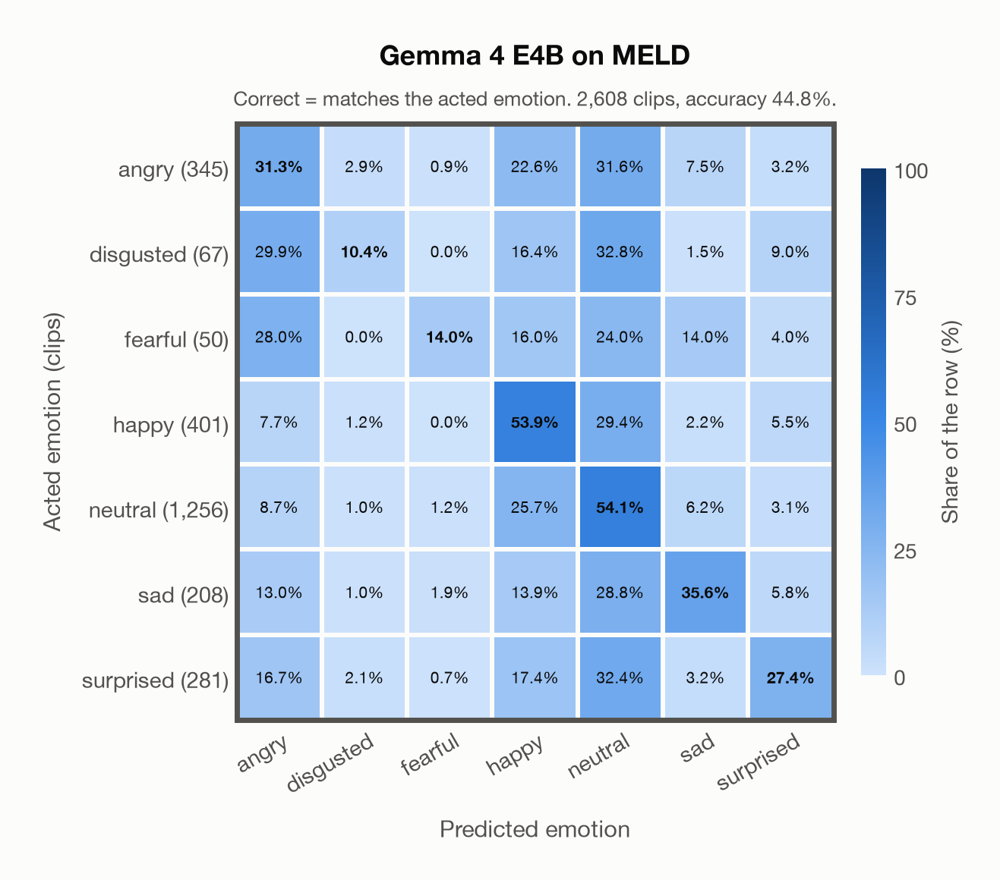

# Gemma 4 E4B on MELD

Generated by `scripts/evaluation/evaluate.py` on 2026-11-08.

## Summary

| Metric | Value |
|---|---|
| Clips evaluated | 2,608 (English) |
| **Accuracy: prediction matches the acted emotion** | **44.8%** |
| Unweighted accuracy (mean recall of the 7 acted emotions) | 32.4% |
| Macro F1 (acted emotion) | 32.5% |
| Accuracy, all 8 model classes (acted emotion) | 44.8% |
| Chance level (7 emotions) | 14.3% |

## Setup

- **Model**: Gemma 4 E4B (`google/gemma-4-E4B-it`) as released (no fine-tuning), transformers 5.18.0, loaded by `scripts/models/gemma4_audio.py`. Gemma 4 E4B (thinking off) gets one conversation per clip in its chat template: the system prompt, then one user turn with the user prompt first and the audio after it (as the model card advises), with the system and user prompts of `scripts/llm_eval/prompts.yaml` (the same as for GPT Realtime); the clip as 16 kHz mono (at most its first 30 s). Greedy decoding (do_sample=False, no repetition penalty), at most 24 new tokens, bfloat16 on `mps`, sdpa attention; so the answers are the same from run to run (up to rounding differences between devices). The answer is read by `scripts/llm_eval/parsing.py` and becomes a one-hot vector over the 7 emotions plus `invalid`. An answer that is not exactly one label gets a follow-up in the same conversation ("Answer with exactly one word from this list, in lowercase, and nothing else: angry, disgusted, fearful, happy, neutral, sad, surprised."), up to 1 time(s); then `invalid`. An answer that is not one of the dataset's emotions counts as wrong (column *other answer* of the confusion matrices); the raw answers are in `outputs/gemma4_e4b/responses.jsonl`.
- **Data**: 2,608 clips of MELD (English) from `data/meld/`.
- **Ground truth (acted emotion)**: the label of each utterance (`Emotion` in `test_sent_emo.csv`): the majority of three annotators who watched the video and read the transcript; the speakers were not asked to act an emotion.
- Label mapping: anger = angry, disgust = disgusted, fear = fearful, joy = happy, neutral = neutral, sadness = sad, surprise = surprised.
- Only the official **test split** (2,610 utterances of 280 dialogues): it is the standard split for reporting results, and the train and dev splits were used to train several of the models.
- Utterances from the TV series *Friends*, converted from the test videos to 16 kHz mono WAV by scripts/common/download_data.py. Left out: `dia38_utt4` (joy) and `dia220_utt0` (disgust), whose time stamps are wrong (each clip holds 4–5 minutes of the episode for one short line).
- **7 emotions**: the prediction is the model's answer when it is one of the 7 emotions in this dataset (angry, disgusted, fearful, happy, neutral, sad, surprised); any other answer (`invalid`) counts as wrong, so the accuracy is the same with all 8 model classes.
- **Hardware**: Apple M4 Max, device `mps`, PyTorch 2.7.1. Inference took 23.6 min (544 ms per clip; answers saved by an earlier run take no time).
- **Per-clip predictions**: `outputs/gemma4_e4b/meld_predictions.csv` (in git, so the results can be checked clip by clip). The JSON file next to it describes the columns.

## Results per emotion

Rows: acted emotion. Precision, recall and F1 compare the prediction with the acted emotion.

| Emotion | Clips | Precision | Recall | F1 |
|---|---|---|---|---|
| angry | 345 | 30.3% | 31.3% | 30.8% |
| disgusted | 67 | 16.7% | 10.4% | 12.8% |
| fearful | 50 | 22.6% | 14.0% | 17.3% |
| happy | 401 | 30.3% | 53.9% | 38.7% |
| neutral | 1,256 | 62.3% | 54.1% | 57.9% |
| sad | 208 | 36.3% | 35.6% | 35.9% |
| surprised | 281 | 45.6% | 27.4% | 34.2% |

## Confusion matrix: acted emotion

The same numbers as a table. Rows: acted emotion. Columns: predicted emotion. Each row adds up to 100%.

| Acted \ Predicted | angry | disgusted | fearful | happy | neutral | sad | surprised |
|---|---|---|---|---|---|---|---|
| angry (345) | **31.3%** | 2.9% | 0.9% | 22.6% | 31.6% | 7.5% | 3.2% |
| disgusted (67) | 29.9% | **10.4%** | 0.0% | 16.4% | 32.8% | 1.5% | 9.0% |
| fearful (50) | 28.0% | 0.0% | **14.0%** | 16.0% | 24.0% | 14.0% | 4.0% |
| happy (401) | 7.7% | 1.2% | 0.0% | **53.9%** | 29.4% | 2.2% | 5.5% |
| neutral (1,256) | 8.7% | 1.0% | 1.2% | 25.7% | **54.1%** | 6.2% | 3.1% |
| sad (208) | 13.0% | 1.0% | 1.9% | 13.9% | 28.8% | **35.6%** | 5.8% |
| surprised (281) | 16.7% | 2.1% | 0.7% | 17.4% | 32.4% | 3.2% | **27.4%** |

Most frequent confusions: disgusted predicted as neutral (32.8%), surprised predicted as neutral (32.4%), angry predicted as neutral (31.6%).

## Predictions outside the 7 emotions

With all 8 model classes, the model chose a class that this dataset does not have for 0 clips (0.0%): `invalid` 0.

## Caveats

- **Gemma 4 E4B's training data**: not published (Google). The model may have heard these public datasets during training.
- **In-the-wild speech with noisy labels.** The annotators saw the video and the transcript, not the voice alone, and agreed moderately (Fleiss' kappa 0.43); the classes are very unbalanced (48% neutral, 2% fear).
- Several speakers, laughter of the studio audience and background music can be heard in a clip; a third of the clips are shorter than 2 s.
- MELD's train split is in the training data of MERaLiON-SER-v1 and of EmoBox (emotion2vec+), so these models have heard the same speakers and show.
- The clips come from a copyrighted TV show (the authors rely on fair use); the repository is GPL-3.0.
