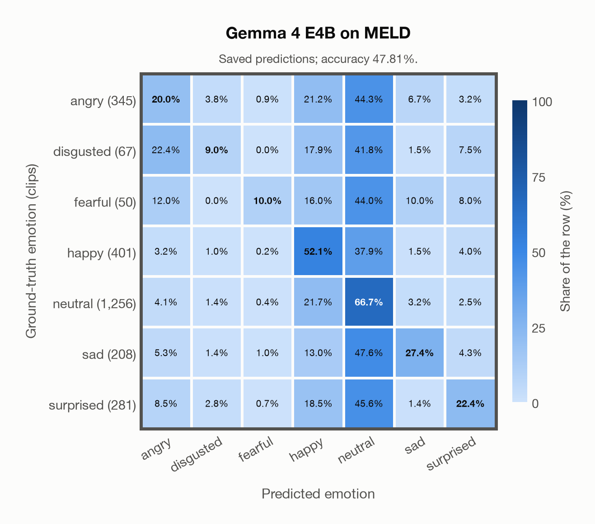

# Gemma 4 E4B on MELD

Regenerated offline from saved CSV/JSON by `scripts/evaluation/refresh_reports.py`. This refresh performs no model inference or API requests.

## Summary

| Metric | Recomputed value |
|---|---:|
| Clips | 2,608 |
| Accuracy: acted emotion | 47.81% |
| UAR: mean ground-truth-row recall | 29.66% |
| Macro F1 | 30.86% |
| Weighted F1: true-support weighted | 46.09% |
| Accuracy: all model classes | 47.81% |
| Invalid / outside-candidate answers | 0 (0.00%) |

## Imported run and verification

- Source: [prediction CSV](../../outputs/gemma4_e4b/meld_predictions.csv) and [metadata JSON](../../outputs/gemma4_e4b/meld_predictions.json); both remain byte-for-byte unchanged.
- Original execution date recorded in JSON: `2026-11-09`.
- Dataset scope recorded in JSON: **MELD**, English; 2,608 / 2,608 clips.
- Ground-truth column: `acted_emotion`. Candidate classes: angry, disgusted, fearful, happy, neutral, sad, surprised.
- Row counts, unique audio paths, correctness flags and saved metrics were checked against the CSV. Metric agreement tolerance is 0.000001 (six-decimal metadata).
- Weighted F1 weights each class's F1 by its true support, using the same resolved truth as macro F1; invalid answers remain errors. New metrics absent from the source JSON are recorded in the offline audit and summaries; the source JSON is preserved.
- Saved candidate/prompt/model protocol matches current configuration: scope `dataset`, model `google/gemma-4-E4B-it`, prompt hash `aab2967fd07a`.
- Original execution/client runtime metadata (reported by the imported run, not measured by this refresh): `{"device": "mps", "hardware": "Apple M4 Max", "seconds": 1636.3, "ms_per_clip": 627.4, "on_cpu": 0}`.
- Saved p_* columns encode the returned answer as one-hot values; they are not calibrated API class probabilities, and no confidence plot is inferred from them.
- A raw responses journal is present; this refresh validates CSV/JSON only.

## Prediction distribution

Counts and shares use all saved samples. The invalid bucket combines `invalid` and `other answer`: answers outside the dataset's candidate classes remain errors.

| Predicted label | Clips | Share of all clips |
|---|---:|---:|
| angry | 189 | 7.25% |
| disgusted | 52 | 1.99% |
| fearful | 18 | 0.69% |
| happy | 653 | 25.04% |
| neutral | 1,420 | 54.45% |
| sad | 136 | 5.21% |
| surprised | 140 | 5.37% |
| invalid / outside candidates | 0 | 0.00% |

## Results per emotion

| Ground-truth emotion | Clips | Recall | Acted-or-listener recall |
|---|---:|---:|---:|
| angry | 345 | 20.00% | — |
| disgusted | 67 | 8.96% | — |
| fearful | 50 | 10.00% | — |
| happy | 401 | 52.12% | — |
| neutral | 1,256 | 66.72% | — |
| sad | 208 | 27.40% | — |
| surprised | 281 | 22.42% | — |

Precision/F1 use the same resolved-truth convention as the evaluation script. Weighted F1 uses the resolved-truth clip counts below as weights.

| Predicted emotion | Resolved-truth clips | Precision | Recall | F1 |
|---|---:|---:|---:|---:|
| angry | 345 | 36.51% | 20.00% | 25.84% |
| disgusted | 67 | 11.54% | 8.96% | 10.08% |
| fearful | 50 | 27.78% | 10.00% | 14.71% |
| happy | 401 | 32.01% | 52.12% | 39.66% |
| neutral | 1,256 | 59.01% | 66.72% | 62.63% |
| sad | 208 | 41.91% | 27.40% | 33.14% |
| surprised | 281 | 45.00% | 22.42% | 29.93% |

## Confusion matrix: acted emotion

| Ground truth \ Predicted | angry | disgusted | fearful | happy | neutral | sad | surprised |
|---|---|---|---|---|---|---|---|
| angry (345) | **20.0%** | 3.8% | 0.9% | 21.2% | 44.3% | 6.7% | 3.2% |
| disgusted (67) | 22.4% | **9.0%** | 0.0% | 17.9% | 41.8% | 1.5% | 7.5% |
| fearful (50) | 12.0% | 0.0% | **10.0%** | 16.0% | 44.0% | 10.0% | 8.0% |
| happy (401) | 3.2% | 1.0% | 0.2% | **52.1%** | 37.9% | 1.5% | 4.0% |
| neutral (1,256) | 4.1% | 1.4% | 0.4% | 21.7% | **66.7%** | 3.2% | 2.5% |
| sad (208) | 5.3% | 1.4% | 1.0% | 13.0% | 47.6% | **27.4%** | 4.3% |
| surprised (281) | 8.5% | 2.8% | 0.7% | 18.5% | 45.6% | 1.4% | **22.4%** |

## Caveats

- **Training involvement for Gemma 4 E4B: No corpus-specific evidence**. Source: Broad multimodal pretraining and instruction tuning; complete corpus-level provenance not published (Google). Direct use and upstream teacher use both count as training involvement. No pattern: no corpus-specific evidence, not verified unseen. Corpus use is not test-clip leakage.
- Internal CSV/JSON consistency does not authenticate the original model or remote request logs.

[Offline validation audit](meld_offline_audit.json)
