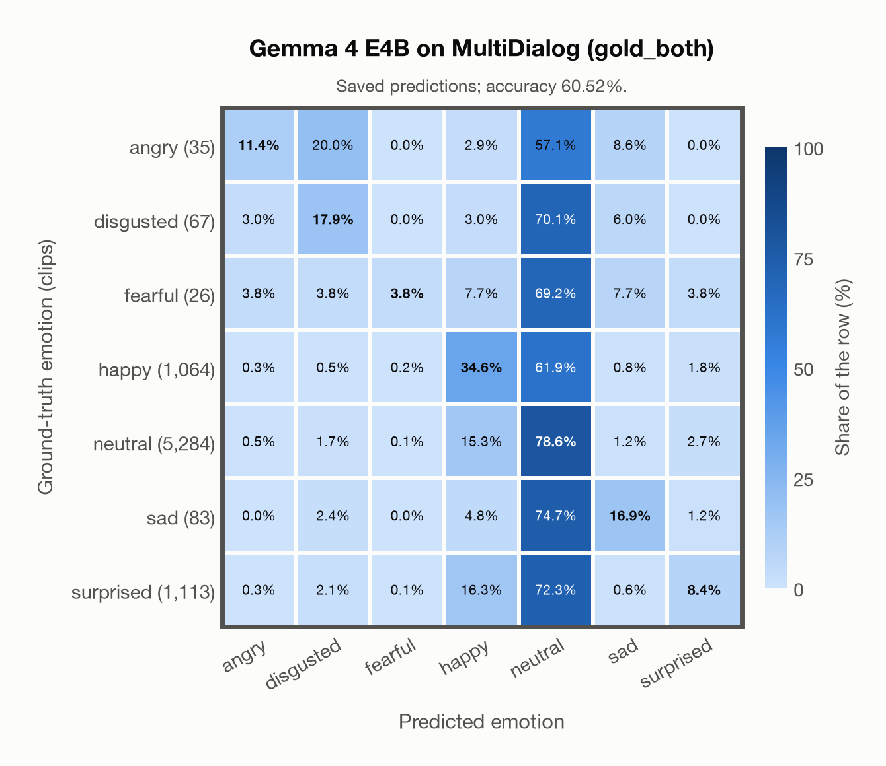

# Gemma 4 E4B on MultiDialog (gold_both)

Regenerated offline from saved CSV/JSON by `scripts/evaluation/refresh_reports.py`. This refresh performs no model inference or API requests.

## Summary

| Metric | Recomputed value |
|---|---:|
| Clips | 7,672 |
| Accuracy: acted emotion | 60.52% |
| UAR: mean ground-truth-row recall | 24.51% |
| Macro F1 | 23.21% |
| Weighted F1: true-support weighted | 58.27% |
| Accuracy: all model classes | 60.52% |
| Invalid / outside-candidate answers | 0 (0.00%) |

## Imported run and verification

- Source: [prediction CSV](../../outputs/gemma4_e4b/multidialog_predictions.csv) and [metadata JSON](../../outputs/gemma4_e4b/multidialog_predictions.json); both remain byte-for-byte unchanged.
- Original execution date recorded in JSON: `2026-11-15`.
- Dataset scope recorded in JSON: **MultiDialog (gold_both)**, English; 7,672 / 7,672 clips.
- Ground-truth column: `acted_emotion`. Candidate classes: angry, disgusted, fearful, happy, neutral, sad, surprised.
- Row counts, unique audio paths, correctness flags and saved metrics were checked against the CSV. Metric agreement tolerance is 0.000001 (six-decimal metadata).
- Weighted F1 weights each class's F1 by its true support, using the same resolved truth as macro F1; invalid answers remain errors. New metrics absent from the source JSON are recorded in the offline audit and summaries; the source JSON is preserved.
- Saved candidate/prompt/model protocol matches current configuration: scope `dataset`, model `google/gemma-4-E4B-it`, prompt hash `aab2967fd07a`.
- Original execution/client runtime metadata (reported by the imported run, not measured by this refresh): `{"device": "mps", "hardware": "Apple M3 Pro", "seconds": 1561.7, "ms_per_clip": 203.6, "on_cpu": 0}`.
- Saved p_* columns encode the returned answer as one-hot values; they are not calibrated API class probabilities, and no confidence plot is inferred from them.
- A raw responses journal is present; this refresh validates CSV/JSON only.

## Prediction distribution

Counts and shares use all saved samples. The invalid bucket combines `invalid` and `other answer`: answers outside the dataset's candidate classes remain errors.

| Predicted label | Clips | Share of all clips |
|---|---:|---:|
| angry | 38 | 0.50% |
| disgusted | 139 | 1.81% |
| fearful | 9 | 0.12% |
| happy | 1,364 | 17.78% |
| neutral | 5,762 | 75.10% |
| sad | 102 | 1.33% |
| surprised | 258 | 3.36% |
| invalid / outside candidates | 0 | 0.00% |

## Results per emotion

| Ground-truth emotion | Clips | Recall | Acted-or-listener recall |
|---|---:|---:|---:|
| angry | 35 | 11.43% | — |
| disgusted | 67 | 17.91% | — |
| fearful | 26 | 3.85% | — |
| happy | 1,064 | 34.59% | — |
| neutral | 5,284 | 78.56% | — |
| sad | 83 | 16.87% | — |
| surprised | 1,113 | 8.36% | — |

Precision/F1 use the same resolved-truth convention as the evaluation script. Weighted F1 uses the resolved-truth clip counts below as weights.

| Predicted emotion | Resolved-truth clips | Precision | Recall | F1 |
|---|---:|---:|---:|---:|
| angry | 35 | 10.53% | 11.43% | 10.96% |
| disgusted | 67 | 8.63% | 17.91% | 11.65% |
| fearful | 26 | 11.11% | 3.85% | 5.71% |
| happy | 1,064 | 26.98% | 34.59% | 30.31% |
| neutral | 5,284 | 72.04% | 78.56% | 75.16% |
| sad | 83 | 13.73% | 16.87% | 15.14% |
| surprised | 1,113 | 36.05% | 8.36% | 13.57% |

## Confusion matrix: acted emotion

| Ground truth \ Predicted | angry | disgusted | fearful | happy | neutral | sad | surprised |
|---|---|---|---|---|---|---|---|
| angry (35) | **11.4%** | 20.0% | 0.0% | 2.9% | 57.1% | 8.6% | 0.0% |
| disgusted (67) | 3.0% | **17.9%** | 0.0% | 3.0% | 70.1% | 6.0% | 0.0% |
| fearful (26) | 3.8% | 3.8% | **3.8%** | 7.7% | 69.2% | 7.7% | 3.8% |
| happy (1,064) | 0.3% | 0.5% | 0.2% | **34.6%** | 61.9% | 0.8% | 1.8% |
| neutral (5,284) | 0.5% | 1.7% | 0.1% | 15.3% | **78.6%** | 1.2% | 2.7% |
| sad (83) | 0.0% | 2.4% | 0.0% | 4.8% | 74.7% | **16.9%** | 1.2% |
| surprised (1,113) | 0.3% | 2.1% | 0.1% | 16.3% | 72.3% | 0.6% | **8.4%** |

## Caveats

- **Training involvement for Gemma 4 E4B: No corpus-specific evidence**. Source: Broad multimodal pretraining and instruction tuning; complete corpus-level provenance not published (Google). Direct use and upstream teacher use both count as training involvement. No pattern: no corpus-specific evidence, not verified unseen. Corpus use is not test-clip leakage.
- Internal CSV/JSON consistency does not authenticate the original model or remote request logs.

[Offline validation audit](multidialog_offline_audit.json)
