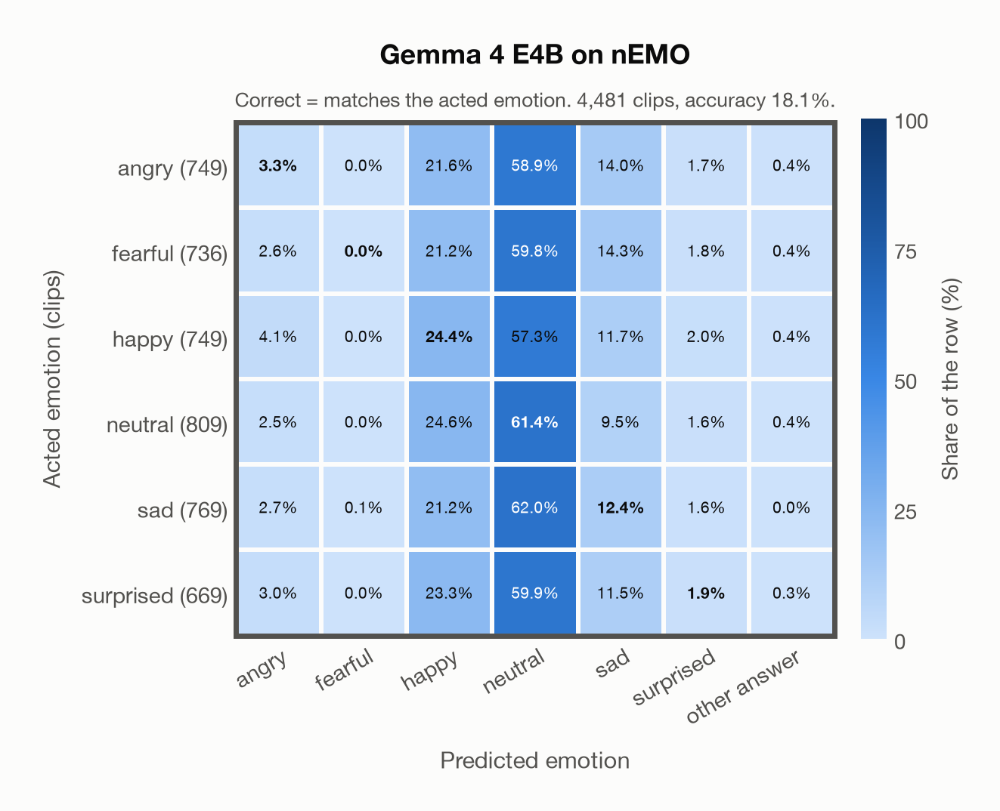

# Gemma 4 E4B on nEMO

Generated by `scripts/evaluation/evaluate.py` on 2026-11-08.

## Summary

| Metric | Value |
|---|---|
| Clips evaluated | 4,481 (Polish) |
| **Accuracy: prediction matches the acted emotion** | **18.1%** |
| Unweighted accuracy (mean recall of the 6 acted emotions) | 17.3% |
| Macro F1 (acted emotion) | 12.1% |
| Accuracy, all 8 model classes (acted emotion) | 18.1% |
| Chance level (6 emotions) | 16.7% |

## Setup

- **Model**: Gemma 4 E4B (`google/gemma-4-E4B-it`) as released (no fine-tuning), transformers 5.18.0, loaded by `scripts/models/gemma4_audio.py`. Gemma 4 E4B (thinking off) gets one conversation per clip in its chat template: the system prompt, then one user turn with the user prompt first and the audio after it (as the model card advises), with the system and user prompts of `scripts/llm_eval/prompts.yaml` (the same as for GPT Realtime); the clip as 16 kHz mono (at most its first 30 s). Greedy decoding (do_sample=False, no repetition penalty), at most 24 new tokens, bfloat16 on `mps`, sdpa attention; so the answers are the same from run to run (up to rounding differences between devices). The answer is read by `scripts/llm_eval/parsing.py` and becomes a one-hot vector over the 7 emotions plus `invalid`. An answer that is not exactly one label gets a follow-up in the same conversation ("Answer with exactly one word from this list, in lowercase, and nothing else: angry, disgusted, fearful, happy, neutral, sad, surprised."), up to 1 time(s); then `invalid`. An answer that is not one of the dataset's emotions counts as wrong (column *other answer* of the confusion matrices); the raw answers are in `outputs/gemma4_e4b/responses.jsonl`.
- **Data**: 4,481 clips of nEMO (Polish) from `data/nemo/`.
- **Ground truth (acted emotion)**: the emotion each speaker was asked to portray (`emotion`).
- Label mapping: anger = angry, fear = fearful, happiness = happy, sadness = sad, surprised = surprised, neutral = neutral.
- **6 emotions**: the prediction is the model's answer when it is one of the 6 emotions in this dataset (angry, fearful, happy, neutral, sad, surprised); any other answer (`disgusted`, `invalid`) counts as wrong, so the accuracy is the same with all 8 model classes.
- **Other answer**: for 14 clips the model's answer is none of the 6 emotions (an emotion this dataset does not have, or no readable answer). They count as wrong and have their own last column, *other answer*, in the confusion matrices; precision, recall and F1 are over the 6 emotions.
- **Hardware**: Apple M4 Max, device `mps`, PyTorch 2.7.1. Inference took 30.5 min (408 ms per clip; answers saved by an earlier run take no time).
- **Per-clip predictions**: `outputs/gemma4_e4b/nemo_predictions.csv` (in git, so the results can be checked clip by clip). The JSON file next to it describes the columns.

## Results per emotion

Rows: acted emotion. Precision, recall and F1 compare the prediction with the acted emotion.

| Emotion | Clips | Precision | Recall | F1 |
|---|---|---|---|---|
| angry | 749 | 18.4% | 3.3% | 5.6% |
| fearful | 736 | 0.0% | 0.0% | 0.0% |
| happy | 749 | 18.0% | 24.4% | 20.7% |
| neutral | 809 | 18.5% | 61.4% | 28.4% |
| sad | 769 | 17.4% | 12.4% | 14.4% |
| surprised | 669 | 16.5% | 1.9% | 3.5% |

## Confusion matrix: acted emotion

The same numbers as a table. Rows: acted emotion. Columns: predicted emotion. Each row adds up to 100%. *other answer*: the answer is none of the dataset's emotions (wrong).

| Acted \ Predicted | angry | fearful | happy | neutral | sad | surprised | other answer |
|---|---|---|---|---|---|---|---|
| angry (749) | **3.3%** | 0.0% | 21.6% | 58.9% | 14.0% | 1.7% | 0.4% |
| fearful (736) | 2.6% | **0.0%** | 21.2% | 59.8% | 14.3% | 1.8% | 0.4% |
| happy (749) | 4.1% | 0.0% | **24.4%** | 57.3% | 11.7% | 2.0% | 0.4% |
| neutral (809) | 2.5% | 0.0% | 24.6% | **61.4%** | 9.5% | 1.6% | 0.4% |
| sad (769) | 2.7% | 0.1% | 21.2% | 62.0% | **12.4%** | 1.6% | 0.0% |
| surprised (669) | 3.0% | 0.0% | 23.3% | 59.9% | 11.5% | **1.9%** | 0.3% |

Most frequent confusions: sad predicted as neutral (62.0%), surprised predicted as neutral (59.9%), fearful predicted as neutral (59.8%).

## Predictions outside the 6 emotions

With all 8 model classes, the model chose a class that this dataset does not have for 14 clips (0.3%): `disgusted` 14, `invalid` 0.

## Caveats

- **Gemma 4 E4B's training data**: not published (Google). The model may have heard these public datasets during training.
- No listeners' labels are published: listeners only screened the recordings, so there is one way of counting a prediction as correct.
- Recorded at home (24 kHz); only 3 of the 9 speakers are professional voice actors.
