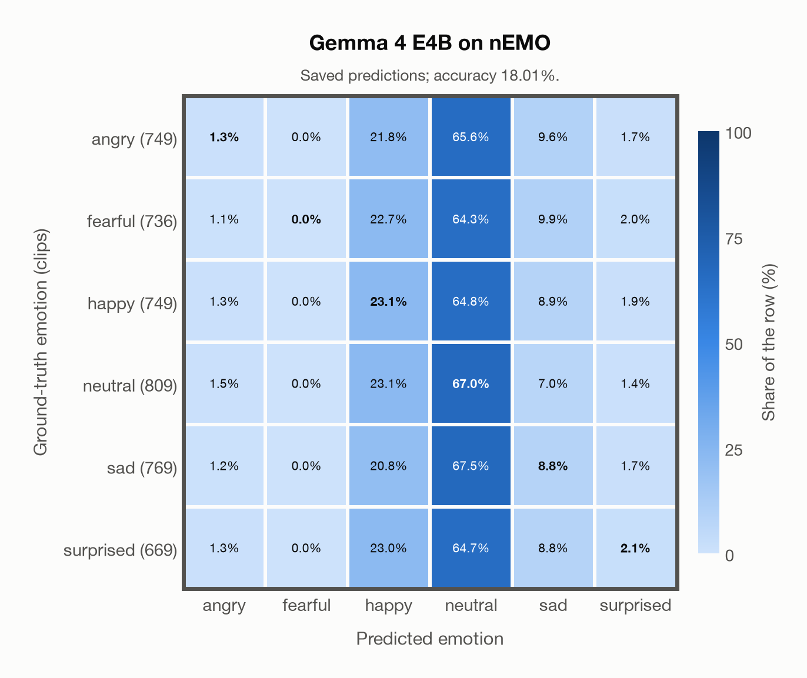

# Gemma 4 E4B on nEMO

Regenerated offline from saved CSV/JSON by `scripts/evaluation/refresh_reports.py`. This refresh performs no model inference or API requests.

## Summary

| Metric | Recomputed value |
|---|---:|
| Clips | 4,481 |
| Accuracy: acted emotion | 18.01% |
| UAR: mean ground-truth-row recall | 17.06% |
| Macro F1 | 11.09% |
| Weighted F1: true-support weighted | 11.49% |
| Accuracy: all model classes | 18.01% |
| Invalid / outside-candidate answers | 0 (0.00%) |

## Imported run and verification

- Source: [prediction CSV](../../outputs/gemma4_e4b/nemo_predictions.csv) and [metadata JSON](../../outputs/gemma4_e4b/nemo_predictions.json); both remain byte-for-byte unchanged.
- Original execution date recorded in JSON: `2026-11-13`.
- Dataset scope recorded in JSON: **nEMO**, Polish; 4,481 / 4,481 clips.
- Ground-truth column: `acted_emotion`. Candidate classes: angry, fearful, happy, neutral, sad, surprised.
- Row counts, unique audio paths, correctness flags and saved metrics were checked against the CSV. Metric agreement tolerance is 0.000001 (six-decimal metadata).
- Weighted F1 weights each class's F1 by its true support, using the same resolved truth as macro F1; invalid answers remain errors. New metrics absent from the source JSON are recorded in the offline audit and summaries; the source JSON is preserved.
- Saved candidate/prompt/model protocol matches current configuration: scope `dataset`, model `google/gemma-4-E4B-it`, prompt hash `6c3ec6823d3d`.
- Original execution/client runtime metadata (reported by the imported run, not measured by this refresh): `{"device": "cuda:0", "hardware": "NVIDIA L4", "seconds": 5972.7, "ms_per_clip": 1332.9, "on_cpu": 0}`.
- Saved p_* columns encode the returned answer as one-hot values; they are not calibrated API class probabilities, and no confidence plot is inferred from them.
- A raw responses journal is present; this refresh validates CSV/JSON only.

## Prediction distribution

Counts and shares use all saved samples. The invalid bucket combines `invalid` and `other answer`: answers outside the dataset's candidate classes remain errors.

| Predicted label | Clips | Share of all clips |
|---|---:|---:|
| angry | 58 | 1.29% |
| fearful | 0 | 0.00% |
| happy | 1,004 | 22.41% |
| neutral | 2,943 | 65.68% |
| sad | 396 | 8.84% |
| surprised | 80 | 1.79% |
| invalid / outside candidates | 0 | 0.00% |

## Results per emotion

| Ground-truth emotion | Clips | Recall | Acted-or-listener recall |
|---|---:|---:|---:|
| angry | 749 | 1.34% | — |
| fearful | 736 | 0.00% | — |
| happy | 749 | 23.10% | — |
| neutral | 809 | 67.00% | — |
| sad | 769 | 8.84% | — |
| surprised | 669 | 2.09% | — |

Precision/F1 use the same resolved-truth convention as the evaluation script. Weighted F1 uses the resolved-truth clip counts below as weights.

| Predicted emotion | Resolved-truth clips | Precision | Recall | F1 |
|---|---:|---:|---:|---:|
| angry | 749 | 17.24% | 1.34% | 2.48% |
| fearful | 736 | 0.00% | 0.00% | 0.00% |
| happy | 749 | 17.23% | 23.10% | 19.74% |
| neutral | 809 | 18.42% | 67.00% | 28.89% |
| sad | 769 | 17.17% | 8.84% | 11.67% |
| surprised | 669 | 17.50% | 2.09% | 3.74% |

## Confusion matrix: acted emotion

| Ground truth \ Predicted | angry | fearful | happy | neutral | sad | surprised |
|---|---|---|---|---|---|---|
| angry (749) | **1.3%** | 0.0% | 21.8% | 65.6% | 9.6% | 1.7% |
| fearful (736) | 1.1% | **0.0%** | 22.7% | 64.3% | 9.9% | 2.0% |
| happy (749) | 1.3% | 0.0% | **23.1%** | 64.8% | 8.9% | 1.9% |
| neutral (809) | 1.5% | 0.0% | 23.1% | **67.0%** | 7.0% | 1.4% |
| sad (769) | 1.2% | 0.0% | 20.8% | 67.5% | **8.8%** | 1.7% |
| surprised (669) | 1.3% | 0.0% | 23.0% | 64.7% | 8.8% | **2.1%** |

## Caveats

- **Training involvement for Gemma 4 E4B: No corpus-specific evidence**. Source: Broad multimodal pretraining and instruction tuning; complete corpus-level provenance not published (Google). Direct use and upstream teacher use both count as training involvement. No pattern: no corpus-specific evidence, not verified unseen. Corpus use is not test-clip leakage.
- Internal CSV/JSON consistency does not authenticate the original model or remote request logs.

[Offline validation audit](nemo_offline_audit.json)
